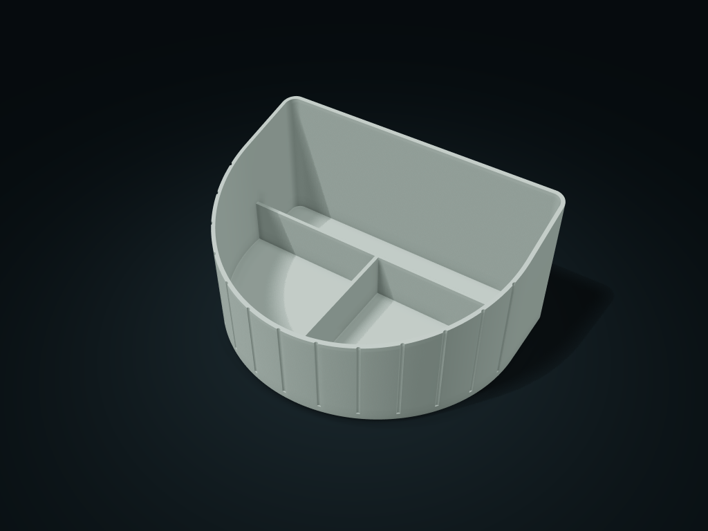
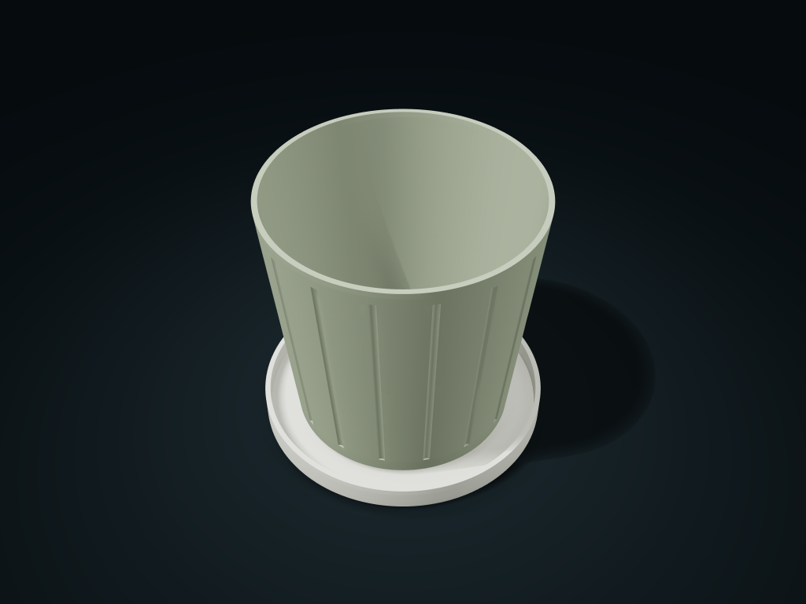
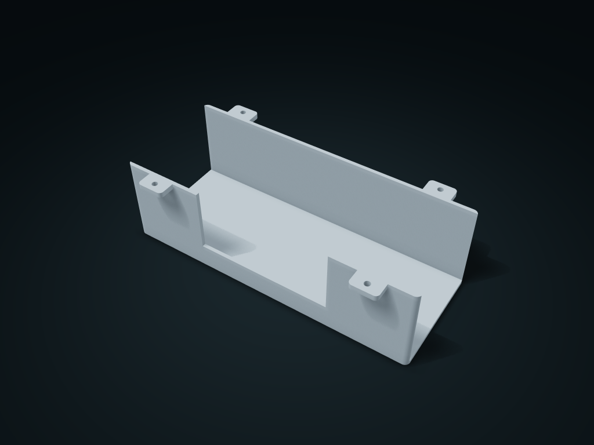
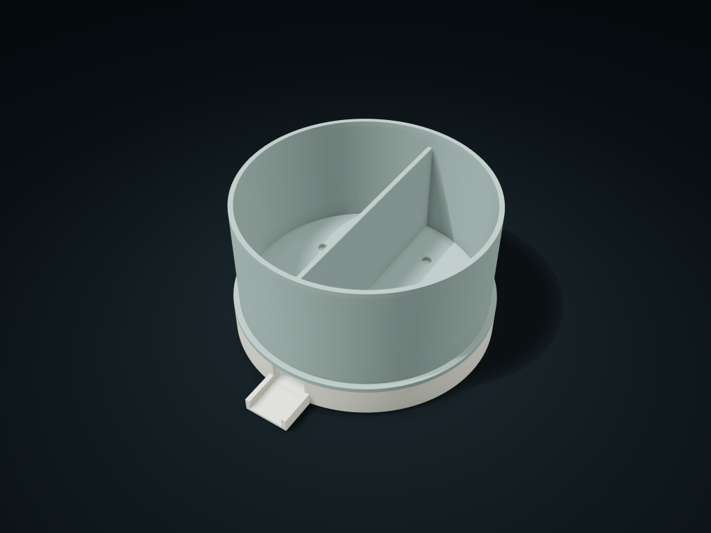

# boxesmodel — Free 3D Printable Models

**743 ready-to-download designs for organizers, storage boxes and practical everyday objects.** Each design includes STL and editable STEP files, a CAD preview, an English description, dimensions, and model-specific printing and assembly notes.

**[Browse all 743 models](CATALOG.md)** · **[Preview and customize on boxesmodel](https://boxesmodel.com/models)** · **[Download this collection](https://github.com/colorsung/boxesmodel-assets/archive/refs/tags/v2026.10.21.zip)**

## Explore a few designs

| [Offset Rounded Five Pocket Tray](models/offset-five-pocket-tray/) | [Fluted Flat-Back Rising-Rim Caddy](models/fluted-flatback-rise-caddy/) | [Rounded-Pentagon Lift-Off Case](models/soft-pentagon-lift-case/) |
| --- | --- | --- |
|  |  |  |

| [Tapered Fluted Planter with Saucer](models/taper-flute-planter-saucer/) | [Side-Access Under-Desk Cable Trough](models/side-service-underdesk-trough/) | [Round Lift-Out Draining Caddy with Spout](models/round-spout-lift-drain-caddy/) |
| --- | --- | --- |
|  |  |  |

## Browse by category

| Category | Models |
| --- | ---: |
| [Desktop Organizers](categories/desktop-organizers.md) | 544 |
| [Stackable Storage](categories/stackable-storage.md) | 32 |
| [Lidded Storage](categories/lidded-storage.md) | 96 |
| [Open Storage](categories/open-storage.md) | 61 |
| [Drawer Storage](categories/drawer-storage.md) | 10 |

These categories follow the boxesmodel catalog. The [full index](CATALOG.md) lists every model with its dimensions and a direct link to the corresponding interactive preview. A [CSV catalog](catalog.csv) is also included.

## Download and use

1. Open a model in the [catalog](CATALOG.md).
2. Read its dimensions, included parts and assembly notes.
3. Download the STL files for your slicer or STEP files for CAD editing. On a GitHub file page, choose **Download raw file**. Download every part listed for the model.
4. Use the model's **Preview & customize** link to inspect it in 3D or adjust the available dimensions and layouts on boxesmodel.

All files use **millimeters**. The collection contains **1,268 STL files and 1,268 STEP files**, representing 1,268 parts across 743 designs. The files in this repository are free to download, with no boxesmodel login required. For a complete copy, use the collection ZIP above or GitHub's **Code → Download ZIP**. Custom exports on boxesmodel follow the options and pricing shown on the platform.

## What is included

Each folder in `models/` contains finished default-size geometry, a preview image and an English README. STEP files are editable solid geometry. JSON model definitions, CAD generation scripts, the parametric engine and website code are outside this release.

Preview images are CAD renders; their colors illustrate the design and are not embedded in the STL/STEP files. Designs were developed with AI assistance. Choose printing orientation, supports, material and fit allowances for your printer and intended use. Any separately purchased hardware is described in the individual model notes.

## License

Copyright © 2026 boxesmodel. Model files, preview images and documentation are available under **[CC BY 4.0](https://creativecommons.org/licenses/by/4.0/)**. Sharing, adaptation and commercial use are permitted with attribution and the other license conditions. See [LICENSE](LICENSE) and the [attribution guide](ATTRIBUTION.md), including a ready-to-copy credit line for each model.

## Collection snapshot

This release captures the **743 models publicly listed on boxesmodel on 2026-10-21**. The individual model versions are listed in their READMEs and the CSV catalog. [SHA256SUMS.txt](SHA256SUMS.txt) lets you verify the included files. The online model pages may evolve after this snapshot.

## Questions and feedback

For a model-specific issue, include its folder name, model version and relevant dimensions in a [GitHub issue](https://github.com/colorsung/boxesmodel-assets/issues) or contact [support@boxesmodel.com](mailto:support@boxesmodel.com). Please share photos or details of useful adaptations with attribution; avoid including private account information.
