# Desktop Organizers

**Page 11 of 11** · Models 501–544 of 544

Click a thumbnail or model name to open its files and guide. Use **Preview & customize** to open the interactive model on boxesmodel.

[All models](../CATALOG.md) · [Collection overview](../README.md)

[← Previous](desktop-organizers-10.md) · [1](desktop-organizers.md) · [2](desktop-organizers-2.md) · [3](desktop-organizers-3.md) · [4](desktop-organizers-4.md) · [5](desktop-organizers-5.md) · [6](desktop-organizers-6.md) · [7](desktop-organizers-7.md) · [8](desktop-organizers-8.md) · [9](desktop-organizers-9.md) · [10](desktop-organizers-10.md) · **11**

| Thumbnail | Model | Default dimensions | Parts | Preview & customize |
| --- | --- | --- | ---: | --- |
| [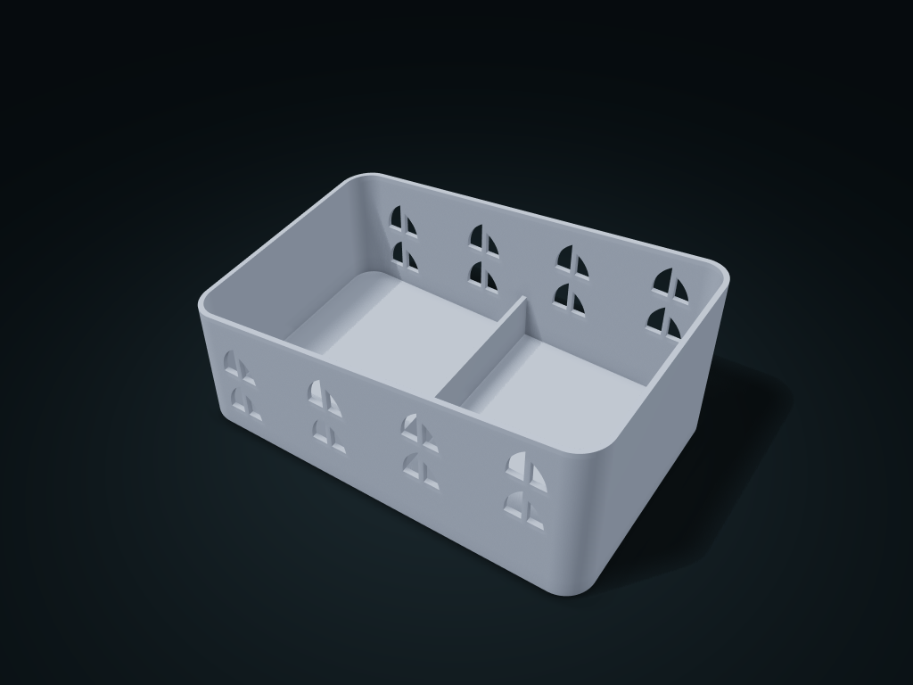](../models/sailpair-slope-bin/) | [Twin Sail Sloping Rim Sorting Bin](../models/sailpair-slope-bin/) | 220 × 140 × 98 mm | 1 | [boxesmodel](https://boxesmodel.com/models/sailpair-slope-bin) |
|  | [Twin-Bridge Tweezer Rest Tray](../models/tweezer-bridge-tray/) | 180 × 100 × 40 mm | 1 | [boxesmodel](https://boxesmodel.com/models/tweezer-bridge-tray) |
|  | [Twin-Column Capsule Window Bathroom Basket](../models/capsule-vanity-caddy/) | 160 × 96 × 112 mm | 2 | [boxesmodel](https://boxesmodel.com/models/capsule-vanity-caddy) |
|  | [Twin-Fork Shoulder Row Drop Bin](../models/split-shoulder-row-transfer/) | 160 × 60 × 56 mm | 4 | [boxesmodel](https://boxesmodel.com/models/split-shoulder-row-transfer) |
|  | [Twin-Pin Handle Limit Box](../models/keeper-bar-case/) | 180 × 120 × 70 mm | 2 | [boxesmodel](https://boxesmodel.com/models/keeper-bar-case) |
|  | [Twin-Plate See-Through Monitor Top Tray](../models/split-service-crown-tray/) | 260 × 240 × 42 mm | 4 | [boxesmodel](https://boxesmodel.com/models/split-service-crown-tray) |
| [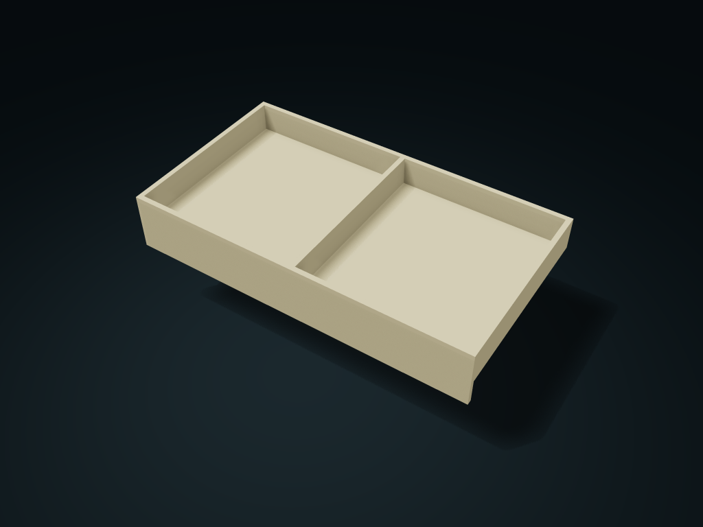](../models/screen-top-backstay-tray/) | [Twin-Support Monitor Top Divided Tray](../models/screen-top-backstay-tray/) | 200 × 110 × 80 mm | 1 | [boxesmodel](https://boxesmodel.com/models/screen-top-backstay-tray) |
|  | [U-Bolt Arched Leg Box](../models/u-bolt-arch-bed/) | 150 × 150 × 28 mm | 1 | [boxesmodel](https://boxesmodel.com/models/u-bolt-arch-bed) |
|  | [U-Shaped Wraparound Tray](../models/u-desk-caddy/) | 220 × 180 × 55 mm | 1 | [boxesmodel](https://boxesmodel.com/models/u-desk-caddy) |
|  | [Under-Cabinet Folded Bag Hanging Rail](../models/folded-edge-sachet-rail/) | 180 × 90 × 22 mm | 1 | [boxesmodel](https://boxesmodel.com/models/folded-edge-sachet-rail) |
| [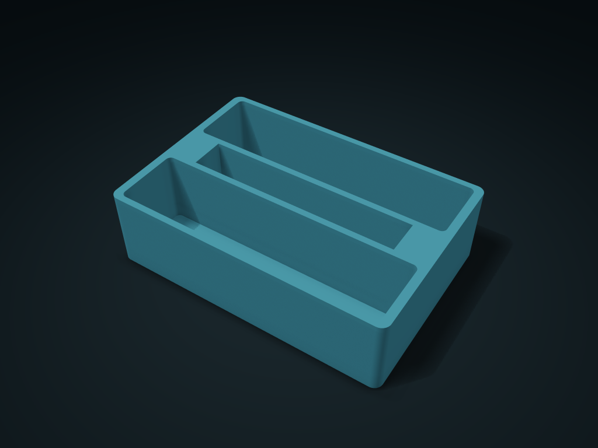](../models/laptop-vent-slot-caddy/) | [Upright Laptop Vent Slot Accessory Box](../models/laptop-vent-slot-caddy/) | 160 × 110 × 45 mm | 1 | [boxesmodel](https://boxesmodel.com/models/laptop-vent-slot-caddy) |
| [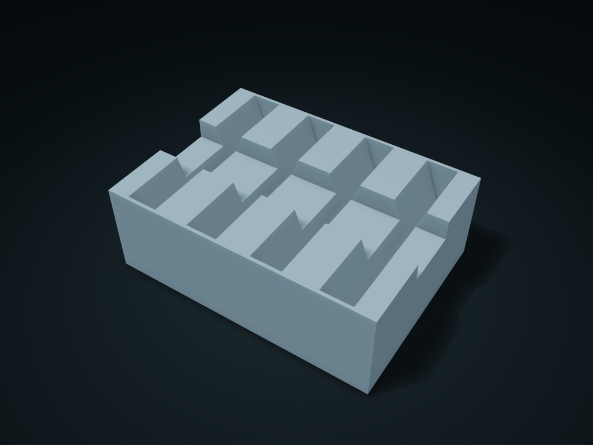](../models/pot-lid-vee-bin/) | [Upright Pot Lid V-Slot Box](../models/pot-lid-vee-bin/) | 185 × 135 × 65 mm | 1 | [boxesmodel](https://boxesmodel.com/models/pot-lid-vee-bin) |
| [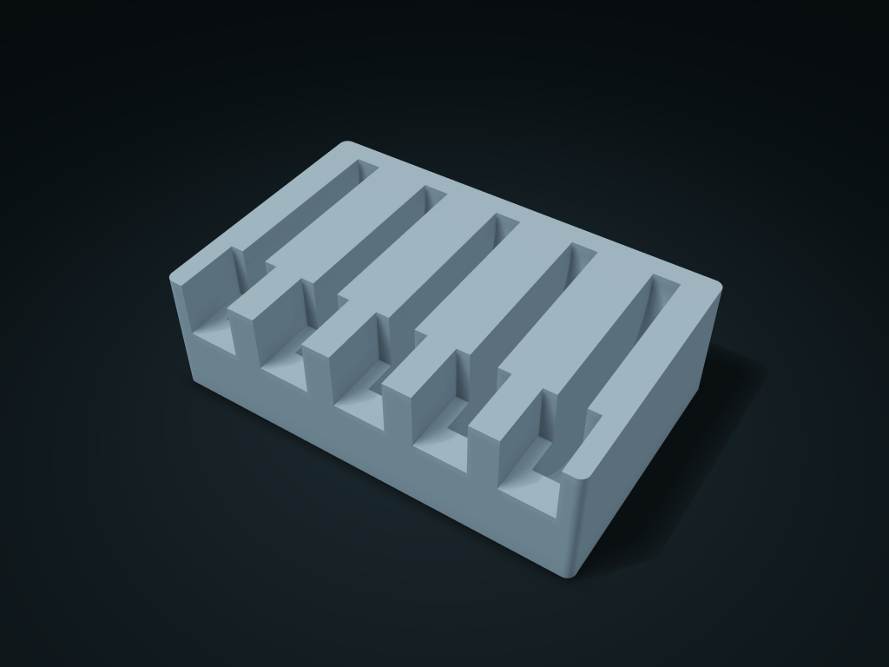](../models/abrasive-disc-file/) | [Upright Sanding Disc Box](../models/abrasive-disc-file/) | 190 × 120 × 58 mm | 1 | [boxesmodel](https://boxesmodel.com/models/abrasive-disc-file) |
|  | [Upside-Down Brush Drip Box](../models/brush-suspension-basin/) | 190 × 120 × 140 mm | 1 | [boxesmodel](https://boxesmodel.com/models/brush-suspension-basin) |
| [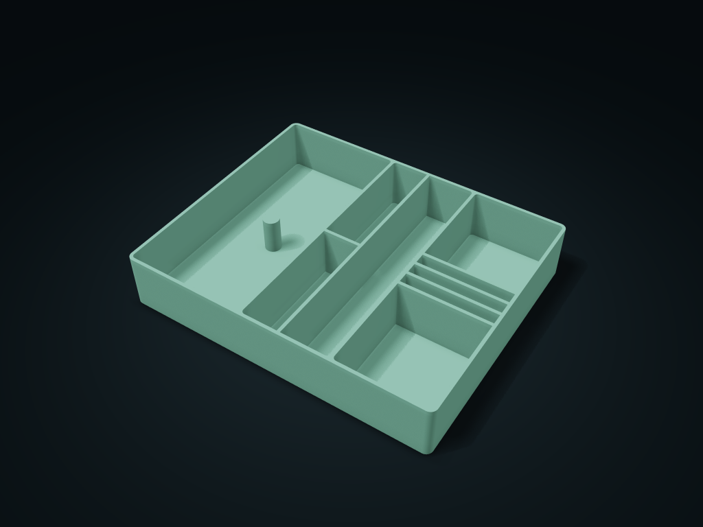](../models/usb-cable-station/) | [USB Short Cable & Adapter Organizer](../models/usb-cable-station/) | 226 × 184 × 40 mm | 1 | [boxesmodel](https://boxesmodel.com/models/usb-cable-station) |
| [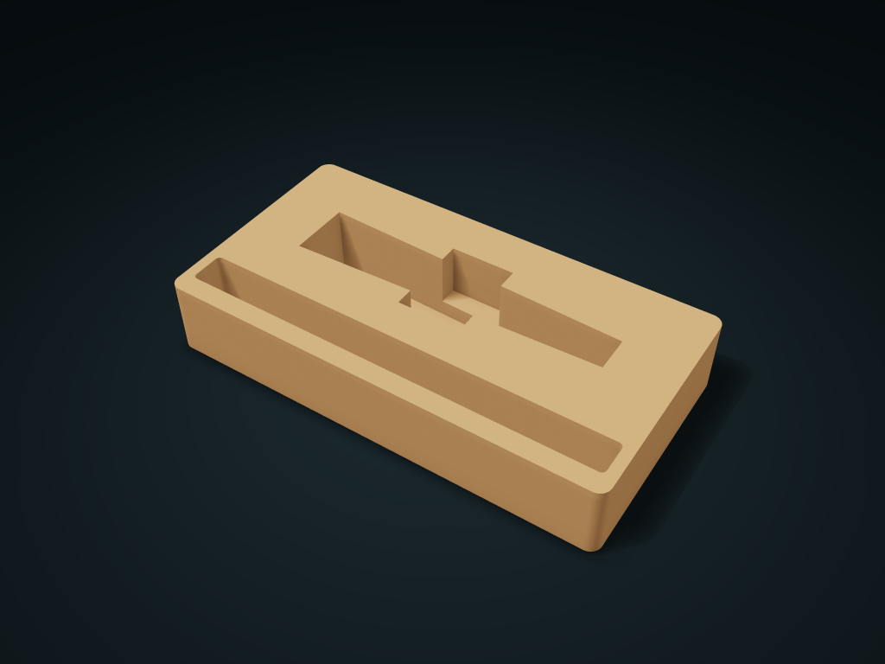](../models/utility-knife-closed-bed/) | [Utility Knife Closed Handle Slot Box](../models/utility-knife-closed-bed/) | 190 × 100 × 32 mm | 1 | [boxesmodel](https://boxesmodel.com/models/utility-knife-closed-bed) |
|  | [V-Cradle Filter Paper Sorter](../models/filter-fan-caddy/) | 140.05 × 79.2 × 62.18 mm | 1 | [boxesmodel](https://boxesmodel.com/models/filter-fan-caddy) |
| [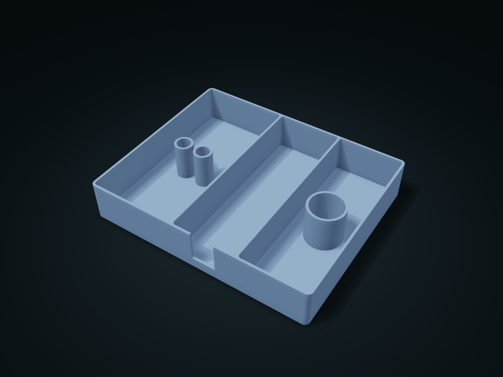](../models/vanity-clean-station/) | [Vanity Dry Care Tray](../models/vanity-clean-station/) | 226 × 184 × 40 mm | 1 | [boxesmodel](https://boxesmodel.com/models/vanity-clean-station) |
| [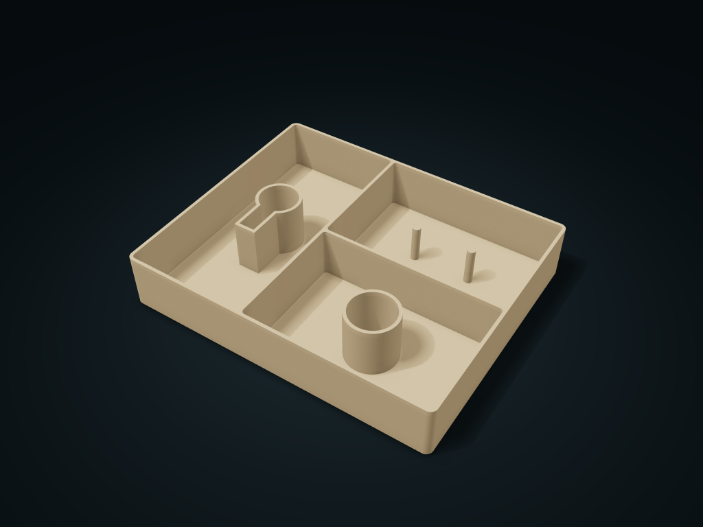](../models/bath-dry-counter-station/) | [Vanity Dry Zone Odds & Ends Tray](../models/bath-dry-counter-station/) | 226 × 184 × 40 mm | 1 | [boxesmodel](https://boxesmodel.com/models/bath-dry-counter-station) |
| [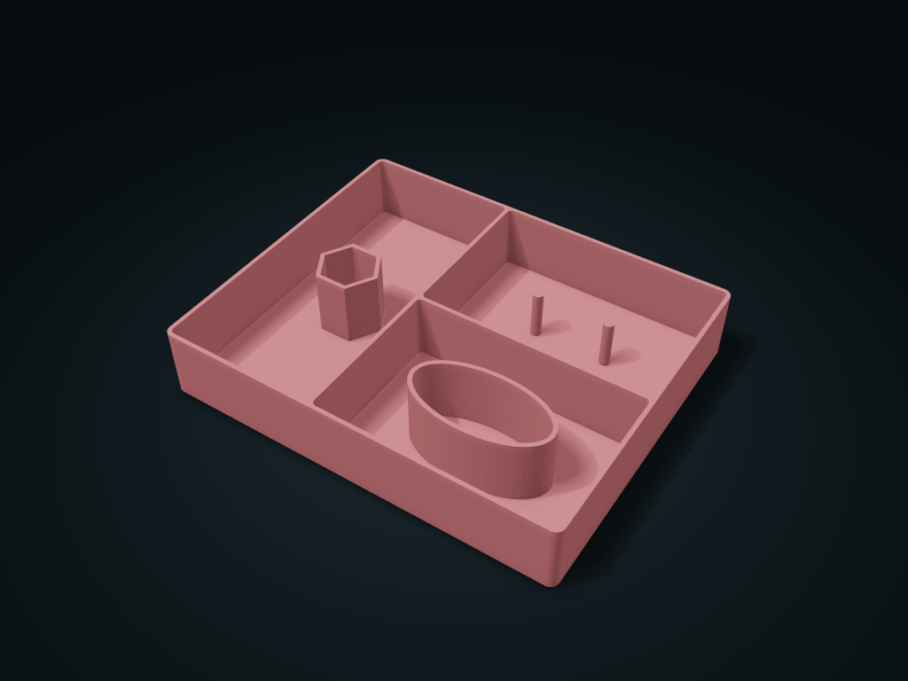](../models/beauty-travel-prep/) | [Vanity Travel Packing Tray](../models/beauty-travel-prep/) | 226 × 184 × 40 mm | 1 | [boxesmodel](https://boxesmodel.com/models/beauty-travel-prep) |
| [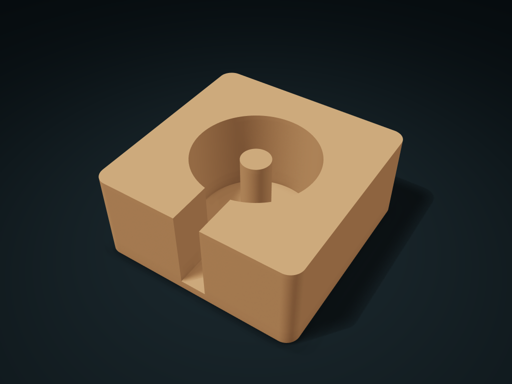](../models/ticket-roll-spindle-bin/) | [Vertical Ticket Roll Spindle Box](../models/ticket-roll-spindle-bin/) | 125 × 125 × 55 mm | 1 | [boxesmodel](https://boxesmodel.com/models/ticket-roll-spindle-bin) |
| [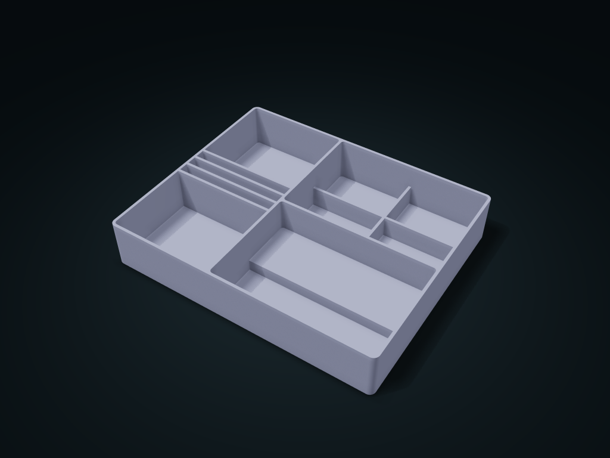](../models/flashcard-review-station/) | [Vocabulary Card Review Box](../models/flashcard-review-station/) | 226 × 184 × 40 mm | 1 | [boxesmodel](https://boxesmodel.com/models/flashcard-review-station) |
|  | [Waisted Arc Lift-Off Case](../models/waisted-arc-lift-case/) | 220 × 110 × 65 mm | 2 | [boxesmodel](https://boxesmodel.com/models/waisted-arc-lift-case) |
| [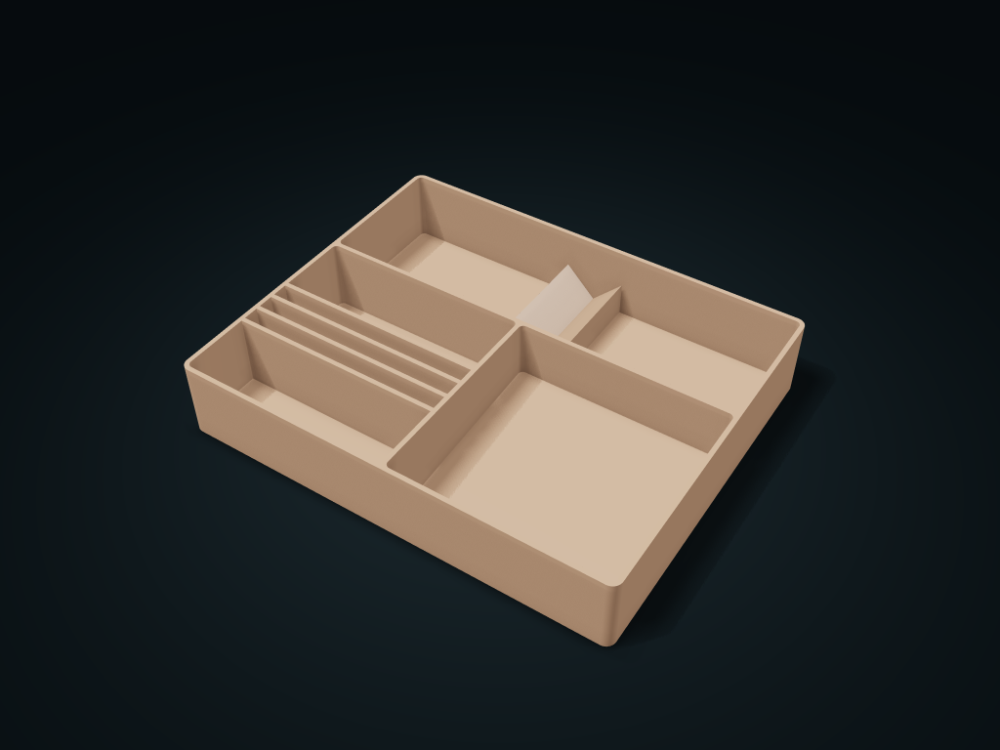](../models/wardrobe-care-station/) | [Wardrobe Care Accessory Tray](../models/wardrobe-care-station/) | 226 × 184 × 40 mm | 1 | [boxesmodel](https://boxesmodel.com/models/wardrobe-care-station) |
| [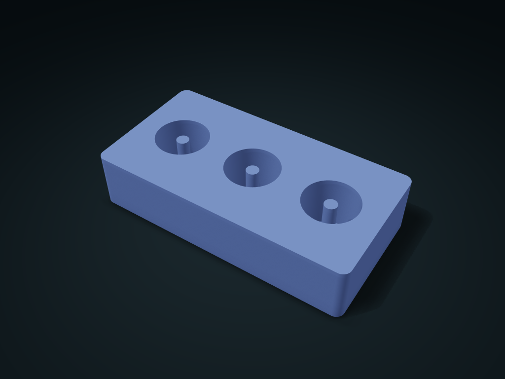](../models/washer-center-post-case/) | [Washer Stepped Post Position Box](../models/washer-center-post-case/) | 185 × 95 × 40 mm | 1 | [boxesmodel](https://boxesmodel.com/models/washer-center-post-case) |
| [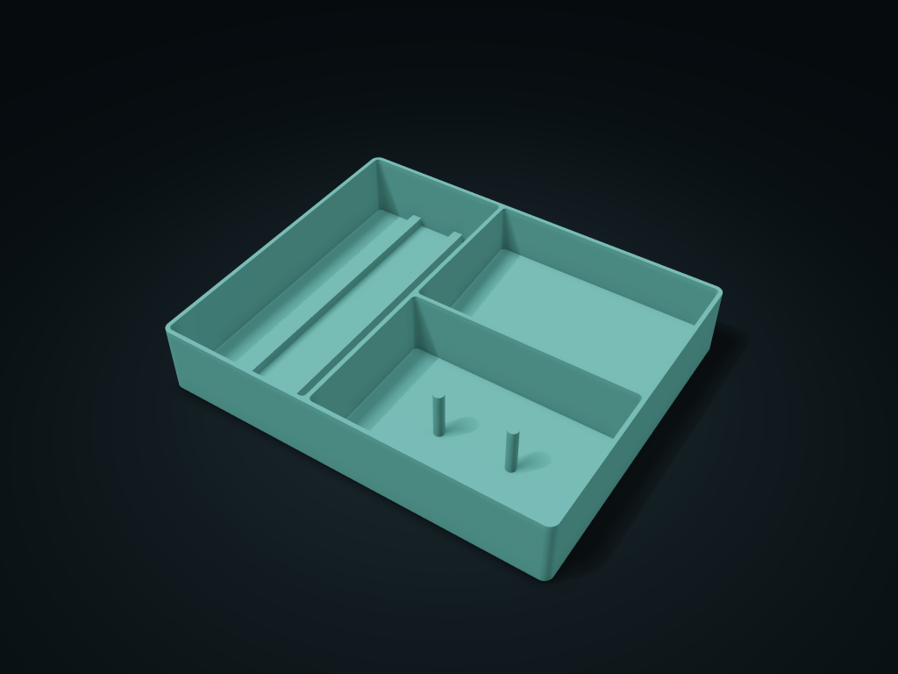](../models/watch-charge-station/) | [Watch Charging Accessory Tray](../models/watch-charge-station/) | 226 × 184 × 40 mm | 1 | [boxesmodel](https://boxesmodel.com/models/watch-charge-station) |
|  | [Watch Strap Arch Box](../models/watch-arch-caddy/) | 180 × 140 × 70 mm | 1 | [boxesmodel](https://boxesmodel.com/models/watch-arch-caddy) |
|  | [Water Drop Merging Sorting Tray](../models/teardrop-pour-tray/) | 210 × 140 × 35 mm | 1 | [boxesmodel](https://boxesmodel.com/models/teardrop-pour-tray) |
|  | [Waterfall Spout Draining Divided Box](../models/spill-drain-caddy/) | 160 × 120 × 29.41 mm | 2 | [boxesmodel](https://boxesmodel.com/models/spill-drain-caddy) |
|  | [Wave Rim Hex Window Basket](../models/wave-rim-hex-basket/) | 230 × 100 × 86 mm | 1 | [boxesmodel](https://boxesmodel.com/models/wave-rim-hex-basket) |
| [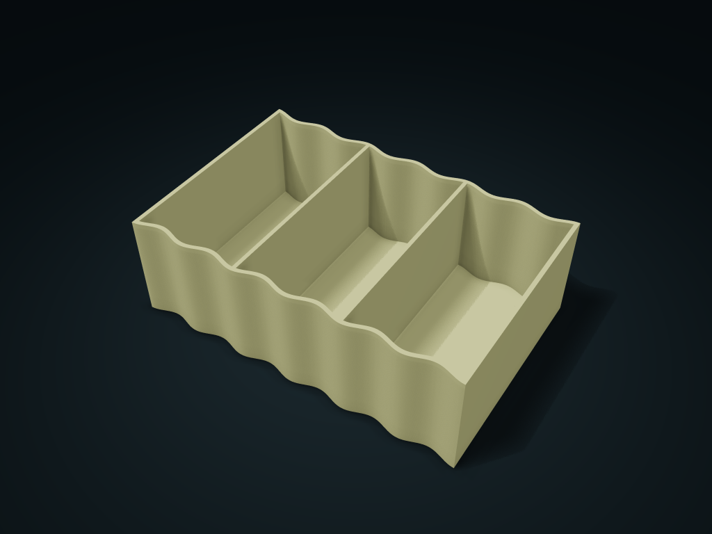](../models/wave-box/) | [Wave Storage Box](../models/wave-box/) | 200 × 130 × 65 mm | 1 | [boxesmodel](https://boxesmodel.com/models/wave-box) |
| [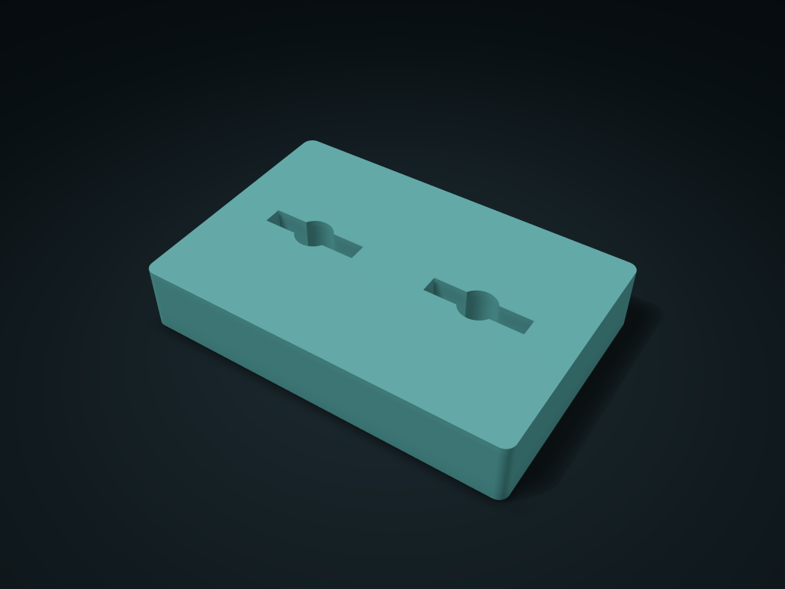](../models/wingnut-butterfly-nest/) | [Wing Nut Twin-Wing Pocket Box](../models/wingnut-butterfly-nest/) | 180 × 120 × 32 mm | 1 | [boxesmodel](https://boxesmodel.com/models/wingnut-butterfly-nest) |
| [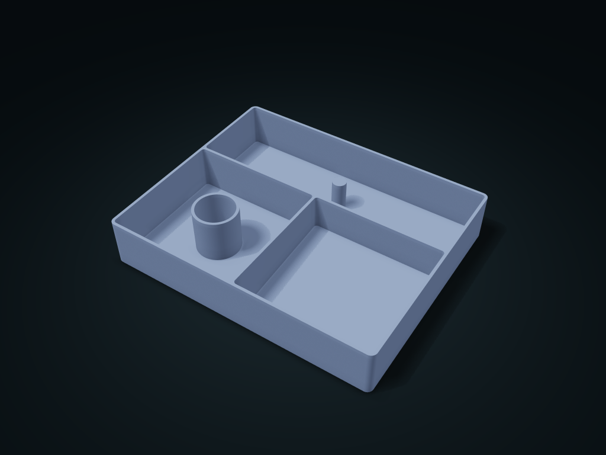](../models/earphone-cable-station/) | [Wired Earphone Organizer](../models/earphone-cable-station/) | 226 × 184 × 40 mm | 1 | [boxesmodel](https://boxesmodel.com/models/earphone-cable-station) |
| [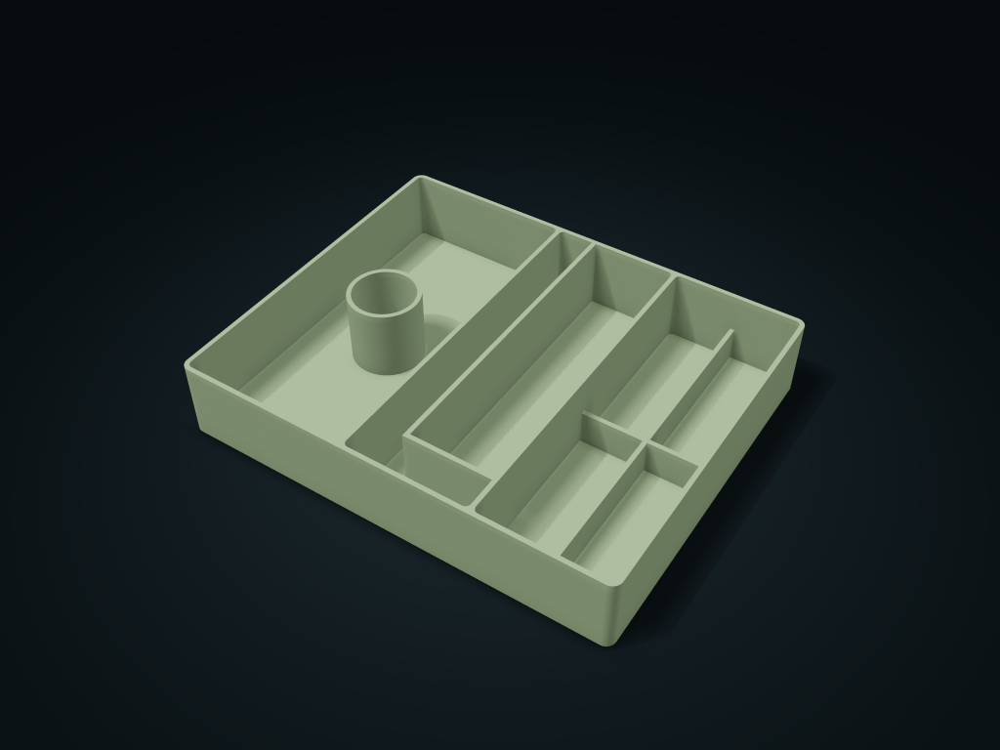](../models/bench-reset-station/) | [Workbench Tidy-Up Return Tray](../models/bench-reset-station/) | 226 × 184 × 40 mm | 1 | [boxesmodel](https://boxesmodel.com/models/bench-reset-station) |
|  | [Z Ribbon Window Lift-Off Box](../models/z-ribbon-lift-box/) | 215 × 138 × 90 mm | 2 | [boxesmodel](https://boxesmodel.com/models/z-ribbon-lift-box) |
| [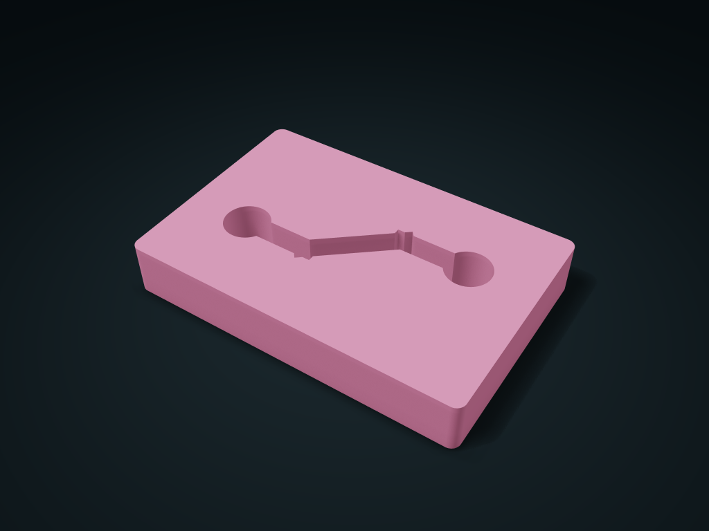](../models/crank-z-link-nest/) | [Z-Offset Linkage Box](../models/crank-z-link-nest/) | 180 × 120 × 28 mm | 1 | [boxesmodel](https://boxesmodel.com/models/crank-z-link-nest) |
|  | [Zigzag Slanted Window Bathroom Basket](../models/chevron-vanity-caddy/) | 150 × 92 × 110 mm | 2 | [boxesmodel](https://boxesmodel.com/models/chevron-vanity-caddy) |
| [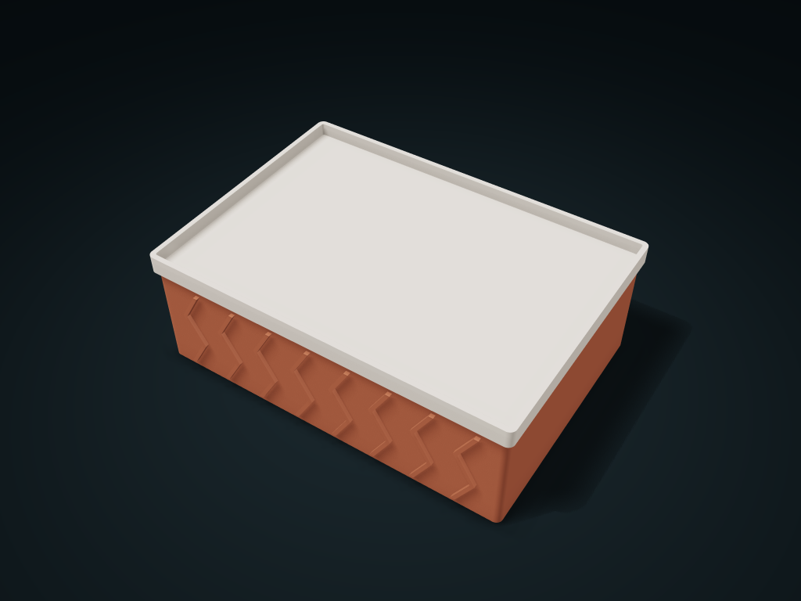](../models/zigzag-column-case/) | [Zigzag Vertical Chain Tray Lid Box](../models/zigzag-column-case/) | 170 × 120 × 58 mm | 2 | [boxesmodel](https://boxesmodel.com/models/zigzag-column-case) |
| [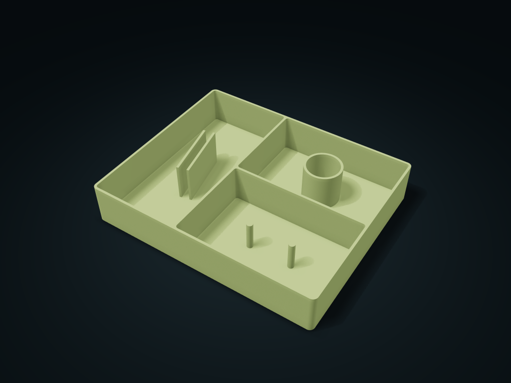](../models/zipper-repair-station/) | [Zipper Repair Accessory Tray](../models/zipper-repair-station/) | 226 × 184 × 40 mm | 1 | [boxesmodel](https://boxesmodel.com/models/zipper-repair-station) |
| [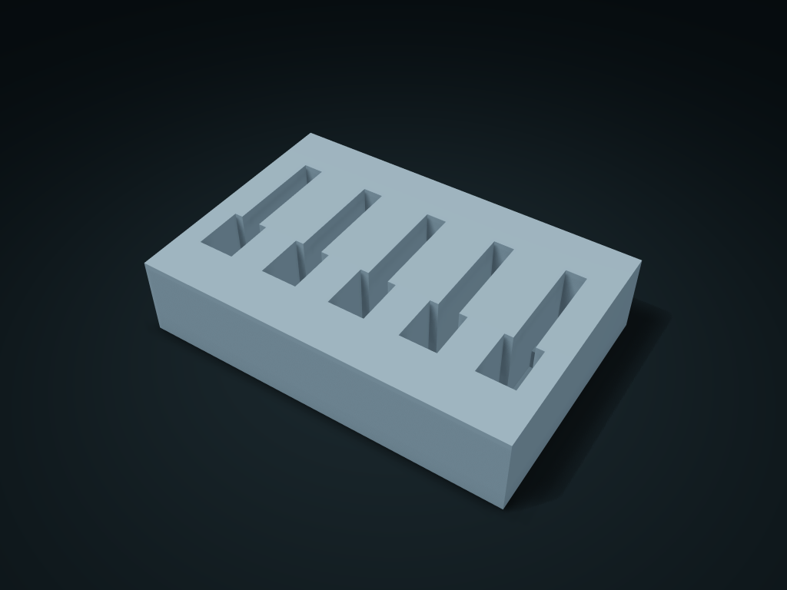](../models/zipper-pull-channel-box/) | [Zipper Slider Bridge Slot Sorting Box](../models/zipper-pull-channel-box/) | 180 × 120 × 40 mm | 1 | [boxesmodel](https://boxesmodel.com/models/zipper-pull-channel-box) |
| [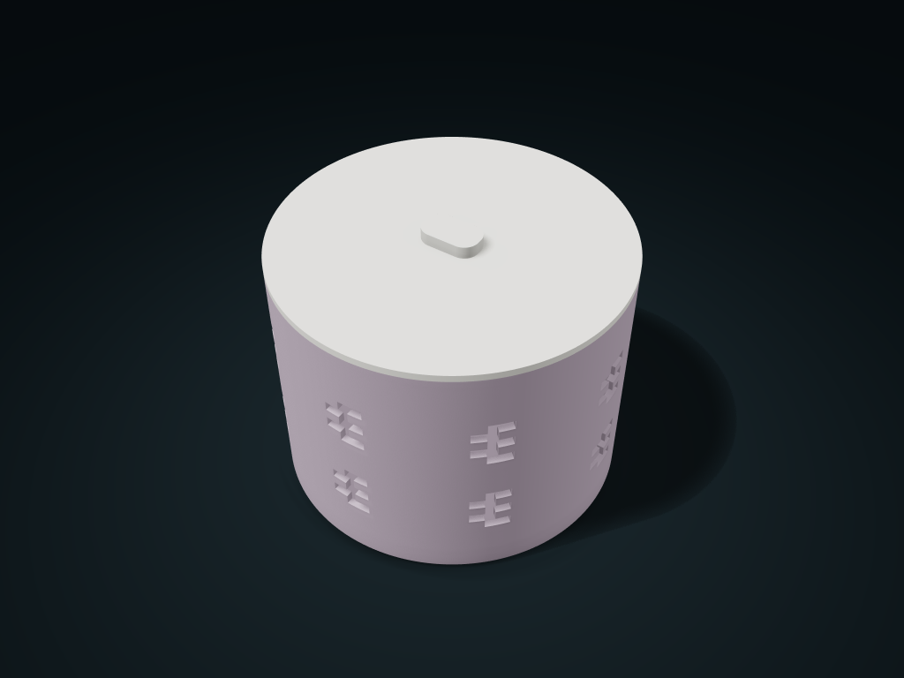](../models/zippertooth-lift-canister/) | [Zipper Tooth Compartment Lift-Off Canister](../models/zippertooth-lift-canister/) | 140 × 140 × 110 mm | 2 | [boxesmodel](https://boxesmodel.com/models/zippertooth-lift-canister) |
| [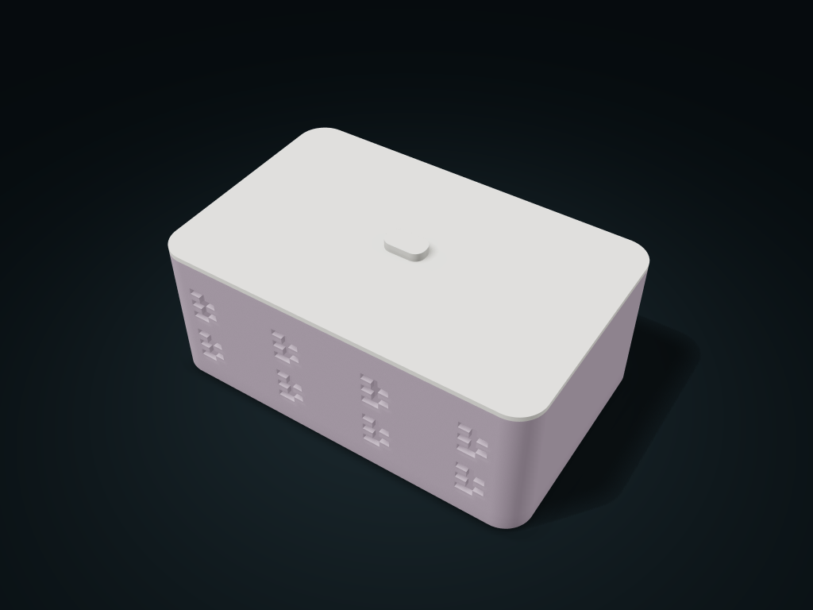](../models/zippertooth-lift-chest/) | [Zipper Tooth Lift-Off Compartment Chest](../models/zippertooth-lift-chest/) | 220 × 140 × 90 mm | 2 | [boxesmodel](https://boxesmodel.com/models/zippertooth-lift-chest) |
| [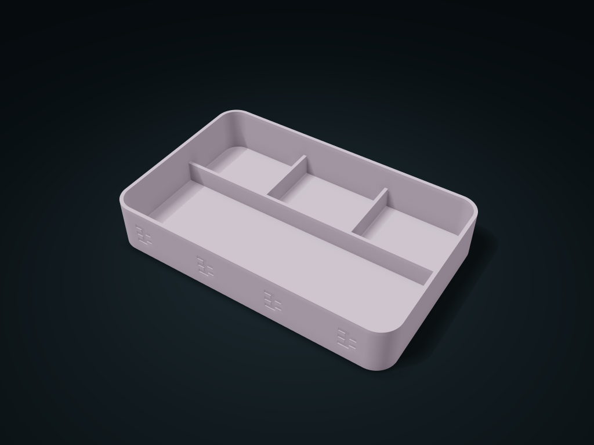](../models/zippertooth-valet-tray/) | [Zipper Tooth Long-and-Small Item Valet Tray](../models/zippertooth-valet-tray/) | 220 × 140 × 38 mm | 1 | [boxesmodel](https://boxesmodel.com/models/zippertooth-valet-tray) |
| [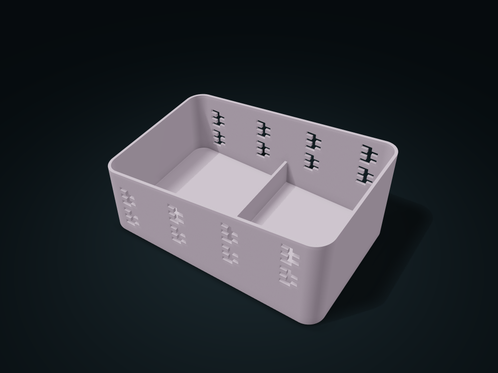](../models/zippertooth-slope-bin/) | [Zipper Tooth Sloping Rim Sorting Bin](../models/zippertooth-slope-bin/) | 220 × 140 × 98 mm | 1 | [boxesmodel](https://boxesmodel.com/models/zippertooth-slope-bin) |

[← Previous](desktop-organizers-10.md) · [1](desktop-organizers.md) · [2](desktop-organizers-2.md) · [3](desktop-organizers-3.md) · [4](desktop-organizers-4.md) · [5](desktop-organizers-5.md) · [6](desktop-organizers-6.md) · [7](desktop-organizers-7.md) · [8](desktop-organizers-8.md) · [9](desktop-organizers-9.md) · [10](desktop-organizers-10.md) · **11**
