# Desktop Organizers

**Page 6 of 11** · Models 251–300 of 544

Click a thumbnail or model name to open its files and guide. Use **Preview & customize** to open the interactive model on boxesmodel.

[All models](../CATALOG.md) · [Collection overview](../README.md)

[← Previous](desktop-organizers-5.md) · [1](desktop-organizers.md) · [2](desktop-organizers-2.md) · [3](desktop-organizers-3.md) · [4](desktop-organizers-4.md) · [5](desktop-organizers-5.md) · **6** · [7](desktop-organizers-7.md) · [8](desktop-organizers-8.md) · [9](desktop-organizers-9.md) · [10](desktop-organizers-10.md) · [11](desktop-organizers-11.md) · [Next →](desktop-organizers-7.md)

| Thumbnail | Model | Default dimensions | Parts | Preview & customize |
| --- | --- | --- | ---: | --- |
| [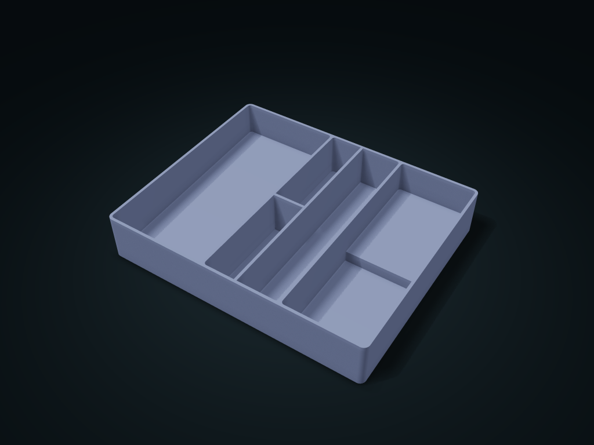](../models/puzzle-sort-station/) | [Jigsaw Piece Helper Tray](../models/puzzle-sort-station/) | 226 × 184 × 40 mm | 1 | [boxesmodel](https://boxesmodel.com/models/puzzle-sort-station) |
|  | [Joined Long Channel Tray](../models/joined-channel-tray/) | 451.2 × 130 × 38 mm | 7 | [boxesmodel](https://boxesmodel.com/models/joined-channel-tray) |
| [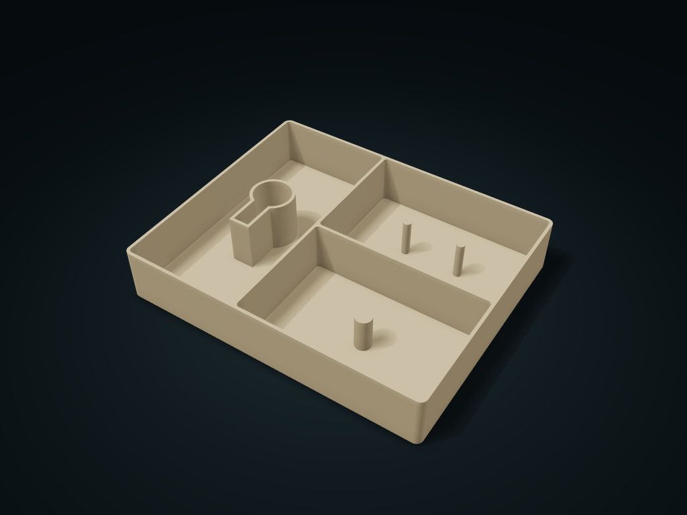](../models/key-lanyard-station/) | [Key & Lanyard Return Box](../models/key-lanyard-station/) | 226 × 184 × 40 mm | 1 | [boxesmodel](https://boxesmodel.com/models/key-lanyard-station) |
|  | [Keyhole Wall-Mount Column Box](../models/keyhole-wall-bin/) | 170 × 105 × 100 mm | 1 | [boxesmodel](https://boxesmodel.com/models/keyhole-wall-bin) |
| [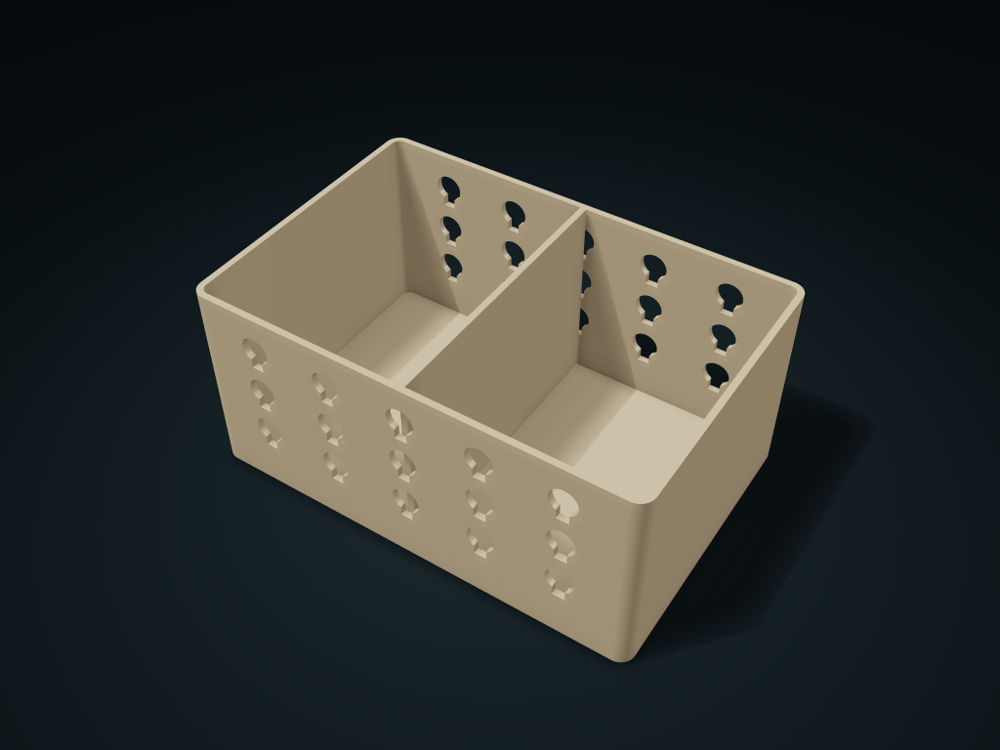](../models/keyhole-desk-basket/) | [Keyhole Window Desk Basket](../models/keyhole-desk-basket/) | 180 × 120 × 82 mm | 1 | [boxesmodel](https://boxesmodel.com/models/keyhole-desk-basket) |
|  | [Knitting Needle V-Bottom Long Slot Box](../models/knitting-needle-vee-box/) | 235 × 125 × 35 mm | 1 | [boxesmodel](https://boxesmodel.com/models/knitting-needle-vee-box) |
| [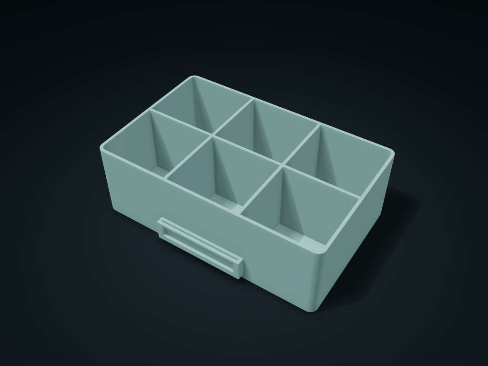](../models/label-pocket-bin/) | [Label Insert Parts Box](../models/label-pocket-bin/) | 180 × 120 × 60 mm | 1 | [boxesmodel](https://boxesmodel.com/models/label-pocket-bin) |
| [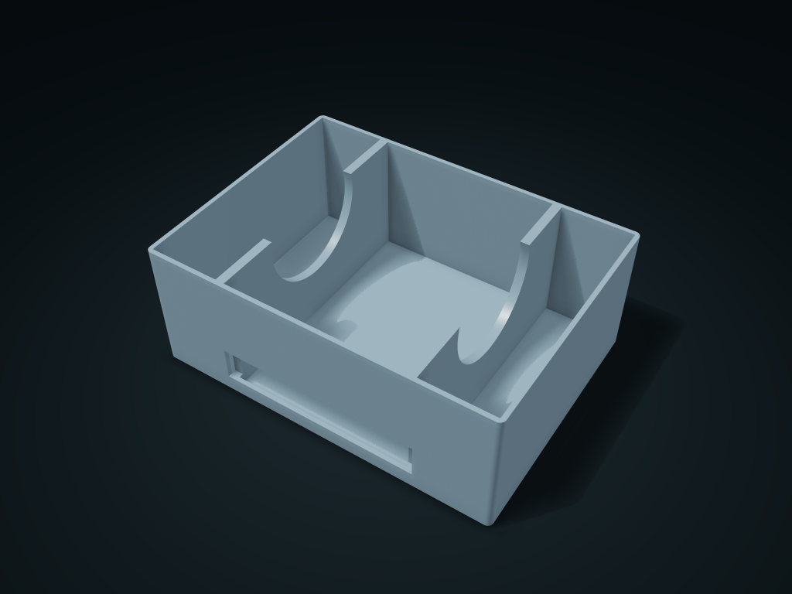](../models/label-roll-saddle-box/) | [Label Roll Arched Saddle Box](../models/label-roll-saddle-box/) | 185 × 135 × 70 mm | 1 | [boxesmodel](https://boxesmodel.com/models/label-roll-saddle-box) |
| [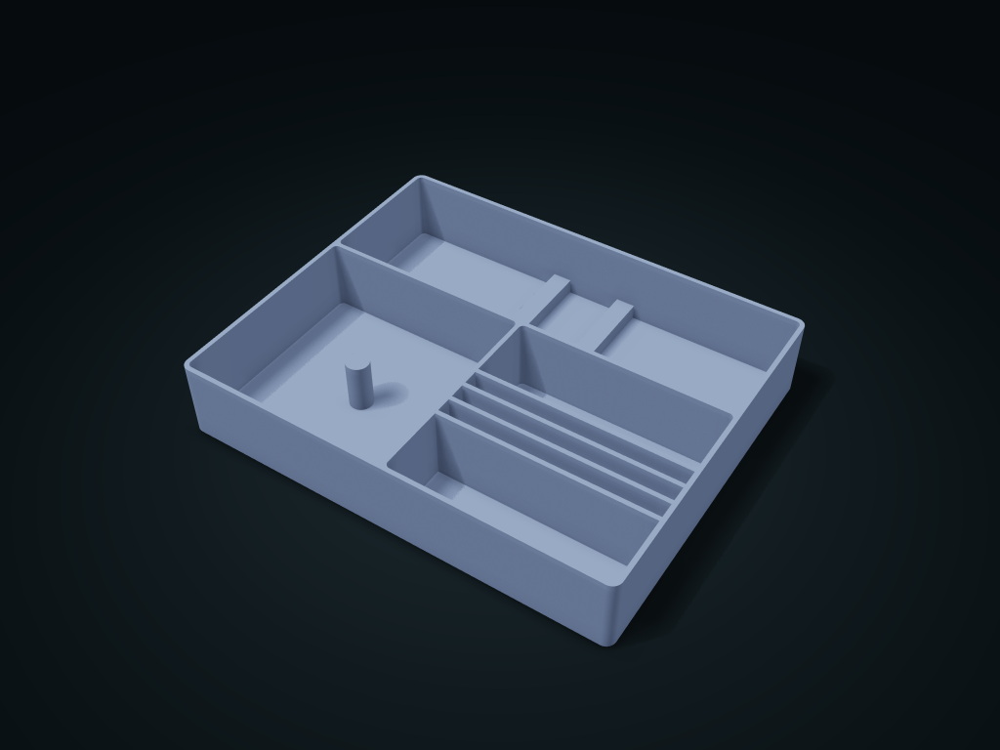](../models/laundry-clip-station/) | [Laundry Clip Return Box](../models/laundry-clip-station/) | 226 × 184 × 40 mm | 1 | [boxesmodel](https://boxesmodel.com/models/laundry-clip-station) |
|  | [Leaf Vein Long & Short Item Box](../models/leaf-vein-tray/) | 210 × 135 × 32 mm | 1 | [boxesmodel](https://boxesmodel.com/models/leaf-vein-tray) |
| [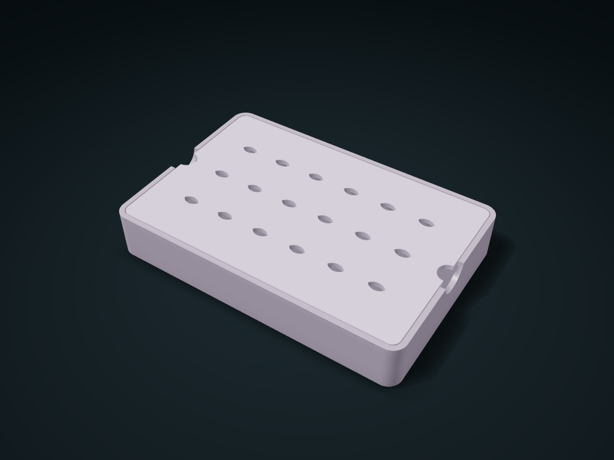](../models/lens-drain-soap-tray/) | [Leaf-Eye Draining Soap Dish](../models/lens-drain-soap-tray/) | 150 × 100 × 24 mm | 2 | [boxesmodel](https://boxesmodel.com/models/lens-drain-soap-tray) |
| [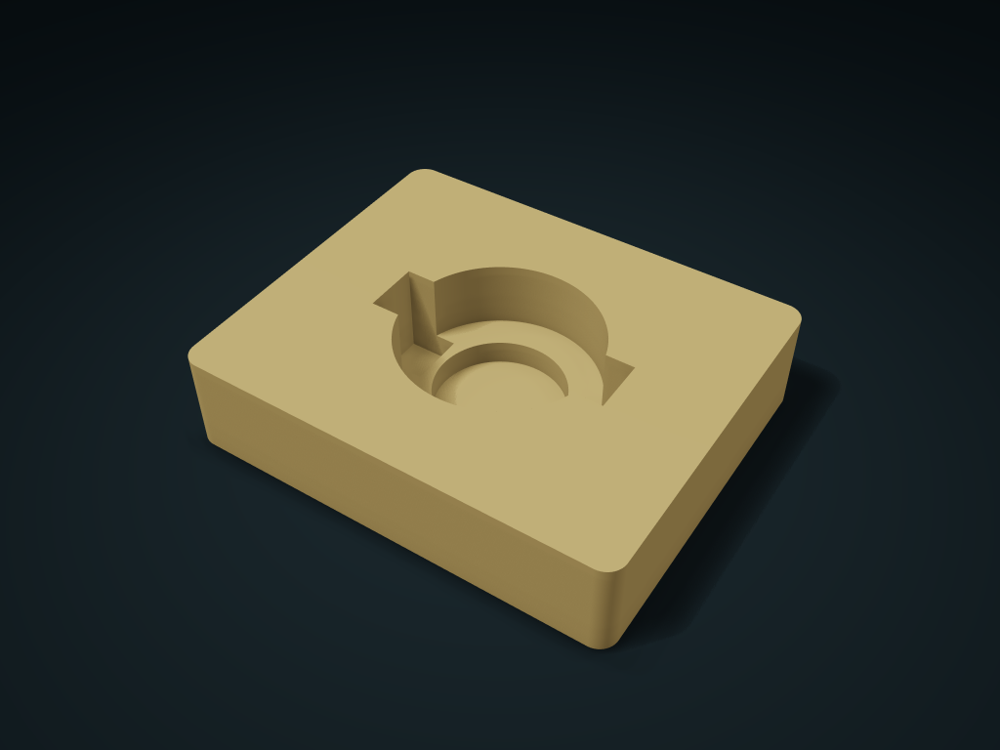](../models/lens-cap-bayonet-bed/) | [Lens Cap Ear Clearance Tray](../models/lens-cap-bayonet-bed/) | 140 × 115 × 32 mm | 1 | [boxesmodel](https://boxesmodel.com/models/lens-cap-bayonet-bed) |
| [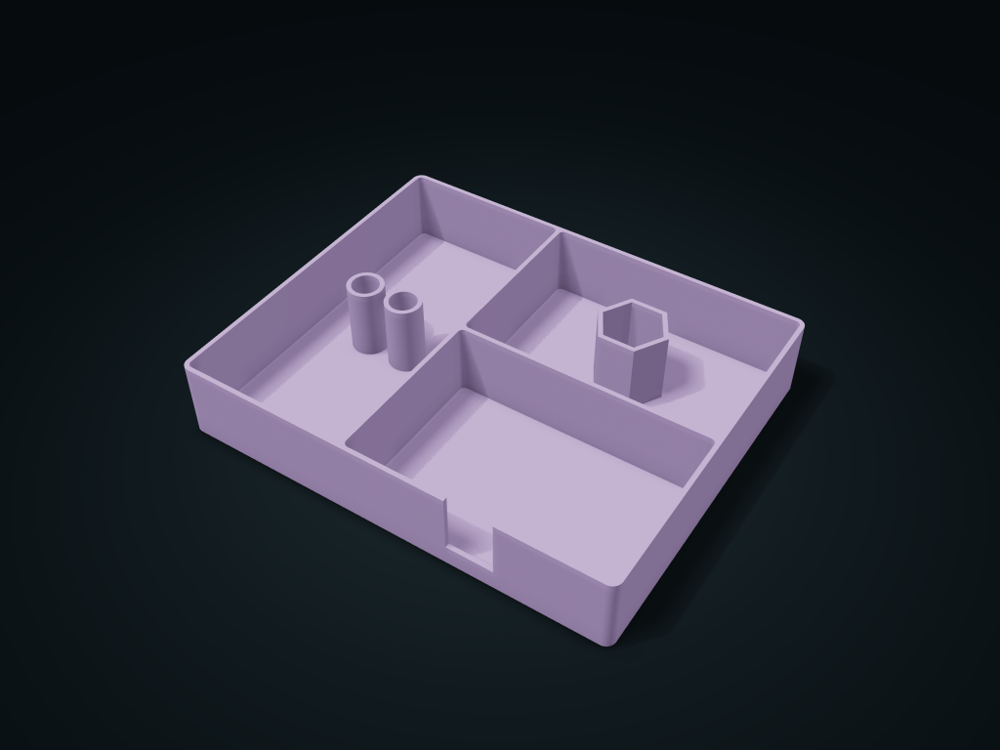](../models/mirror-clean-station/) | [Lens Cleaning Accessory Tray](../models/mirror-clean-station/) | 226 × 184 × 40 mm | 1 | [boxesmodel](https://boxesmodel.com/models/mirror-clean-station) |
| [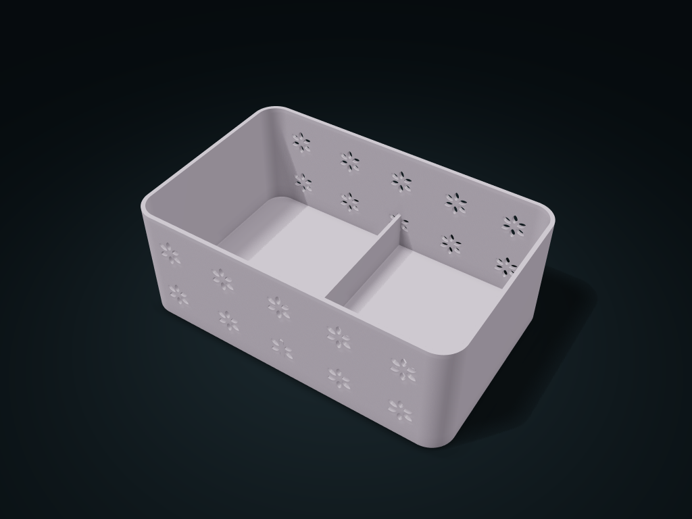](../models/lens-rosette-window-bin/) | [Lens Rosette Window Bin](../models/lens-rosette-window-bin/) | 220 × 140 × 82 mm | 1 | [boxesmodel](https://boxesmodel.com/models/lens-rosette-window-bin) |
| [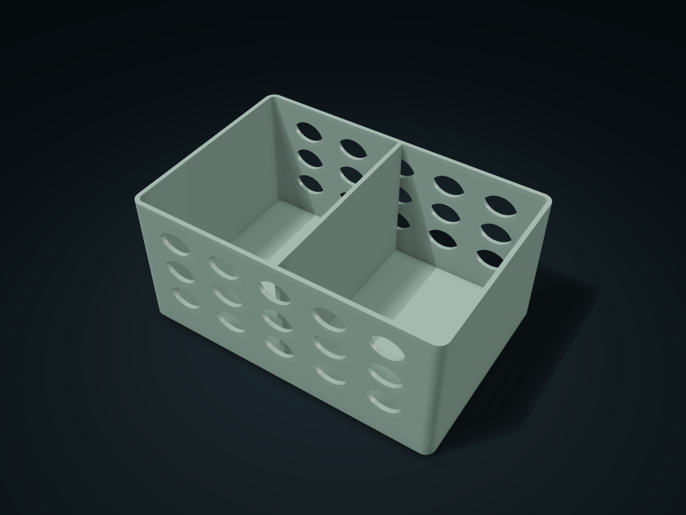](../models/lens-window-desk-basket/) | [Lens Window Desk Basket](../models/lens-window-desk-basket/) | 180 × 120 × 82 mm | 1 | [boxesmodel](https://boxesmodel.com/models/lens-window-desk-basket) |
|  | [Lift-Card Earring Holder](../models/lift-card-earring-caddy/) | 220 × 100 × 150 mm | 5 | [boxesmodel](https://boxesmodel.com/models/lift-card-earring-caddy) |
|  | [Lift-Out Dice Cassette](../models/dice-lift-cassette/) | 175 × 115 × 55 mm | 2 | [boxesmodel](https://boxesmodel.com/models/dice-lift-cassette) |
| [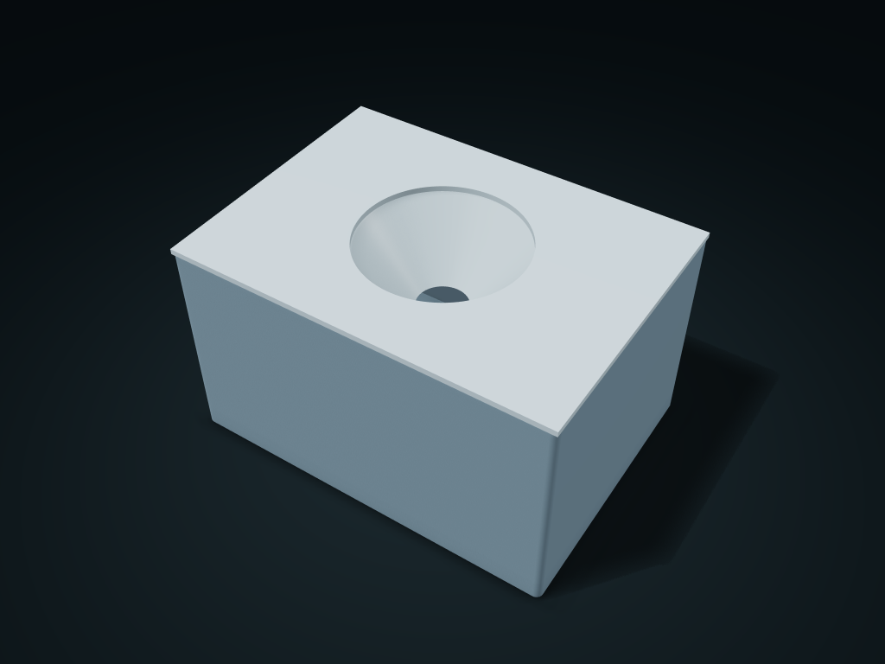](../models/funnel-service-bin/) | [Lift-Out Funnel Mouth Parts Box](../models/funnel-service-bin/) | 165 × 120 × 95 mm | 2 | [boxesmodel](https://boxesmodel.com/models/funnel-service-bin) |
|  | [Lift-Out Hole Box Rotary Tool Station](../models/lift-out-rotary-service-dock/) | 200 × 100 × 70 mm | 3 | [boxesmodel](https://boxesmodel.com/models/lift-out-rotary-service-dock) |
|  | [Lift-Out Soap Dish with Drip Box](../models/soap-lift-grid-box/) | 150 × 105 × 38 mm | 2 | [boxesmodel](https://boxesmodel.com/models/soap-lift-grid-box) |
| [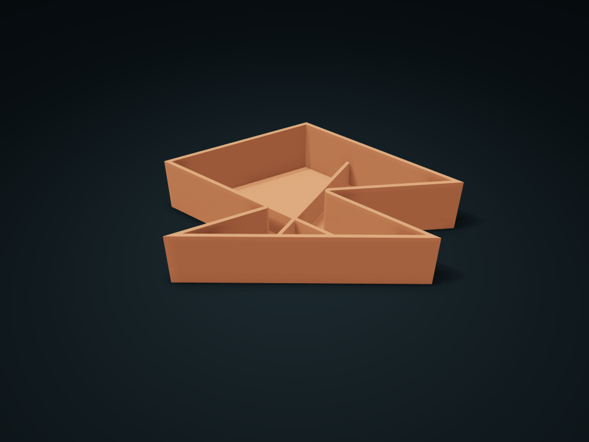](../models/lightning-zig-tray/) | [Lightning Zigzag Compartment Tray](../models/lightning-zig-tray/) | 180 × 140 × 40 mm | 1 | [boxesmodel](https://boxesmodel.com/models/lightning-zig-tray) |
| [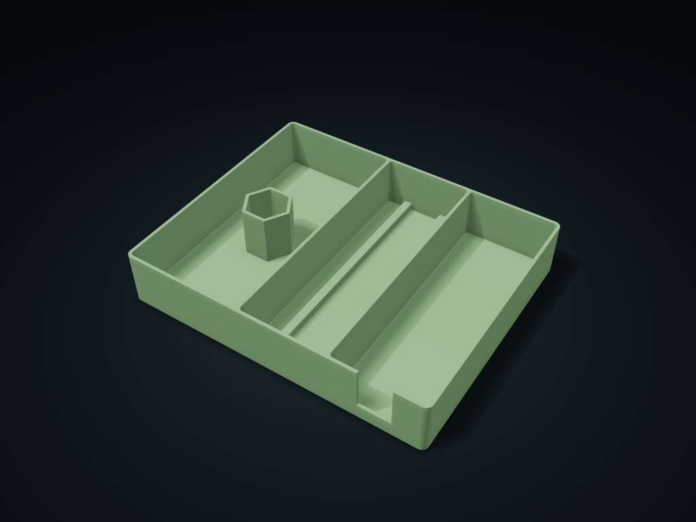](../models/lip-care-station/) | [Lip Makeup Quick Tray](../models/lip-care-station/) | 226 × 184 × 40 mm | 1 | [boxesmodel](https://boxesmodel.com/models/lip-care-station) |
| [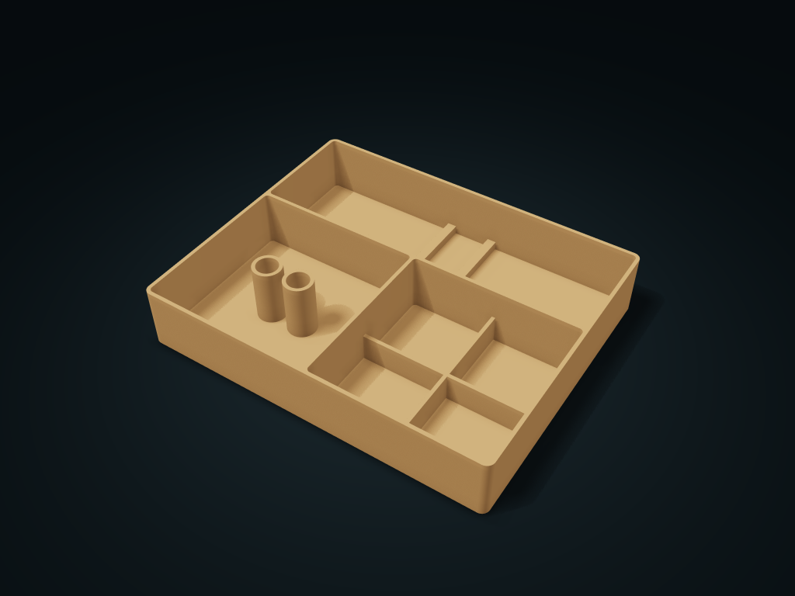](../models/living-room-note-station/) | [Living Room Memo Accessory Tray](../models/living-room-note-station/) | 226 × 184 × 40 mm | 1 | [boxesmodel](https://boxesmodel.com/models/living-room-note-station) |
| [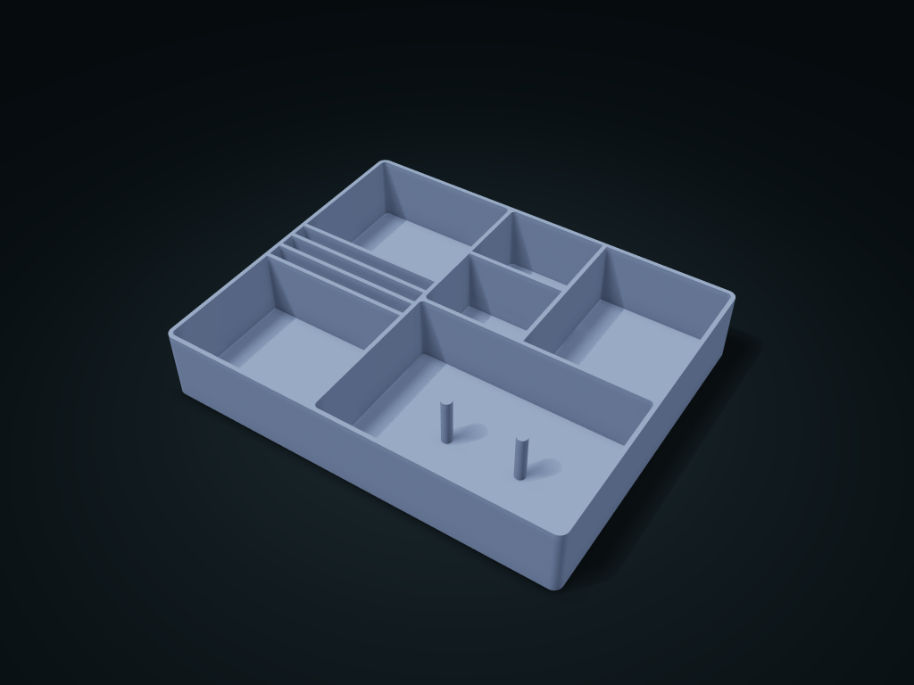](../models/luggage-tag-station/) | [Luggage Tag Assembly Organizer](../models/luggage-tag-station/) | 226 × 184 × 40 mm | 1 | [boxesmodel](https://boxesmodel.com/models/luggage-tag-station) |
| [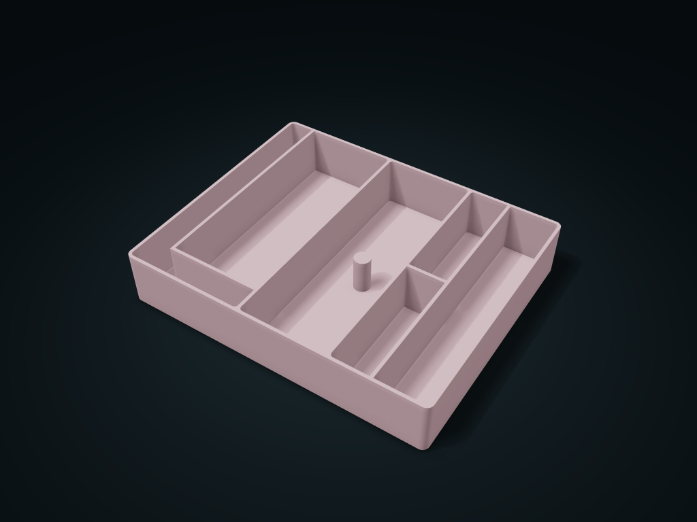](../models/lunchbox-parts-station/) | [Lunch Box Drying Accessory Tray](../models/lunchbox-parts-station/) | 226 × 184 × 40 mm | 1 | [boxesmodel](https://boxesmodel.com/models/lunchbox-parts-station) |
| [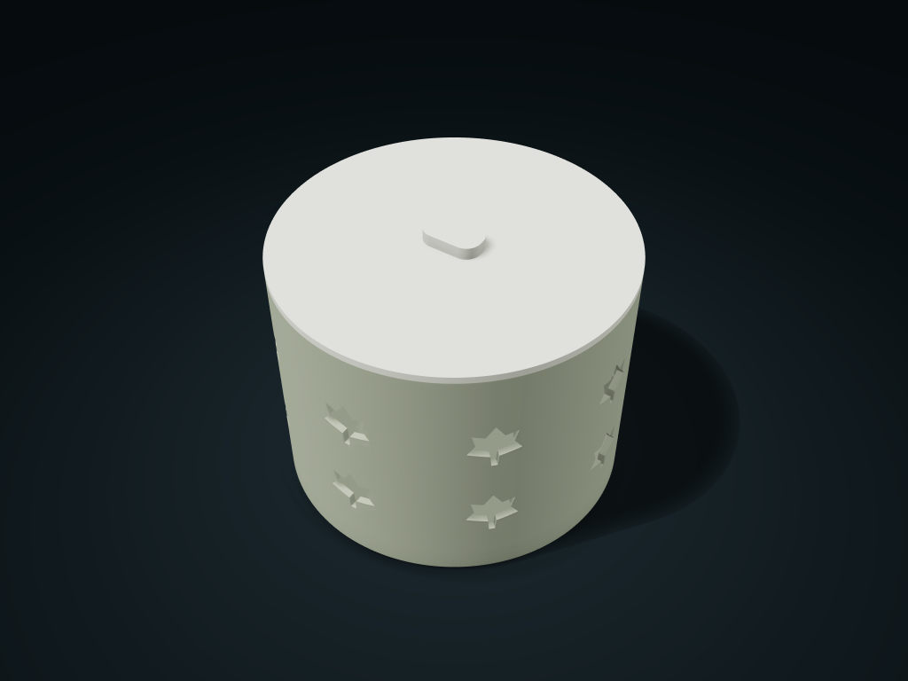](../models/maplecut-lift-canister/) | [Maple Leaf Compartment Lift-Off Canister](../models/maplecut-lift-canister/) | 140 × 140 × 110 mm | 2 | [boxesmodel](https://boxesmodel.com/models/maplecut-lift-canister) |
| [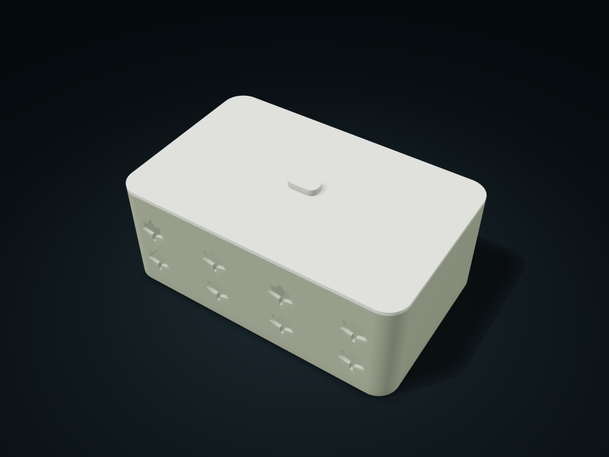](../models/maplecut-lift-chest/) | [Maple Leaf Lift-Off Compartment Chest](../models/maplecut-lift-chest/) | 220 × 140 × 90 mm | 2 | [boxesmodel](https://boxesmodel.com/models/maplecut-lift-chest) |
| [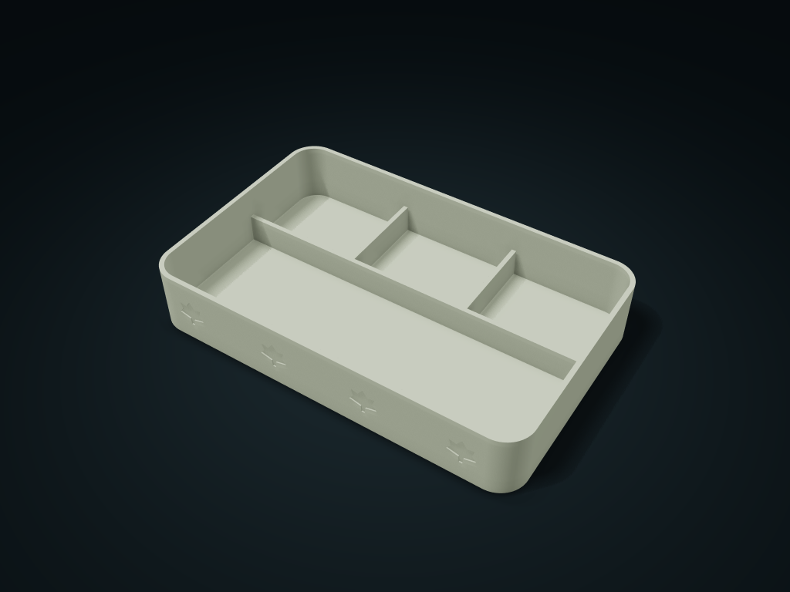](../models/maplecut-valet-tray/) | [Maple Leaf Long-and-Small Item Valet Tray](../models/maplecut-valet-tray/) | 220 × 140 × 38 mm | 1 | [boxesmodel](https://boxesmodel.com/models/maplecut-valet-tray) |
| [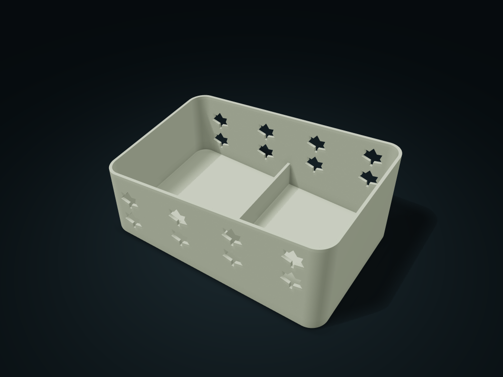](../models/maplecut-slope-bin/) | [Maple Leaf Sloping Rim Sorting Bin](../models/maplecut-slope-bin/) | 220 × 140 × 98 mm | 1 | [boxesmodel](https://boxesmodel.com/models/maplecut-slope-bin) |
| [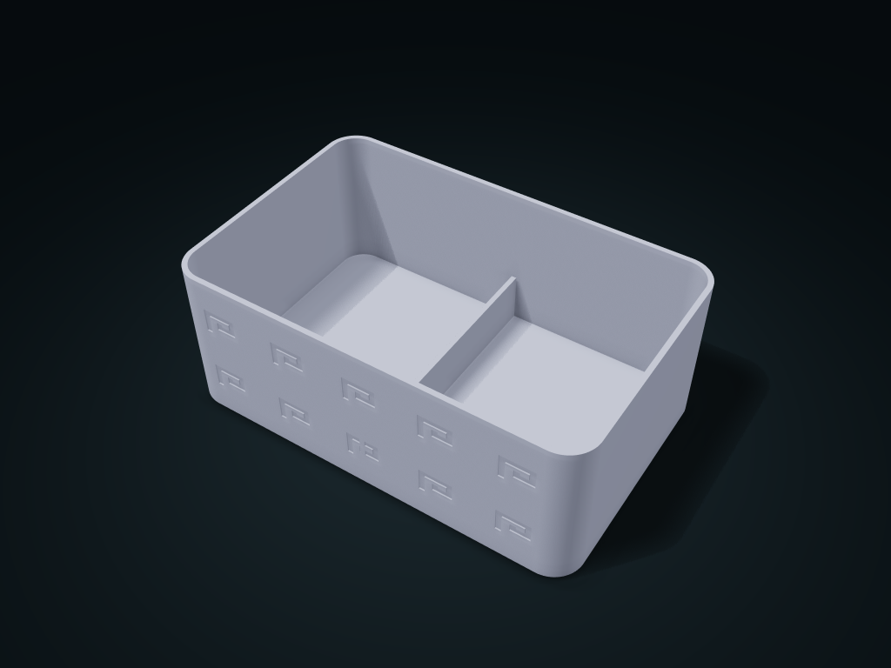](../models/meander-groove-counter-box/) | [Meander Groove Counter Box](../models/meander-groove-counter-box/) | 215 × 138 × 82 mm | 1 | [boxesmodel](https://boxesmodel.com/models/meander-groove-counter-box) |
|  | [Measuring Spoon Bowl & Handle Rest Box](../models/scoop-saddle-basin/) | 200 × 140 × 40 mm | 1 | [boxesmodel](https://boxesmodel.com/models/scoop-saddle-basin) |
| [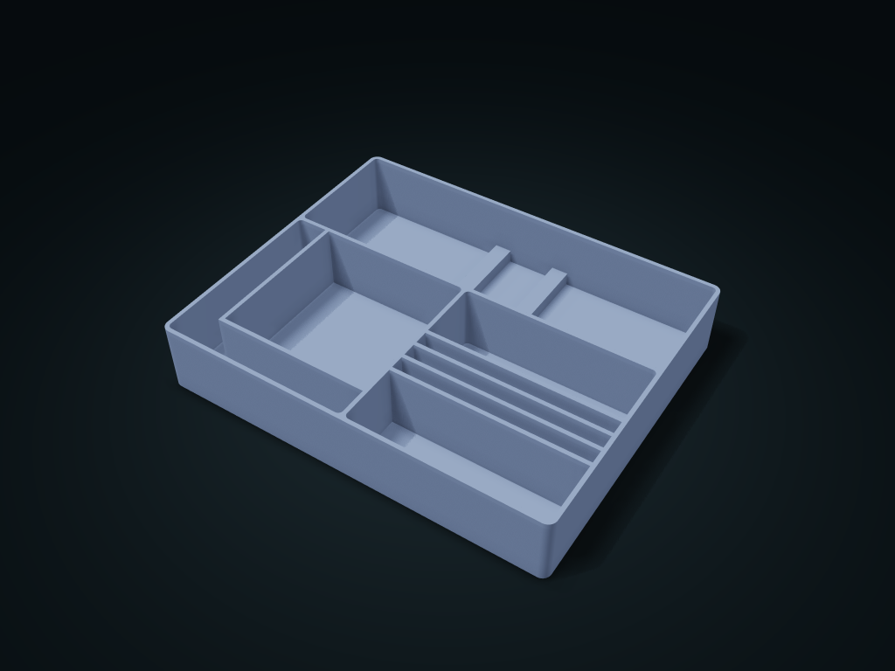](../models/measurement-station/) | [Measuring Tool Accessory Tray](../models/measurement-station/) | 226 × 184 × 40 mm | 1 | [boxesmodel](https://boxesmodel.com/models/measurement-station) |
| [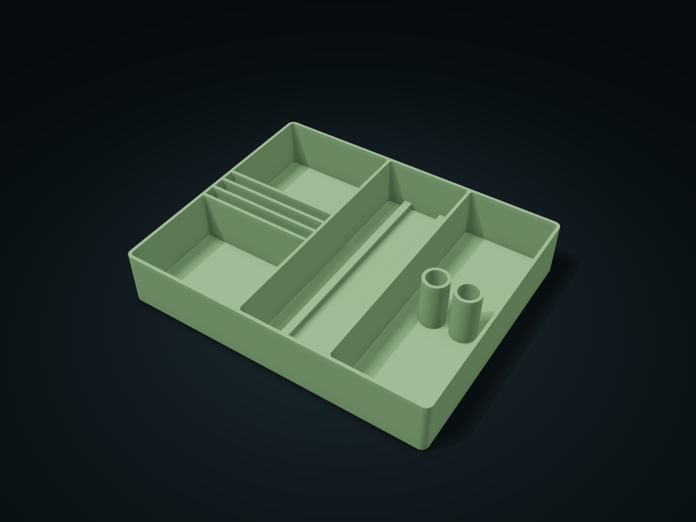](../models/meeting-note-station/) | [Meeting Notes Desk Box](../models/meeting-note-station/) | 226 × 184 × 40 mm | 1 | [boxesmodel](https://boxesmodel.com/models/meeting-note-station) |
|  | [Memory Card & USB Drive Locating Box](../models/media-slot-caddy/) | 120 × 110 × 18 mm | 1 | [boxesmodel](https://boxesmodel.com/models/media-slot-caddy) |
| [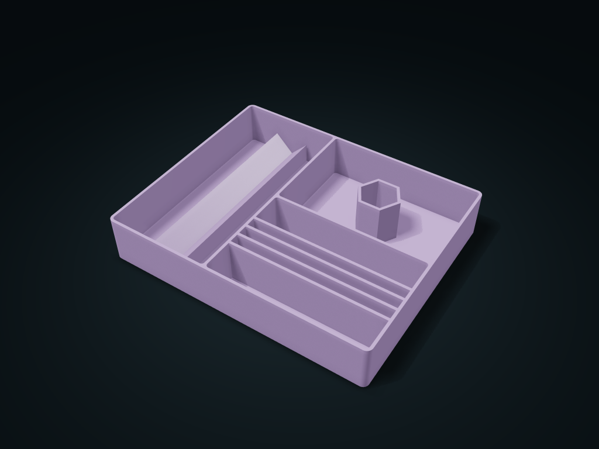](../models/mini-build-station/) | [Miniature Assembly Accessory Tray](../models/mini-build-station/) | 226 × 184 × 40 mm | 1 | [boxesmodel](https://boxesmodel.com/models/mini-build-station) |
| [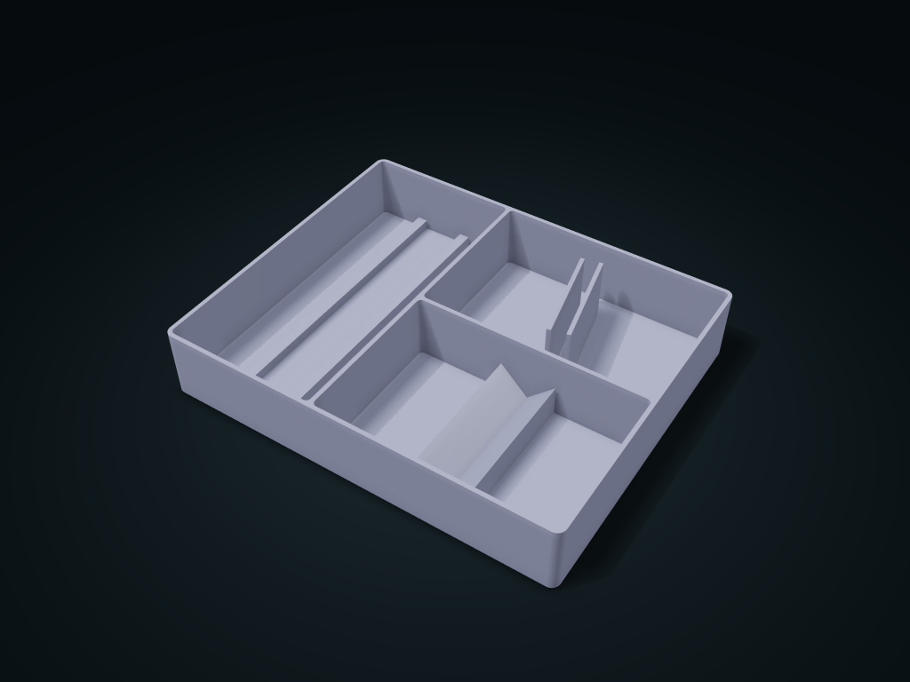](../models/miniature-base-station/) | [Miniature Base Organizer Tray](../models/miniature-base-station/) | 226 × 184 × 40 mm | 1 | [boxesmodel](https://boxesmodel.com/models/miniature-base-station) |
| [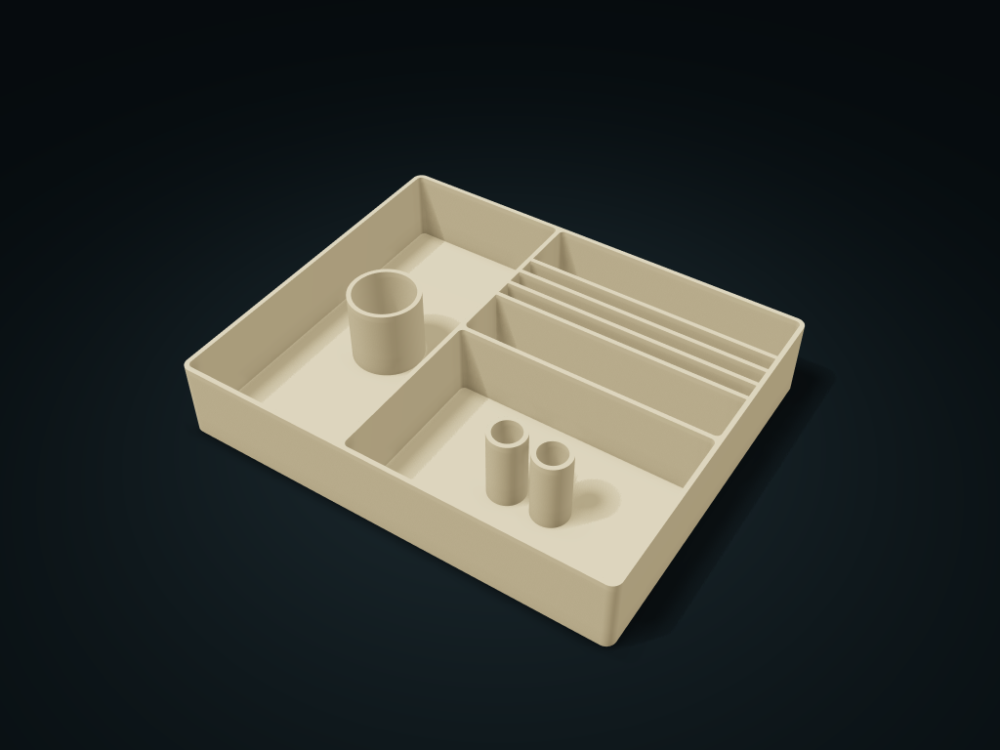](../models/mini-paint-station/) | [Miniature Painting Dry Zone Box](../models/mini-paint-station/) | 226 × 184 × 40 mm | 1 | [boxesmodel](https://boxesmodel.com/models/mini-paint-station) |
|  | [Mirror Base Wraparound Crescent Box](../models/crescent-vanity-tray/) | 190 × 180 × 35 mm | 1 | [boxesmodel](https://boxesmodel.com/models/crescent-vanity-tray) |
| [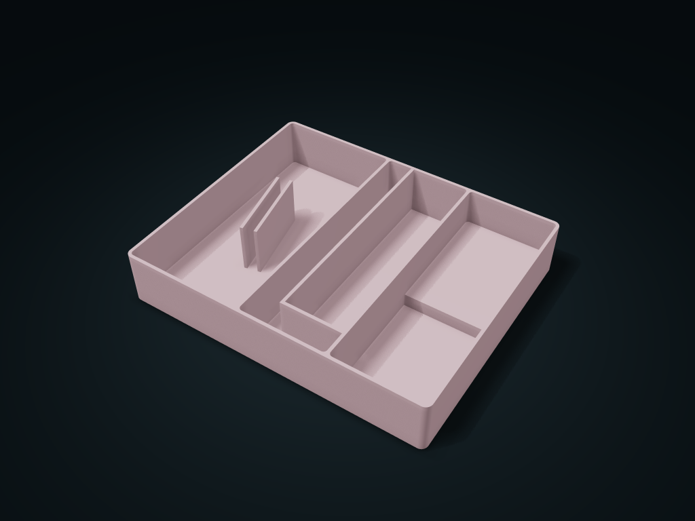](../models/model-decals-station/) | [Model Decal Supply Tray](../models/model-decals-station/) | 226 × 184 × 40 mm | 1 | [boxesmodel](https://boxesmodel.com/models/model-decals-station) |
| [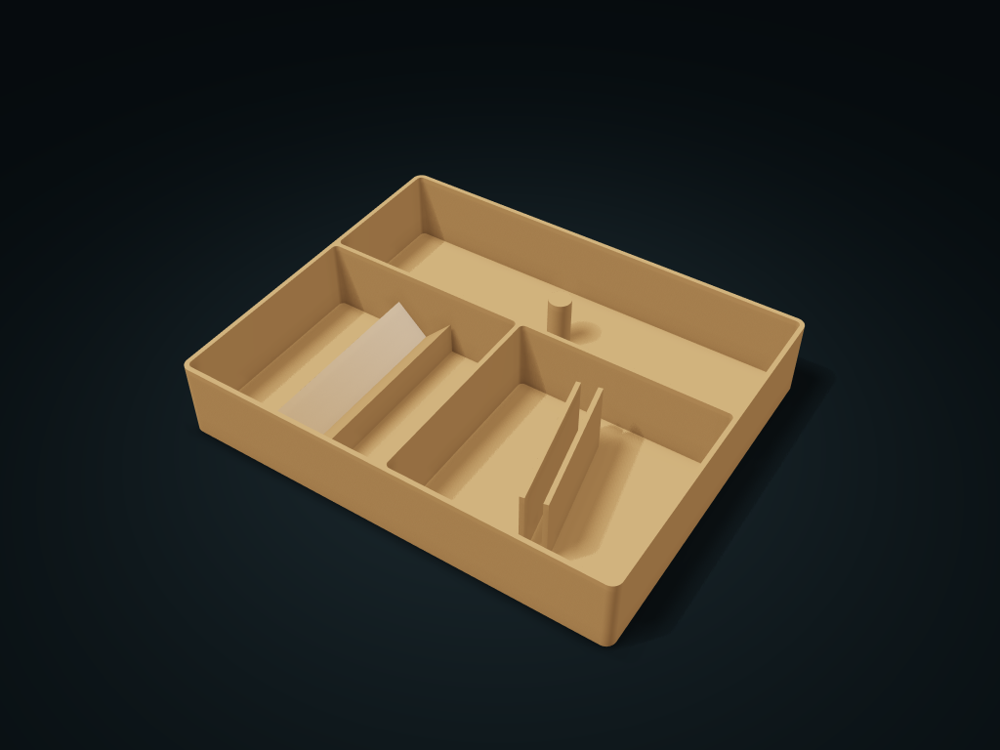](../models/model-wheel-station/) | [Model Wheel & Axle Spares Tray](../models/model-wheel-station/) | 226 × 184 × 40 mm | 1 | [boxesmodel](https://boxesmodel.com/models/model-wheel-station) |
|  | [Modular Inner Box Storage Tray](../models/modular-caddy/) | 210 × 150 × 65 mm | 7 | [boxesmodel](https://boxesmodel.com/models/modular-caddy) |
| [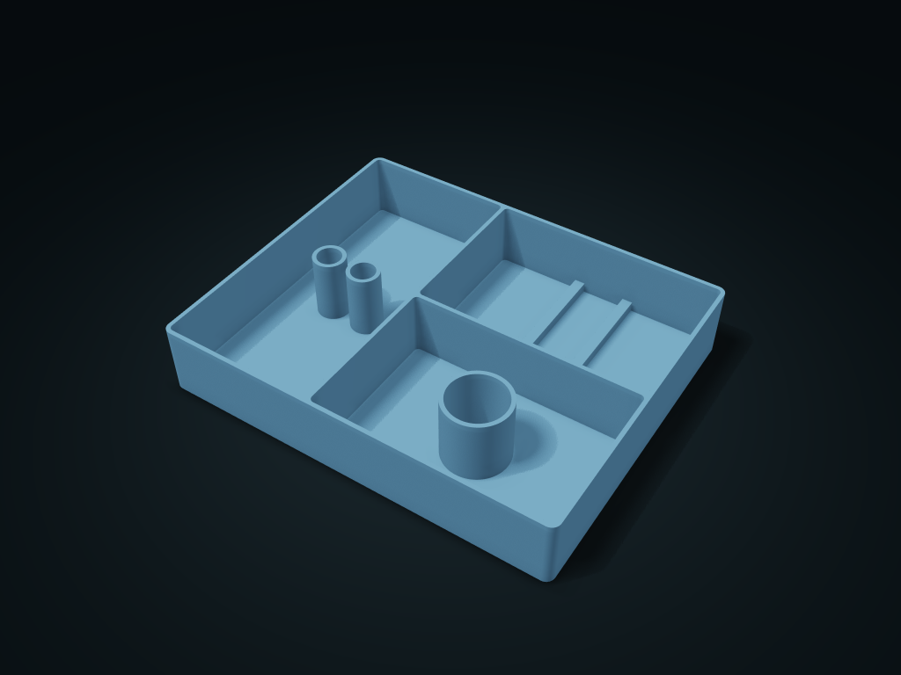](../models/morning-makeup-station/) | [Morning Grooming Tool Tray](../models/morning-makeup-station/) | 226 × 184 × 40 mm | 1 | [boxesmodel](https://boxesmodel.com/models/morning-makeup-station) |
| [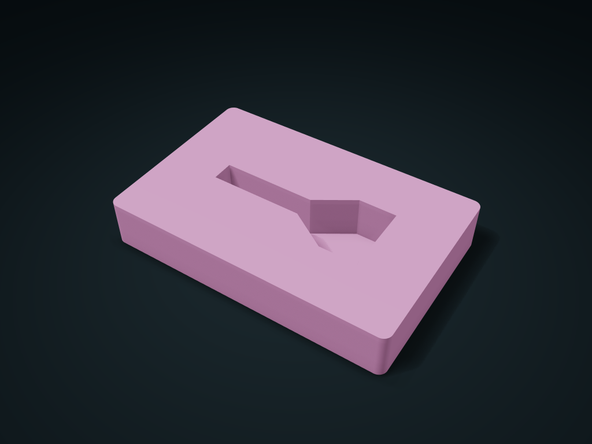](../models/mouthpiece-funnel-flat-bed/) | [Mouthpiece Cup & Shank Flat Box](../models/mouthpiece-funnel-flat-bed/) | 170 × 110 × 28 mm | 1 | [boxesmodel](https://boxesmodel.com/models/mouthpiece-funnel-flat-bed) |
| [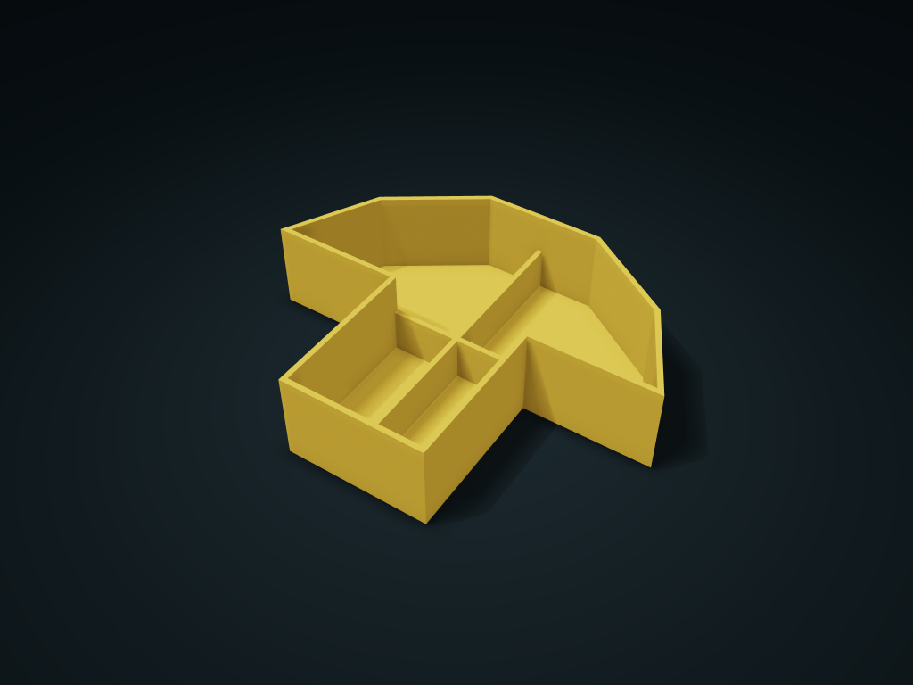](../models/mushroom-canopy-tray/) | [Mushroom Cap & Stem Compartment Tray](../models/mushroom-canopy-tray/) | 180 × 140 × 40 mm | 1 | [boxesmodel](https://boxesmodel.com/models/mushroom-canopy-tray) |
| [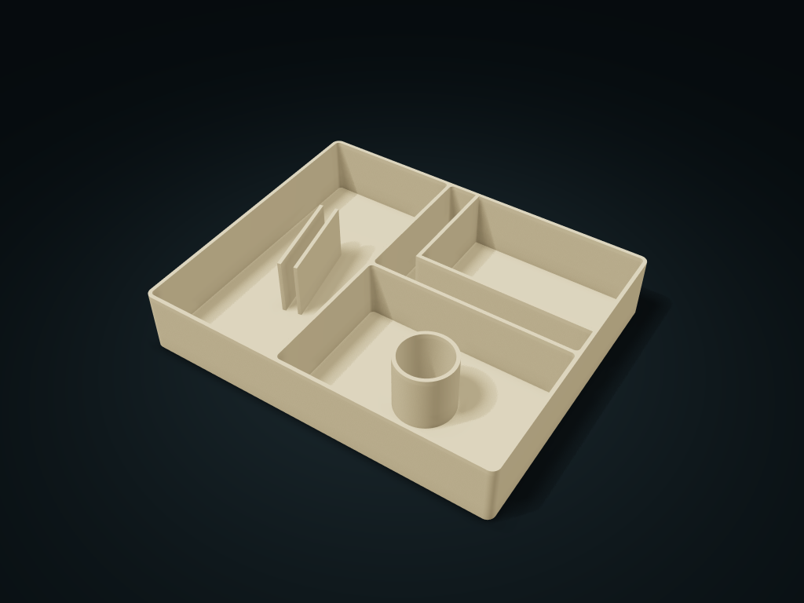](../models/nail-color-station/) | [Nail Color Swatch Accessory Tray](../models/nail-color-station/) | 226 × 184 × 40 mm | 1 | [boxesmodel](https://boxesmodel.com/models/nail-color-station) |
|  | [Napkin Holder with Weight Plate](../models/napkin-follower-box/) | 180 × 180 × 65 mm | 2 | [boxesmodel](https://boxesmodel.com/models/napkin-follower-box) |
|  | [Necklace Two-Height Comb Box](../models/necklace-notch-caddy/) | 200 × 130 × 130 mm | 1 | [boxesmodel](https://boxesmodel.com/models/necklace-notch-caddy) |
| [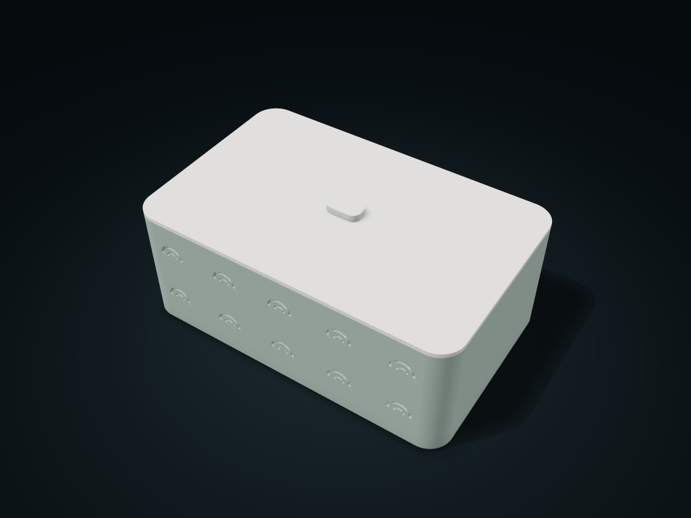](../models/nested-arch-window-box/) | [Nested Arch Window Box](../models/nested-arch-window-box/) | 220 × 140 × 90 mm | 2 | [boxesmodel](https://boxesmodel.com/models/nested-arch-window-box) |
| [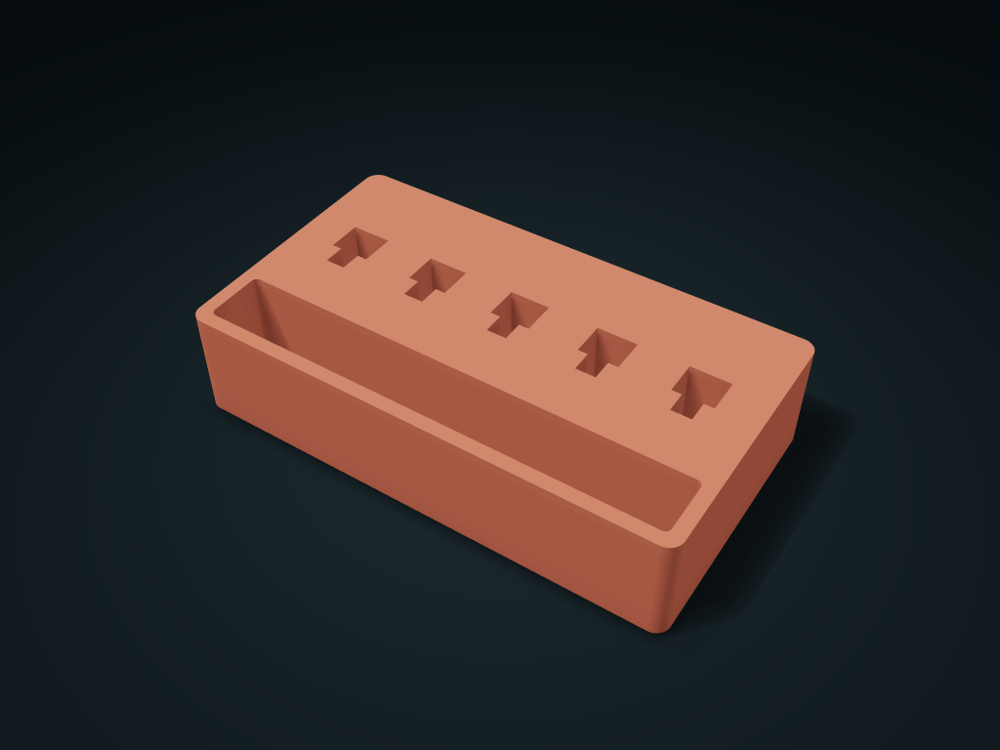](../models/modular-plug-latch-well/) | [Network Plug Latch Guard Box](../models/modular-plug-latch-well/) | 170 × 95 × 38 mm | 1 | [boxesmodel](https://boxesmodel.com/models/modular-plug-latch-well) |
| [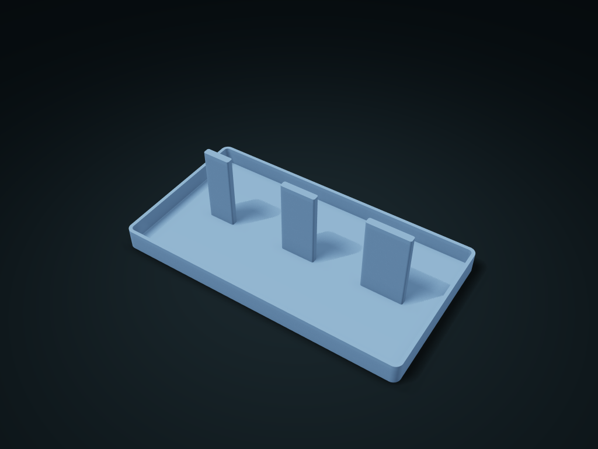](../models/oring-ladder-bin/) | [O-Ring Stepped Rail Box](../models/oring-ladder-bin/) | 195 × 105 × 55 mm | 1 | [boxesmodel](https://boxesmodel.com/models/oring-ladder-bin) |

[← Previous](desktop-organizers-5.md) · [1](desktop-organizers.md) · [2](desktop-organizers-2.md) · [3](desktop-organizers-3.md) · [4](desktop-organizers-4.md) · [5](desktop-organizers-5.md) · **6** · [7](desktop-organizers-7.md) · [8](desktop-organizers-8.md) · [9](desktop-organizers-9.md) · [10](desktop-organizers-10.md) · [11](desktop-organizers-11.md) · [Next →](desktop-organizers-7.md)
