# Desktop Organizers

**Page 7 of 11** · Models 301–350 of 544

Click a thumbnail or model name to open its files and guide. Use **Preview & customize** to open the interactive model on boxesmodel.

[All models](../CATALOG.md) · [Collection overview](../README.md)

[← Previous](desktop-organizers-6.md) · [1](desktop-organizers.md) · [2](desktop-organizers-2.md) · [3](desktop-organizers-3.md) · [4](desktop-organizers-4.md) · [5](desktop-organizers-5.md) · [6](desktop-organizers-6.md) · **7** · [8](desktop-organizers-8.md) · [9](desktop-organizers-9.md) · [10](desktop-organizers-10.md) · [11](desktop-organizers-11.md) · [Next →](desktop-organizers-8.md)

| Thumbnail | Model | Default dimensions | Parts | Preview & customize |
| --- | --- | --- | ---: | --- |
| [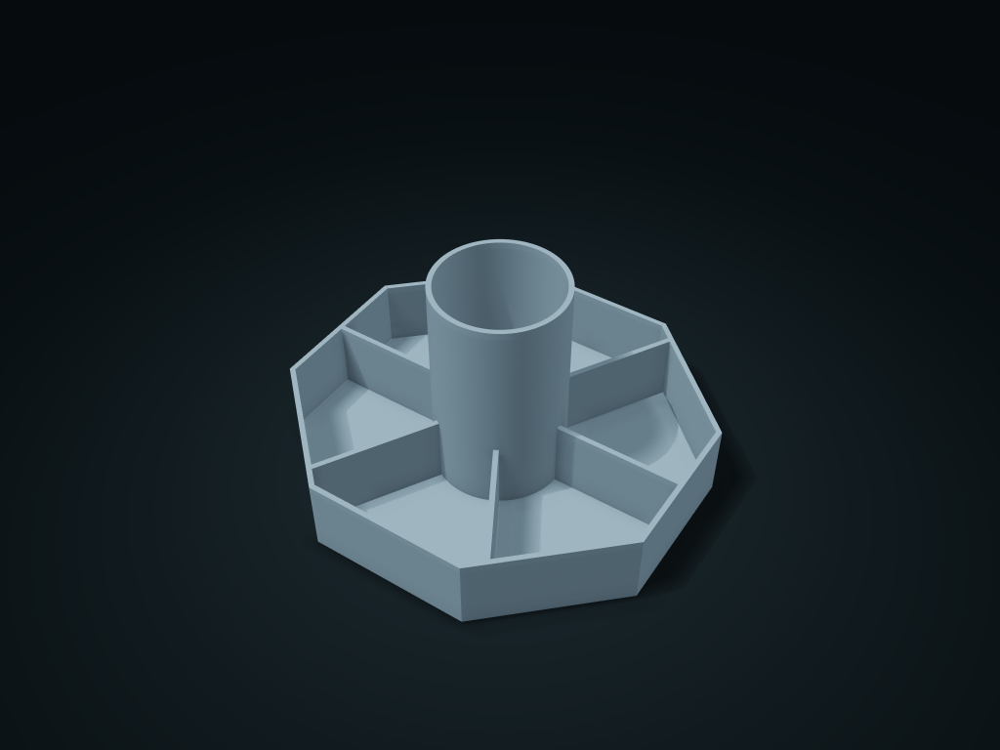](../models/octagon-center-caddy/) | [Octagon Tall-Core Tool Caddy](../models/octagon-center-caddy/) | 180 × 170 × 100 mm | 1 | [boxesmodel](https://boxesmodel.com/models/octagon-center-caddy) |
| [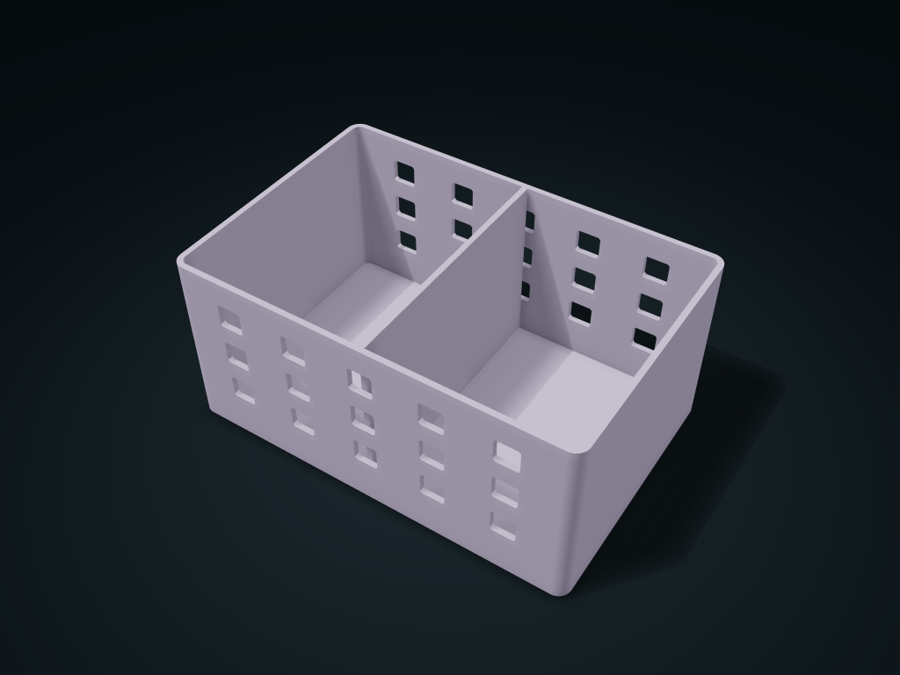](../models/octagon-window-drawer-basket/) | [Octagon Window Drawer Basket](../models/octagon-window-drawer-basket/) | 180 × 120 × 82 mm | 1 | [boxesmodel](https://boxesmodel.com/models/octagon-window-drawer-basket) |
| [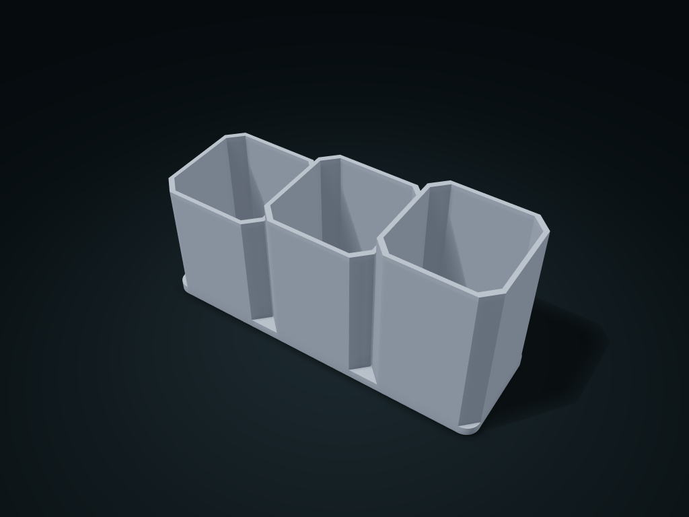](../models/octagonal-tiered-brush-cups/) | [Octagonal Tiered Brush Cups](../models/octagonal-tiered-brush-cups/) | 218 × 72 × 110 mm | 1 | [boxesmodel](https://boxesmodel.com/models/octagonal-tiered-brush-cups) |
| [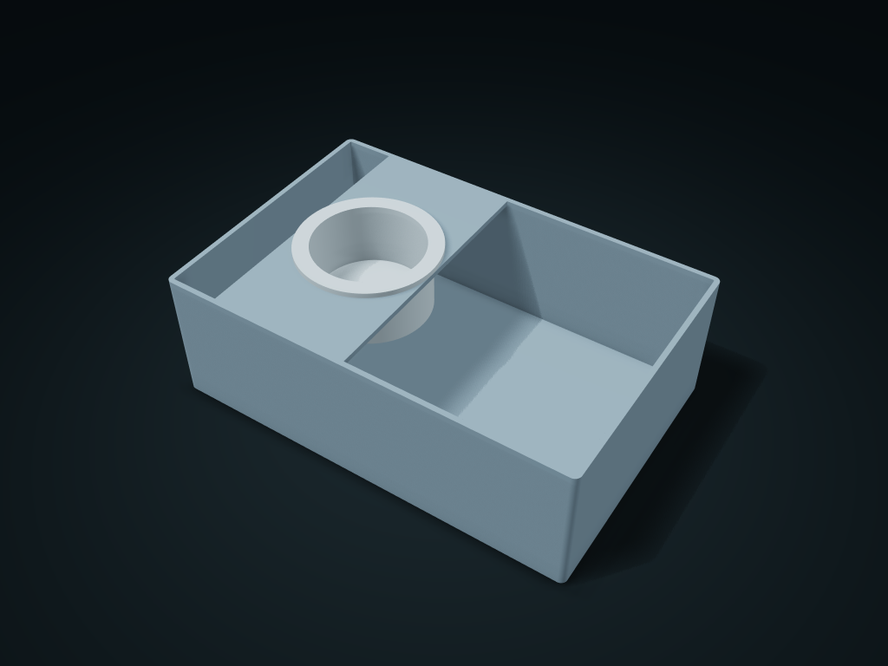](../models/offset-service-cup-box/) | [Offset Lift-Out Cup Spare Parts Box](../models/offset-service-cup-box/) | 190 × 125 × 65 mm | 2 | [boxesmodel](https://boxesmodel.com/models/offset-service-cup-box) |
|  | [Offset Rounded Five Pocket Tray](../models/offset-five-pocket-tray/) | 210 × 150 × 40 mm | 1 | [boxesmodel](https://boxesmodel.com/models/offset-five-pocket-tray) |
|  | [Ogee Shoulder Lift-Off Jar](../models/ogee-shoulder-lift-jar/) | 132 × 132 × 110 mm | 2 | [boxesmodel](https://boxesmodel.com/models/ogee-shoulder-lift-jar) |
| [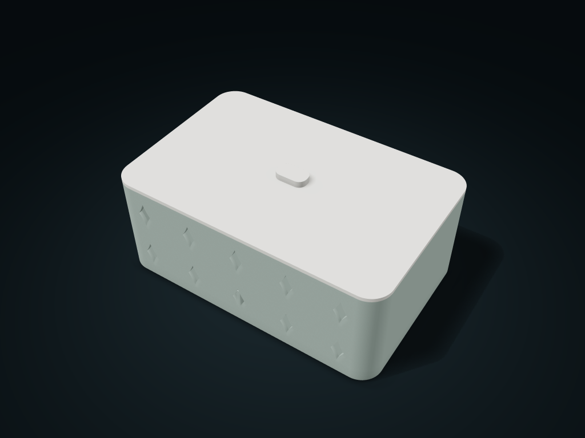](../models/ogee-lattice-lift-box/) | [Ogee Window Lift-Off Box](../models/ogee-lattice-lift-box/) | 210 × 136 × 88 mm | 2 | [boxesmodel](https://boxesmodel.com/models/ogee-lattice-lift-box) |
|  | [Open Arc Bead Prep Box](../models/bead-open-arc-board/) | 180 × 125 × 28 mm | 1 | [boxesmodel](https://boxesmodel.com/models/bead-open-arc-board) |
|  | [Opposed Crescent Counter Bin](../models/opposed-crescent-bin/) | 220 × 140 × 82 mm | 1 | [boxesmodel](https://boxesmodel.com/models/opposed-crescent-bin) |
| [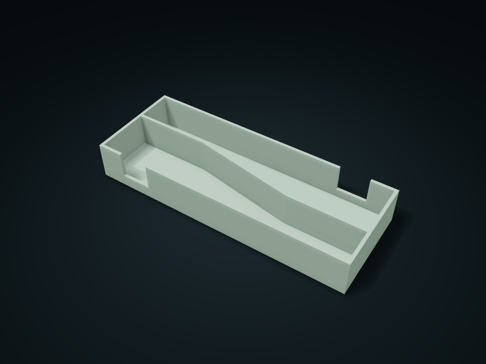](../models/opposed-head-cutlery-tray/) | [Opposed-Head Cutlery Twin Tray](../models/opposed-head-cutlery-tray/) | 240 × 90 × 35 mm | 1 | [boxesmodel](https://boxesmodel.com/models/opposed-head-cutlery-tray) |
| [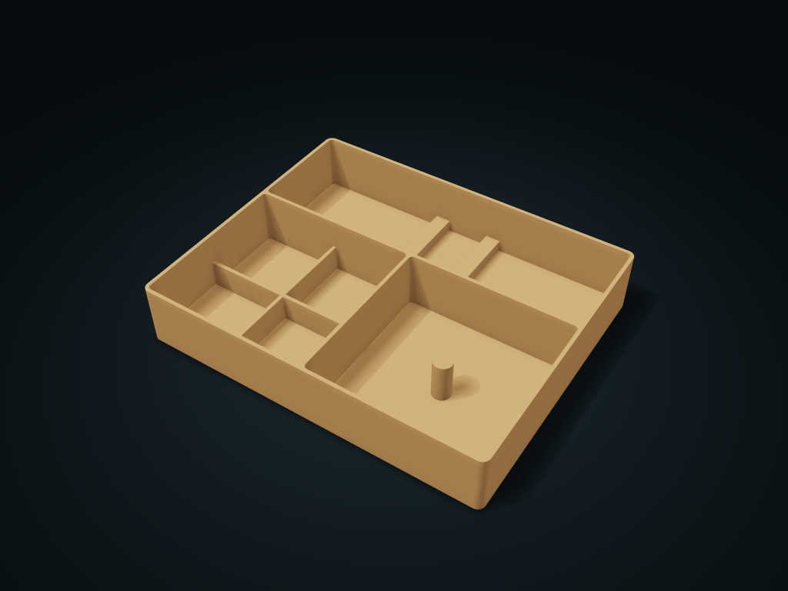](../models/outdoor-kit-station/) | [Outdoor Small Items Checklist Tray](../models/outdoor-kit-station/) | 226 × 184 × 40 mm | 1 | [boxesmodel](https://boxesmodel.com/models/outdoor-kit-station) |
| [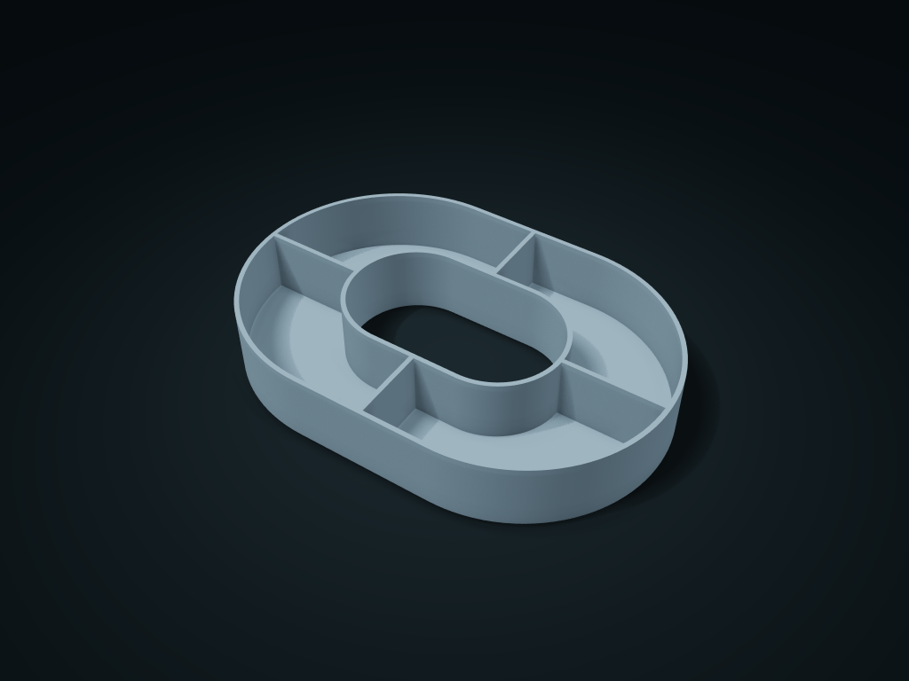](../models/racetrack-ring-tray/) | [Oval Base Wraparound Box](../models/racetrack-ring-tray/) | 220 × 150 × 35 mm | 1 | [boxesmodel](https://boxesmodel.com/models/racetrack-ring-tray) |
| [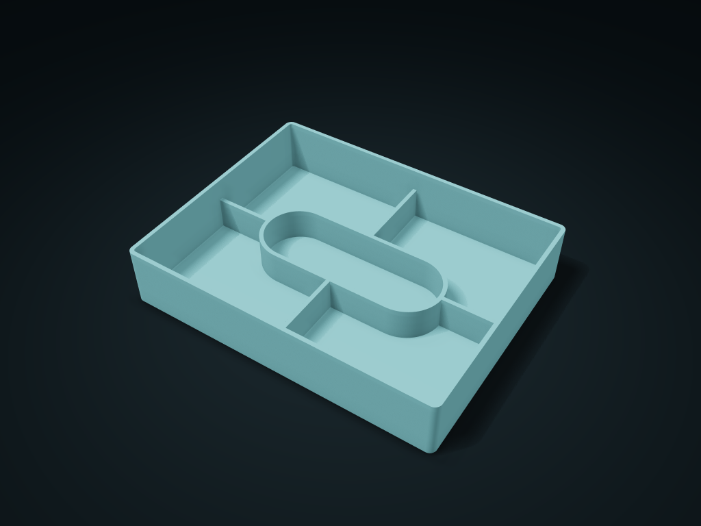](../models/capsule-center-side-bays/) | [Oval Main Compartment Side Bay Tray](../models/capsule-center-side-bays/) | 180 × 140 × 34 mm | 1 | [boxesmodel](https://boxesmodel.com/models/capsule-center-side-bays) |
|  | [Over-Door Inverted Hanging Box](../models/door-saddle-caddy/) | 170 × 125 × 145 mm | 1 | [boxesmodel](https://boxesmodel.com/models/door-saddle-caddy) |
| [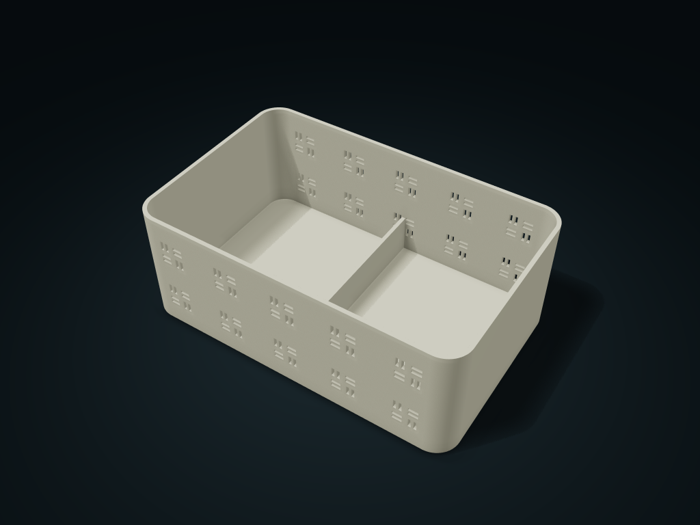](../models/overunder-slot-bin/) | [Over-Under Slot Organizer Bin](../models/overunder-slot-bin/) | 220 × 140 × 82 mm | 1 | [boxesmodel](https://boxesmodel.com/models/overunder-slot-bin) |
| [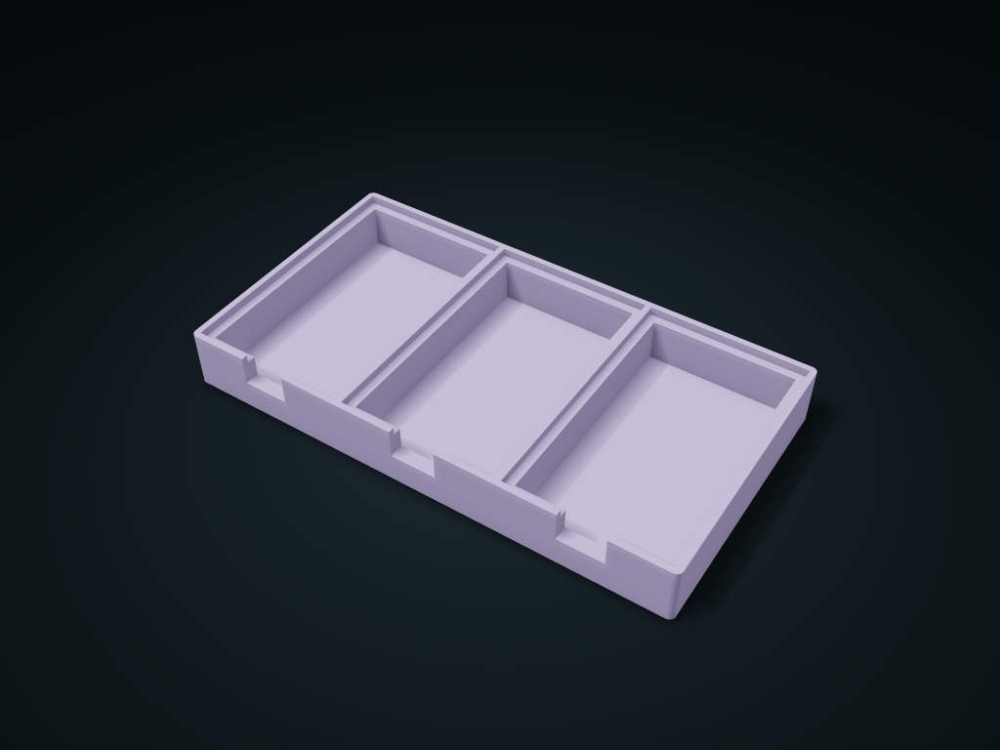](../models/edge-rest-blister-tray/) | [Overhang Blister Pack Tray](../models/edge-rest-blister-tray/) | 240 × 130 × 28 mm | 1 | [boxesmodel](https://boxesmodel.com/models/edge-rest-blister-tray) |
| [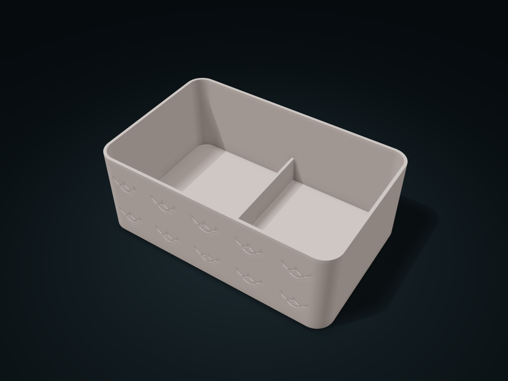](../models/overlap-scale-recess-bin/) | [Overlapping Scale Recess Bin](../models/overlap-scale-recess-bin/) | 220 × 140 × 82 mm | 1 | [boxesmodel](https://boxesmodel.com/models/overlap-scale-recess-bin) |
|  | [Overlapping Telescopic Storage Tray](../models/telescoping-overlap-tray/) | 220 × 130 × 45 mm | 2 | [boxesmodel](https://boxesmodel.com/models/telescoping-overlap-tray) |
| [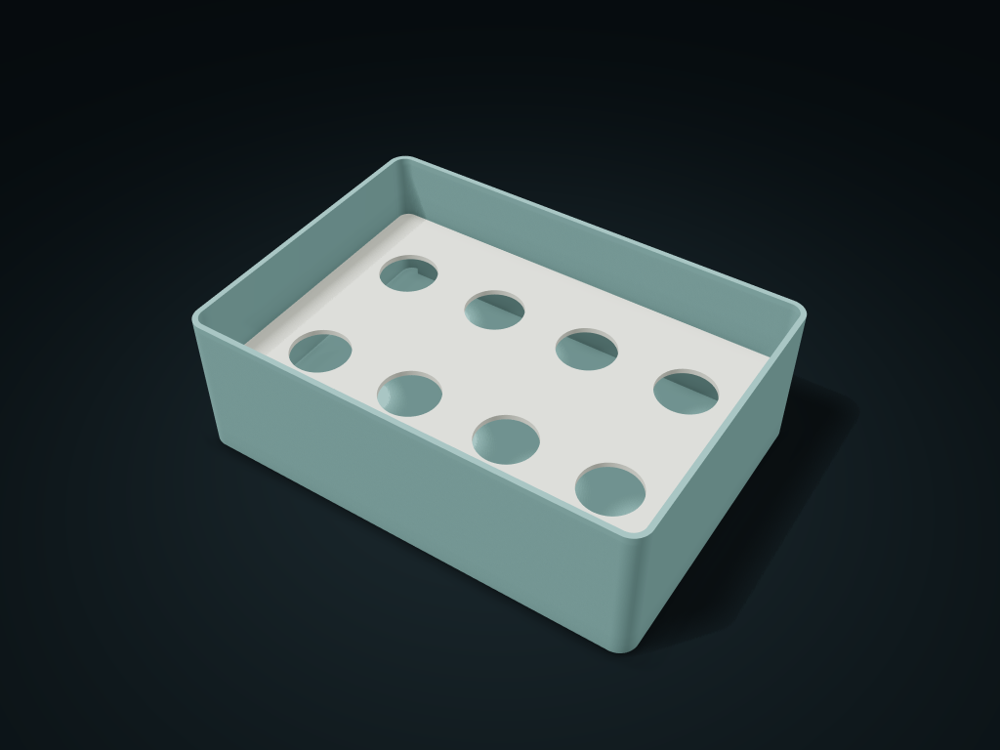](../models/paint-pot-caddy/) | [Paint Bottle Locating Basket](../models/paint-pot-caddy/) | 200 × 140 × 65 mm | 2 | [boxesmodel](https://boxesmodel.com/models/paint-pot-caddy) |
| [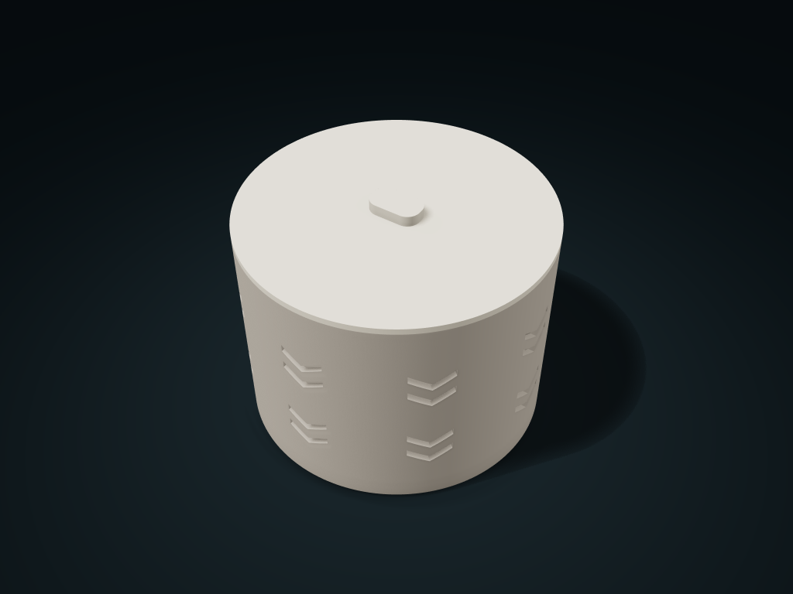](../models/chevronpair-lift-canister/) | [Paired Chevron Compartment Lift-Off Canister](../models/chevronpair-lift-canister/) | 140 × 140 × 110 mm | 2 | [boxesmodel](https://boxesmodel.com/models/chevronpair-lift-canister) |
| [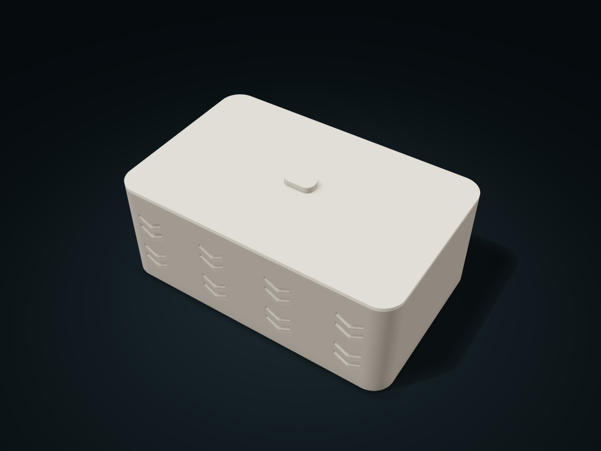](../models/chevronpair-lift-chest/) | [Paired Chevron Lift-Off Compartment Chest](../models/chevronpair-lift-chest/) | 220 × 140 × 90 mm | 2 | [boxesmodel](https://boxesmodel.com/models/chevronpair-lift-chest) |
| [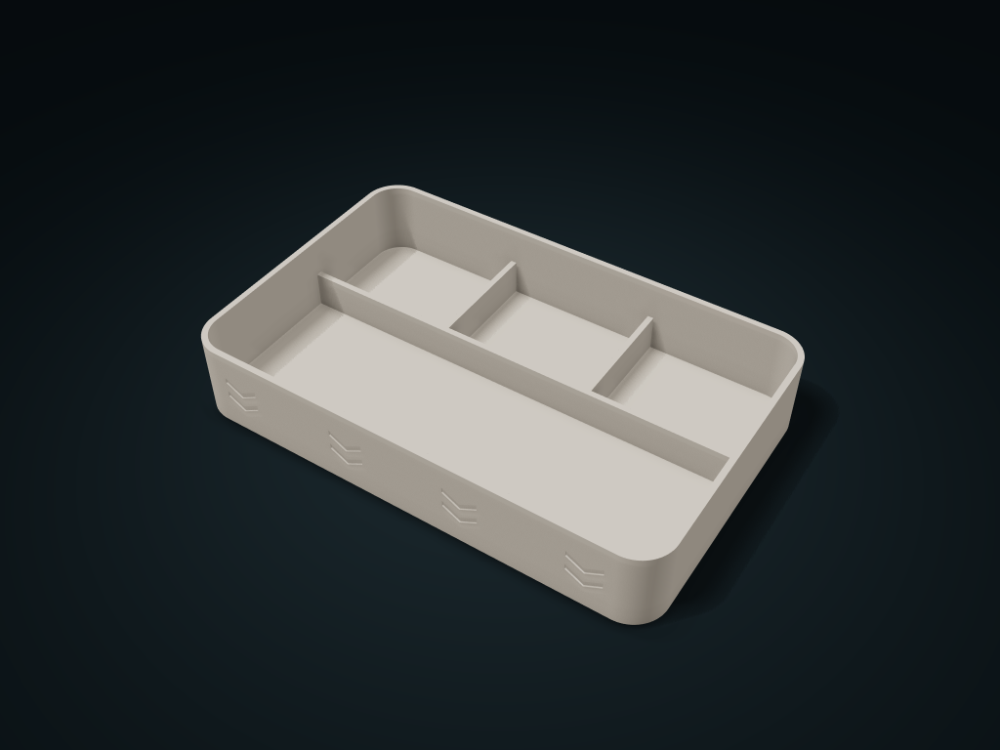](../models/chevronpair-valet-tray/) | [Paired Chevron Long-and-Small Item Valet Tray](../models/chevronpair-valet-tray/) | 220 × 140 × 38 mm | 1 | [boxesmodel](https://boxesmodel.com/models/chevronpair-valet-tray) |
| [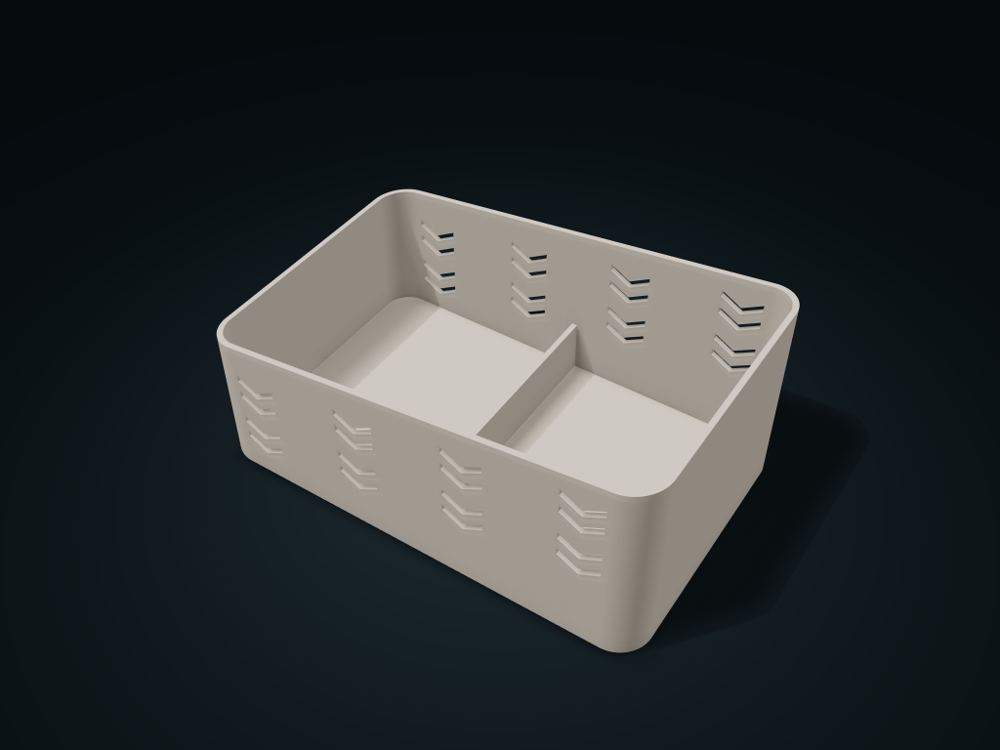](../models/chevronpair-slope-bin/) | [Paired Chevron Sloping Rim Sorting Bin](../models/chevronpair-slope-bin/) | 220 × 140 × 98 mm | 1 | [boxesmodel](https://boxesmodel.com/models/chevronpair-slope-bin) |
|  | [Paired S-Scroll Recess Box](../models/s-scroll-recess-box/) | 220 × 140 × 90 mm | 2 | [boxesmodel](https://boxesmodel.com/models/s-scroll-recess-box) |
| [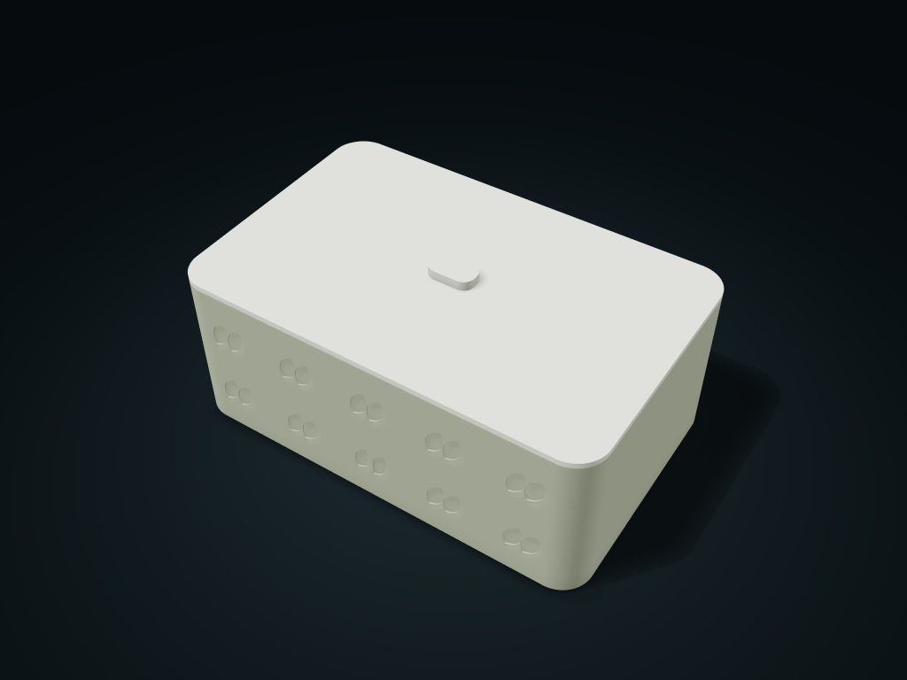](../models/willow-pair-lift-box/) | [Paired Willow Lift-Off Box](../models/willow-pair-lift-box/) | 215 × 138 × 90 mm | 2 | [boxesmodel](https://boxesmodel.com/models/willow-pair-lift-box) |
| [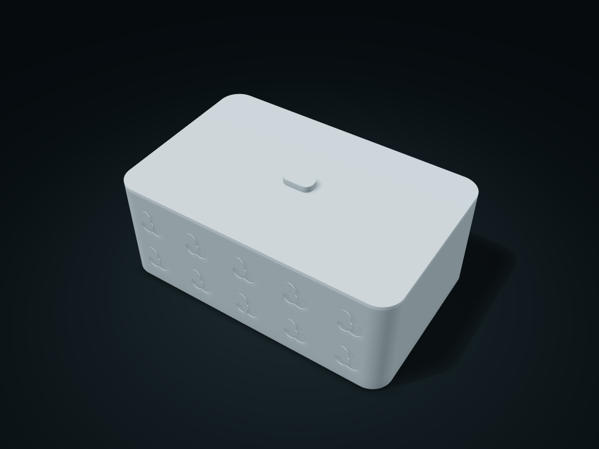](../models/paisley-recess-box/) | [Paisley Recess Lift-Off Box](../models/paisley-recess-box/) | 220 × 140 × 90 mm | 2 | [boxesmodel](https://boxesmodel.com/models/paisley-recess-box) |
| [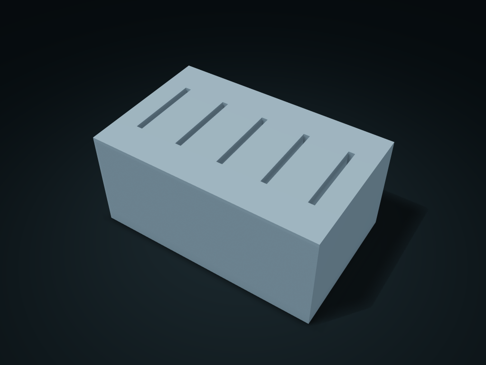](../models/palette-knife-gallery/) | [Palette Knife Staggered Slot Box](../models/palette-knife-gallery/) | 185 × 115 × 85 mm | 1 | [boxesmodel](https://boxesmodel.com/models/palette-knife-gallery) |
| [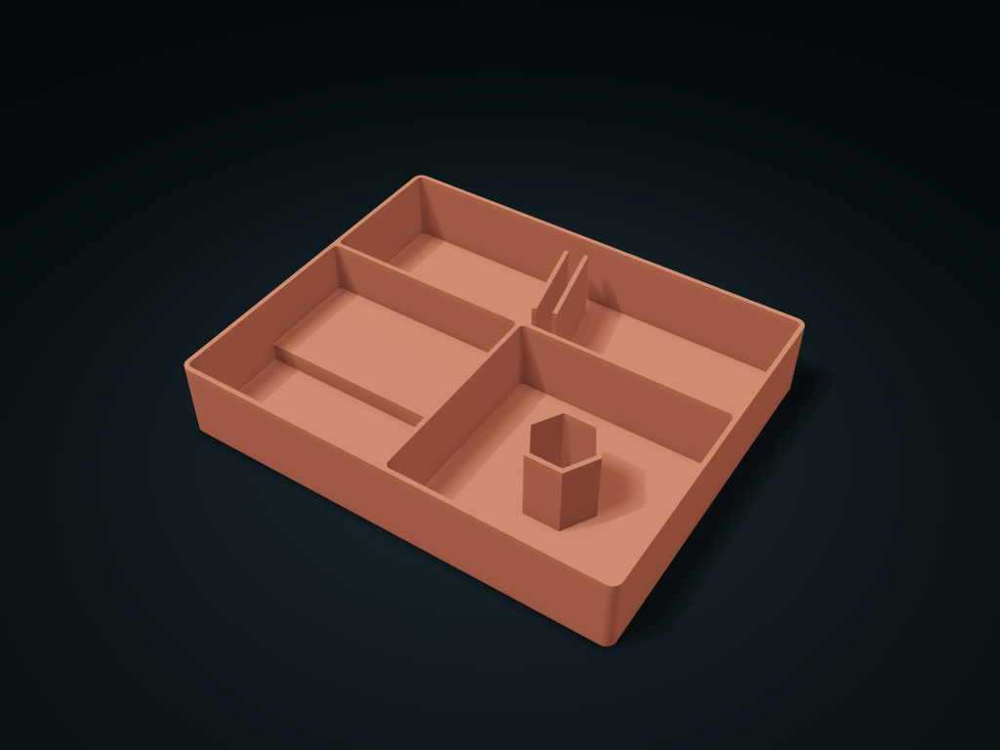](../models/paper-craft-station/) | [Papercraft Accessory Tray](../models/paper-craft-station/) | 226 × 184 × 40 mm | 1 | [boxesmodel](https://boxesmodel.com/models/paper-craft-station) |
| [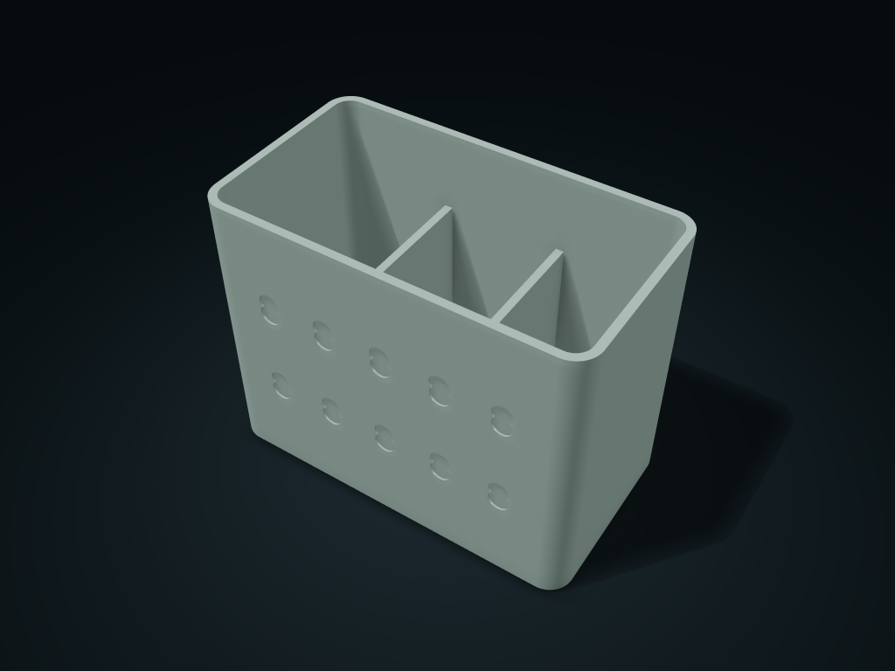](../models/peanut-cutlery-crock/) | [Peanut Pattern Chopstick & Spoon Crock](../models/peanut-cutlery-crock/) | 180 × 100 × 140 mm | 1 | [boxesmodel](https://boxesmodel.com/models/peanut-cutlery-crock) |
| [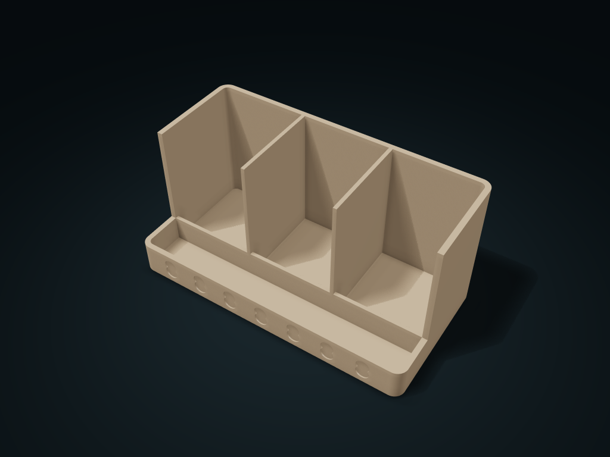](../models/peanut-remote-valet/) | [Peanut Pattern Remote Valet](../models/peanut-remote-valet/) | 210 × 108 × 100 mm | 1 | [boxesmodel](https://boxesmodel.com/models/peanut-remote-valet) |
| [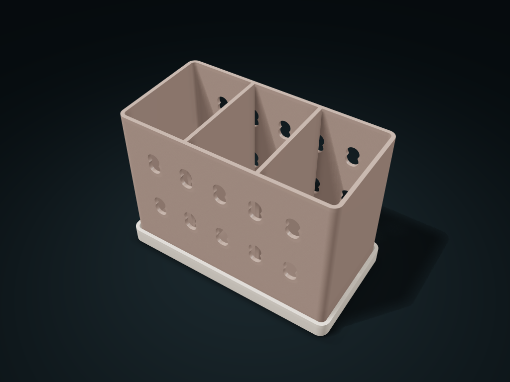](../models/peanut-brush-drain-caddy/) | [Peanut Window Toothbrush Drip Caddy](../models/peanut-brush-drain-caddy/) | 168 × 88 × 118 mm | 2 | [boxesmodel](https://boxesmodel.com/models/peanut-brush-drain-caddy) |
| [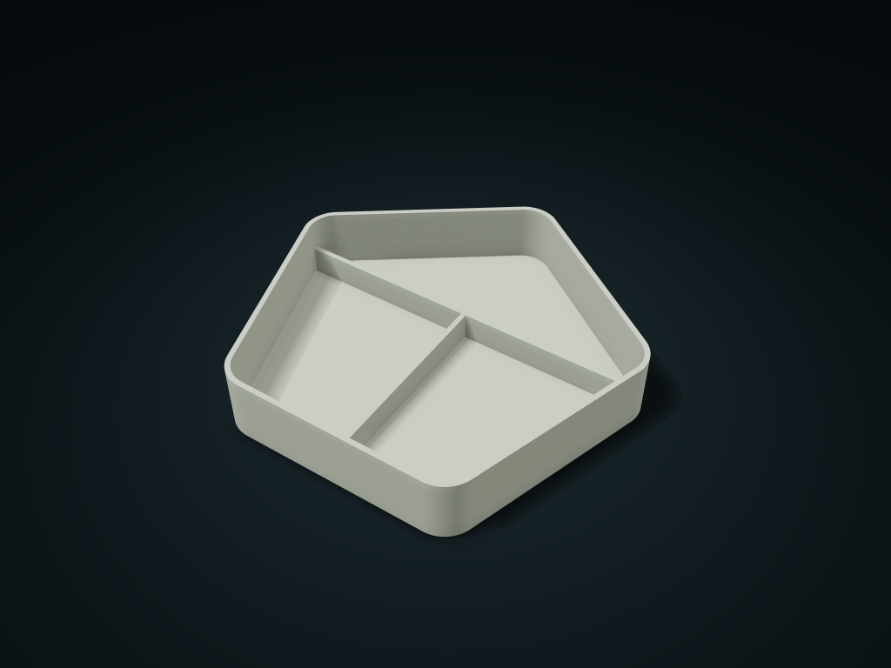](../models/pentagon-bank-valet-tray/) | [Pentagon Long-Pocket Valet Tray](../models/pentagon-bank-valet-tray/) | 200 × 191.97 × 35 mm | 1 | [boxesmodel](https://boxesmodel.com/models/pentagon-bank-valet-tray) |
|  | [Pentagon Rising-Rim Caddy](../models/pentagon-rise-caddy/) | 200 × 191.97 × 105 mm | 1 | [boxesmodel](https://boxesmodel.com/models/pentagon-rise-caddy) |
| [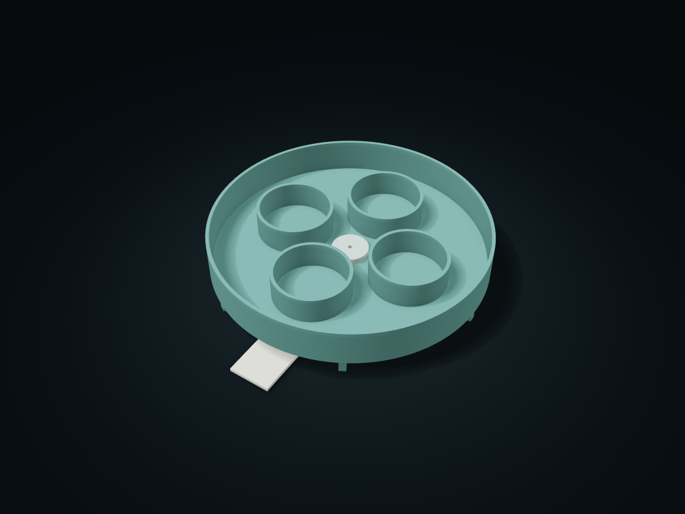](../models/peripheral-roller-bottle-carousel/) | [Perimeter Roller Jar Carousel](../models/peripheral-roller-bottle-carousel/) | 240 × 264 × 54 mm | 11 | [boxesmodel](https://boxesmodel.com/models/peripheral-roller-bottle-carousel) |
| [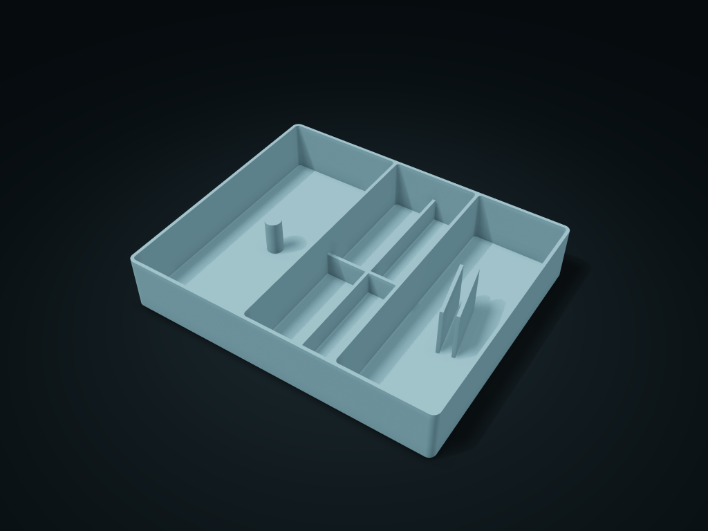](../models/pet-walk-station/) | [Pet Walk Accessory Prep Tray](../models/pet-walk-station/) | 226 × 184 × 40 mm | 1 | [boxesmodel](https://boxesmodel.com/models/pet-walk-station) |
| [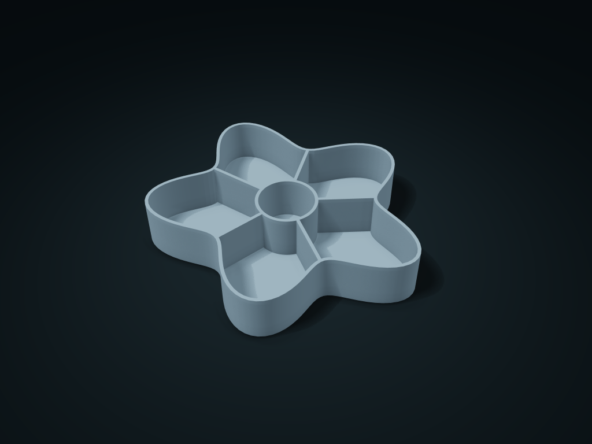](../models/petal-sorting-tray/) | [Petal Center Supply Sorting Box](../models/petal-sorting-tray/) | 190 × 180 × 35 mm | 1 | [boxesmodel](https://boxesmodel.com/models/petal-sorting-tray) |
| [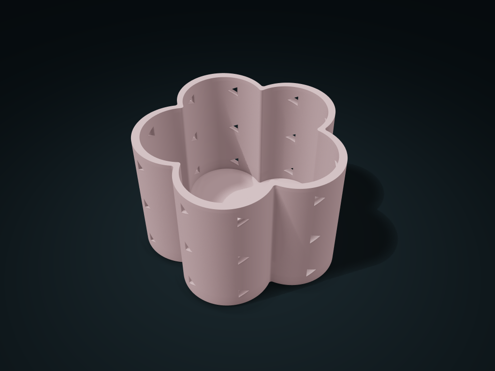](../models/petal-triangle-window-basket/) | [Petal Triangle Window Basket](../models/petal-triangle-window-basket/) | 140 × 143.88 × 95 mm | 1 | [boxesmodel](https://boxesmodel.com/models/petal-triangle-window-basket) |
| [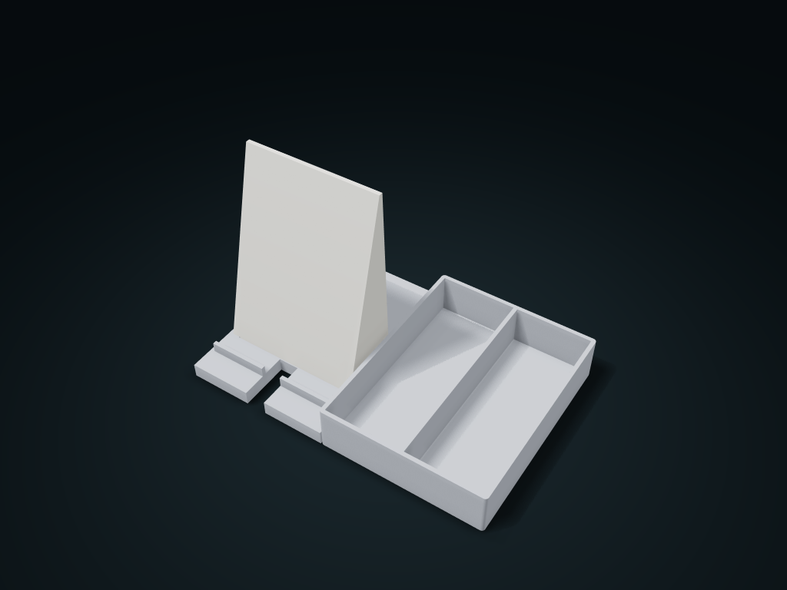](../models/phone-tray-caddy/) | [Phone Stand Organizer](../models/phone-tray-caddy/) | 180 × 120 × 120 mm | 2 | [boxesmodel](https://boxesmodel.com/models/phone-tray-caddy) |
| [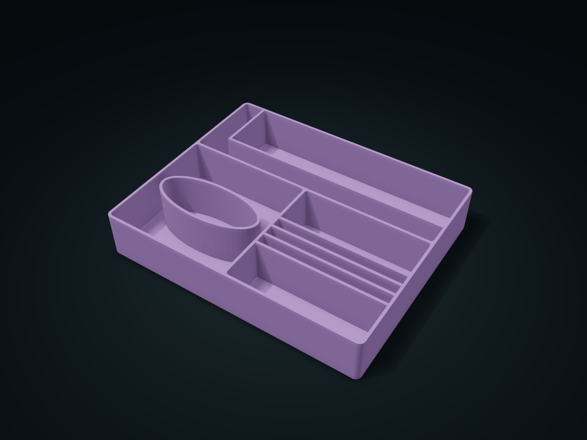](../models/phone-trip-station/) | [Phone Travel Accessory Tray](../models/phone-trip-station/) | 226 × 184 × 40 mm | 1 | [boxesmodel](https://boxesmodel.com/models/phone-trip-station) |
|  | [Piano Key Stepped Tray Lid Box](../models/piano-key-relief-case/) | 170 × 120 × 58 mm | 2 | [boxesmodel](https://boxesmodel.com/models/piano-key-relief-case) |
|  | [Picture Frame Hardware Tray](../models/picture-hanging-prep/) | 226 × 184 × 40 mm | 1 | [boxesmodel](https://boxesmodel.com/models/picture-hanging-prep) |
| [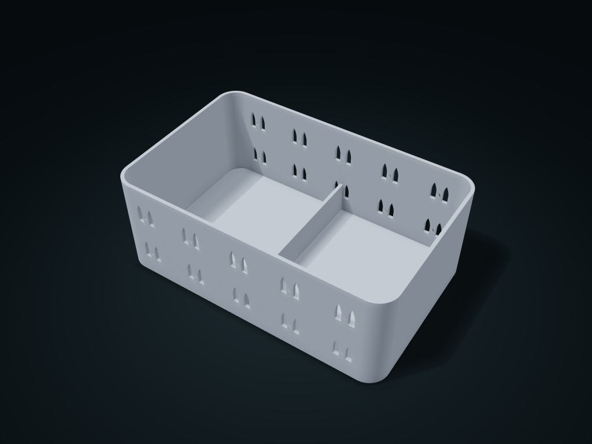](../models/pinched-lancet-window-bin/) | [Pinched Lancet Window Bin](../models/pinched-lancet-window-bin/) | 220 × 140 × 82 mm | 1 | [boxesmodel](https://boxesmodel.com/models/pinched-lancet-window-bin) |
| [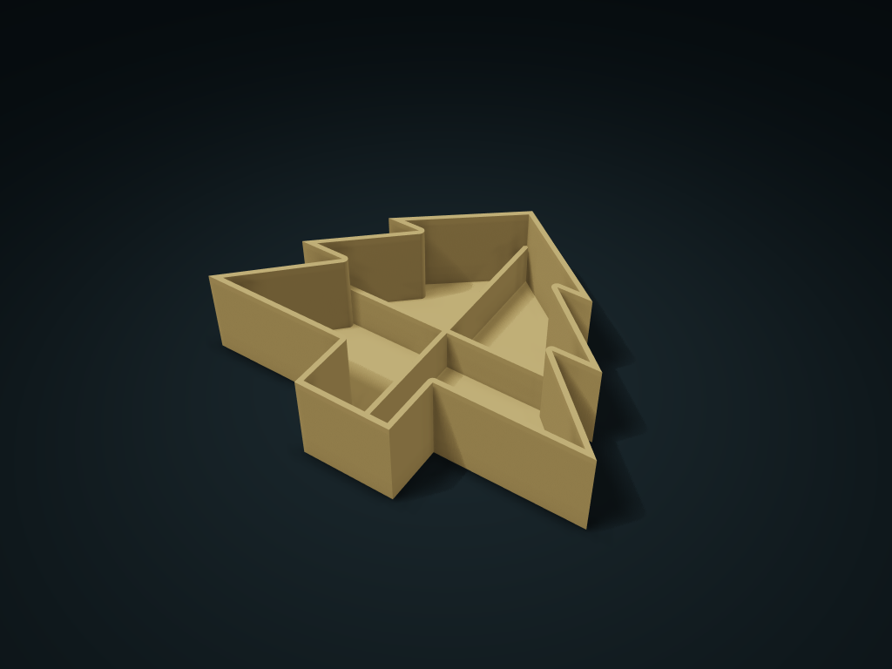](../models/pine-branch-tray/) | [Pine Branch Tiered Compartment Tray](../models/pine-branch-tray/) | 180 × 140 × 40 mm | 1 | [boxesmodel](https://boxesmodel.com/models/pine-branch-tray) |
| [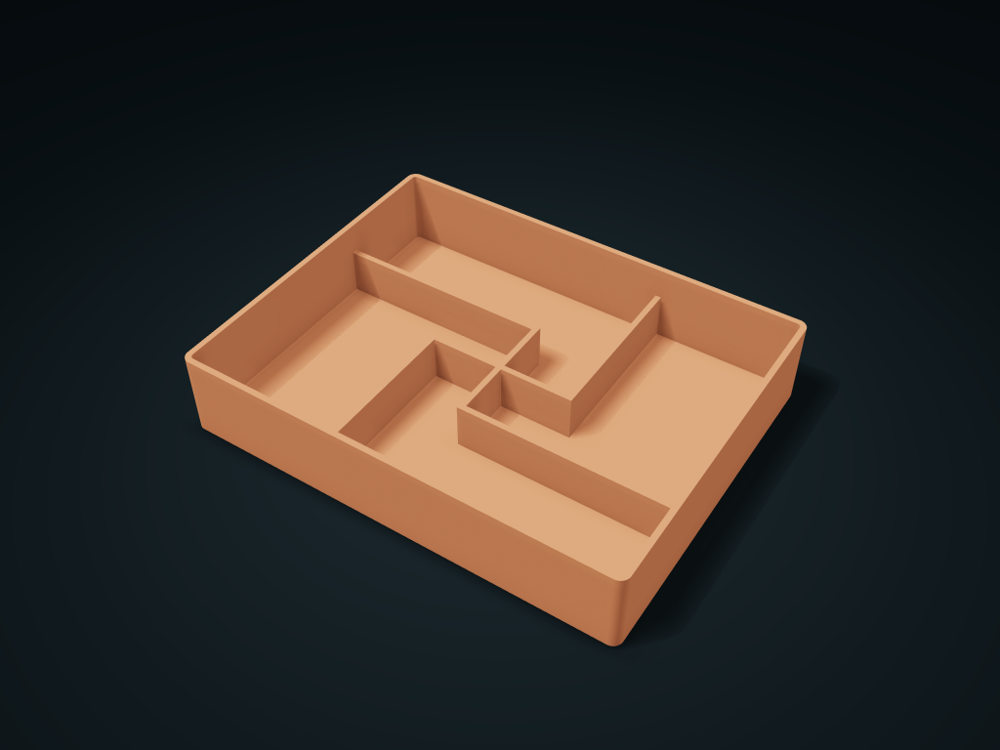](../models/pinwheel-elbow-tray/) | [Pinwheel Folded Arm Compartment Tray](../models/pinwheel-elbow-tray/) | 180 × 140 × 34 mm | 1 | [boxesmodel](https://boxesmodel.com/models/pinwheel-elbow-tray) |
| [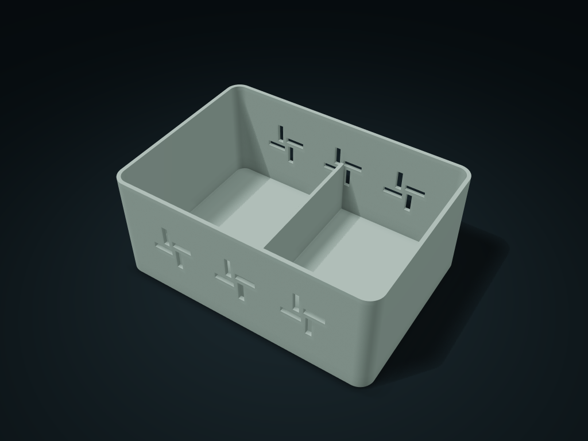](../models/pinwheel-window-desk-bin/) | [Pinwheel Window Desk Bin](../models/pinwheel-window-desk-bin/) | 180 × 126 × 76 mm | 1 | [boxesmodel](https://boxesmodel.com/models/pinwheel-window-desk-bin) |
|  | [Pivoting Bottle Cap Drying Box](../models/bottle-cap-spindle-bin/) | 180 × 120 × 45 mm | 2 | [boxesmodel](https://boxesmodel.com/models/bottle-cap-spindle-bin) |
| [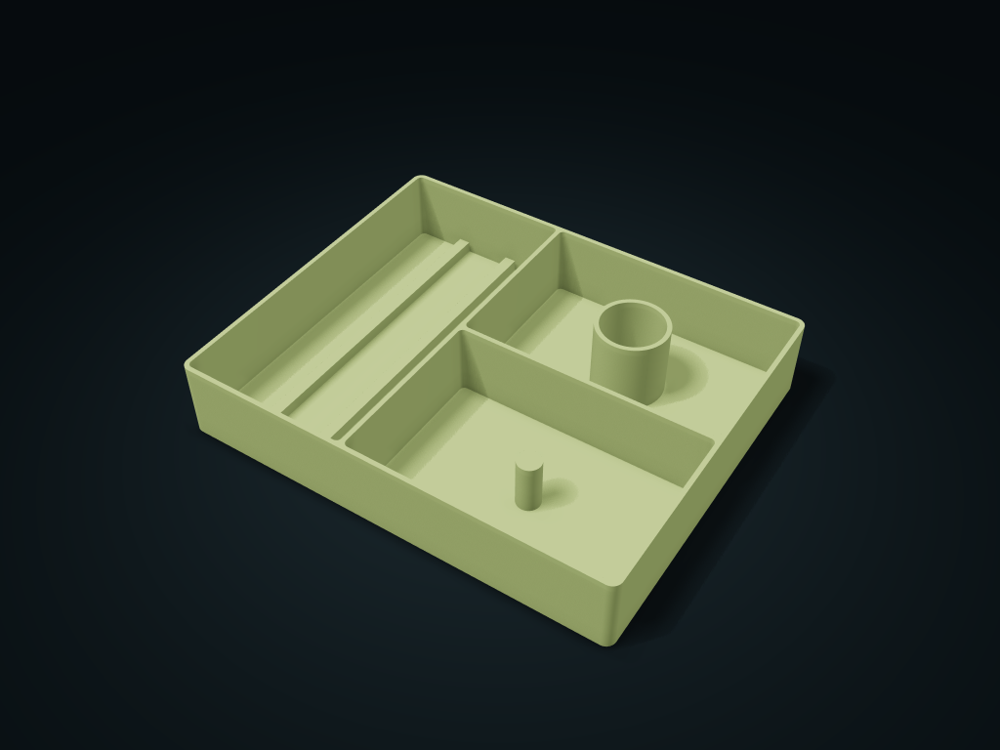](../models/player-ready-station/) | [Player Personal Items Tray](../models/player-ready-station/) | 226 × 184 × 40 mm | 1 | [boxesmodel](https://boxesmodel.com/models/player-ready-station) |
| [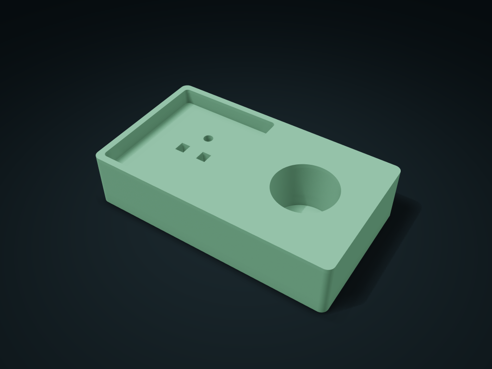](../models/plug-pin-parking-case/) | [Plug Pin Clearance Cable End Box](../models/plug-pin-parking-case/) | 175 × 100 × 40 mm | 1 | [boxesmodel](https://boxesmodel.com/models/plug-pin-parking-case) |
| [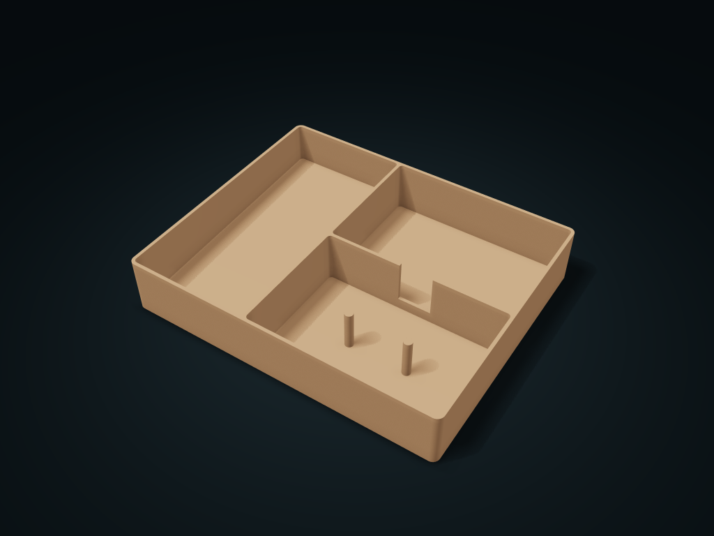](../models/door-pocket-station/) | [Pocket Items Return Tray](../models/door-pocket-station/) | 226 × 184 × 40 mm | 1 | [boxesmodel](https://boxesmodel.com/models/door-pocket-station) |
| [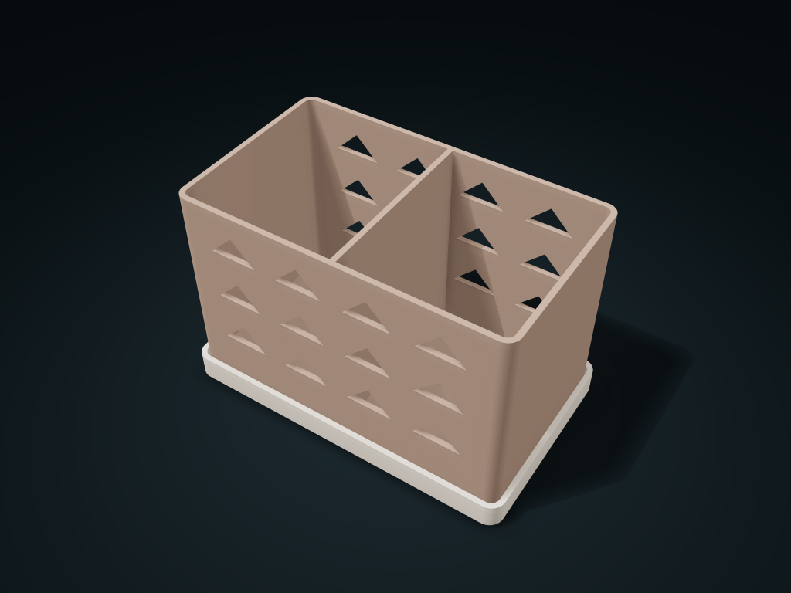](../models/spear-window-bath-caddy/) | [Pointed-Arch Triangle Window Bathroom Basket](../models/spear-window-bath-caddy/) | 160 × 96 × 104 mm | 2 | [boxesmodel](https://boxesmodel.com/models/spear-window-bath-caddy) |

[← Previous](desktop-organizers-6.md) · [1](desktop-organizers.md) · [2](desktop-organizers-2.md) · [3](desktop-organizers-3.md) · [4](desktop-organizers-4.md) · [5](desktop-organizers-5.md) · [6](desktop-organizers-6.md) · **7** · [8](desktop-organizers-8.md) · [9](desktop-organizers-9.md) · [10](desktop-organizers-10.md) · [11](desktop-organizers-11.md) · [Next →](desktop-organizers-8.md)
