# Desktop Organizers

**Page 9 of 11** · Models 401–450 of 544

Click a thumbnail or model name to open its files and guide. Use **Preview & customize** to open the interactive model on boxesmodel.

[All models](../CATALOG.md) · [Collection overview](../README.md)

[← Previous](desktop-organizers-8.md) · [1](desktop-organizers.md) · [2](desktop-organizers-2.md) · [3](desktop-organizers-3.md) · [4](desktop-organizers-4.md) · [5](desktop-organizers-5.md) · [6](desktop-organizers-6.md) · [7](desktop-organizers-7.md) · [8](desktop-organizers-8.md) · **9** · [10](desktop-organizers-10.md) · [11](desktop-organizers-11.md) · [Next →](desktop-organizers-10.md)

| Thumbnail | Model | Default dimensions | Parts | Preview & customize |
| --- | --- | --- | ---: | --- |
| [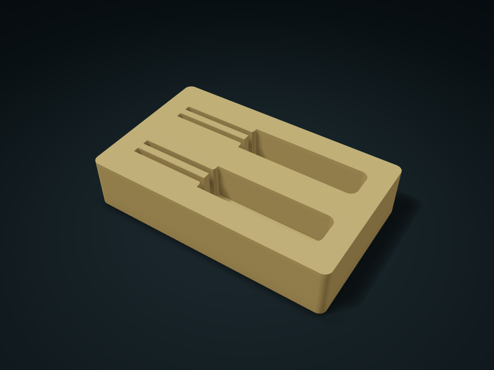](../models/seam-ripper-fork-bed/) | [Seam Ripper Twin-Tip Relief Box](../models/seam-ripper-fork-bed/) | 165 × 100 × 35 mm | 1 | [boxesmodel](https://boxesmodel.com/models/seam-ripper-fork-bed) |
| [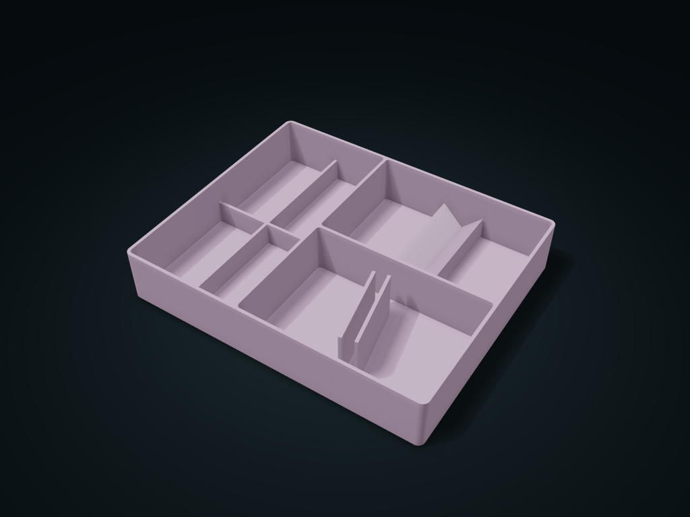](../models/fabric-clips-station/) | [Sewing Clip & Marker Tray](../models/fabric-clips-station/) | 226 × 184 × 40 mm | 1 | [boxesmodel](https://boxesmodel.com/models/fabric-clips-station) |
|  | [Shared-Lid Twin Resource Trays](../models/shared-cap-resource-pair/) | 184 × 128 × 30 mm | 3 | [boxesmodel](https://boxesmodel.com/models/shared-cap-resource-pair) |
| [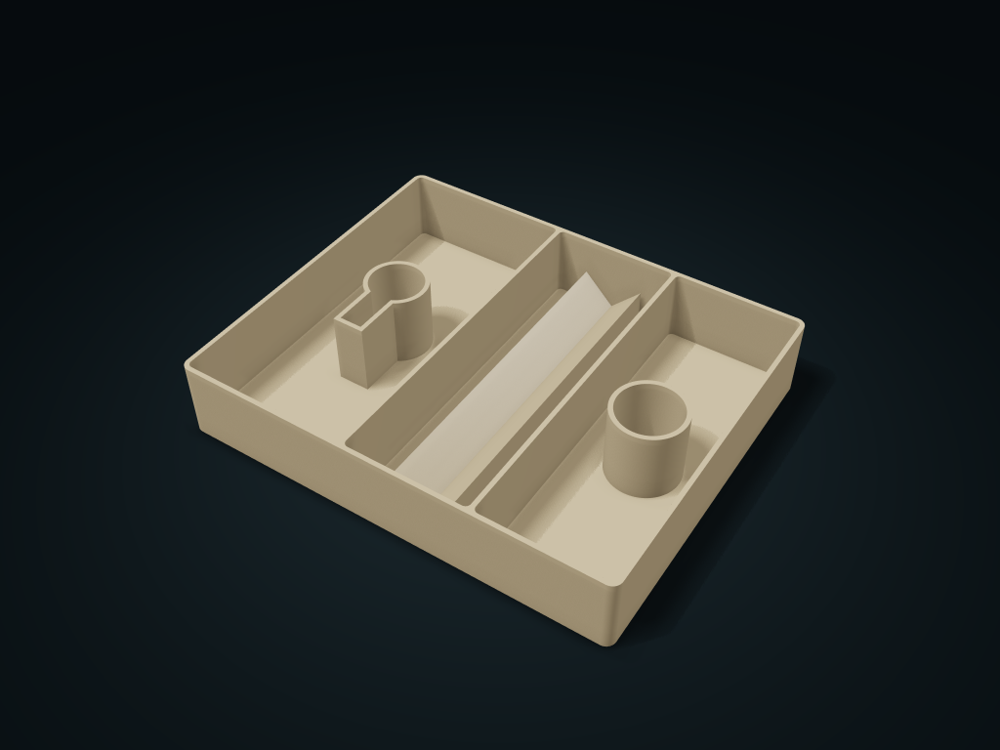](../models/razor-accessory-station/) | [Shaving Accessories Return Tray](../models/razor-accessory-station/) | 226 × 184 × 40 mm | 1 | [boxesmodel](https://boxesmodel.com/models/razor-accessory-station) |
| [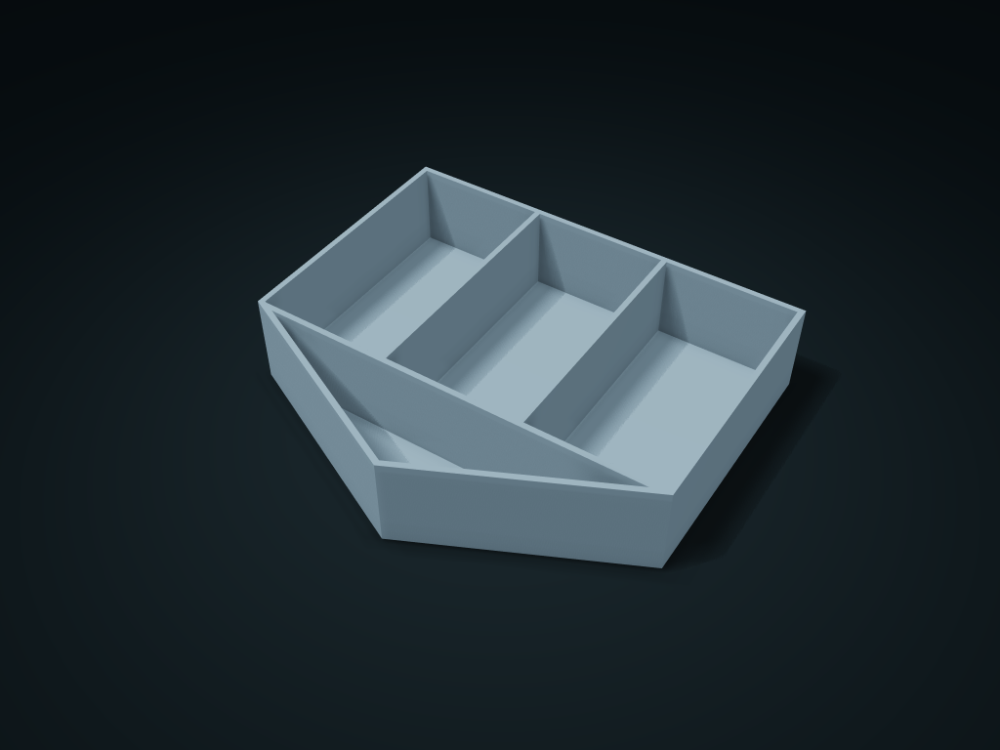](../models/shield-token-tray/) | [Shield Token Sorting Box](../models/shield-token-tray/) | 175 × 150 × 38 mm | 1 | [boxesmodel](https://boxesmodel.com/models/shield-token-tray) |
| [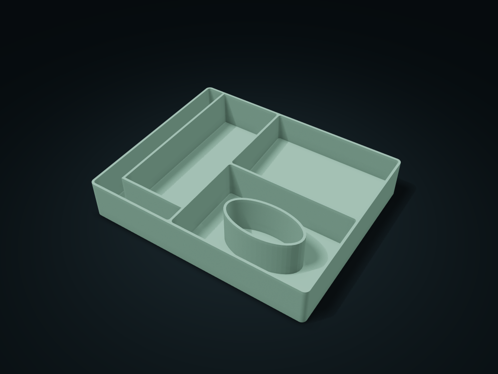](../models/collar-stay-station/) | [Shirt Accessory Return Box](../models/collar-stay-station/) | 226 × 184 × 40 mm | 1 | [boxesmodel](https://boxesmodel.com/models/collar-stay-station) |
| [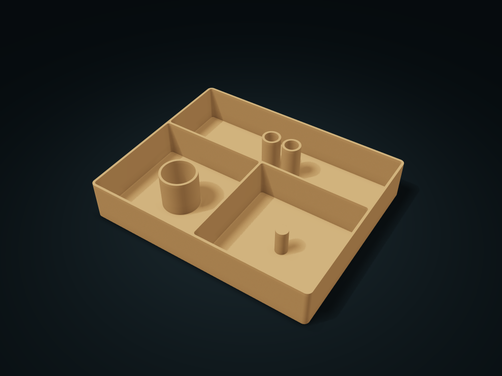](../models/shoe-care-station/) | [Shoe Care Dry Zone Tray](../models/shoe-care-station/) | 226 × 184 × 40 mm | 1 | [boxesmodel](https://boxesmodel.com/models/shoe-care-station) |
| [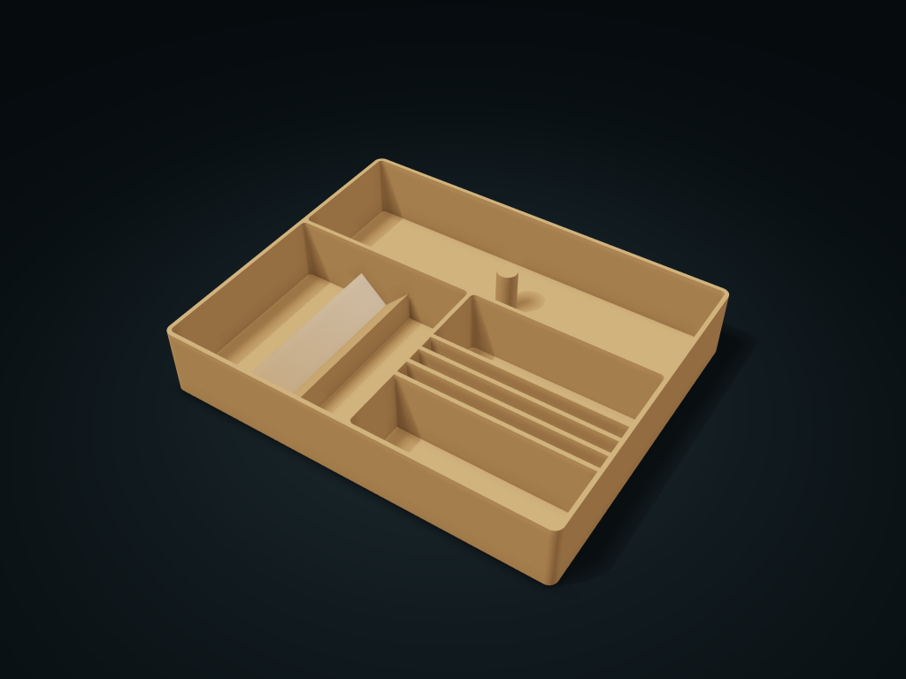](../models/audio-patch-station/) | [Short Audio Cable Organizer](../models/audio-patch-station/) | 226 × 184 × 40 mm | 1 | [boxesmodel](https://boxesmodel.com/models/audio-patch-station) |
| [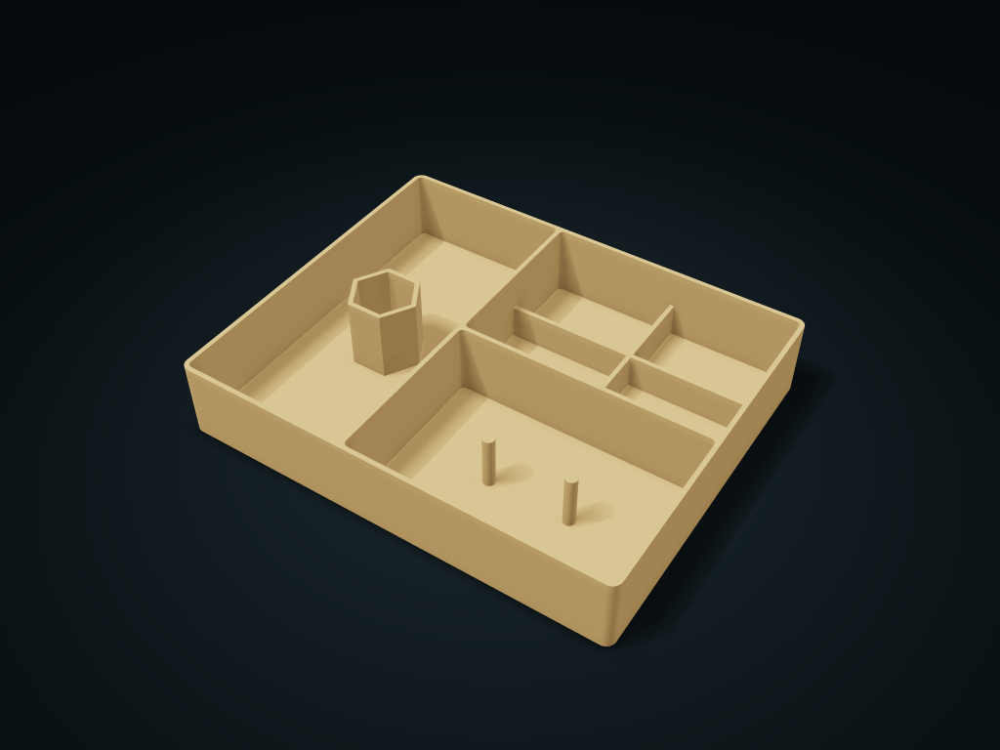](../models/small-driver-station/) | [Short Bit Repair Supply Tray](../models/small-driver-station/) | 226 × 184 × 40 mm | 1 | [boxesmodel](https://boxesmodel.com/models/small-driver-station) |
| [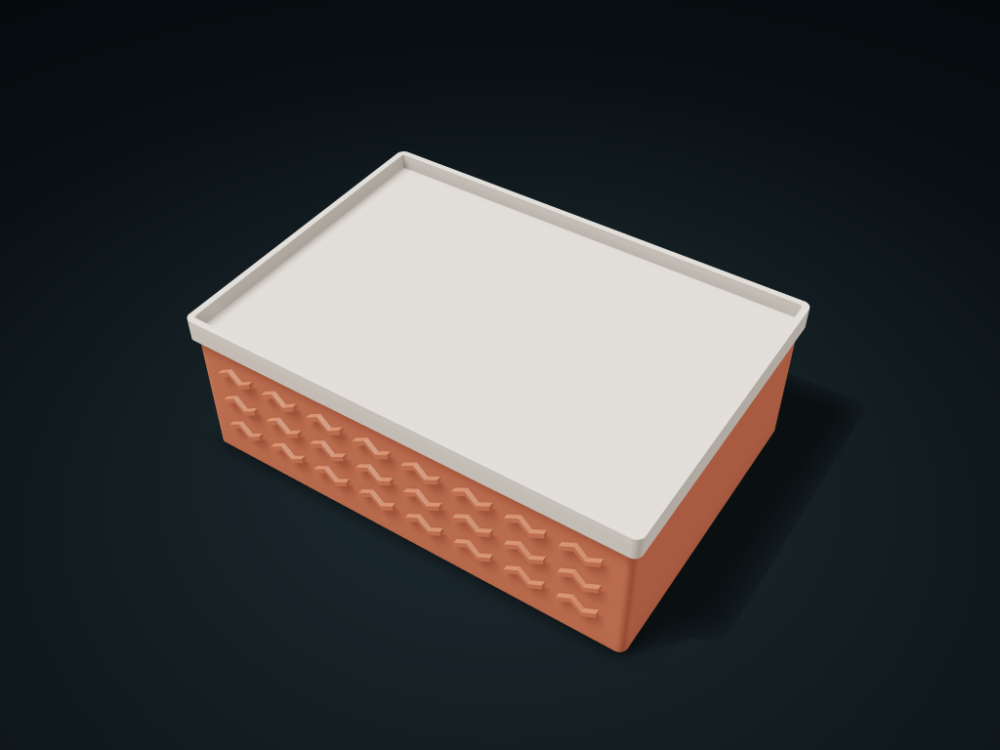](../models/wavelet-rib-case/) | [Short Wave Segmented Tray Lid Box](../models/wavelet-rib-case/) | 170 × 120 × 58 mm | 2 | [boxesmodel](https://boxesmodel.com/models/wavelet-rib-case) |
|  | [Shoulder-Hung Upper Divided Box](../models/shoulder-hung-bin/) | 180 × 112 × 45 mm | 1 | [boxesmodel](https://boxesmodel.com/models/shoulder-hung-bin) |
| [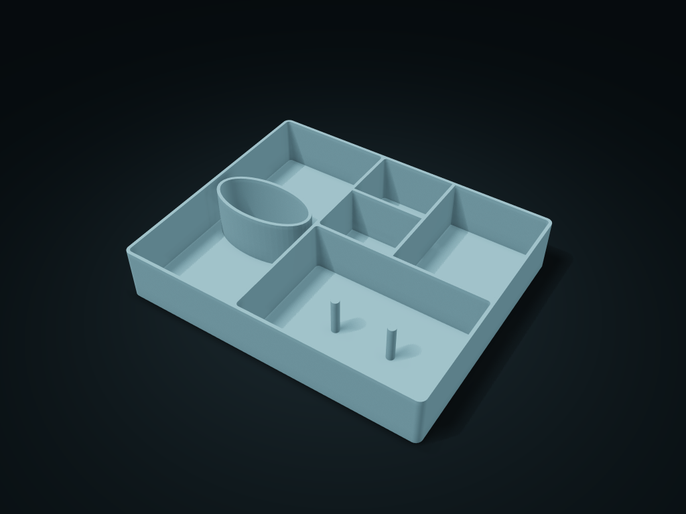](../models/shower-cap-station/) | [Shower Cap & Hair Tie Dry Zone Box](../models/shower-cap-station/) | 226 × 184 × 40 mm | 1 | [boxesmodel](https://boxesmodel.com/models/shower-cap-station) |
| [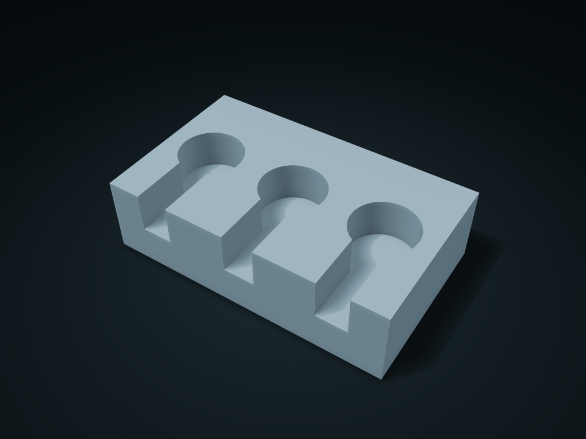](../models/measuring-cup-open-cradle/) | [Side-Access Measuring Cup Arc Bay Box](../models/measuring-cup-open-cradle/) | 200 × 120 × 55 mm | 1 | [boxesmodel](https://boxesmodel.com/models/measuring-cup-open-cradle) |
|  | [Side-Insert Label Divided Box](../models/nameplate-slide-bin/) | 180 × 125 × 65 mm | 2 | [boxesmodel](https://boxesmodel.com/models/nameplate-slide-bin) |
| [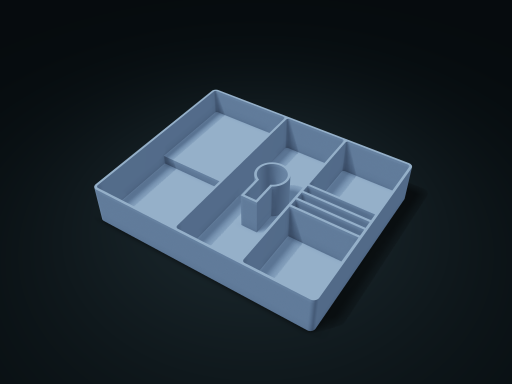](../models/sim-service-station/) | [SIM Tray Service Accessory Box](../models/sim-service-station/) | 226 × 184 × 40 mm | 1 | [boxesmodel](https://boxesmodel.com/models/sim-service-station) |
| [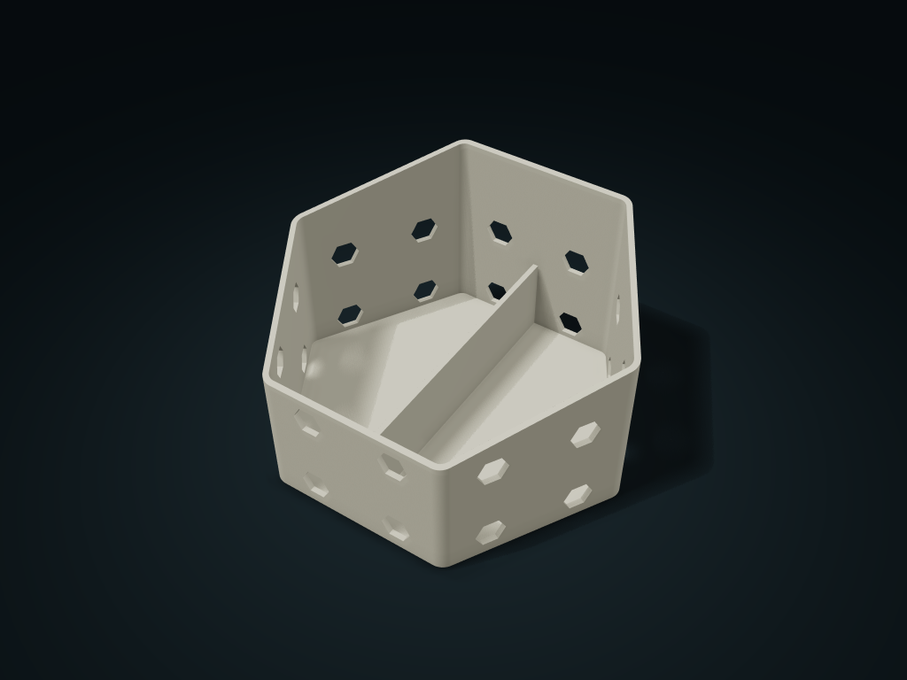](../models/slant-hex-window-basket/) | [Slant Hex Window Basket](../models/slant-hex-window-basket/) | 180 × 158.03 × 100 mm | 1 | [boxesmodel](https://boxesmodel.com/models/slant-hex-window-basket) |
| [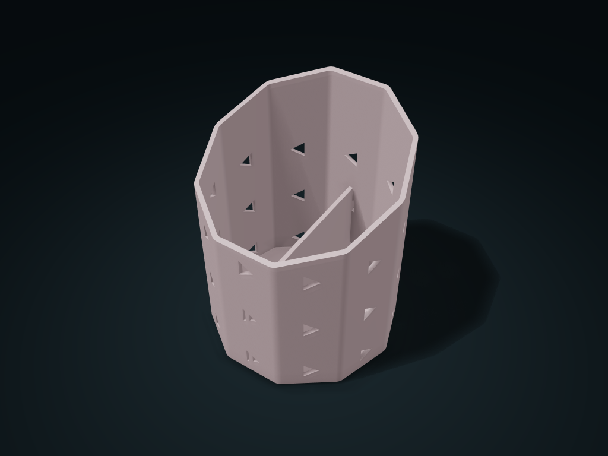](../models/slant-ten-triangle-cup/) | [Slant Ten Facet Triangle Cup](../models/slant-ten-triangle-cup/) | 120 × 114.91 × 145 mm | 1 | [boxesmodel](https://boxesmodel.com/models/slant-ten-triangle-cup) |
|  | [Sliding Stop Draw & Discard Card Shoe](../models/shift-divider-card-shoe/) | 86 × 160 × 65 mm | 2 | [boxesmodel](https://boxesmodel.com/models/shift-divider-card-shoe) |
| [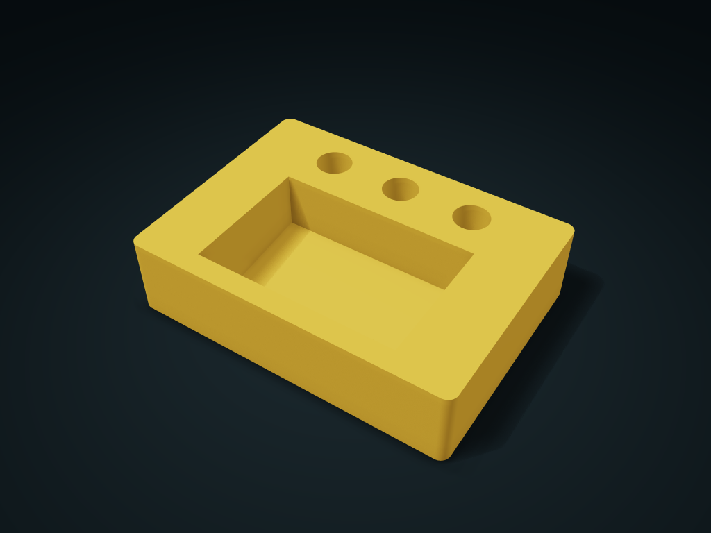](../models/calculator-tilt-bin/) | [Sloped Floor Calculator Stationery Box](../models/calculator-tilt-bin/) | 165 × 120 × 40 mm | 1 | [boxesmodel](https://boxesmodel.com/models/calculator-tilt-bin) |
| [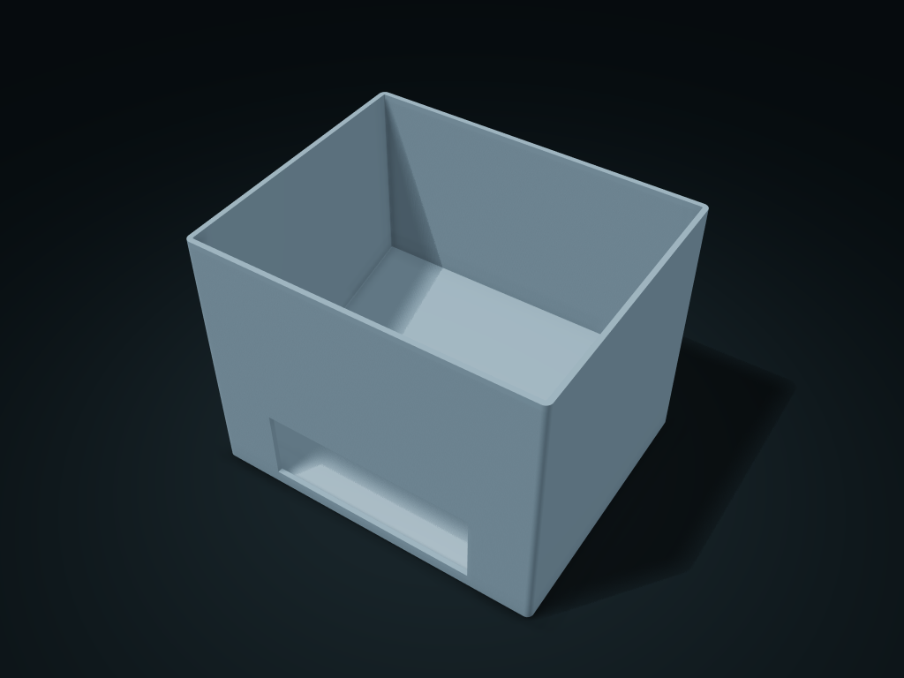](../models/packet-gravity-bin/) | [Sloped Floor Sachet Supply Box](../models/packet-gravity-bin/) | 160 × 130 × 125 mm | 1 | [boxesmodel](https://boxesmodel.com/models/packet-gravity-bin) |
| [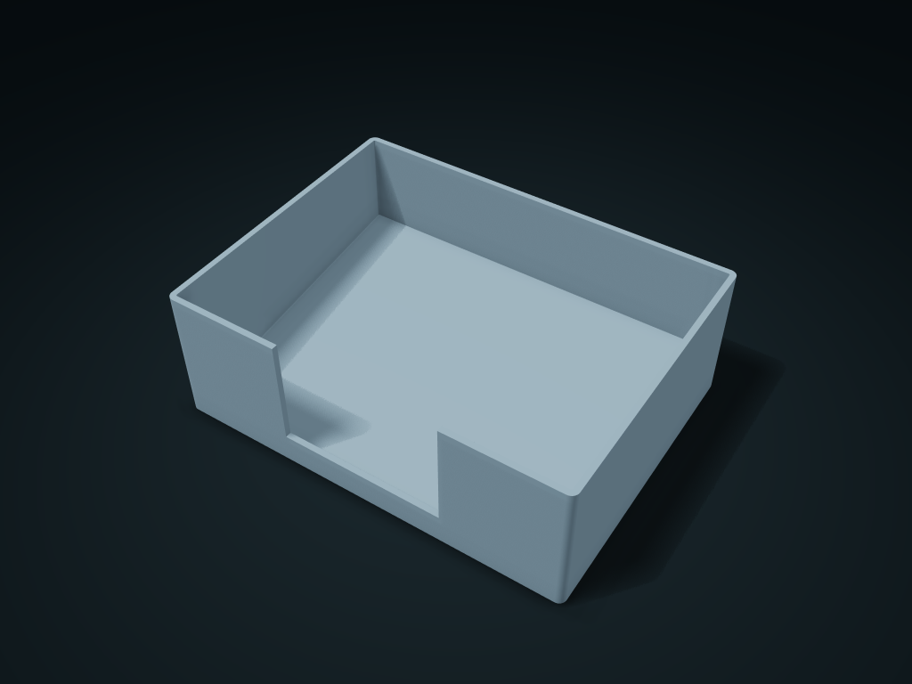](../models/paper-reveal-wedge-box/) | [Sloped Floor Sticky Note Dispenser](../models/paper-reveal-wedge-box/) | 160 × 120 × 55 mm | 1 | [boxesmodel](https://boxesmodel.com/models/paper-reveal-wedge-box) |
| [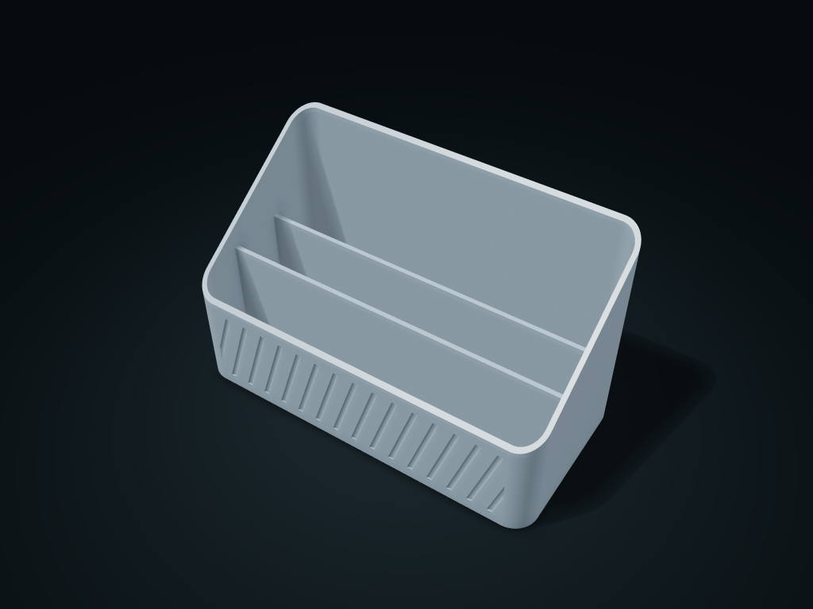](../models/slant-reed-letter-bin/) | [Sloping Fluted Letter Bin](../models/slant-reed-letter-bin/) | 210 × 105 × 130 mm | 1 | [boxesmodel](https://boxesmodel.com/models/slant-reed-letter-bin) |
| [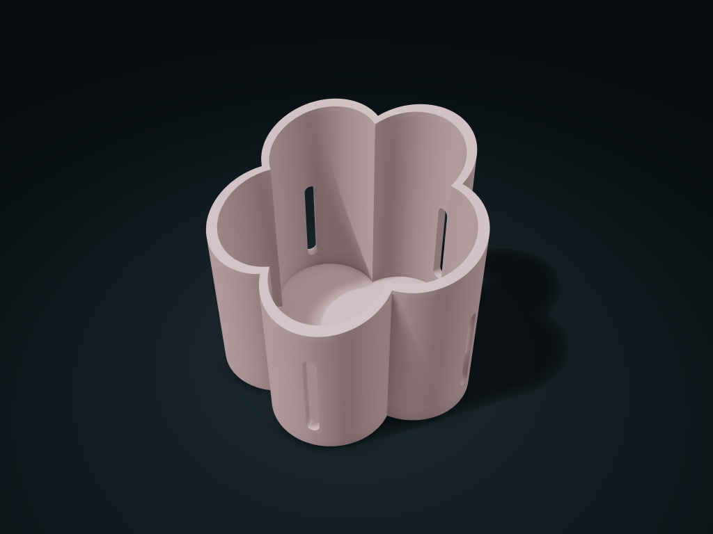](../models/petal-oval-window-cup/) | [Sloping Oval Window Petal Cup](../models/petal-oval-window-cup/) | 136 × 139.66 × 125 mm | 1 | [boxesmodel](https://boxesmodel.com/models/petal-oval-window-cup) |
|  | [Slot-In Divider Box](../models/divider-box/) | 220 × 140 × 75 mm | 4 | [boxesmodel](https://boxesmodel.com/models/divider-box) |
| [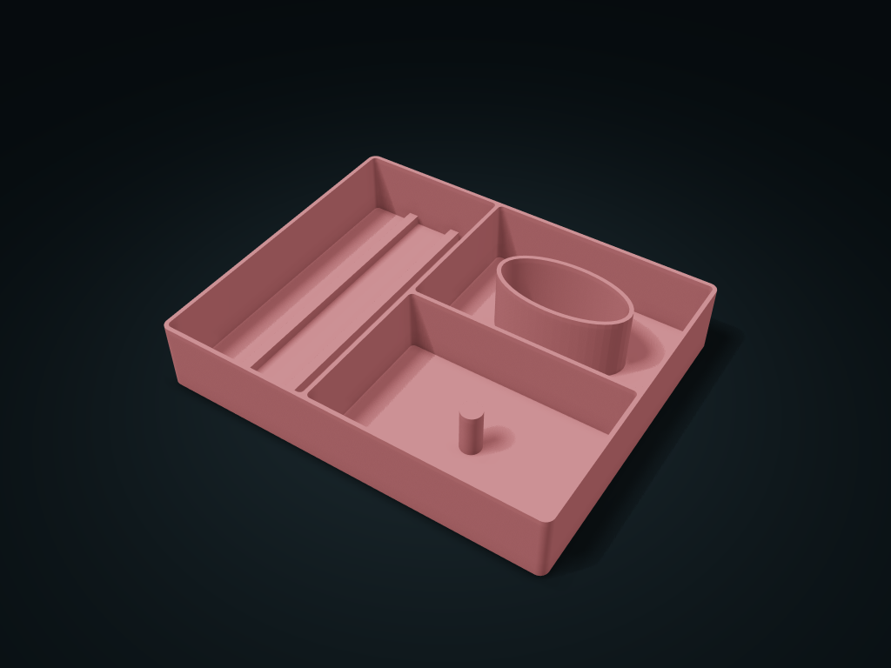](../models/powerbank-pack-station/) | [Small Power Supply Travel Prep Tray](../models/powerbank-pack-station/) | 226 × 184 × 40 mm | 1 | [boxesmodel](https://boxesmodel.com/models/powerbank-pack-station) |
|  | [SMD Component Tape Strip Cassette](../models/component-tape-cassette/) | 190 × 140 × 24 mm | 1 | [boxesmodel](https://boxesmodel.com/models/component-tape-cassette) |
| [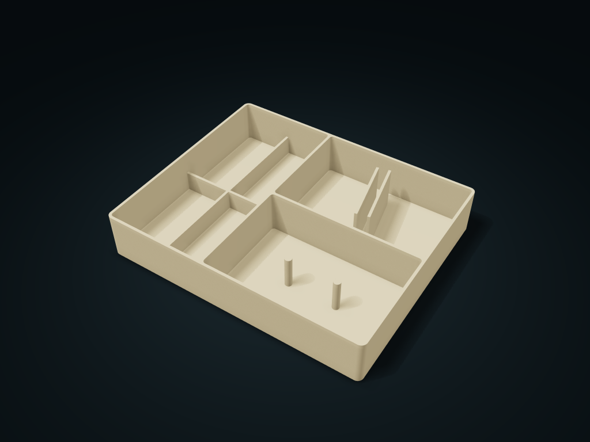](../models/snack-seal-station/) | [Snack Bag Sealing Accessory Box](../models/snack-seal-station/) | 226 × 184 × 40 mm | 1 | [boxesmodel](https://boxesmodel.com/models/snack-seal-station) |
|  | [Soap Case Travel Prep Tray](../models/soap-travel-prep/) | 226 × 184 × 40 mm | 1 | [boxesmodel](https://boxesmodel.com/models/soap-travel-prep) |
|  | [Socket Riser Compartment Box](../models/riser-sleeve-bin/) | 180 × 125 × 110 mm | 2 | [boxesmodel](https://boxesmodel.com/models/riser-sleeve-bin) |
| [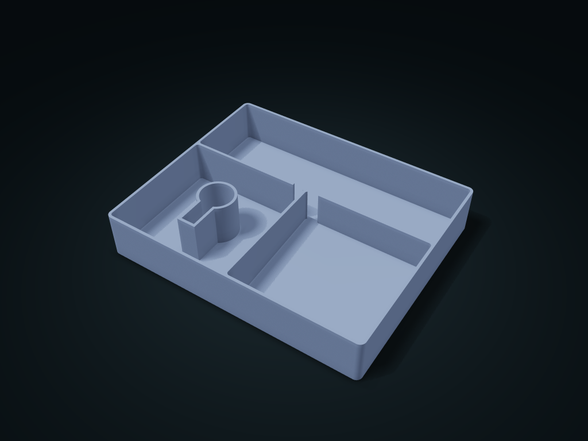](../models/sofa-pocket-station/) | [Sofa-Side Pocket Items Tray](../models/sofa-pocket-station/) | 226 × 184 × 40 mm | 1 | [boxesmodel](https://boxesmodel.com/models/sofa-pocket-station) |
| [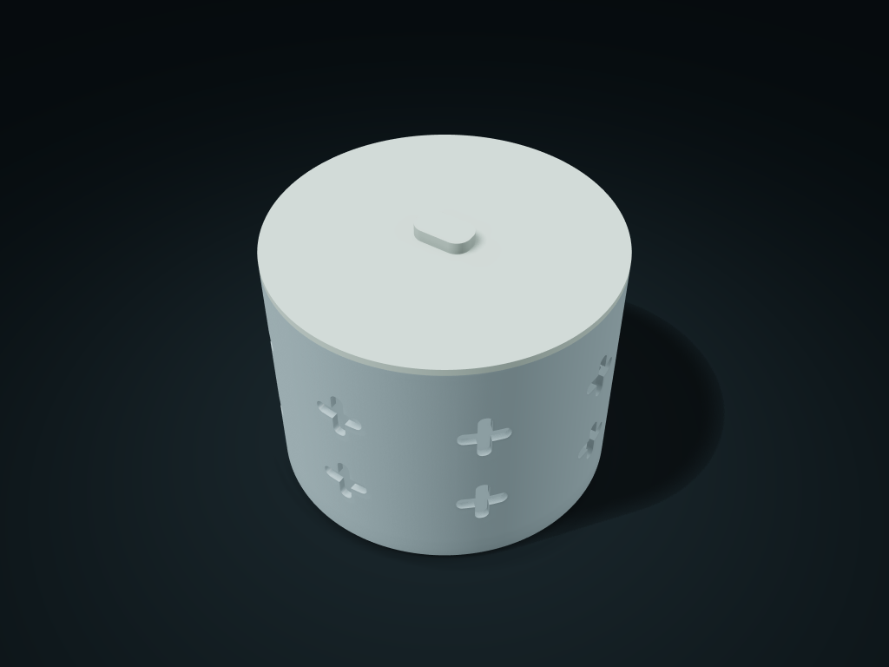](../models/softcross-lift-canister/) | [Soft Cross Compartment Lift-Off Canister](../models/softcross-lift-canister/) | 140 × 140 × 110 mm | 2 | [boxesmodel](https://boxesmodel.com/models/softcross-lift-canister) |
| [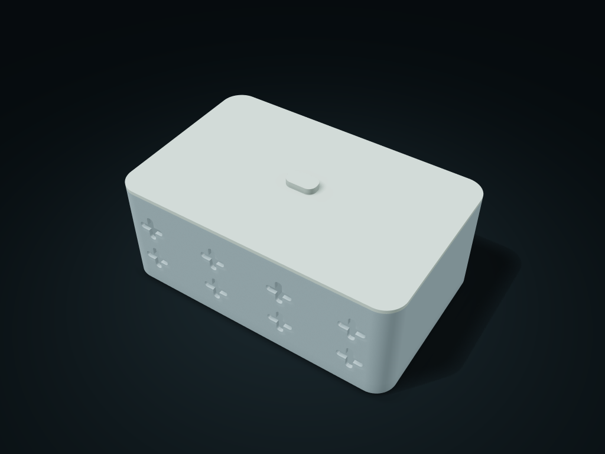](../models/softcross-lift-chest/) | [Soft Cross Lift-Off Compartment Chest](../models/softcross-lift-chest/) | 220 × 140 × 90 mm | 2 | [boxesmodel](https://boxesmodel.com/models/softcross-lift-chest) |
| [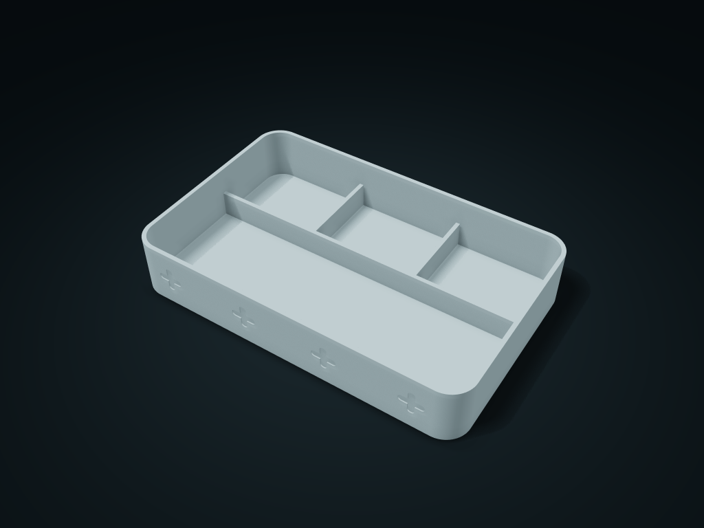](../models/softcross-valet-tray/) | [Soft Cross Long-and-Small Item Valet Tray](../models/softcross-valet-tray/) | 220 × 140 × 38 mm | 1 | [boxesmodel](https://boxesmodel.com/models/softcross-valet-tray) |
| [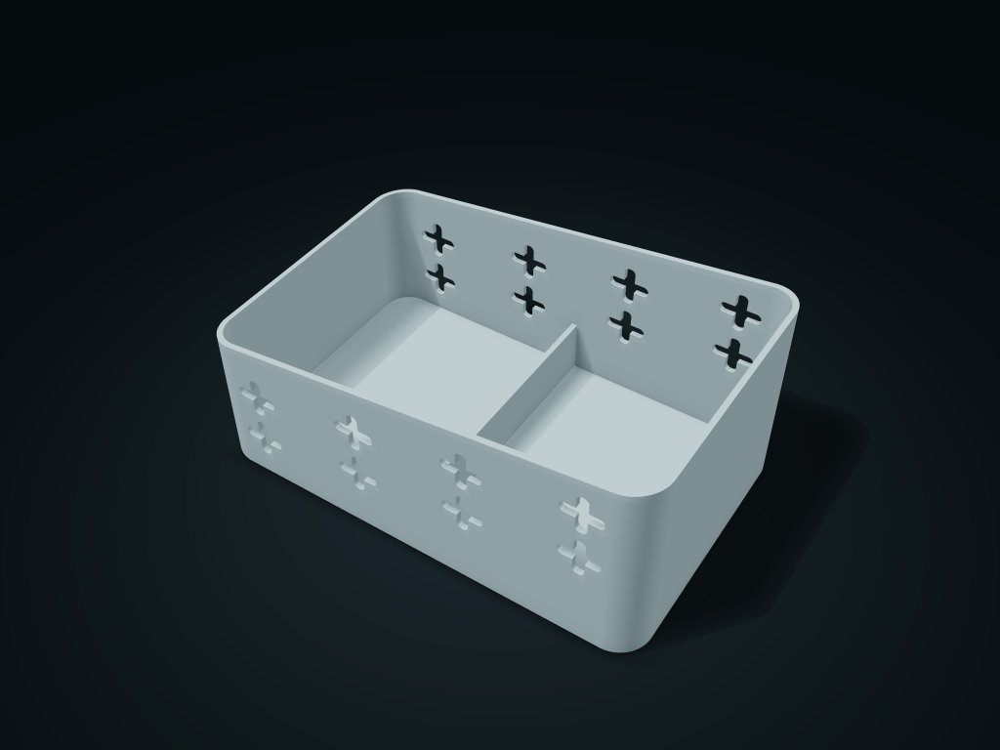](../models/softcross-slope-bin/) | [Soft Cross Sloping Rim Sorting Bin](../models/softcross-slope-bin/) | 220 × 140 × 98 mm | 1 | [boxesmodel](https://boxesmodel.com/models/softcross-slope-bin) |
| [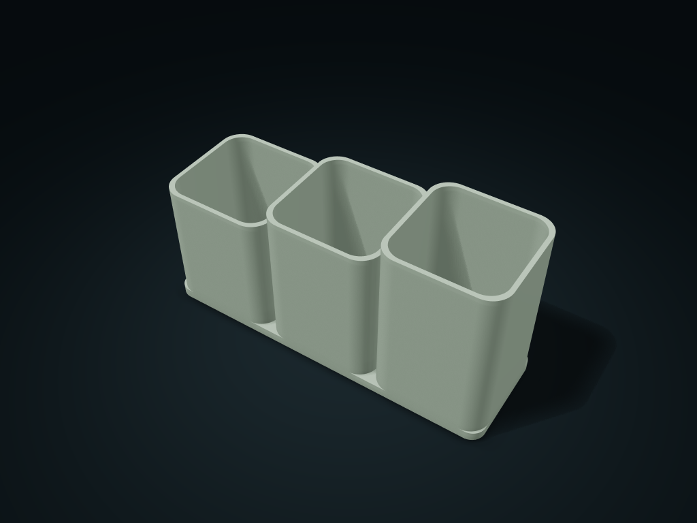](../models/softsquare-tiered-brush-cups/) | [Soft-Square Tiered Brush Cups](../models/softsquare-tiered-brush-cups/) | 218 × 72 × 110 mm | 1 | [boxesmodel](https://boxesmodel.com/models/softsquare-tiered-brush-cups) |
|  | [Speaking Practice Accessory Box](../models/language-practice-station/) | 226 × 184 × 40 mm | 1 | [boxesmodel](https://boxesmodel.com/models/language-practice-station) |
| [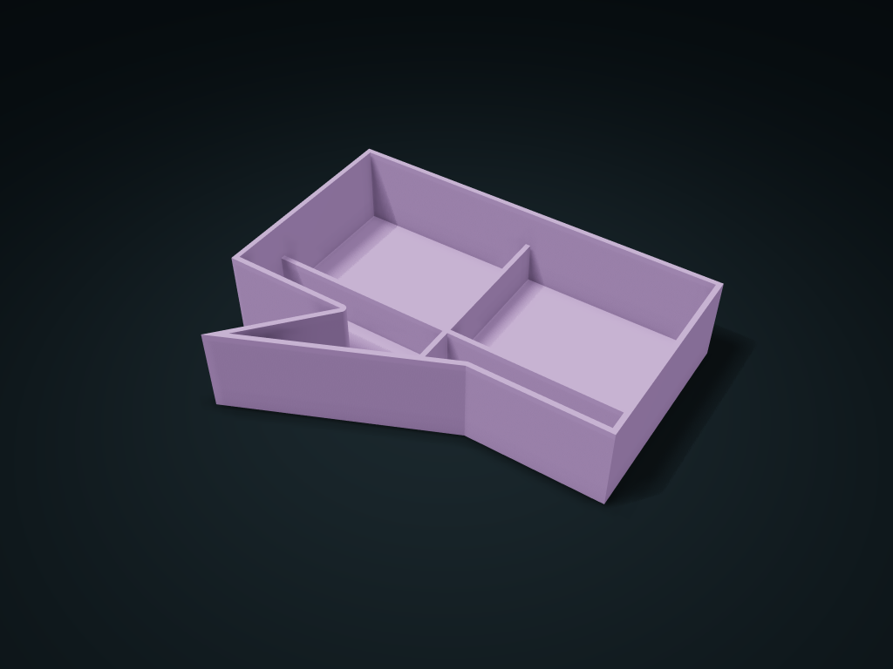](../models/speech-tail-tray/) | [Speech Bubble Tail Compartment Tray](../models/speech-tail-tray/) | 180 × 140 × 40 mm | 1 | [boxesmodel](https://boxesmodel.com/models/speech-tail-tray) |
| [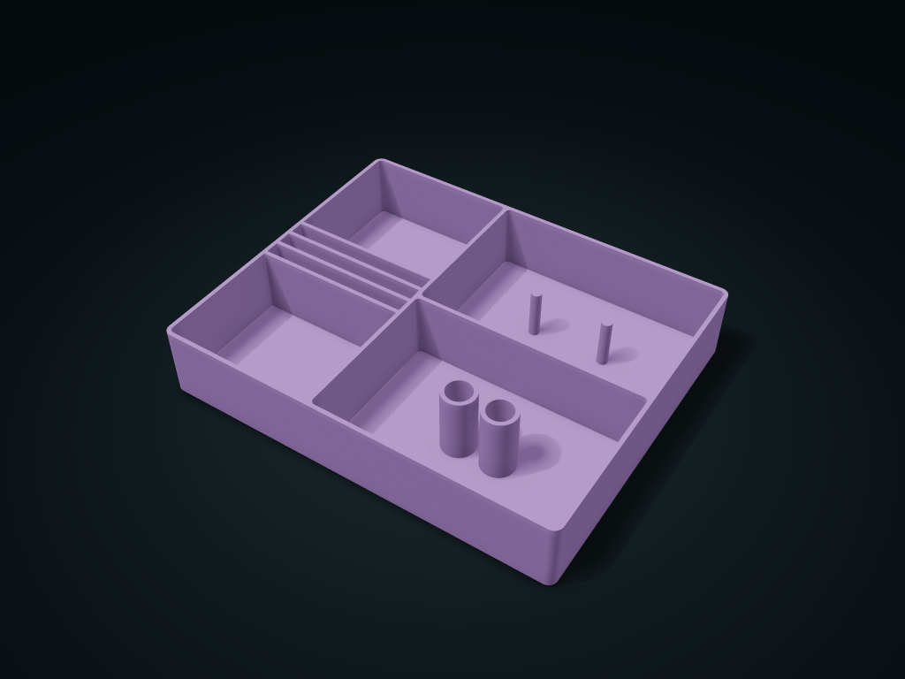](../models/spice-label-station/) | [Spice Label Organizer](../models/spice-label-station/) | 226 × 184 × 40 mm | 1 | [boxesmodel](https://boxesmodel.com/models/spice-label-station) |
|  | [Spiral Cable Guide Tray](../models/spiral-cable-tray/) | 190 × 180 × 35 mm | 1 | [boxesmodel](https://boxesmodel.com/models/spiral-cable-tray) |
| [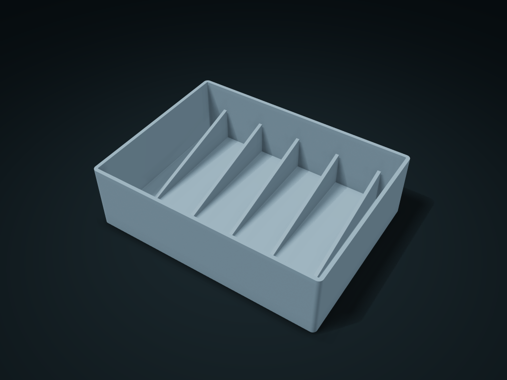](../models/sponge-slope-basin/) | [Sponge Angled Rib Draining Box](../models/sponge-slope-basin/) | 155 × 115 × 45 mm | 1 | [boxesmodel](https://boxesmodel.com/models/sponge-slope-basin) |
|  | [Spool Locating Box](../models/sewing-bobbin-case/) | 210 × 160 × 50 mm | 1 | [boxesmodel](https://boxesmodel.com/models/sewing-bobbin-case) |
|  | [Spouted Bead Cup Tray](../models/bead-funnel-cups/) | 210 × 140 × 55 mm | 7 | [boxesmodel](https://boxesmodel.com/models/bead-funnel-cups) |
|  | [Spring Plier Handle Limit Box](../models/spring-plier-rack/) | 129 × 97.6 × 55 mm | 1 | [boxesmodel](https://boxesmodel.com/models/spring-plier-rack) |
| [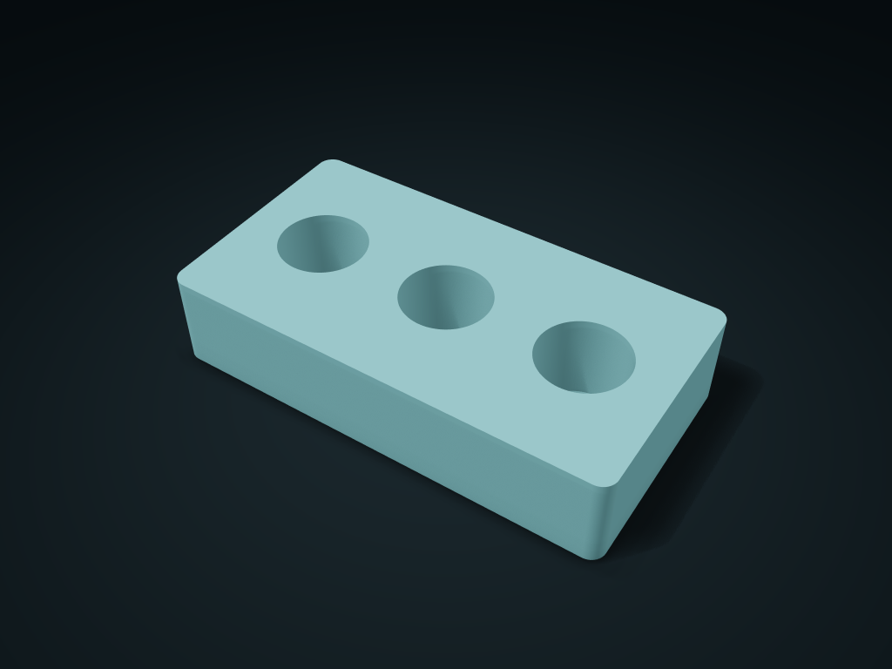](../models/spring-annulus-tray/) | [Spring Ring Well Rest Box](../models/spring-annulus-tray/) | 180 × 95 × 38 mm | 1 | [boxesmodel](https://boxesmodel.com/models/spring-annulus-tray) |
| [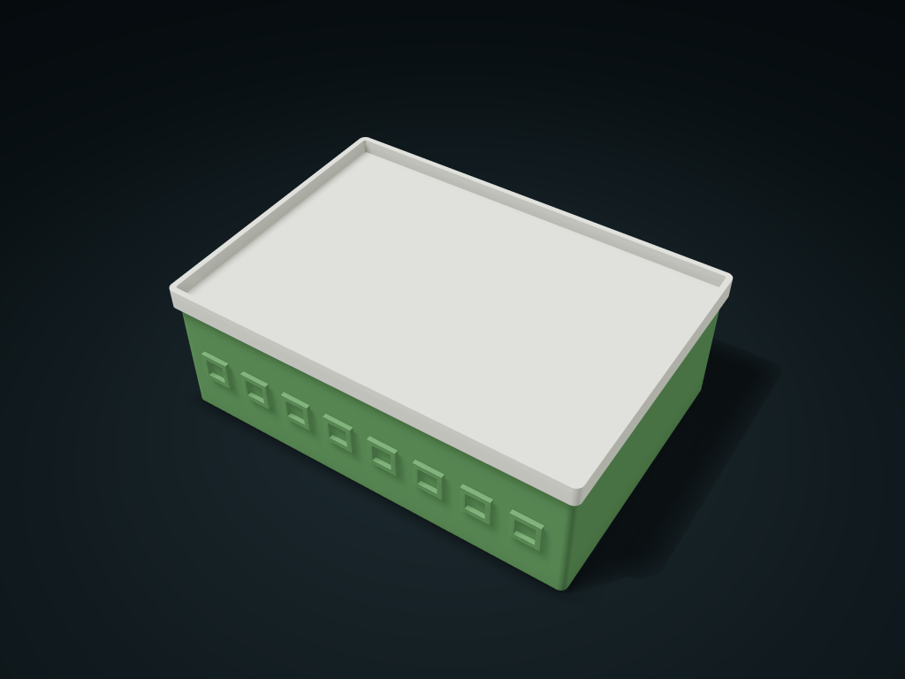](../models/square-frame-relief-case/) | [Square Fret Pattern Tray Lid Box](../models/square-frame-relief-case/) | 170 × 120 × 58 mm | 2 | [boxesmodel](https://boxesmodel.com/models/square-frame-relief-case) |
| [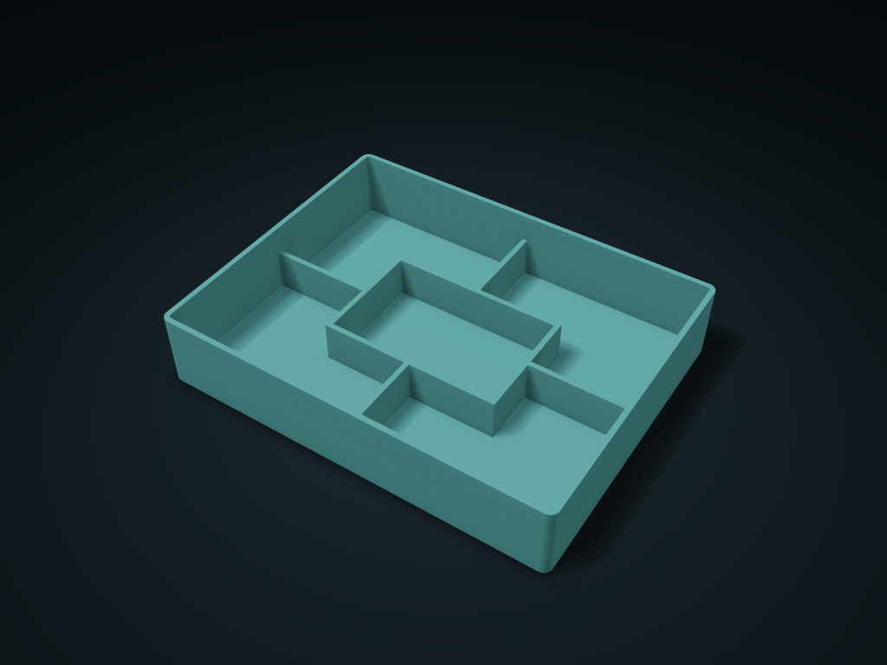](../models/square-moat-sorting-tray/) | [Square Ring Main Compartment Perimeter Tray](../models/square-moat-sorting-tray/) | 180 × 140 × 34 mm | 1 | [boxesmodel](https://boxesmodel.com/models/square-moat-sorting-tray) |
| [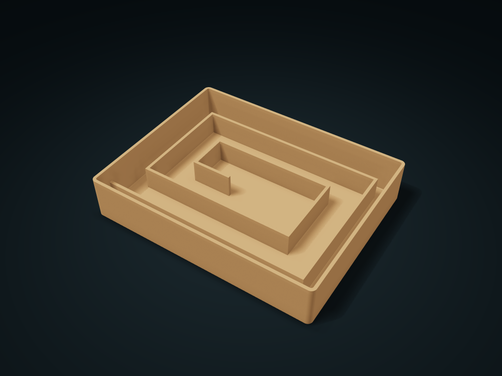](../models/square-spiral-channel-tray/) | [Square Spiral Workflow Channel Tray](../models/square-spiral-channel-tray/) | 180 × 140 × 34 mm | 1 | [boxesmodel](https://boxesmodel.com/models/square-spiral-channel-tray) |
| [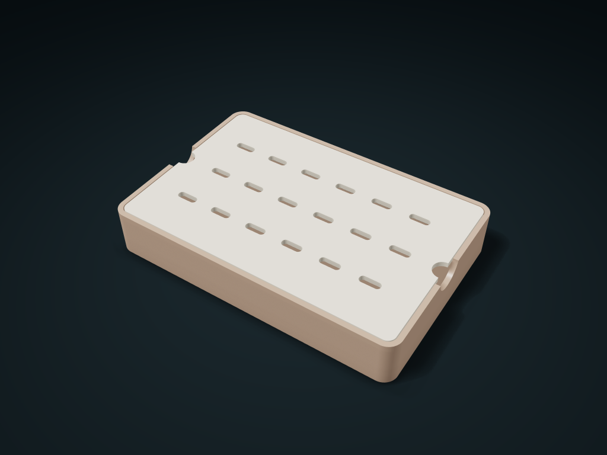](../models/staggered-pill-soap-tray/) | [Staggered Capsule Draining Soap Dish](../models/staggered-pill-soap-tray/) | 150 × 100 × 24 mm | 2 | [boxesmodel](https://boxesmodel.com/models/staggered-pill-soap-tray) |
| [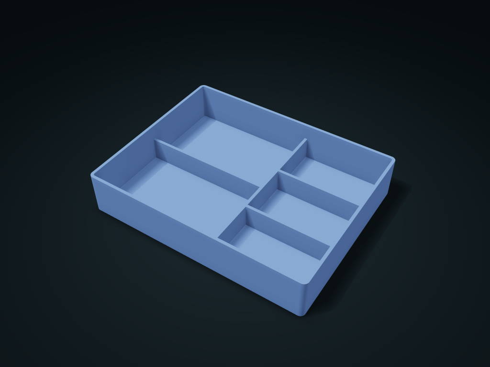](../models/offset-comb-dual-bank/) | [Staggered Comb Bay Sorting Tray](../models/offset-comb-dual-bank/) | 180 × 140 × 34 mm | 1 | [boxesmodel](https://boxesmodel.com/models/offset-comb-dual-bank) |
|  | [Staggered Double Ring Pocket Tray](../models/stagger-ring-pocket-tray/) | 200 × 200 × 38 mm | 1 | [boxesmodel](https://boxesmodel.com/models/stagger-ring-pocket-tray) |

[← Previous](desktop-organizers-8.md) · [1](desktop-organizers.md) · [2](desktop-organizers-2.md) · [3](desktop-organizers-3.md) · [4](desktop-organizers-4.md) · [5](desktop-organizers-5.md) · [6](desktop-organizers-6.md) · [7](desktop-organizers-7.md) · [8](desktop-organizers-8.md) · **9** · [10](desktop-organizers-10.md) · [11](desktop-organizers-11.md) · [Next →](desktop-organizers-10.md)
