# Desktop Organizers

**Page 1 of 11** · Models 1–50 of 544

Click a thumbnail or model name to open its files and guide. Use **Preview & customize** to open the interactive model on boxesmodel.

[All models](../CATALOG.md) · [Collection overview](../README.md)

**1** · [2](desktop-organizers-2.md) · [3](desktop-organizers-3.md) · [4](desktop-organizers-4.md) · [5](desktop-organizers-5.md) · [6](desktop-organizers-6.md) · [7](desktop-organizers-7.md) · [8](desktop-organizers-8.md) · [9](desktop-organizers-9.md) · [10](desktop-organizers-10.md) · [11](desktop-organizers-11.md) · [Next →](desktop-organizers-2.md)

| Thumbnail | Model | Default dimensions | Parts | Preview & customize |
| --- | --- | --- | ---: | --- |
|  | [42 mm Grid Locating Bin](../models/grid-seat-bin/) | 126 × 84 × 45.8 mm | 2 | [boxesmodel](https://boxesmodel.com/models/grid-seat-bin) |
| [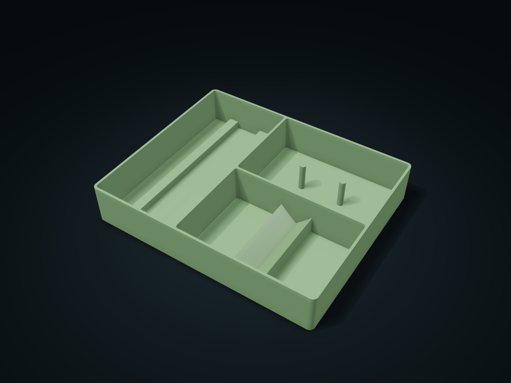](../models/actioncam-supply-station/) | [Action Camera Accessory Tray](../models/actioncam-supply-station/) | 226 × 184 × 40 mm | 1 | [boxesmodel](https://boxesmodel.com/models/actioncam-supply-station) |
| [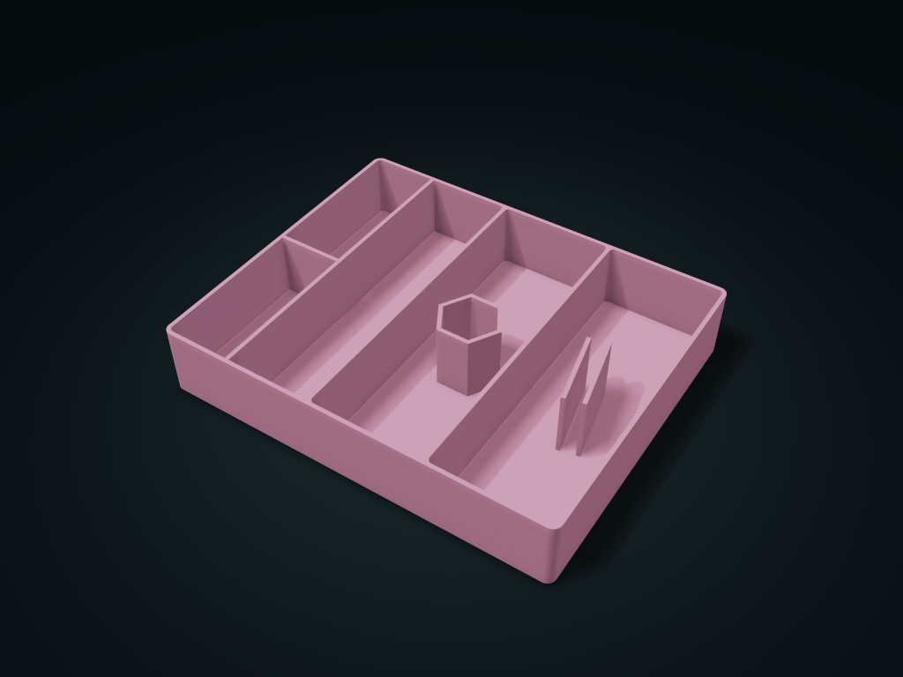](../models/adapter-desk-station/) | [Adapter Sorting Work Box](../models/adapter-desk-station/) | 226 × 184 × 40 mm | 1 | [boxesmodel](https://boxesmodel.com/models/adapter-desk-station) |
| [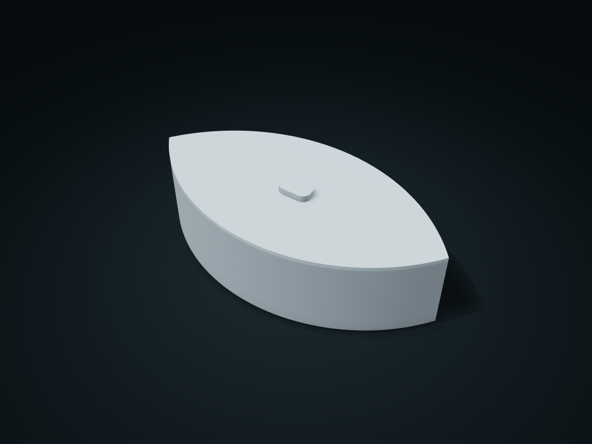](../models/almond-arc-lift-case/) | [Almond Arc Lift-Off Case](../models/almond-arc-lift-case/) | 220 × 110 × 65 mm | 2 | [boxesmodel](https://boxesmodel.com/models/almond-arc-lift-case) |
|  | [Angled Divider Drawer Insert](../models/diagonal-drawer-insert/) | 220 × 120 × 35 mm | 1 | [boxesmodel](https://boxesmodel.com/models/diagonal-drawer-insert) |
|  | [Angled Knife Sheath Box](../models/angled-knife-box/) | 151 × 124.14 × 173.64 mm | 1 | [boxesmodel](https://boxesmodel.com/models/angled-knife-box) |
|  | [Angled Marker Box](../models/token-display-box/) | 160 × 120 × 40 mm | 1 | [boxesmodel](https://boxesmodel.com/models/token-display-box) |
| [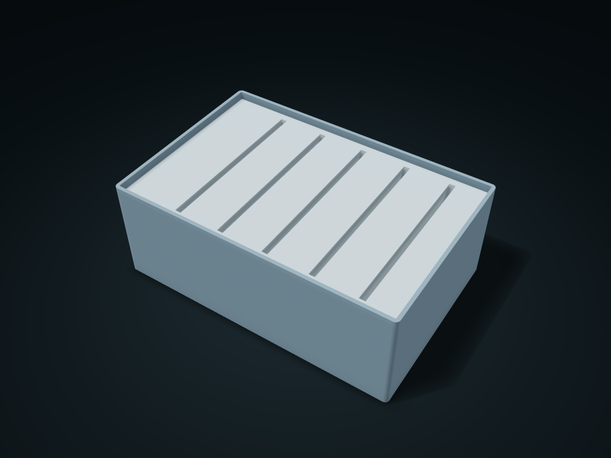](../models/angle-file-insert-box/) | [Angled Plate Lift-Out Document Bin](../models/angle-file-insert-box/) | 190 × 125 × 70 mm | 2 | [boxesmodel](https://boxesmodel.com/models/angle-file-insert-box) |
|  | [Angled Remote Control Box](../models/remote-control-dock/) | 200 × 130 × 110 mm | 1 | [boxesmodel](https://boxesmodel.com/models/remote-control-dock) |
|  | [Arc Belly Triangle Window Basket](../models/arc-belly-triangle-basket/) | 140 × 140 × 70 mm | 1 | [boxesmodel](https://boxesmodel.com/models/arc-belly-triangle-basket) |
| [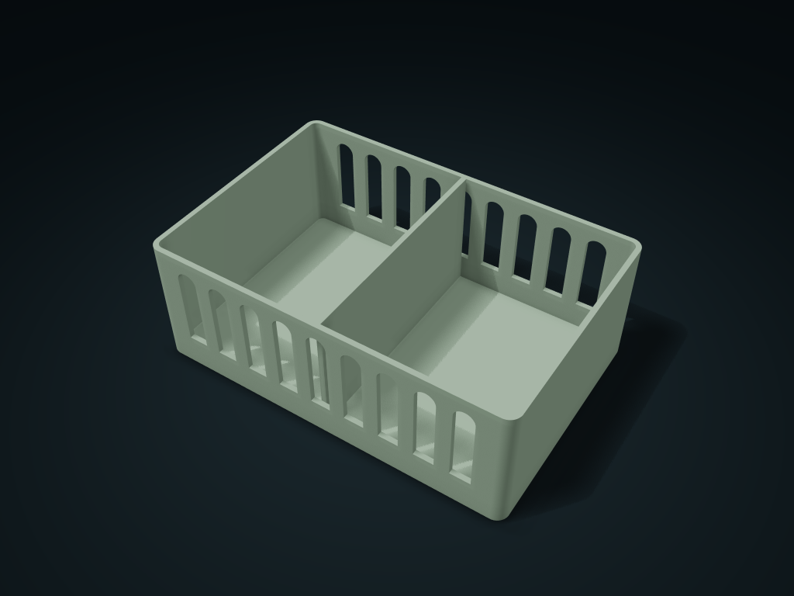](../models/arcade-desk-basket/) | [Arch Window Desk Divider Basket](../models/arcade-desk-basket/) | 180 × 120 × 64 mm | 1 | [boxesmodel](https://boxesmodel.com/models/arcade-desk-basket) |
|  | [Arched Honeycomb Letter Rack](../models/arch-honeycomb-letter-rack/) | 160 × 87.2 × 125 mm | 1 | [boxesmodel](https://boxesmodel.com/models/arch-honeycomb-letter-rack) |
| [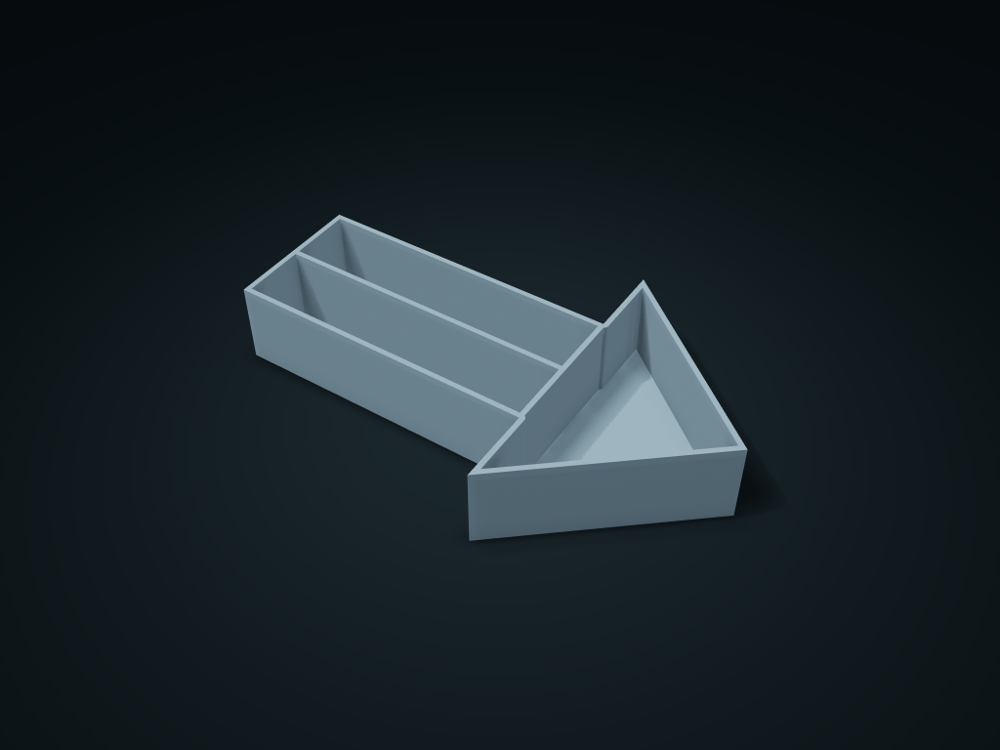](../models/arrow-tool-tray/) | [Arrow Workflow Zone Box](../models/arrow-tool-tray/) | 220 × 135 × 38 mm | 1 | [boxesmodel](https://boxesmodel.com/models/arrow-tool-tray) |
| [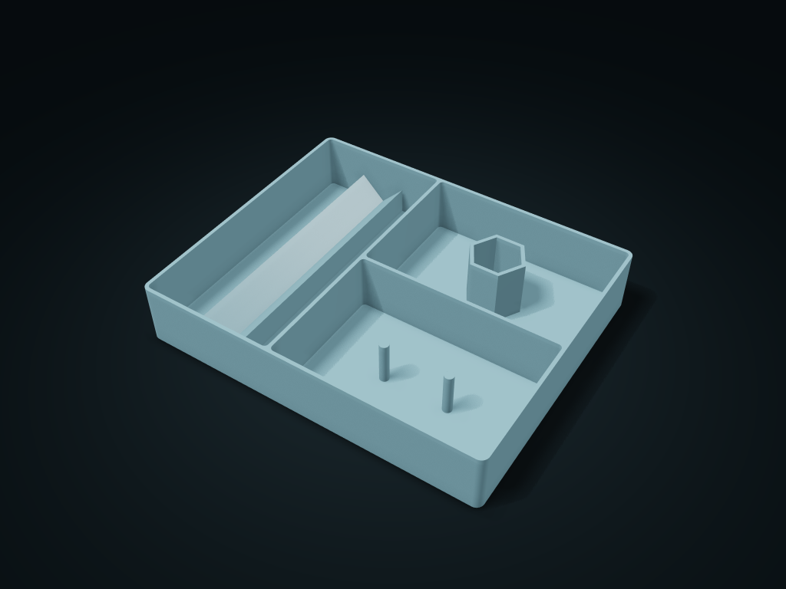](../models/building-pin-station/) | [Assembly Pin & Axle Organizer Tray](../models/building-pin-station/) | 226 × 184 × 40 mm | 1 | [boxesmodel](https://boxesmodel.com/models/building-pin-station) |
| [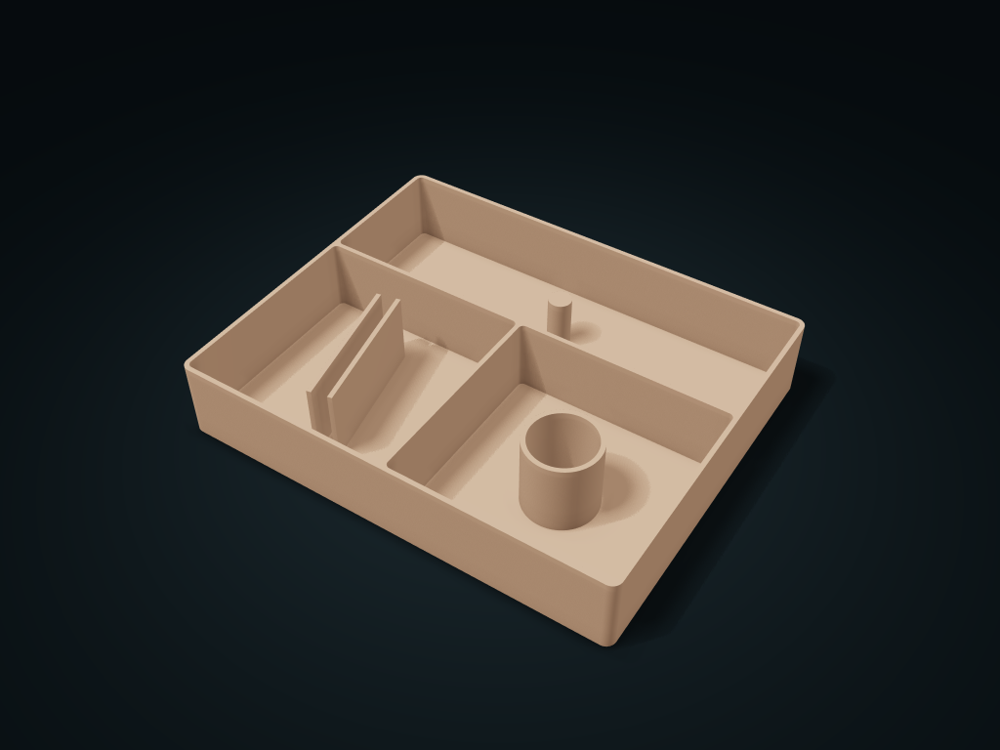](../models/tv-label-station/) | [AV Label Accessory Box](../models/tv-label-station/) | 226 × 184 × 40 mm | 1 | [boxesmodel](https://boxesmodel.com/models/tv-label-station) |
| [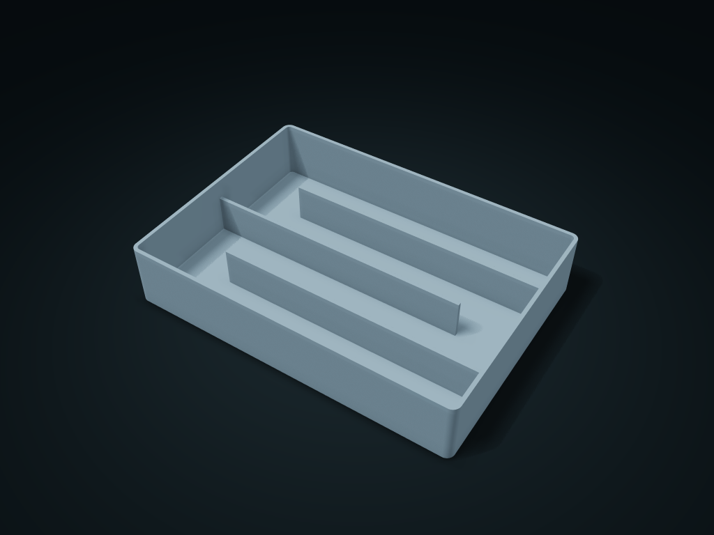](../models/serpentine-parts-tray/) | [Back-and-Forth Workflow Guide Tray](../models/serpentine-parts-tray/) | 210 × 150 × 40 mm | 1 | [boxesmodel](https://boxesmodel.com/models/serpentine-parts-tray) |
| [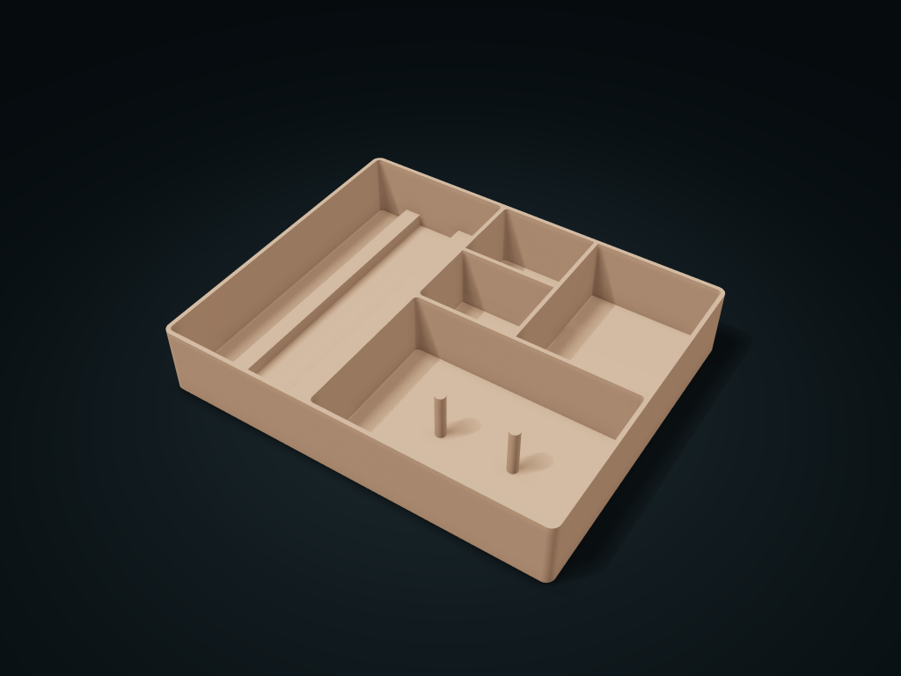](../models/bag-strap-station/) | [Bag Strap Accessory Tray](../models/bag-strap-station/) | 226 × 184 × 40 mm | 1 | [boxesmodel](https://boxesmodel.com/models/bag-strap-station) |
| [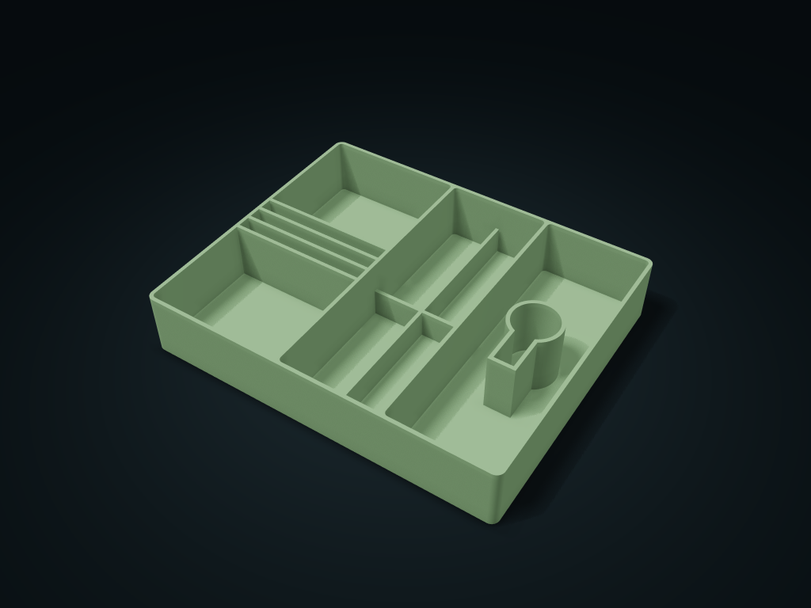](../models/baking-packet-station/) | [Baking Sachet Organizer Tray](../models/baking-packet-station/) | 226 × 184 × 40 mm | 1 | [boxesmodel](https://boxesmodel.com/models/baking-packet-station) |
|  | [Bamboo Node Compartment Lift-Off Canister](../models/bamboonode-lift-canister/) | 140 × 140 × 110 mm | 2 | [boxesmodel](https://boxesmodel.com/models/bamboonode-lift-canister) |
| [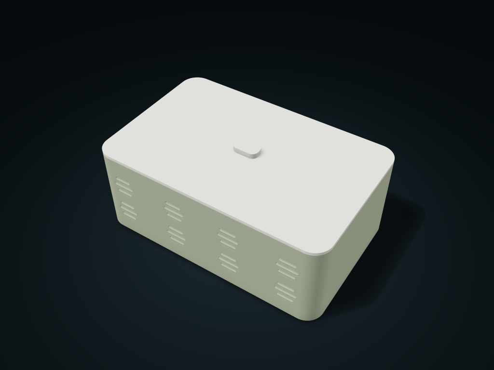](../models/bamboonode-lift-chest/) | [Bamboo Node Lift-Off Compartment Chest](../models/bamboonode-lift-chest/) | 220 × 140 × 90 mm | 2 | [boxesmodel](https://boxesmodel.com/models/bamboonode-lift-chest) |
|  | [Bamboo Node Long-and-Small Item Valet Tray](../models/bamboonode-valet-tray/) | 220 × 140 × 38 mm | 1 | [boxesmodel](https://boxesmodel.com/models/bamboonode-valet-tray) |
| [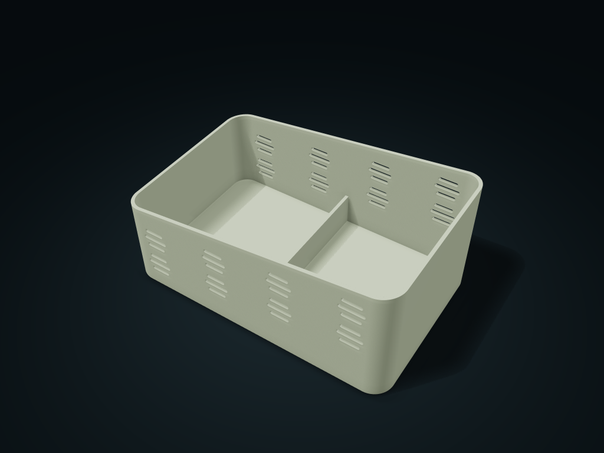](../models/bamboonode-slope-bin/) | [Bamboo Node Sloping Rim Sorting Bin](../models/bamboonode-slope-bin/) | 220 × 140 × 98 mm | 1 | [boxesmodel](https://boxesmodel.com/models/bamboonode-slope-bin) |
| [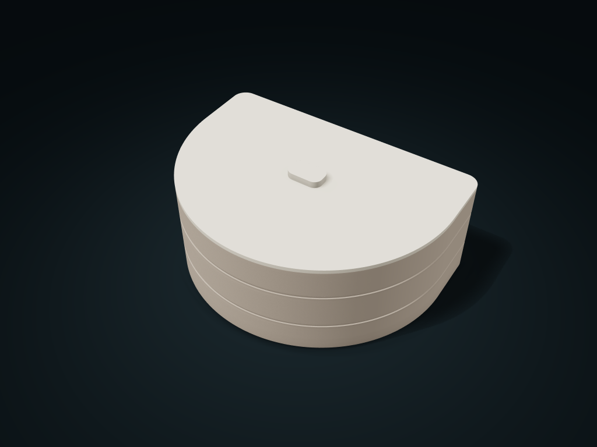](../models/banded-flatback-lift-case/) | [Banded Flat-Back Lift-Off Case](../models/banded-flatback-lift-case/) | 200 × 145 × 80 mm | 2 | [boxesmodel](https://boxesmodel.com/models/banded-flatback-lift-case) |
| [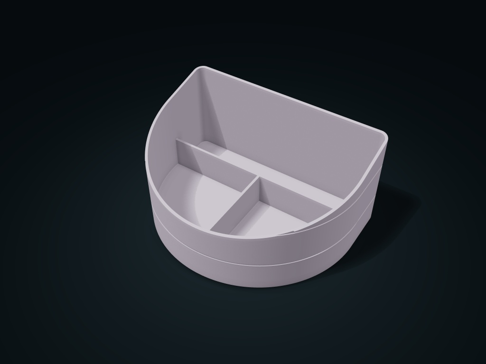](../models/banded-flatback-rise-caddy/) | [Banded Flat-Back Rising-Rim Caddy](../models/banded-flatback-rise-caddy/) | 220 × 165 × 105 mm | 1 | [boxesmodel](https://boxesmodel.com/models/banded-flatback-rise-caddy) |
| [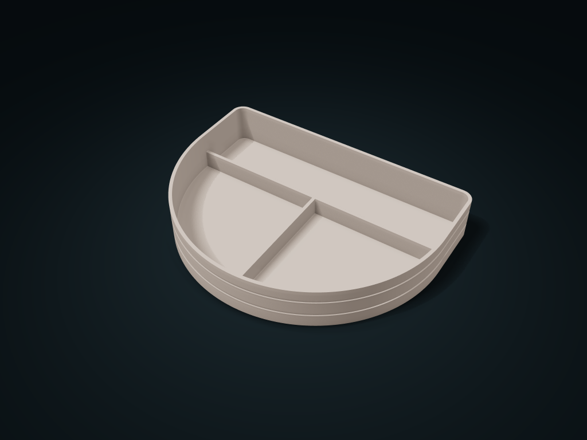](../models/banded-flatback-valet-tray/) | [Banded Flat-Back Valet Tray](../models/banded-flatback-valet-tray/) | 220 × 165 × 35 mm | 1 | [boxesmodel](https://boxesmodel.com/models/banded-flatback-valet-tray) |
|  | [Banded Pentagon Lift-Off Case](../models/banded-pentagon-lift-case/) | 200 × 191.97 × 80 mm | 2 | [boxesmodel](https://boxesmodel.com/models/banded-pentagon-lift-case) |
| [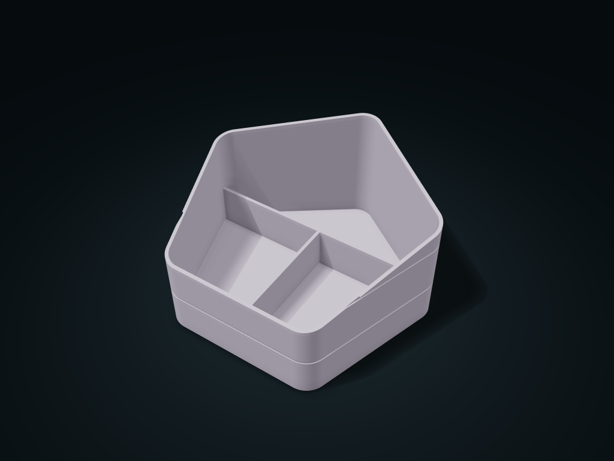](../models/banded-pentagon-rise-caddy/) | [Banded Pentagon Rising-Rim Caddy](../models/banded-pentagon-rise-caddy/) | 200 × 191.97 × 105 mm | 1 | [boxesmodel](https://boxesmodel.com/models/banded-pentagon-rise-caddy) |
| [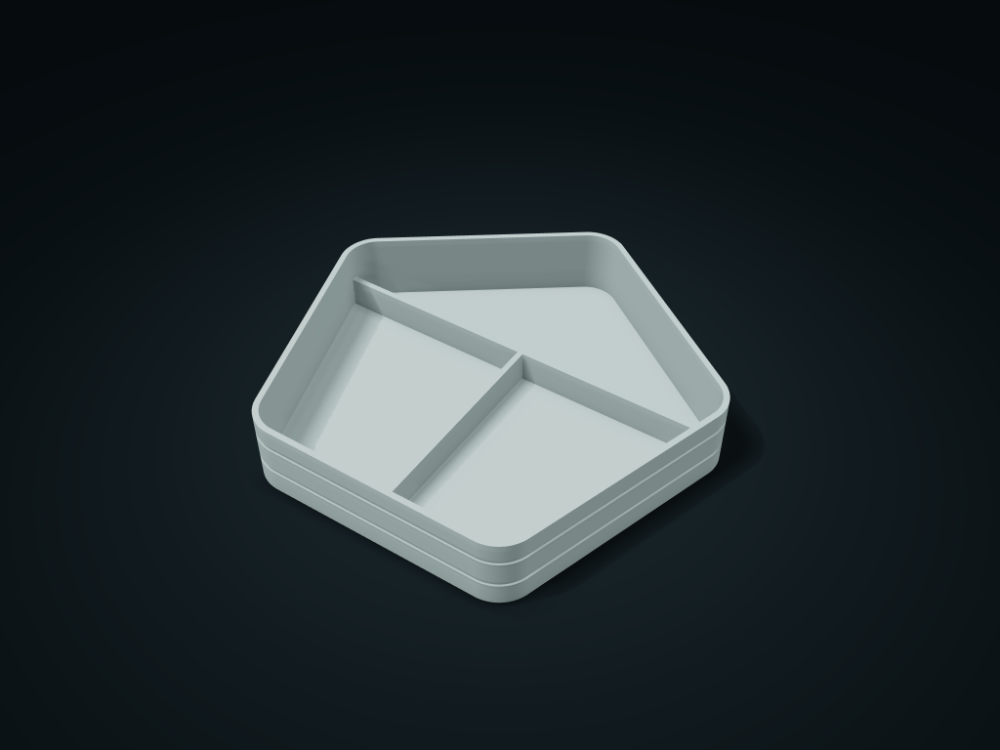](../models/banded-pentagon-valet-tray/) | [Banded Pentagon Valet Tray](../models/banded-pentagon-valet-tray/) | 200 × 191.97 × 35 mm | 1 | [boxesmodel](https://boxesmodel.com/models/banded-pentagon-valet-tray) |
|  | [Barrel Belly Lift-Off Jar](../models/barrel-belly-lift-jar/) | 130 × 130 × 112 mm | 2 | [boxesmodel](https://boxesmodel.com/models/barrel-belly-lift-jar) |
| [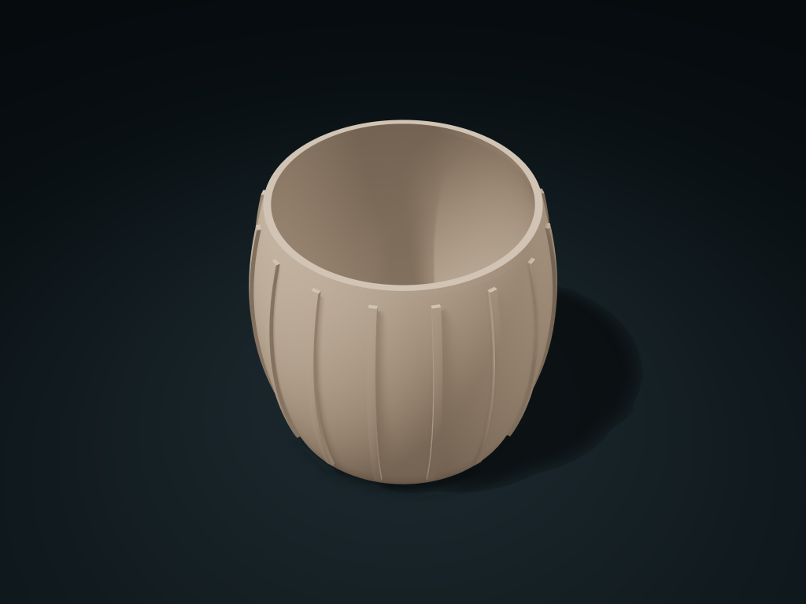](../models/barrel-reed-open-cup/) | [Barrel Reed Storage Cup](../models/barrel-reed-open-cup/) | 128 × 128 × 112 mm | 1 | [boxesmodel](https://boxesmodel.com/models/barrel-reed-open-cup) |
| [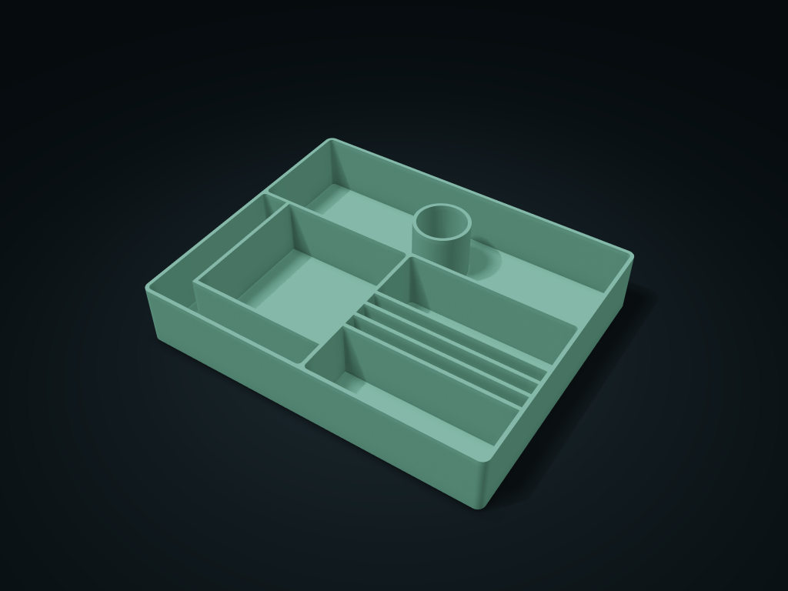](../models/grooming-dry-station/) | [Bathroom Dry Zone Accessory Box](../models/grooming-dry-station/) | 226 × 184 × 40 mm | 1 | [boxesmodel](https://boxesmodel.com/models/grooming-dry-station) |
| [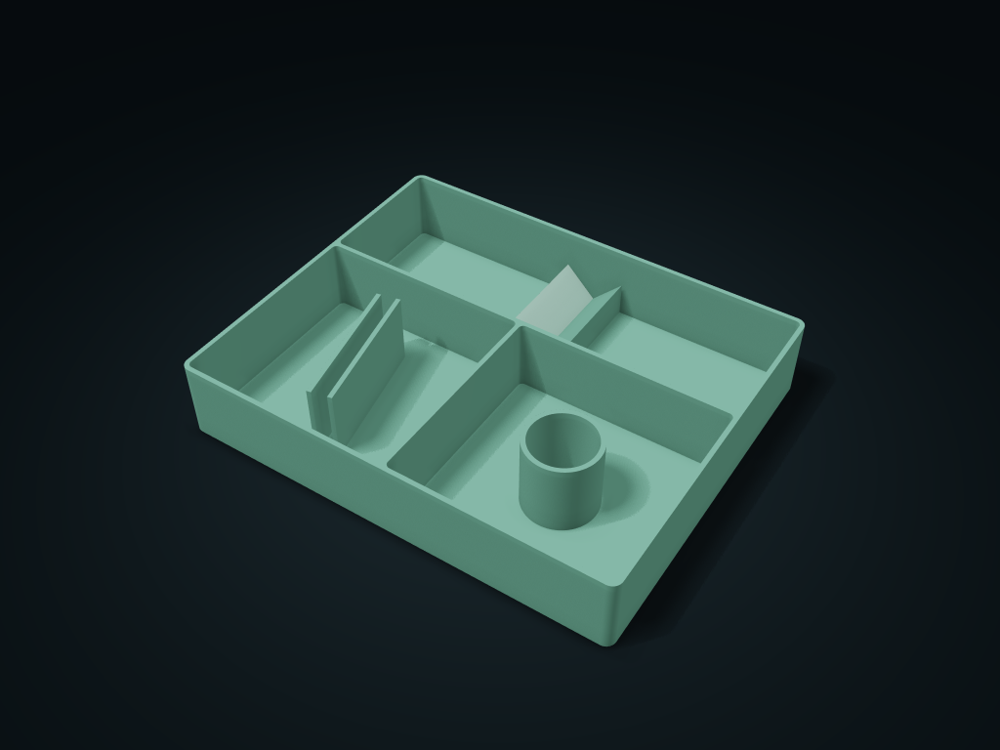](../models/battery-label-station/) | [Battery Accessory Label Tray](../models/battery-label-station/) | 226 × 184 × 40 mm | 1 | [boxesmodel](https://boxesmodel.com/models/battery-label-station) |
|  | [Battery Locating Grid Box](../models/battery-crate/) | 130 × 90 × 35 mm | 1 | [boxesmodel](https://boxesmodel.com/models/battery-crate) |
| [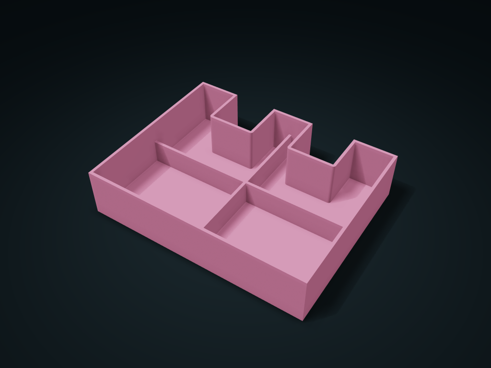](../models/castle-battlement-tray/) | [Battlement Outline Sorting Tray](../models/castle-battlement-tray/) | 180 × 140 × 40 mm | 1 | [boxesmodel](https://boxesmodel.com/models/castle-battlement-tray) |
| [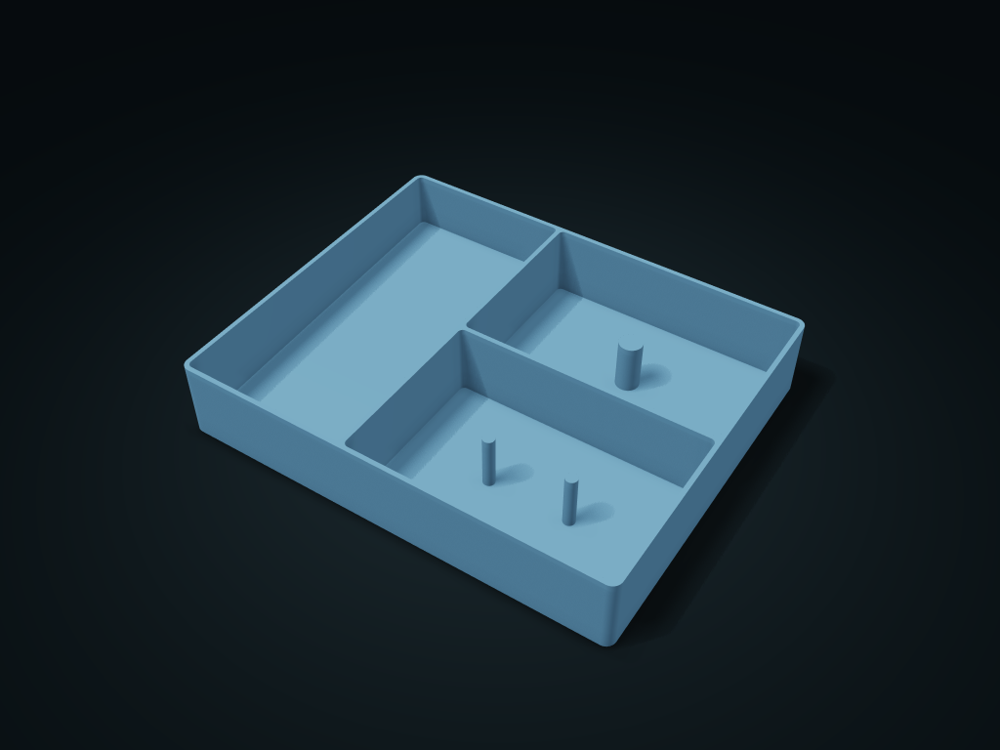](../models/bead-assembly-station/) | [Bead Assembly Prep Tray](../models/bead-assembly-station/) | 226 × 184 × 40 mm | 1 | [boxesmodel](https://boxesmodel.com/models/bead-assembly-station) |
| [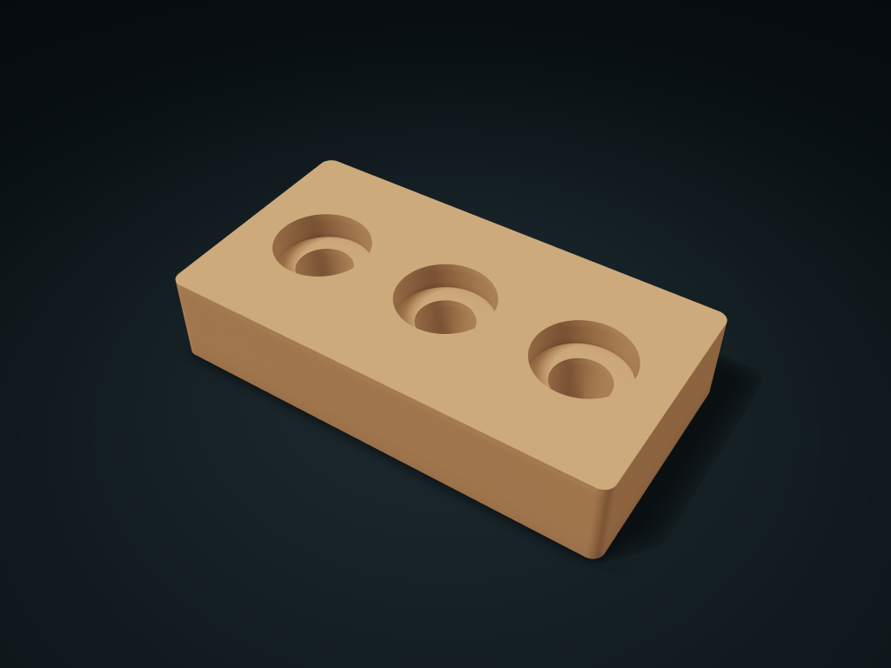](../models/bearing-ring-seat-tray/) | [Bearing Outer Race Shoulder Box](../models/bearing-ring-seat-tray/) | 190 × 100 × 38 mm | 1 | [boxesmodel](https://boxesmodel.com/models/bearing-ring-seat-tray) |
| [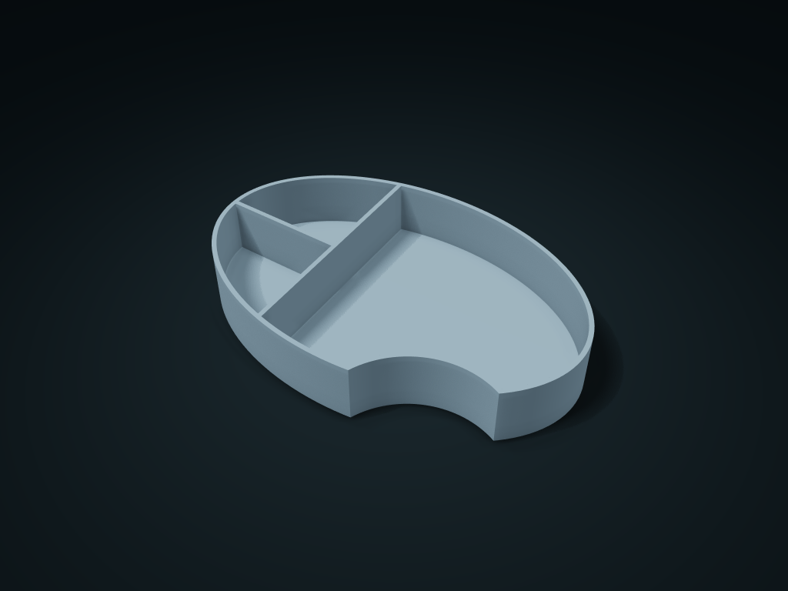](../models/kidney-bedside-tray/) | [Bedside Recessed Zone Box](../models/kidney-bedside-tray/) | 200 × 130 × 32 mm | 1 | [boxesmodel](https://boxesmodel.com/models/kidney-bedside-tray) |
| [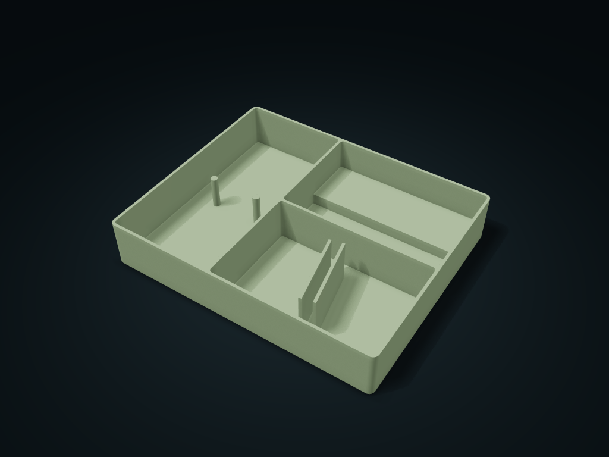](../models/bedside-ring-station/) | [Bedside Ring & Card Tray](../models/bedside-ring-station/) | 226 × 184 × 40 mm | 1 | [boxesmodel](https://boxesmodel.com/models/bedside-ring-station) |
| [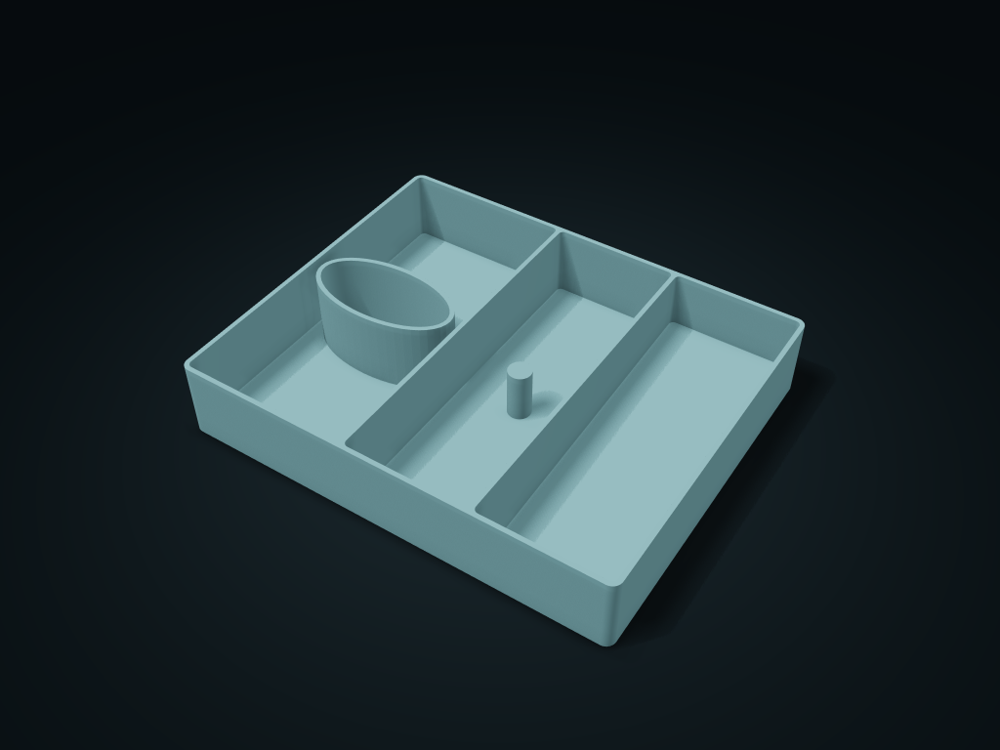](../models/bedside-cable-station/) | [Bedside Unplugged Cable Tray](../models/bedside-cable-station/) | 226 × 184 × 40 mm | 1 | [boxesmodel](https://boxesmodel.com/models/bedside-cable-station) |
| [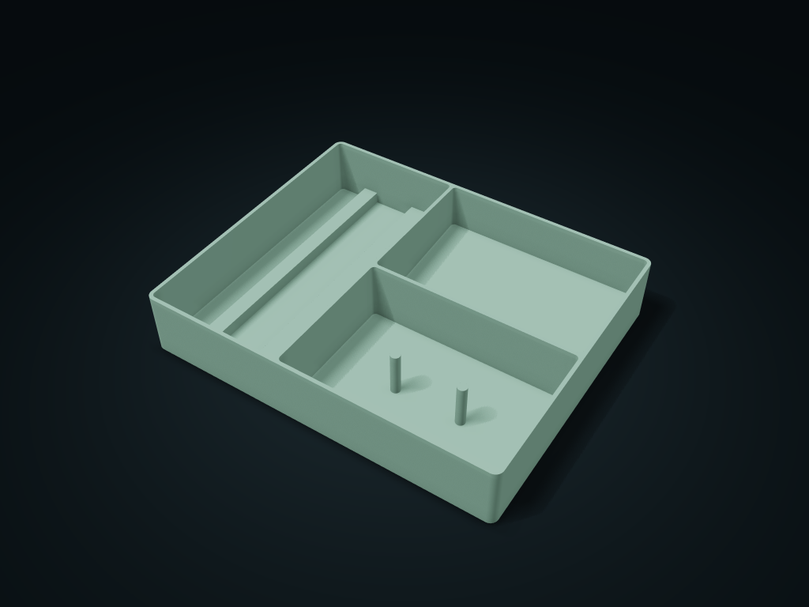](../models/night-watch-station/) | [Bedside Watch Accessory Tray](../models/night-watch-station/) | 226 × 184 × 40 mm | 1 | [boxesmodel](https://boxesmodel.com/models/night-watch-station) |
| [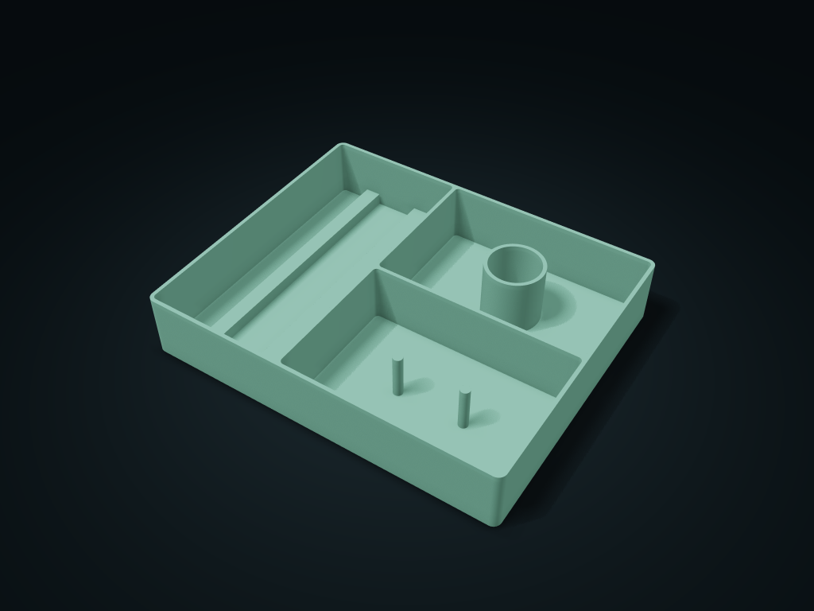](../models/bedtime-routine-station/) | [Bedtime Carry Items Return Tray](../models/bedtime-routine-station/) | 226 × 184 × 40 mm | 1 | [boxesmodel](https://boxesmodel.com/models/bedtime-routine-station) |
| [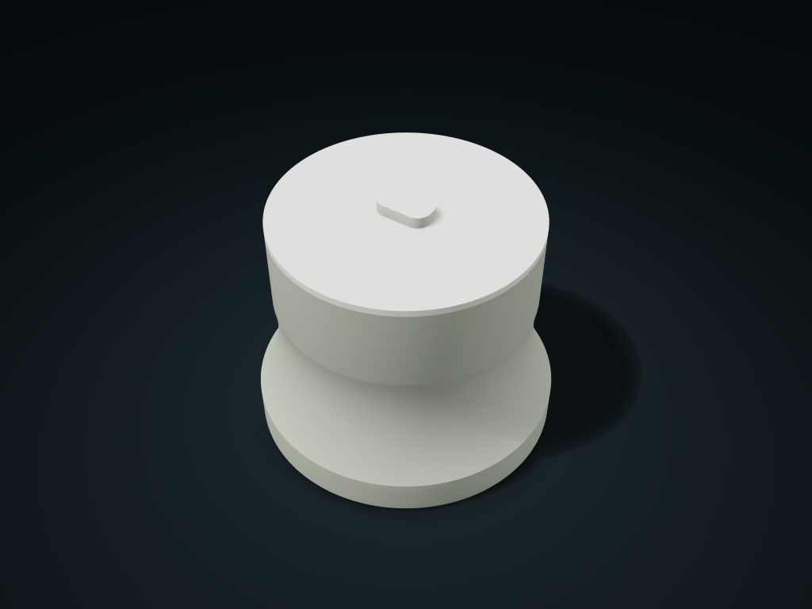](../models/bell-foot-lift-jar/) | [Bell Foot Lift-Off Jar](../models/bell-foot-lift-jar/) | 132 × 132 × 110 mm | 2 | [boxesmodel](https://boxesmodel.com/models/bell-foot-lift-jar) |
| [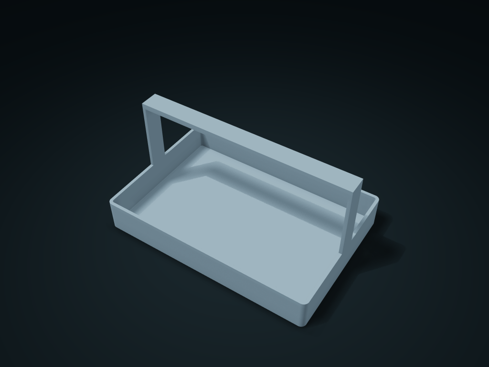](../models/binder-clip-perch-bin/) | [Binder Clip Hanging Beam Box](../models/binder-clip-perch-bin/) | 160 × 110 × 80 mm | 1 | [boxesmodel](https://boxesmodel.com/models/binder-clip-perch-bin) |
|  | [Blade Fuse Locating Box](../models/fuse-finger-case/) | 150 × 95 × 30 mm | 1 | [boxesmodel](https://boxesmodel.com/models/fuse-finger-case) |
| [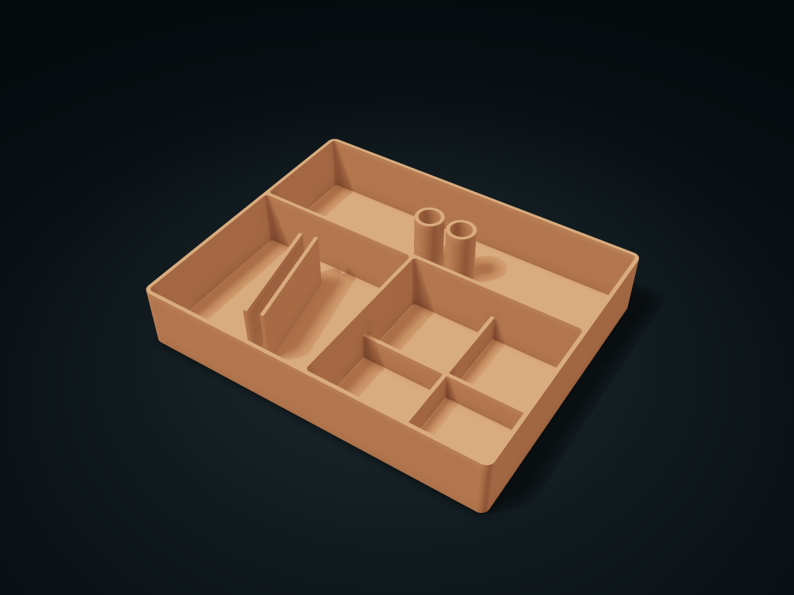](../models/boardgame-score-station/) | [Board Game Scoring Tool Tray](../models/boardgame-score-station/) | 226 × 184 × 40 mm | 1 | [boxesmodel](https://boxesmodel.com/models/boardgame-score-station) |
| [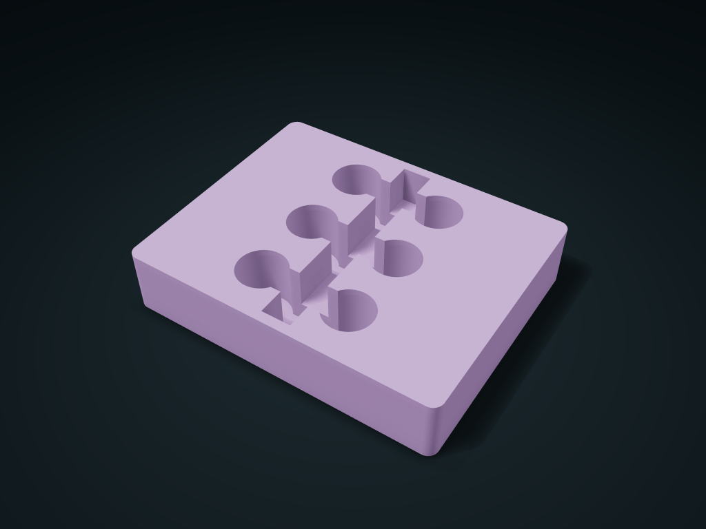](../models/shuttle-waist-nest/) | [Bobbin Narrow-Waist Pocket Box](../models/shuttle-waist-nest/) | 150 × 120 × 30 mm | 1 | [boxesmodel](https://boxesmodel.com/models/shuttle-waist-nest) |
| [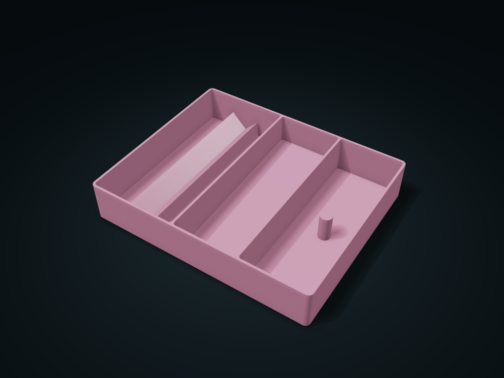](../models/sewing-bobbin-station/) | [Bobbin Sewing Accessory Tray](../models/sewing-bobbin-station/) | 226 × 184 × 40 mm | 1 | [boxesmodel](https://boxesmodel.com/models/sewing-bobbin-station) |
|  | [Bookend Side Pocket Box](../models/bookend-pocket-bin/) | 180 × 120 × 150 mm | 1 | [boxesmodel](https://boxesmodel.com/models/bookend-pocket-bin) |
| [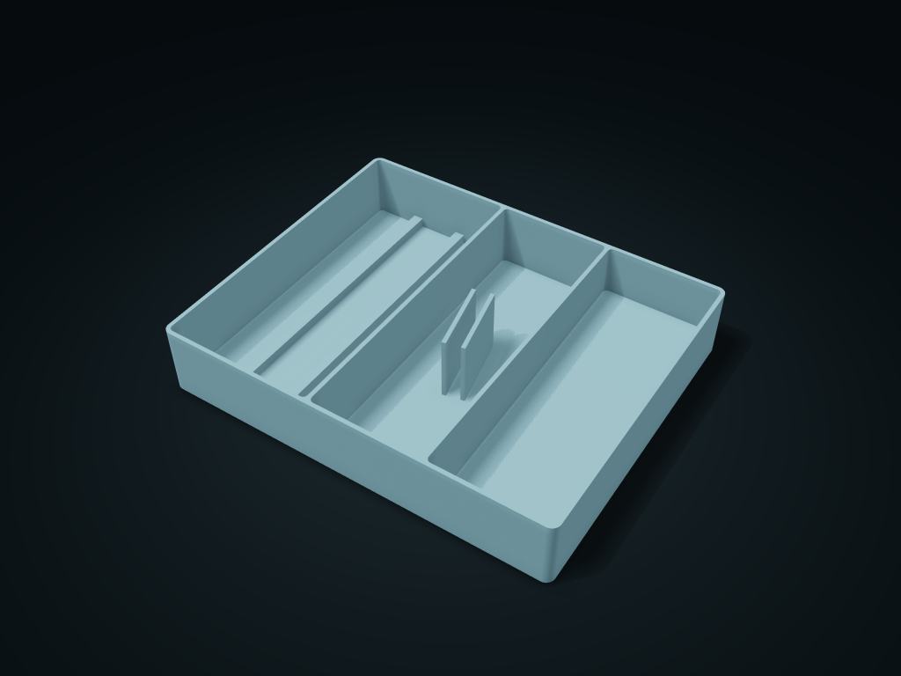](../models/notebook-tab-station/) | [Booklet Marker Tool Box](../models/notebook-tab-station/) | 226 × 184 × 40 mm | 1 | [boxesmodel](https://boxesmodel.com/models/notebook-tab-station) |
| [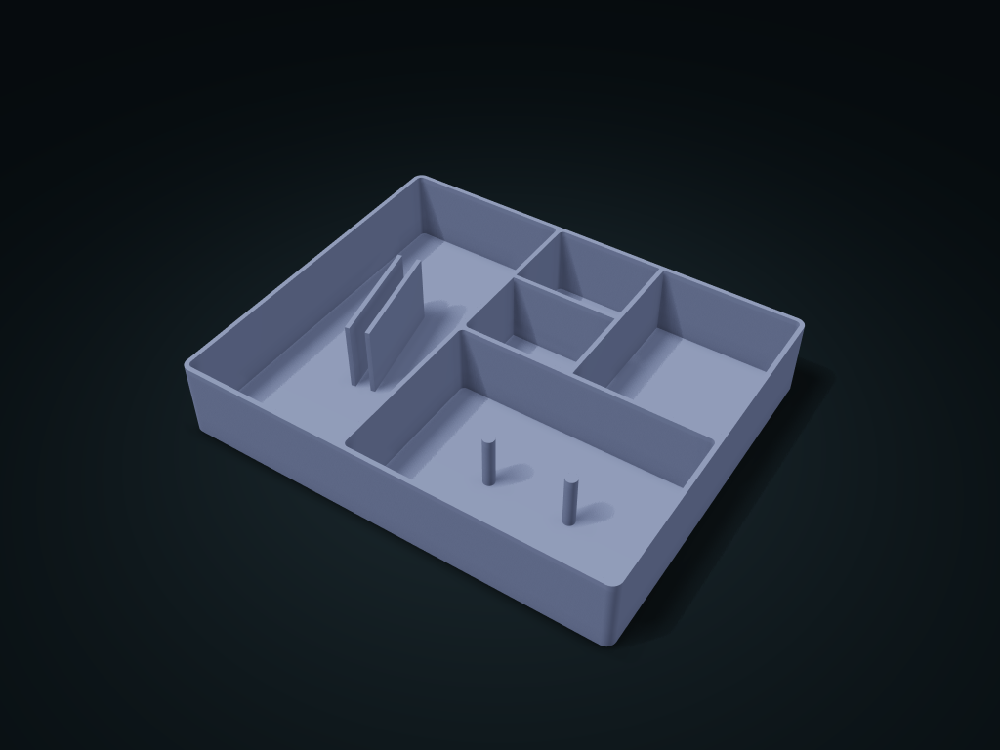](../models/bookmark-craft-station/) | [Bookmark Assembly Organizer](../models/bookmark-craft-station/) | 226 × 184 × 40 mm | 1 | [boxesmodel](https://boxesmodel.com/models/bookmark-craft-station) |

**1** · [2](desktop-organizers-2.md) · [3](desktop-organizers-3.md) · [4](desktop-organizers-4.md) · [5](desktop-organizers-5.md) · [6](desktop-organizers-6.md) · [7](desktop-organizers-7.md) · [8](desktop-organizers-8.md) · [9](desktop-organizers-9.md) · [10](desktop-organizers-10.md) · [11](desktop-organizers-11.md) · [Next →](desktop-organizers-2.md)
