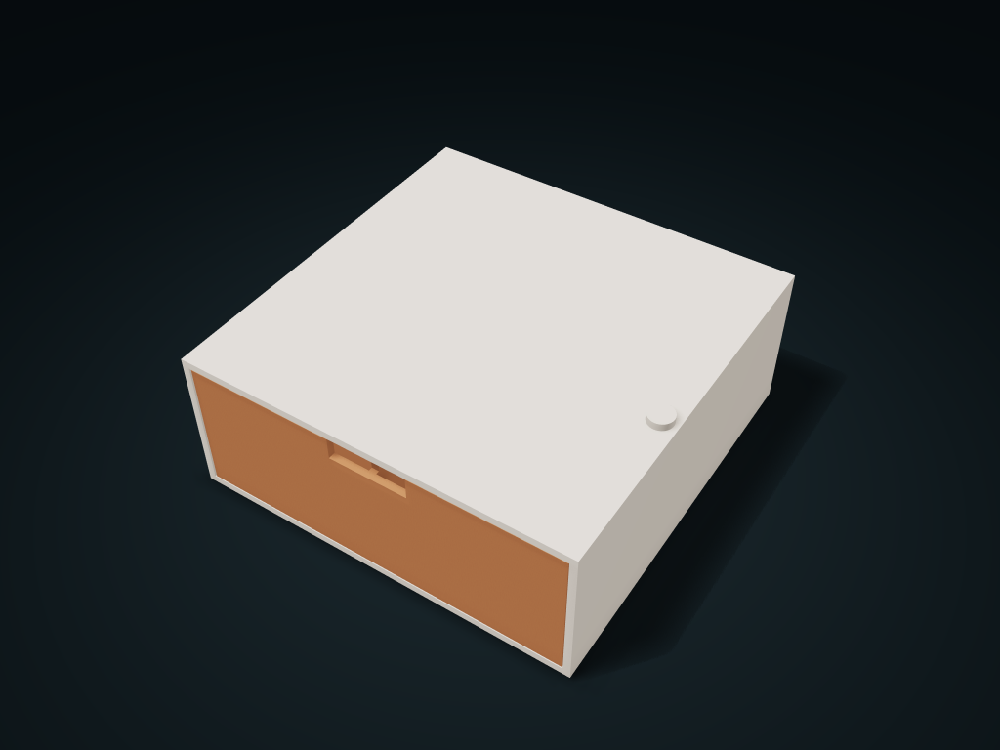

# Drawer Storage

**Page 1 of 1** · Models 1–10 of 10

Click a thumbnail or model name to open its files and guide. Use **Preview & customize** to open the interactive model on boxesmodel.

[All models](../CATALOG.md) · [Collection overview](../README.md)

| Thumbnail | Model | Default dimensions | Parts | Preview & customize |
| --- | --- | --- | ---: | --- |
|  | [Arc-Slot Tip-Out Bin](../models/tilt-sector-bin/) | 168.8 × 96.4 × 119.4 mm | 3 | [boxesmodel](https://boxesmodel.com/models/tilt-sector-bin) |
|  | [Cross-Bar Locked Removable Case Drawer](../models/crossbar-dock-drawer/) | 220 × 160 × 70 mm | 4 | [boxesmodel](https://boxesmodel.com/models/crossbar-dock-drawer) |
|  | [Desktop Drawer Cabinet](../models/drawer-cabinet/) | 220 × 160 × 168 mm | 4 | [boxesmodel](https://boxesmodel.com/models/drawer-cabinet) |
|  | [Removable Stop Single Drawer Cabinet](../models/pull-pin-stop-drawer/) | 160 × 160 × 65 mm | 3 | [boxesmodel](https://boxesmodel.com/models/pull-pin-stop-drawer) |
|  | [Sloped-Top Drawer Box](../models/stair-gap-bin/) | 200 × 140 × 120 mm | 4 | [boxesmodel](https://boxesmodel.com/models/stair-gap-bin) |
|  | [Sticky Note Holder with Mini Drawer](../models/sticky-note-drawer/) | 140 × 150 × 85 mm | 2 | [boxesmodel](https://boxesmodel.com/models/sticky-note-drawer) |
|  | [Tail-Retained Two-Row Pull-Out Bottle Box](../models/captive-tail-bottle-pullout/) | 160 × 240 × 60 mm | 3 | [boxesmodel](https://boxesmodel.com/models/captive-tail-bottle-pullout) |
|  | [Two-Column Drawer Cabinet](../models/twin-drawer-cabinet/) | 240 × 150 × 180 mm | 6 | [boxesmodel](https://boxesmodel.com/models/twin-drawer-cabinet) |
|  | [Under-Desk Compartment Drawer](../models/under-desk-drawer/) | 210 × 190 × 65 mm | 2 | [boxesmodel](https://boxesmodel.com/models/under-desk-drawer) |
|  | [Vertical-Hinge Front Door Shelf Cabinet](../models/front-door-shelf-cabinet/) | 160 × 120 × 180 mm | 6 | [boxesmodel](https://boxesmodel.com/models/front-door-shelf-cabinet) |
