# Lidded Storage

**Page 2 of 2** · Models 51–96 of 96

Click a thumbnail or model name to open its files and guide. Use **Preview & customize** to open the interactive model on boxesmodel.

[All models](../CATALOG.md) · [Collection overview](../README.md)

[← Previous](lidded-storage.md) · [1](lidded-storage.md) · **2**

| Thumbnail | Model | Default dimensions | Parts | Preview & customize |
| --- | --- | --- | ---: | --- |
|  | [Pebble Recess Tissue Box](../models/pebble-panel-tissue-case/) | 220 × 130 × 100 mm | 2 | [boxesmodel](https://boxesmodel.com/models/pebble-panel-tissue-case) |
|  | [Pencil Tip Divided Box](../models/pencil-tip-lift-box/) | 180 × 140 × 38 mm | 2 | [boxesmodel](https://boxesmodel.com/models/pencil-tip-lift-box) |
|  | [Pinned Flip Lid Divided Box](../models/pin-hinge-box/) | 180 × 130 × 65 mm | 3 | [boxesmodel](https://boxesmodel.com/models/pin-hinge-box) |
| [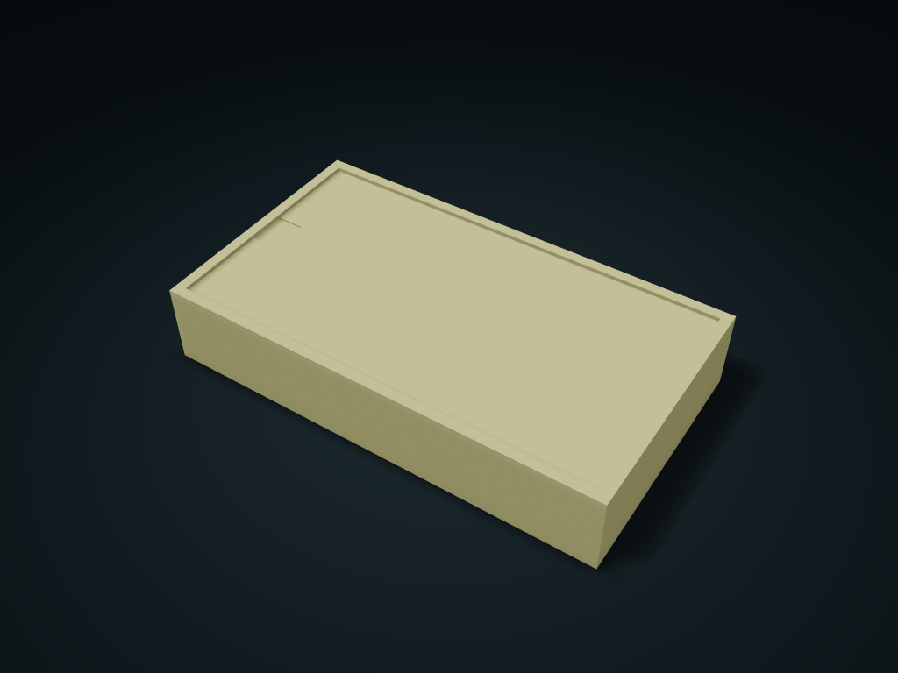](../models/potentiometer-round-stem-slide/) | [Potentiometer Round Body & Shaft Slot Box](../models/potentiometer-round-stem-slide/) | 205 × 115 × 38 mm | 2 | [boxesmodel](https://boxesmodel.com/models/potentiometer-round-stem-slide) |
|  | [Power Transistor Lead Sliding Lid Box](../models/transistor-tab-slide/) | 205 × 115 × 38 mm | 2 | [boxesmodel](https://boxesmodel.com/models/transistor-tab-slide) |
|  | [Rear-Press Wide-Mouth Liner Bin](../models/rear-press-liner-bin/) | 150 × 145 × 150 mm | 4 | [boxesmodel](https://boxesmodel.com/models/rear-press-liner-bin) |
| [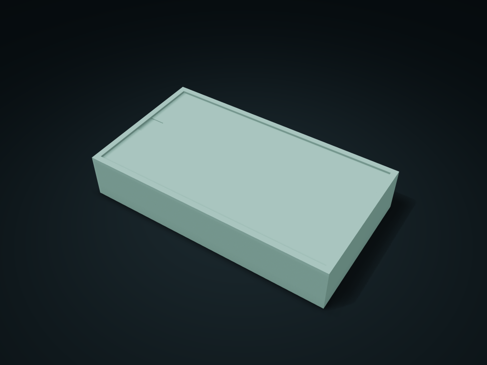](../models/relay-offset-pin-slide/) | [Relay Staggered Pin Sliding Lid Box](../models/relay-offset-pin-slide/) | 205 × 115 × 38 mm | 2 | [boxesmodel](https://boxesmodel.com/models/relay-offset-pin-slide) |
|  | [Rocket Fin Divided Box](../models/rocket-fin-lift-box/) | 180 × 140 × 38 mm | 2 | [boxesmodel](https://boxesmodel.com/models/rocket-fin-lift-box) |
| [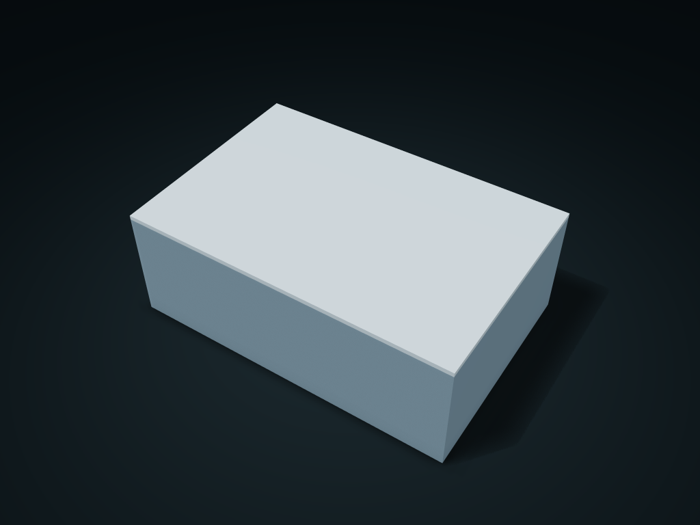](../models/gasket-groove-case/) | [Rope Groove Lift-Off Lid Box](../models/gasket-groove-case/) | 180 × 120 × 65 mm | 2 | [boxesmodel](https://boxesmodel.com/models/gasket-groove-case) |
| [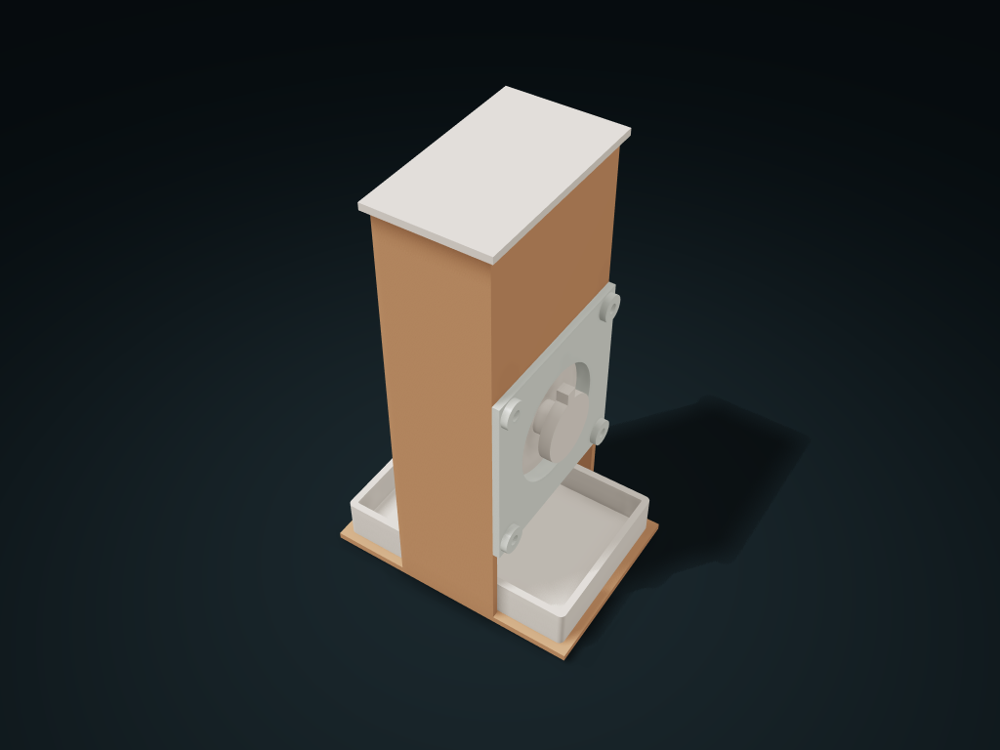](../models/pocket-drum-bin/) | [Rotating Drum Portion Dispenser Box](../models/pocket-drum-bin/) | 90 × 67.6 × 151.2 mm | 5 | [boxesmodel](https://boxesmodel.com/models/pocket-drum-bin) |
|  | [Rotating Window Compartment Box](../models/rotary-window-box/) | 140 × 140 × 33.2 mm | 2 | [boxesmodel](https://boxesmodel.com/models/rotary-window-box) |
| [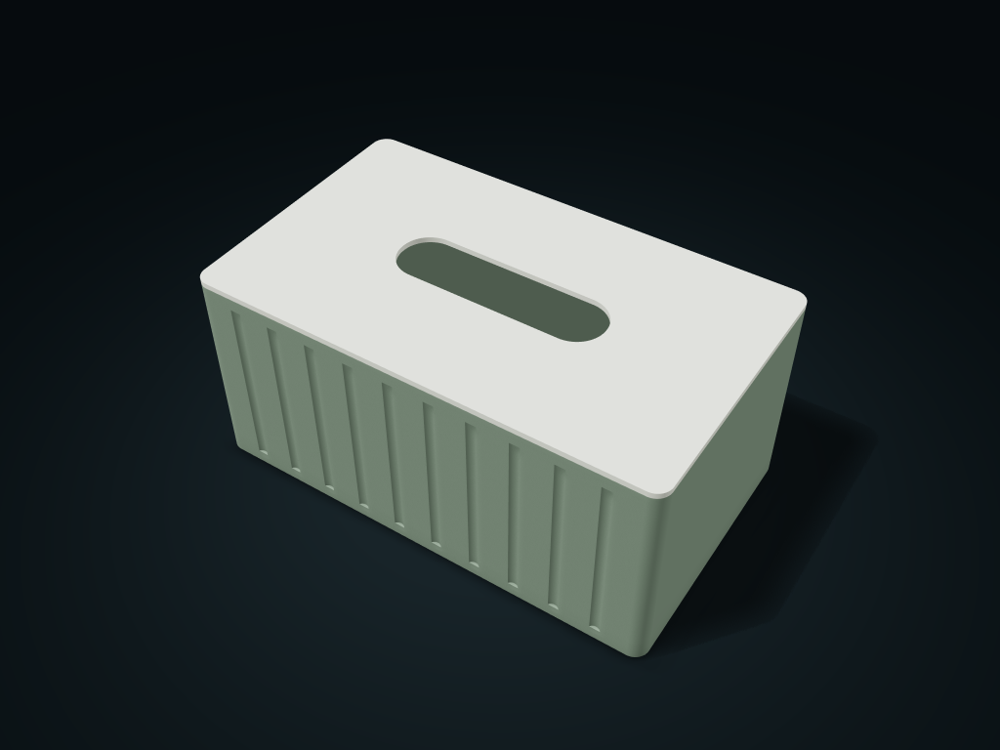](../models/fluted-tissue-case/) | [Round Recessed Groove Tissue Box](../models/fluted-tissue-case/) | 220 × 130 × 100 mm | 2 | [boxesmodel](https://boxesmodel.com/models/fluted-tissue-case) |
|  | [Rounded Capsule Box](../models/capsule-box/) | 200 × 90 × 50 mm | 2 | [boxesmodel](https://boxesmodel.com/models/capsule-box) |
|  | [Sailboat Hull Divided Box](../models/sailboat-mast-lift-box/) | 180 × 140 × 38 mm | 2 | [boxesmodel](https://boxesmodel.com/models/sailboat-mast-lift-box) |
| [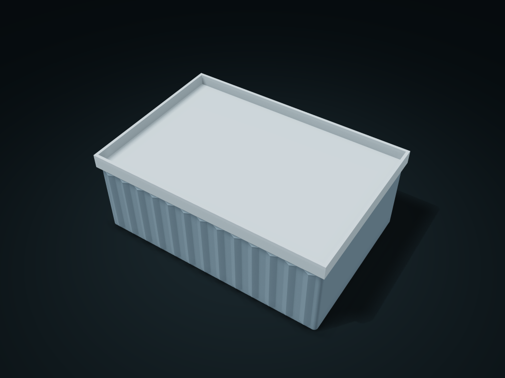](../models/sawtooth-fold-case/) | [Sawtooth Wall Tray Lid Box](../models/sawtooth-fold-case/) | 190 × 130 × 72 mm | 2 | [boxesmodel](https://boxesmodel.com/models/sawtooth-fold-case) |
|  | [Scalloped Plinth Tray Lid Box](../models/scallop-plinth-case/) | 190 × 130 × 72 mm | 2 | [boxesmodel](https://boxesmodel.com/models/scallop-plinth-case) |
|  | [Screw-Lid Lift-Out Compartment Jar](../models/screw-insert-jar/) | 102.7 × 102.7 × 65.2 mm | 3 | [boxesmodel](https://boxesmodel.com/models/screw-insert-jar) |
|  | [Screw-Lid Refill Box](../models/threaded-port-box/) | 120 × 100 × 85 mm | 2 | [boxesmodel](https://boxesmodel.com/models/threaded-port-box) |
|  | [Side Sliding Lid Box](../models/sliding-box/) | 190 × 100 × 45 mm | 2 | [boxesmodel](https://boxesmodel.com/models/sliding-box) |
|  | [Side-Pull Tea Bag Box](../models/tea-sachet-tower/) | 200 × 90 × 160 mm | 2 | [boxesmodel](https://boxesmodel.com/models/tea-sachet-tower) |
| [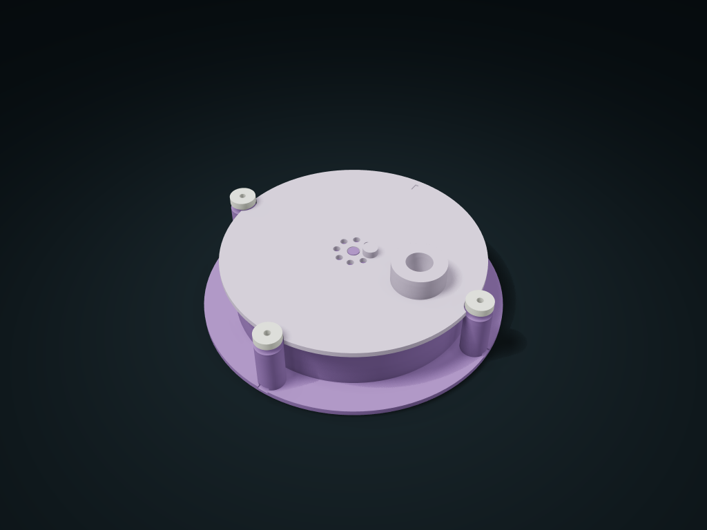](../models/service-key-indexed-cell-case/) | [Single Lid-Off Position Pinned Compartment Box](../models/service-key-indexed-cell-case/) | 160 × 160 × 44 mm | 7 | [boxesmodel](https://boxesmodel.com/models/service-key-indexed-cell-case) |
|  | [Six-Compartment Roll-Up Case](../models/rollup-cell-case/) | 122.93 × 145.6 × 106.46 mm | 14 | [boxesmodel](https://boxesmodel.com/models/rollup-cell-case) |
| [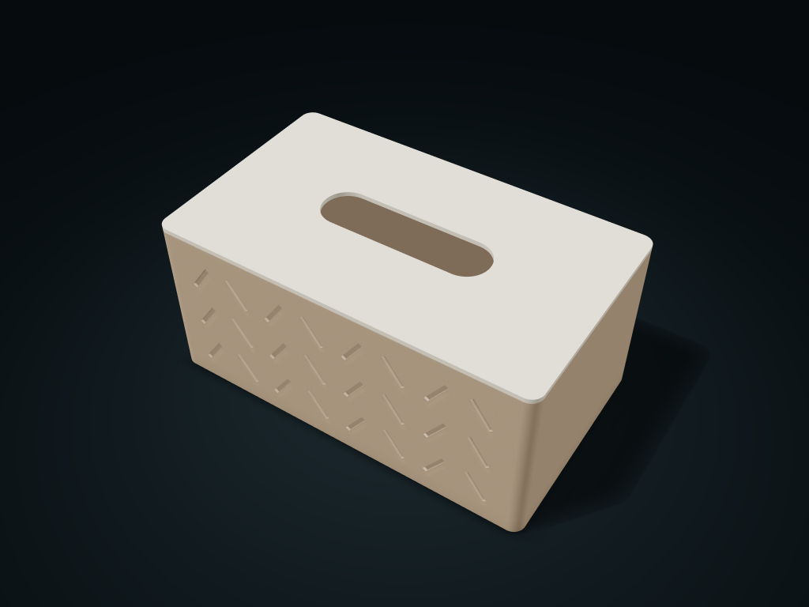](../models/oblique-dash-tissue-case/) | [Slanted Feather Pattern Tissue Box](../models/oblique-dash-tissue-case/) | 220 × 130 × 100 mm | 2 | [boxesmodel](https://boxesmodel.com/models/oblique-dash-tissue-case) |
|  | [Sliding Stop Lid Dice Shaker Cup](../models/turn-bar-dice-cup/) | 95 × 100 × 85 mm | 3 | [boxesmodel](https://boxesmodel.com/models/turn-bar-dice-cup) |
|  | [Small Fan Corner Cable Sliding Lid Box](../models/mini-fan-wire-corner-slide/) | 205 × 115 × 38 mm | 2 | [boxesmodel](https://boxesmodel.com/models/mini-fan-wire-corner-slide) |
| [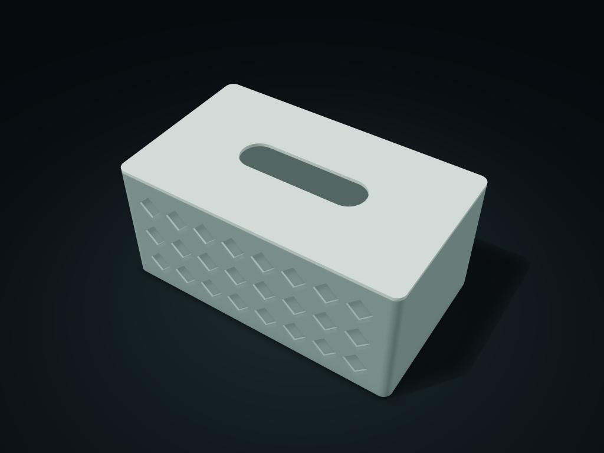](../models/diamond-dimple-tissue-case/) | [Soft Diamond Recess Tissue Box](../models/diamond-dimple-tissue-case/) | 220 × 130 × 100 mm | 2 | [boxesmodel](https://boxesmodel.com/models/diamond-dimple-tissue-case) |
|  | [Spool Core Breathable Tube](../models/spool-core-desiccant/) | 49 × 49 × 62 mm | 2 | [boxesmodel](https://boxesmodel.com/models/spool-core-desiccant) |
| [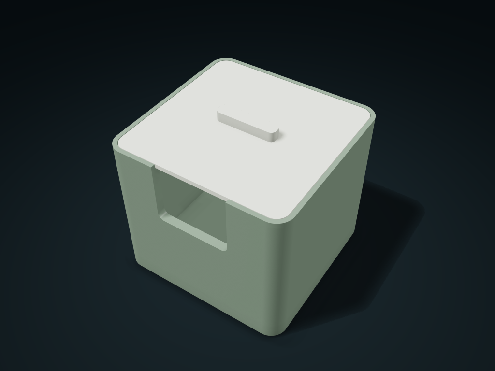](../models/sink-filter-reserve-box/) | [Square Compartment Sink Strainer Spare Box](../models/sink-filter-reserve-box/) | 106 × 104 × 96 mm | 2 | [boxesmodel](https://boxesmodel.com/models/sink-filter-reserve-box) |
| [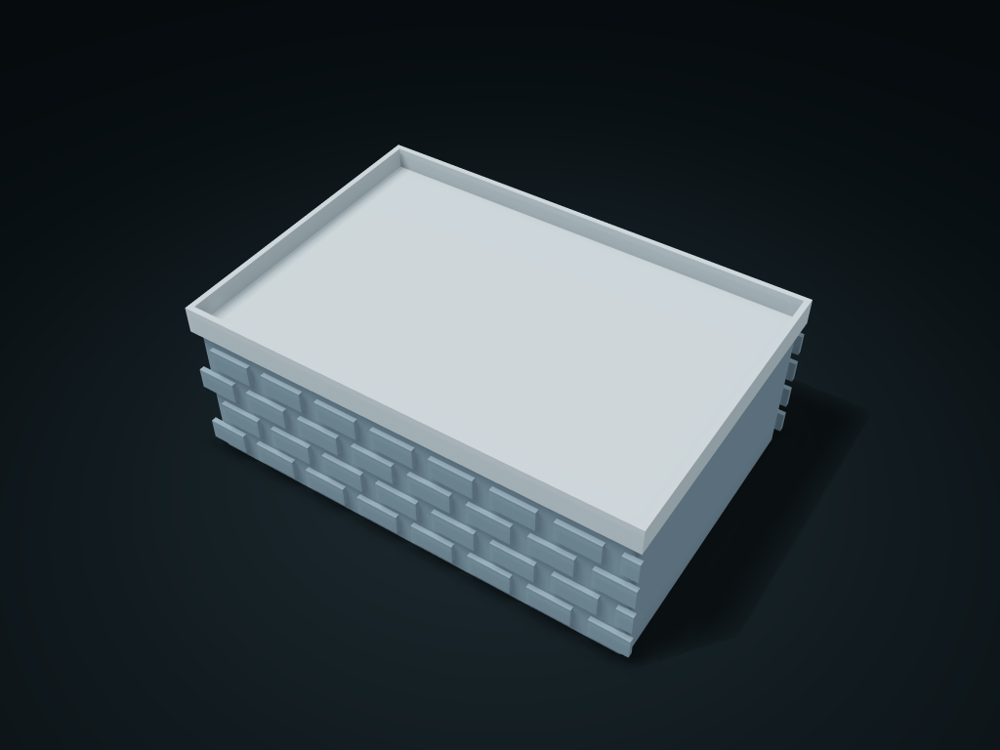](../models/brick-face-case/) | [Staggered Brick Tray Lid Box](../models/brick-face-case/) | 190 × 130 × 72 mm | 2 | [boxesmodel](https://boxesmodel.com/models/brick-face-case) |
|  | [Strap-Base Pinned Quick-Release Flip Lid Box](../models/pinned-webbing-flip-case/) | 110 × 95 × 40 mm | 4 | [boxesmodel](https://boxesmodel.com/models/pinned-webbing-flip-case) |
| [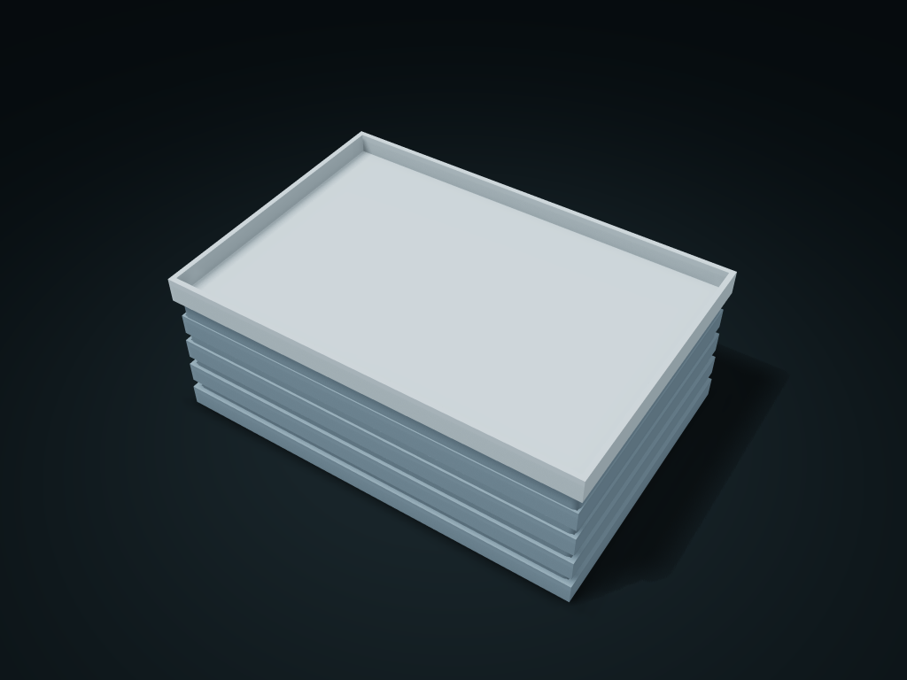](../models/stepped-terrace-case/) | [Tiered Rim Tray Lid Box](../models/stepped-terrace-case/) | 190 × 130 × 72 mm | 2 | [boxesmodel](https://boxesmodel.com/models/stepped-terrace-case) |
| [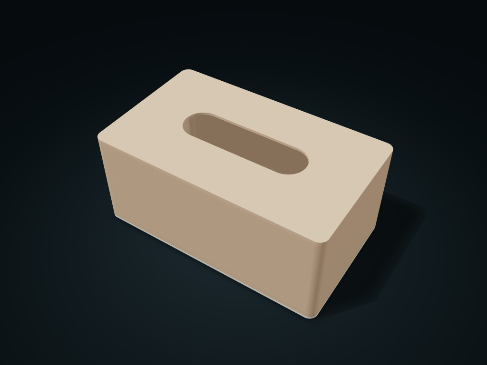](../models/tissue-cover-box/) | [Tissue Cover Box](../models/tissue-cover-box/) | 220 × 130 × 95 mm | 2 | [boxesmodel](https://boxesmodel.com/models/tissue-cover-box) |
|  | [Travel-Limited Twin Compartment Portion Box](../models/captive-pair-dose-slider/) | 180 × 90 × 32 mm | 7 | [boxesmodel](https://boxesmodel.com/models/captive-pair-dose-slider) |
|  | [Triangle Relief Box](../models/facet-box/) | 180 × 130 × 80 mm | 2 | [boxesmodel](https://boxesmodel.com/models/facet-box) |
| [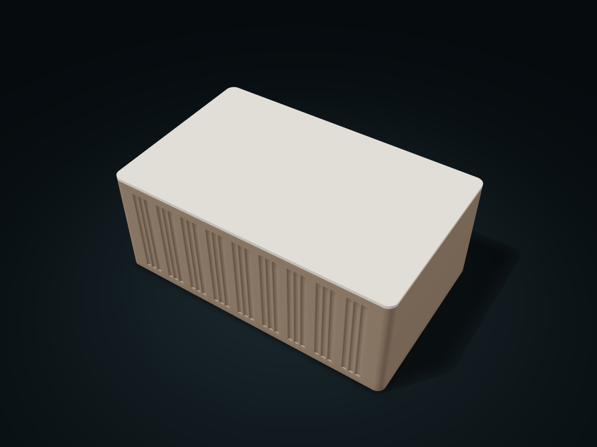](../models/triple-reed-tea-chest/) | [Triple Reed Tea Bag Box](../models/triple-reed-tea-chest/) | 240 × 150 × 95 mm | 2 | [boxesmodel](https://boxesmodel.com/models/triple-reed-tea-chest) |
|  | [Tulip Petal Divided Box](../models/tulip-petal-lift-box/) | 180 × 140 × 38 mm | 2 | [boxesmodel](https://boxesmodel.com/models/tulip-petal-lift-box) |
| [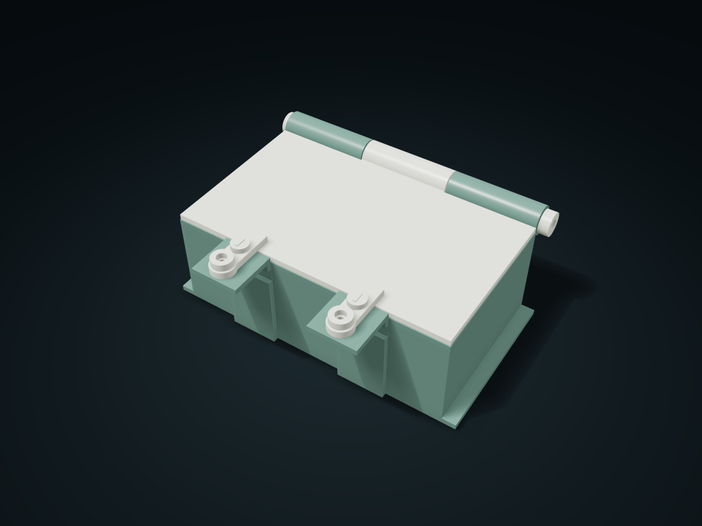](../models/dual-indexed-tongue-toolcase/) | [Twin-Locating Twist Tongue Tool Box](../models/dual-indexed-tongue-toolcase/) | 180 × 140 × 70 mm | 10 | [boxesmodel](https://boxesmodel.com/models/dual-indexed-tongue-toolcase) |
|  | [Twist-Lock Compartment Box](../models/bayonet-compartment-box/) | 111.6 × 111.6 × 59.8 mm | 2 | [boxesmodel](https://boxesmodel.com/models/bayonet-compartment-box) |
| [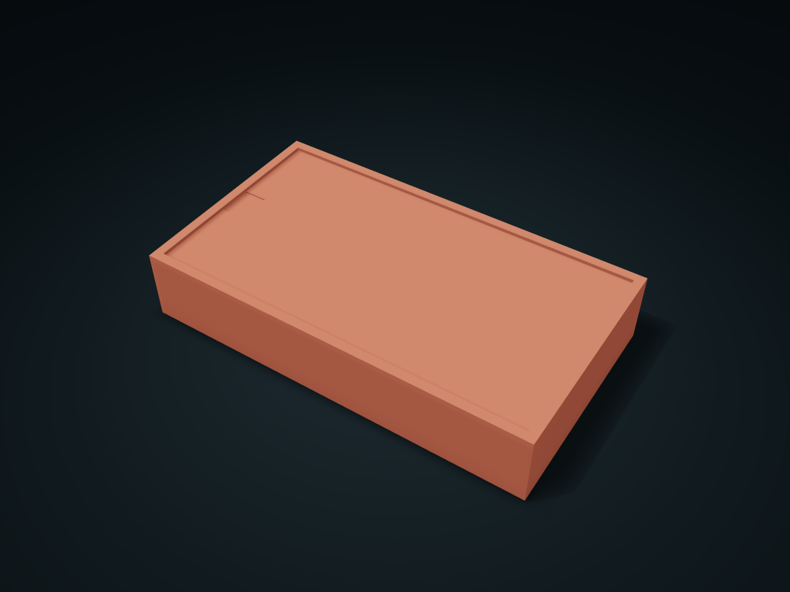](../models/dip-body-shoulder-slide/) | [Two-Row Chip Shoulder Slide Box](../models/dip-body-shoulder-slide/) | 205 × 115 × 38 mm | 2 | [boxesmodel](https://boxesmodel.com/models/dip-body-shoulder-slide) |
| [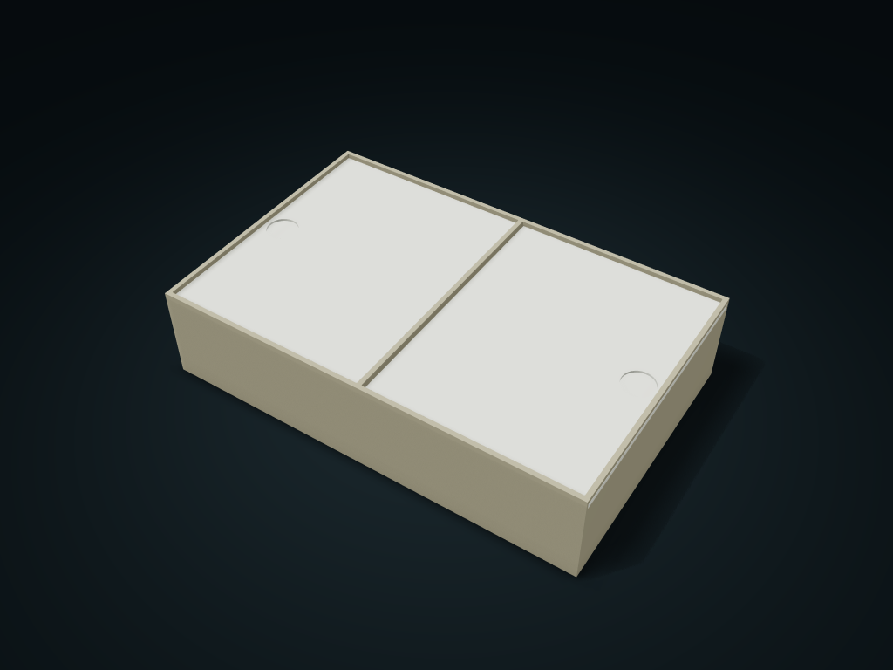](../models/double-slide-case/) | [Two-Way Sliding Lid Box](../models/double-slide-case/) | 220 × 140 × 50 mm | 3 | [boxesmodel](https://boxesmodel.com/models/double-slide-case) |
|  | [Umbrella Hook Divided Box](../models/umbrella-hook-lift-box/) | 180 × 140 × 38 mm | 2 | [boxesmodel](https://boxesmodel.com/models/umbrella-hook-lift-box) |
|  | [Vented Brush Head Guard Box with Handle Opening](../models/handle-port-brush-pod/) | 60 × 38 × 28 mm | 2 | [boxesmodel](https://boxesmodel.com/models/handle-port-brush-pod) |
| [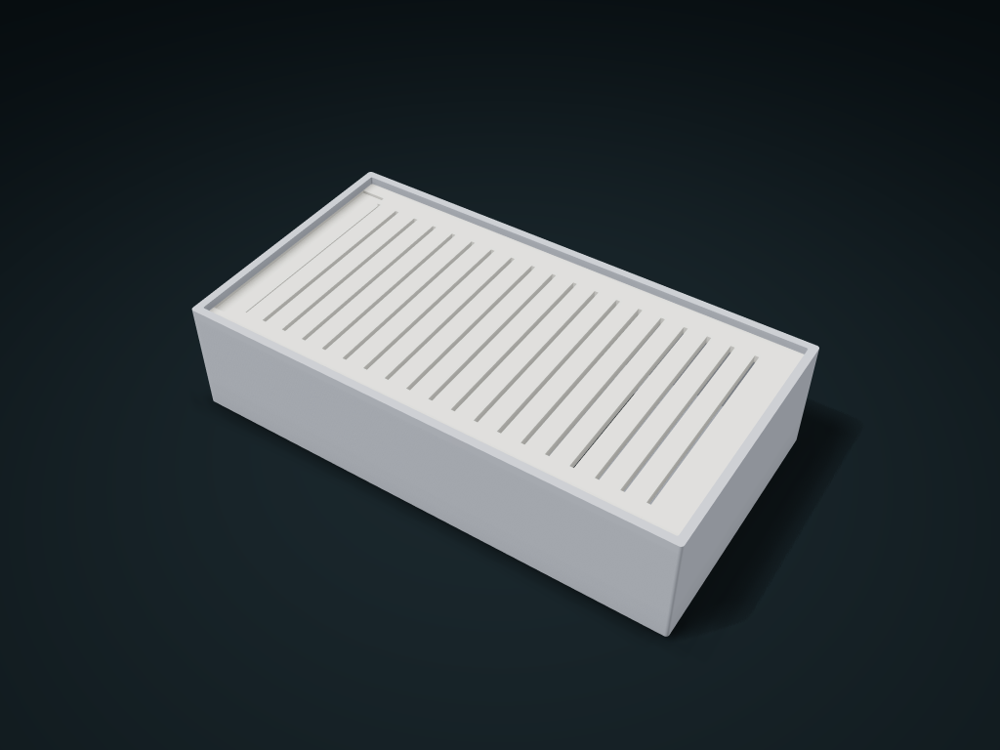](../models/desiccant-slide-box/) | [Vented Desiccant Sliding Lid Box](../models/desiccant-slide-box/) | 150 × 80 × 35 mm | 2 | [boxesmodel](https://boxesmodel.com/models/desiccant-slide-box) |
|  | [Wet Palette with Paper Press](../models/wet-palette-case/) | 178.8 × 118.8 × 25.6 mm | 3 | [boxesmodel](https://boxesmodel.com/models/wet-palette-case) |
| [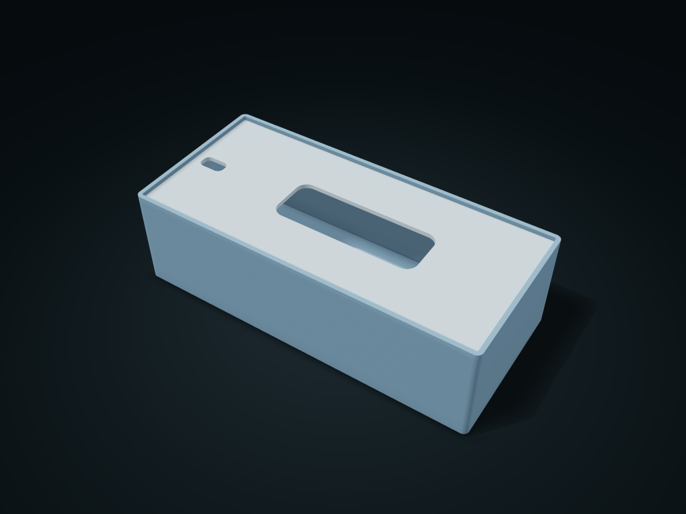](../models/window-sled-bag-box/) | [Window-Slide Food Bag Box](../models/window-sled-bag-box/) | 240 × 110 × 70 mm | 2 | [boxesmodel](https://boxesmodel.com/models/window-sled-bag-box) |
|  | [Windowed Spare Toilet Roll Cover Box](../models/hooded-roll-reserve/) | 160 × 160 × 240 mm | 2 | [boxesmodel](https://boxesmodel.com/models/hooded-roll-reserve) |

[← Previous](lidded-storage.md) · [1](lidded-storage.md) · **2**
