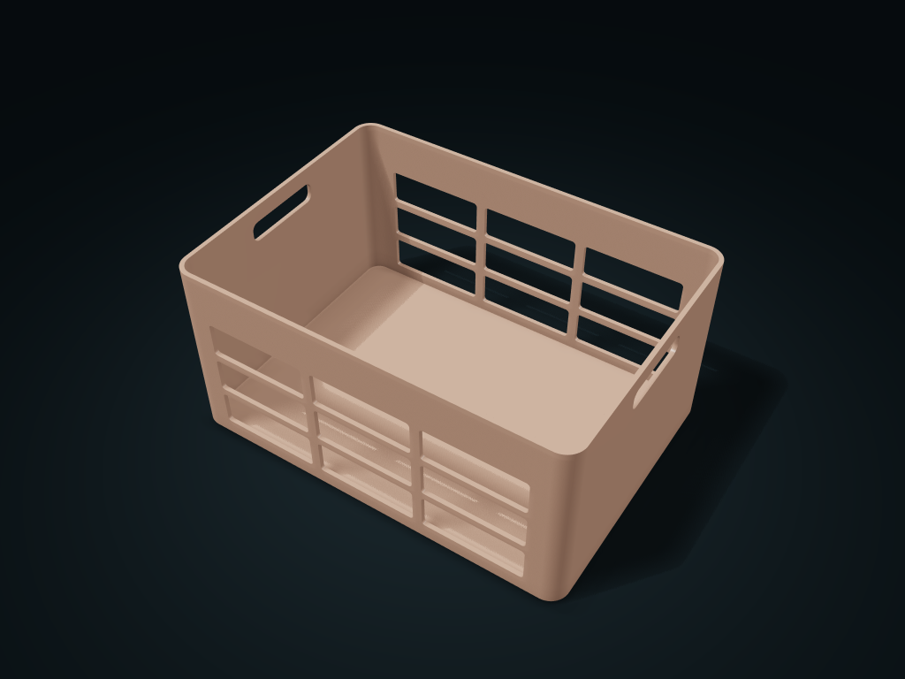
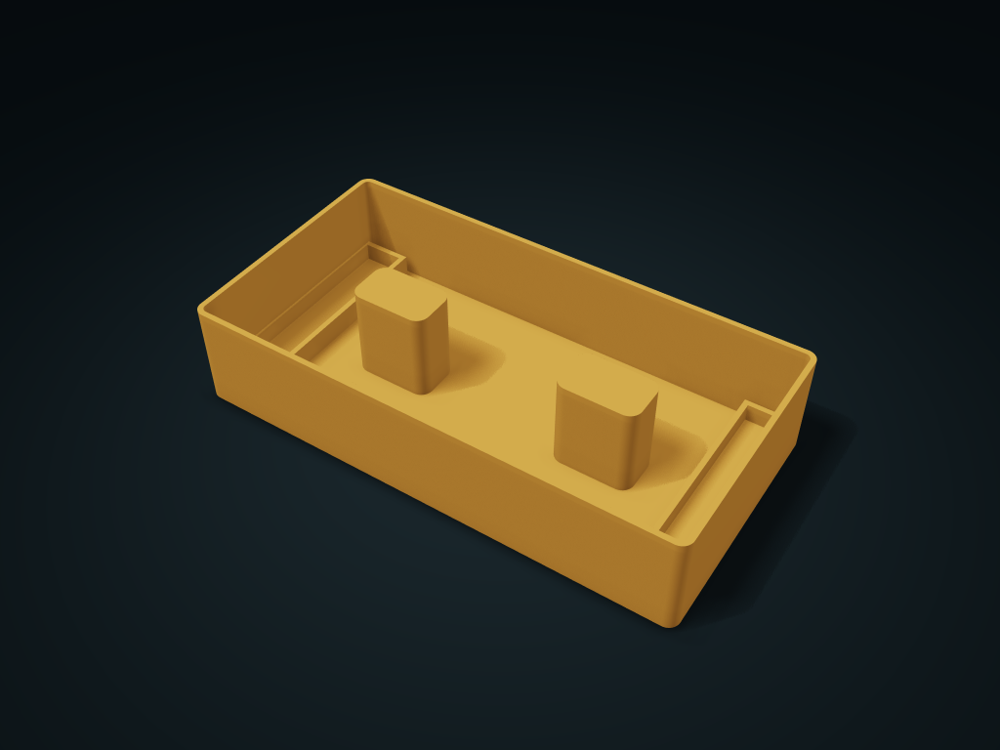
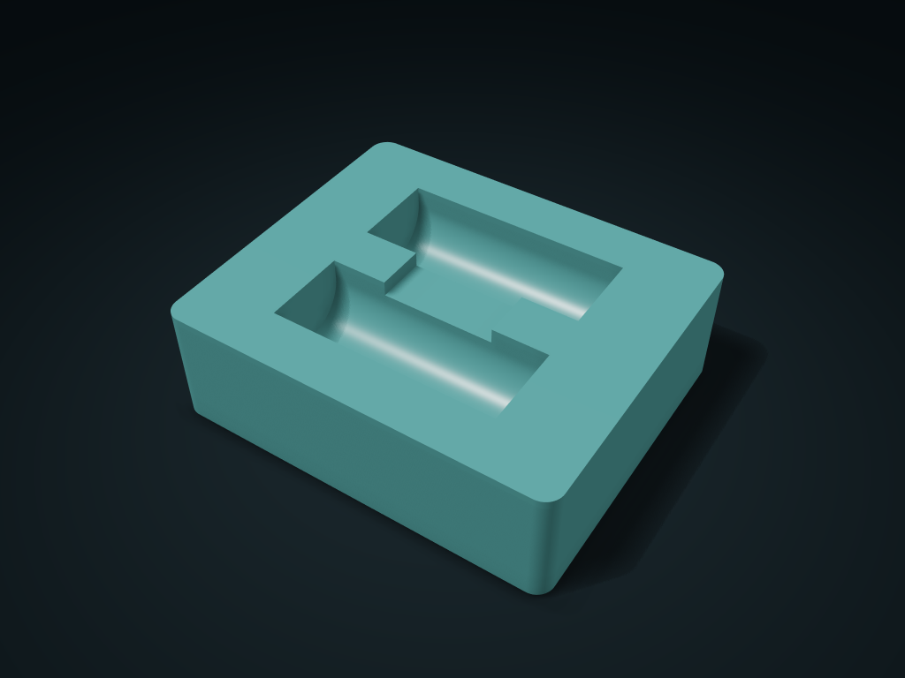
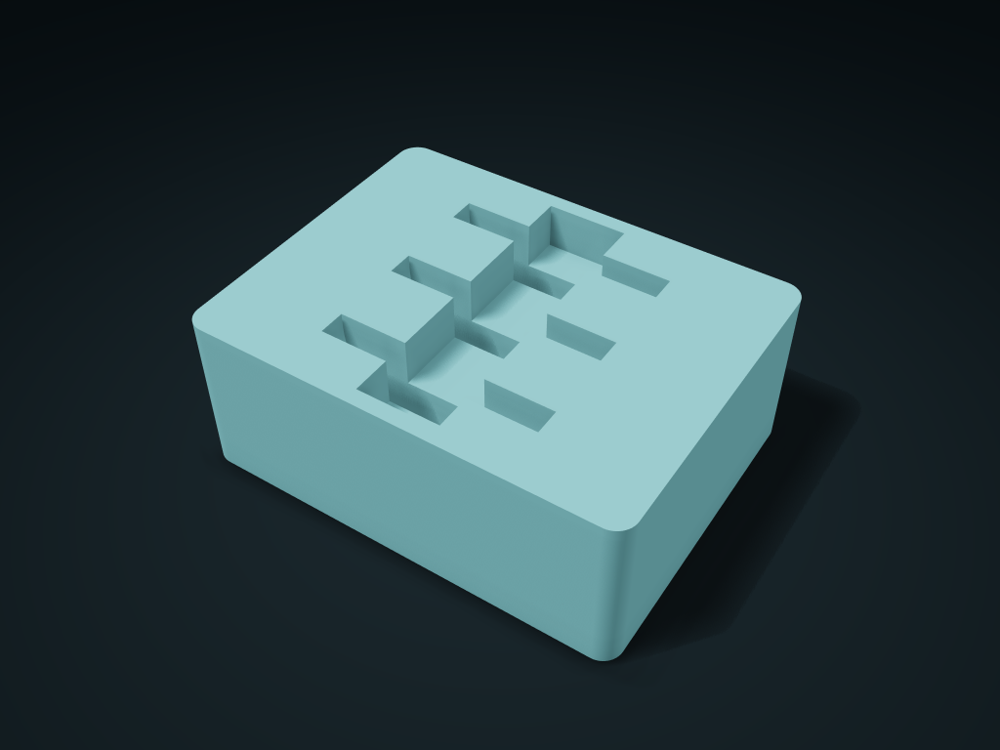

# Open Storage

**Page 2 of 2** · Models 51–61 of 61

Click a thumbnail or model name to open its files and guide. Use **Preview & customize** to open the interactive model on boxesmodel.

[All models](../CATALOG.md) · [Collection overview](../README.md)

[← Previous](open-storage.md) · [1](open-storage.md) · **2**

| Thumbnail | Model | Default dimensions | Parts | Preview & customize |
| --- | --- | --- | ---: | --- |
|  | [Twin-Handle Vented Basket](../models/vented-basket/) | 210 × 150 × 100 mm | 1 | [boxesmodel](https://boxesmodel.com/models/vented-basket) |
|  | [Twin-Hole Fixed Divided Box](../models/pegboard-bolt-bin/) | 160 × 100 × 90 mm | 1 | [boxesmodel](https://boxesmodel.com/models/pegboard-bolt-bin) |
|  | [Twin-Post Figure-Eight Cable Winder](../models/cable-figure-eight-bin/) | 215 × 110 × 45 mm | 1 | [boxesmodel](https://boxesmodel.com/models/cable-figure-eight-bin) |
|  | [Twin-Rod Spool Rack](../models/twin-rod-spool-cradle/) | 300 × 180 × 65 mm | 2 | [boxesmodel](https://boxesmodel.com/models/twin-rod-spool-cradle) |
|  | [Twin-Tube Bridge Rest Box](../models/binocular-bridge-bed/) | 155 × 130 × 48 mm | 1 | [boxesmodel](https://boxesmodel.com/models/binocular-bridge-bed) |
|  | [Two-Row Post Bag Dryer](../models/twin-mast-bag-dryer/) | 180 × 140 × 185 mm | 5 | [boxesmodel](https://boxesmodel.com/models/twin-mast-bag-dryer) |
|  | [Two-Way Sloped Floor Sachet Box](../models/sachet-opposed-bin/) | 190 × 115 × 50 mm | 1 | [boxesmodel](https://boxesmodel.com/models/sachet-opposed-bin) |
|  | [Under-Cabinet Lid Rim Hanging Bay](../models/rim-hung-lid-cassette/) | 168 × 95 × 18 mm | 1 | [boxesmodel](https://boxesmodel.com/models/rim-hung-lid-cassette) |
|  | [Up-and-Over Rotating Jar Rack](../models/return-can-rack/) | 121.8 × 190.39 × 190.02 mm | 1 | [boxesmodel](https://boxesmodel.com/models/return-can-rack) |
|  | [Upright Document Box](../models/open-file-rack/) | 180 × 180 × 150 mm | 1 | [boxesmodel](https://boxesmodel.com/models/open-file-rack) |
|  | [Windowed Bangle Arc Slot Box](../models/bangle-upright-saddle/) | 130 × 100 × 50 mm | 1 | [boxesmodel](https://boxesmodel.com/models/bangle-upright-saddle) |

[← Previous](open-storage.md) · [1](open-storage.md) · **2**
