# Open Storage

**Page 1 of 2** · Models 1–50 of 61

Click a thumbnail or model name to open its files and guide. Use **Preview & customize** to open the interactive model on boxesmodel.

[All models](../CATALOG.md) · [Collection overview](../README.md)

**1** · [2](open-storage-2.md) · [Next →](open-storage-2.md)

| Thumbnail | Model | Default dimensions | Parts | Preview & customize |
| --- | --- | --- | ---: | --- |
|  | [Arched-Vent Nursery Pot Sleeve](../models/arched-vent-nursery-sleeve/) | 145 × 145 × 115 mm | 1 | [boxesmodel](https://boxesmodel.com/models/arched-vent-nursery-sleeve) |
| [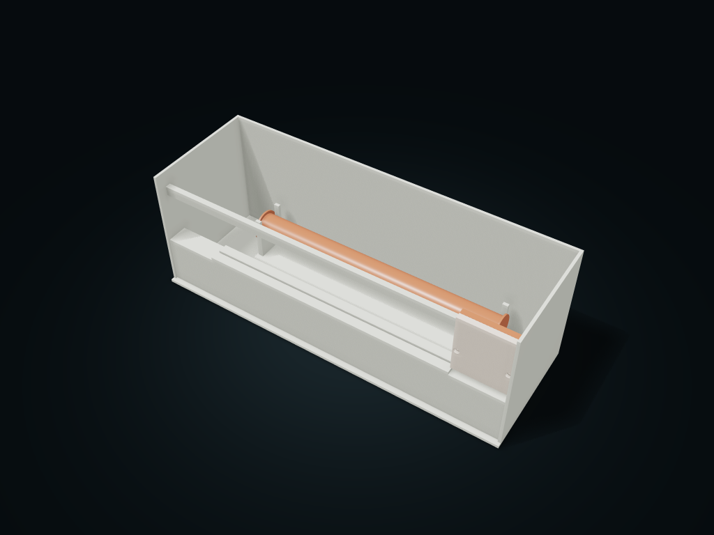](../models/roll-cutter-rail-holder/) | [Axle-Rest Roll Cutter Station](../models/roll-cutter-rail-holder/) | 380 × 130 × 135 mm | 4 | [boxesmodel](https://boxesmodel.com/models/roll-cutter-rail-holder) |
|  | [Bag Roll Dispenser Box](../models/bag-roll-dispenser/) | 180 × 110 × 100 mm | 2 | [boxesmodel](https://boxesmodel.com/models/bag-roll-dispenser) |
| [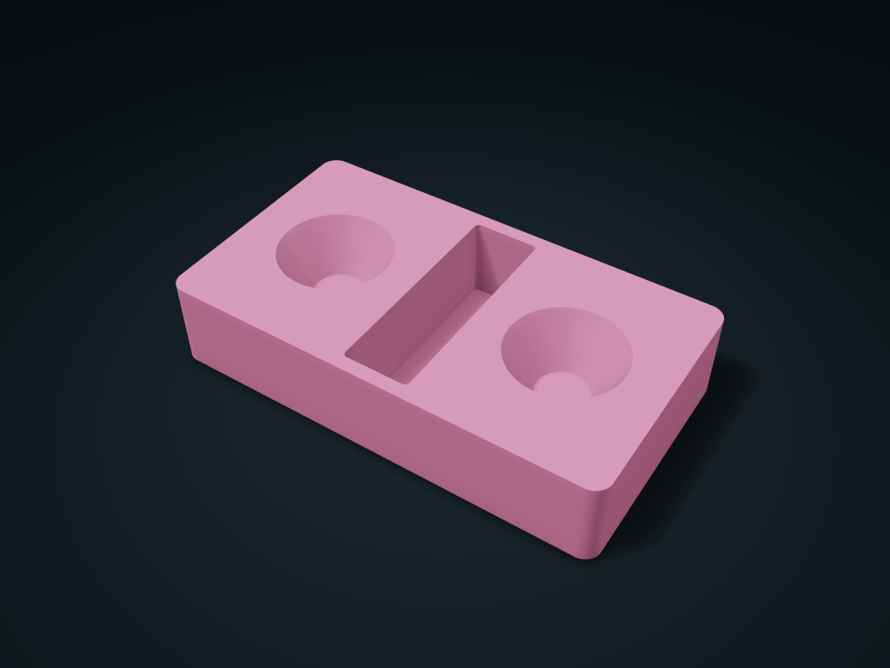](../models/makeup-sponge-taper-bed/) | [Beauty Sponge Flared Pocket Box](../models/makeup-sponge-taper-bed/) | 190 × 105 × 38 mm | 1 | [boxesmodel](https://boxesmodel.com/models/makeup-sponge-taper-bed) |
| [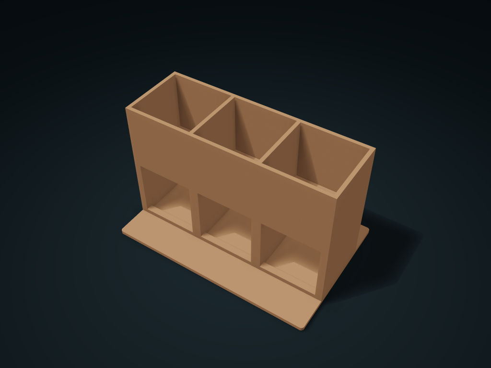](../models/carton-feed-caddy/) | [Boxed Capsule Bottom-Dispensing Compartment Seat](../models/carton-feed-caddy/) | 135 × 90 × 86.4 mm | 1 | [boxesmodel](https://boxesmodel.com/models/carton-feed-caddy) |
| [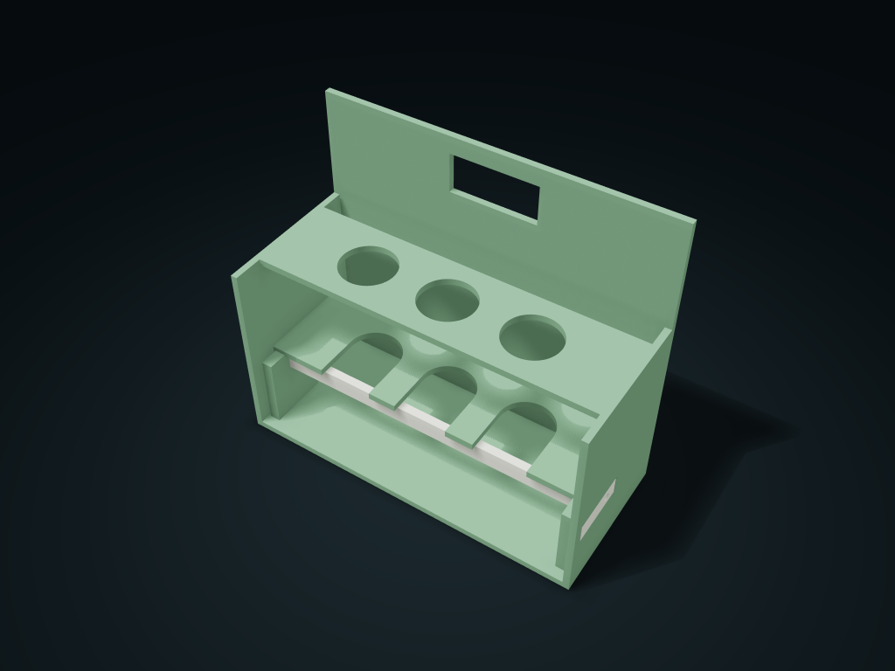](../models/fork-vial-step-carrier/) | [Cap-Rest Fork Two-Level Bottle Rack](../models/fork-vial-step-carrier/) | 160 × 70 × 138 mm | 2 | [boxesmodel](https://boxesmodel.com/models/fork-vial-step-carrier) |
| [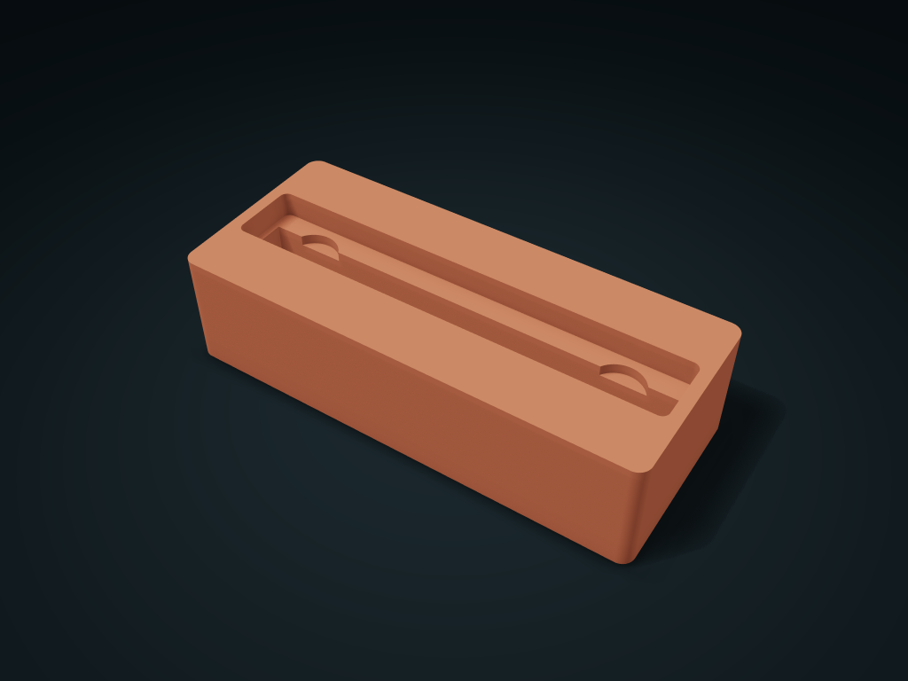](../models/comb-tooth-guard-box/) | [Comb Tooth Relief Lying Box](../models/comb-tooth-guard-box/) | 180 × 75 × 45 mm | 1 | [boxesmodel](https://boxesmodel.com/models/comb-tooth-guard-box) |
| [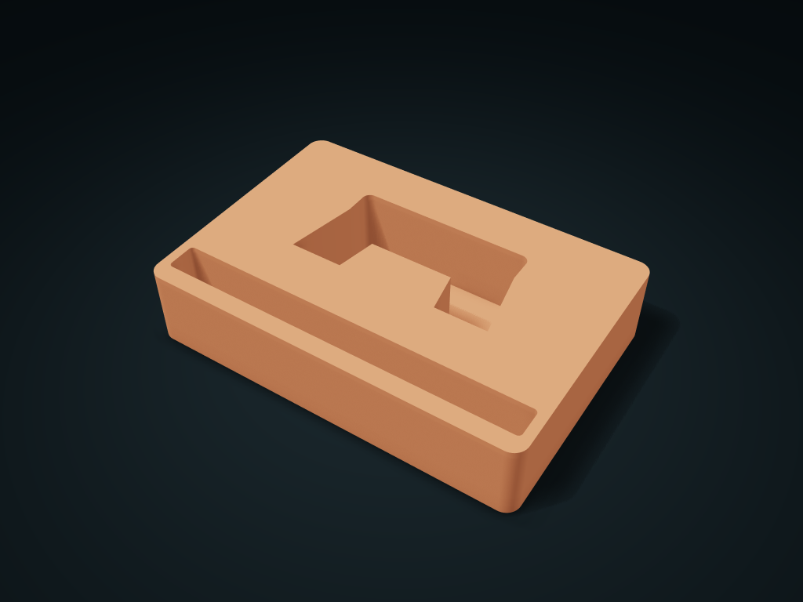](../models/controller-wing-basin/) | [Controller Twin-Wing Outline Box](../models/controller-wing-basin/) | 185 × 125 × 38 mm | 1 | [boxesmodel](https://boxesmodel.com/models/controller-wing-basin) |
|  | [Curved Brim Cap Holder](../models/arc-slot-cap-caddy/) | 210 × 280 × 50 mm | 1 | [boxesmodel](https://boxesmodel.com/models/arc-slot-cap-caddy) |
|  | [Cut-Out Storage Box](../models/window-box/) | 200 × 130 × 75 mm | 1 | [boxesmodel](https://boxesmodel.com/models/window-box) |
| [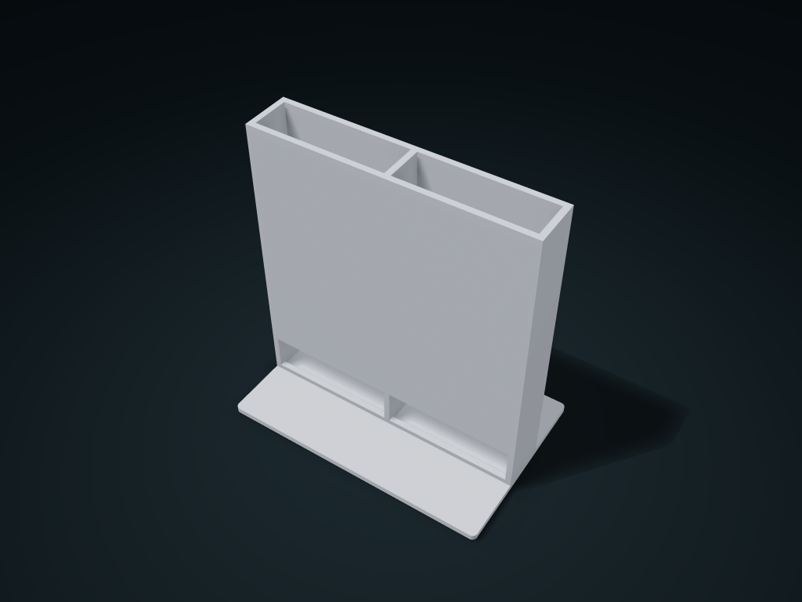](../models/battery-feed-bin/) | [Cylinder Bottom-Dispensing Bin](../models/battery-feed-bin/) | 109.8 × 72.9 × 120 mm | 1 | [boxesmodel](https://boxesmodel.com/models/battery-feed-bin) |
| [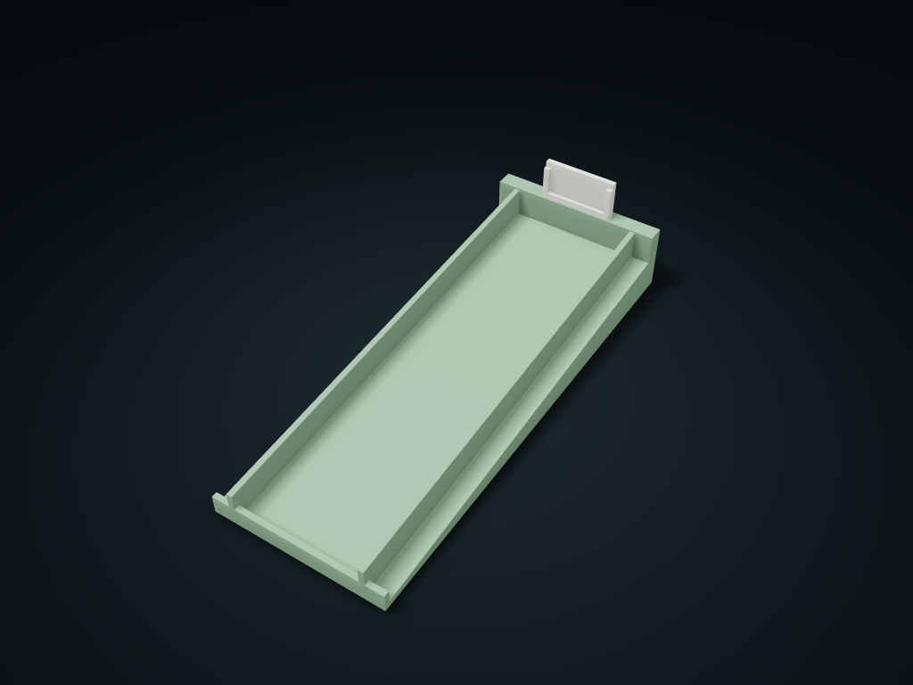](../models/date-tab-egg-ramp/) | [Date-Label Gentle Slope Egg Rack](../models/date-tab-egg-ramp/) | 90 × 240 × 55.9 mm | 2 | [boxesmodel](https://boxesmodel.com/models/date-tab-egg-ramp) |
| [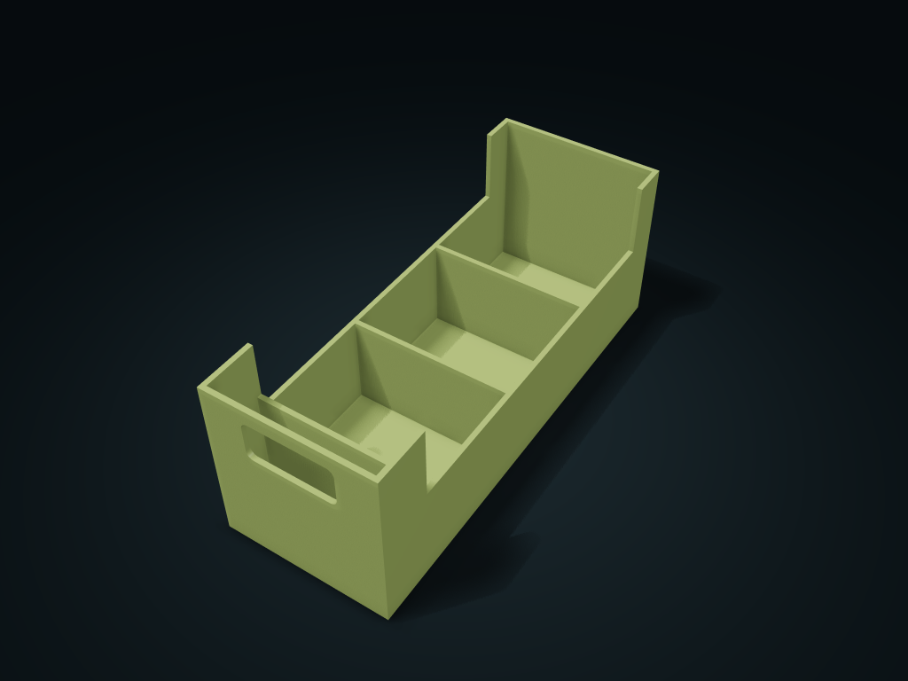](../models/front-pull-bottle-caddy/) | [Deep Cabinet Front-Pull Steady Bottle Box](../models/front-pull-bottle-caddy/) | 92 × 245 × 94 mm | 1 | [boxesmodel](https://boxesmodel.com/models/front-pull-bottle-caddy) |
| [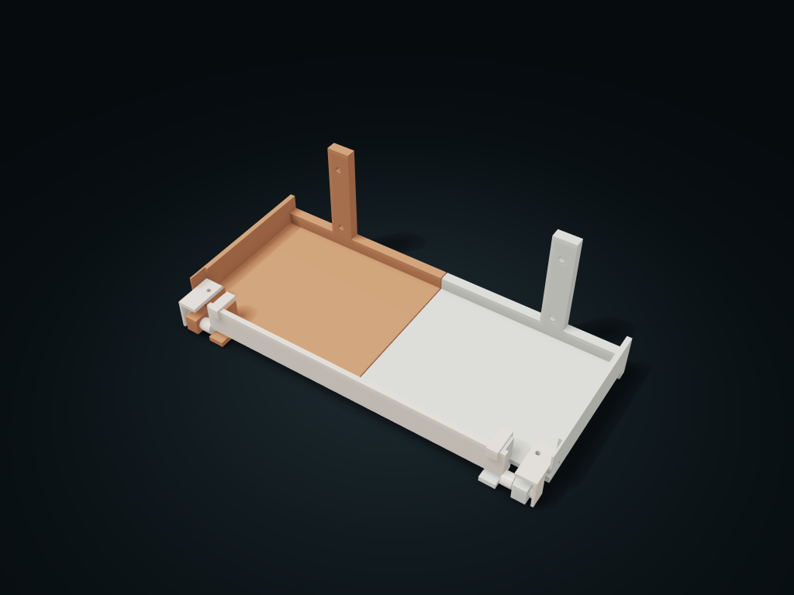](../models/fold-gate-carton-wall-cradle/) | [Drop-Down Front Paper Box Wall Rack](../models/fold-gate-carton-wall-cradle/) | 290 × 135 × 100 mm | 11 | [boxesmodel](https://boxesmodel.com/models/fold-gate-carton-wall-cradle) |
| [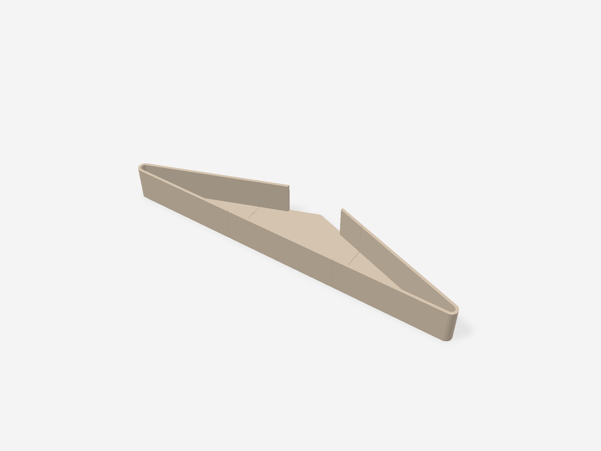](../models/hanger-shoulder-stack-cradle/) | [Empty Hanger Double-Shoulder Stand](../models/hanger-shoulder-stack-cradle/) | 374 × 79.51 × 38 mm | 3 | [boxesmodel](https://boxesmodel.com/models/hanger-shoulder-stack-cradle) |
| [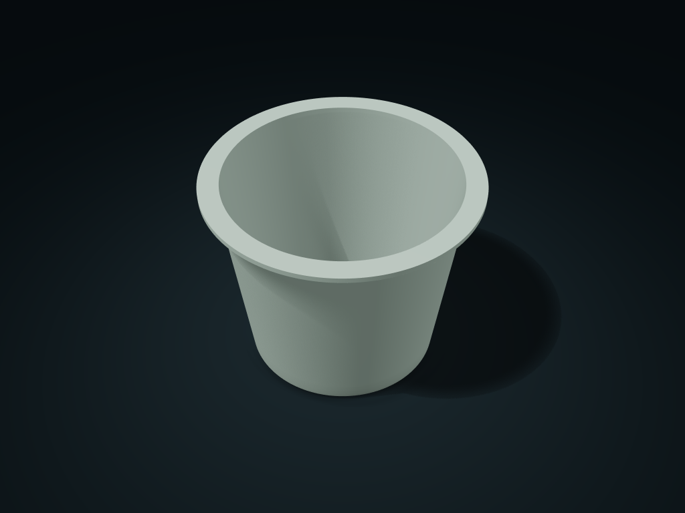](../models/rim-rest-drainage-liner/) | [Flanged Tapered Drainage Liner](../models/rim-rest-drainage-liner/) | 150 × 150 × 115 mm | 1 | [boxesmodel](https://boxesmodel.com/models/rim-rest-drainage-liner) |
| [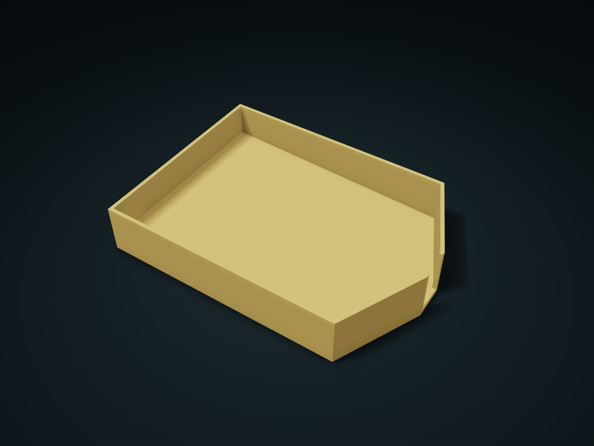](../models/pour-sorter/) | [Flow Guide Sorting Tray](../models/pour-sorter/) | 180 × 130 × 32 mm | 1 | [boxesmodel](https://boxesmodel.com/models/pour-sorter) |
| [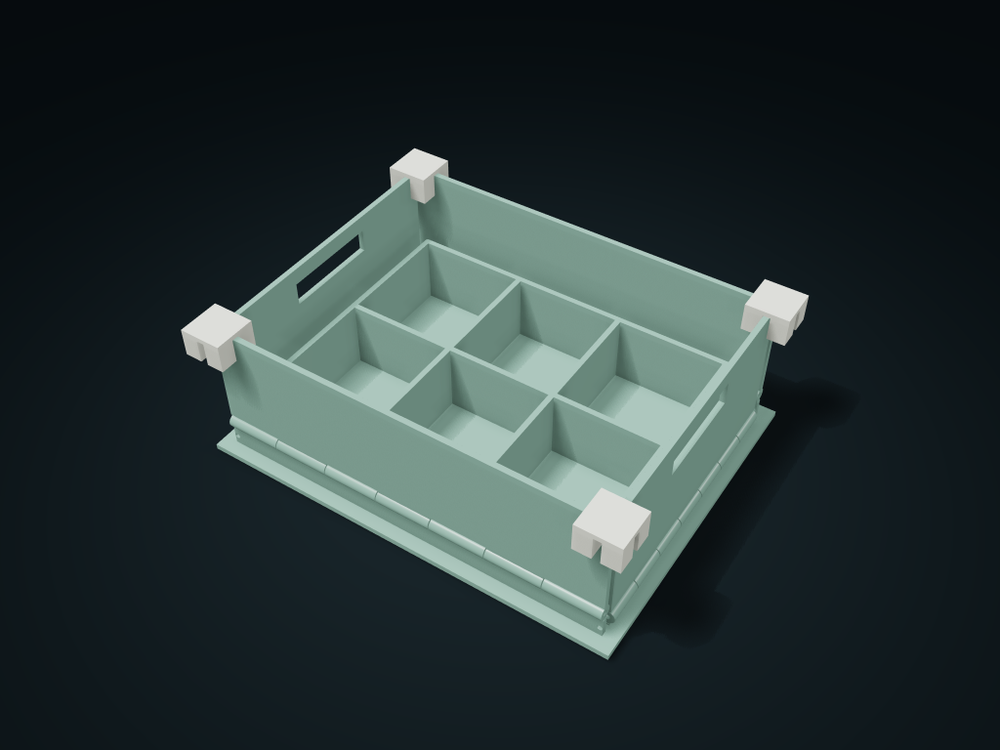](../models/folding-partition-crate/) | [Folding Column Crate](../models/folding-partition-crate/) | 184 × 144 × 64 mm | 10 | [boxesmodel](https://boxesmodel.com/models/folding-partition-crate) |
| [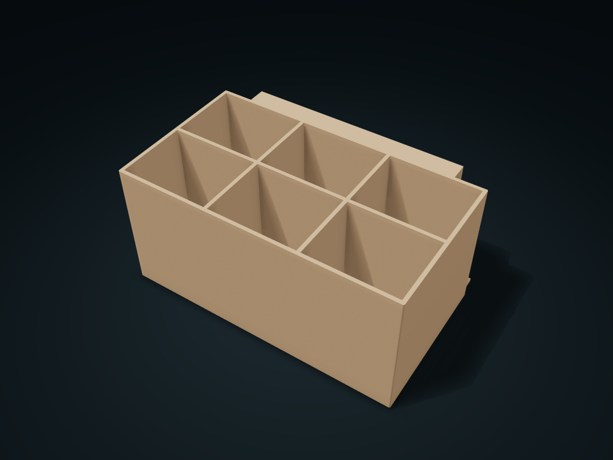](../models/cleat-hanging-bin/) | [French Cleat Wall Divided Box](../models/cleat-hanging-bin/) | 180 × 110 × 85 mm | 2 | [boxesmodel](https://boxesmodel.com/models/cleat-hanging-bin) |
|  | [Hairpin Switchback Lane Tray](../models/hairpin-labyrinth-tray/) | 180 × 130 × 25 mm | 1 | [boxesmodel](https://boxesmodel.com/models/hairpin-labyrinth-tray) |
| [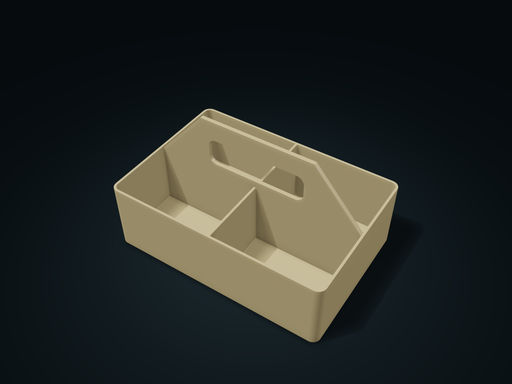](../models/carry-caddy/) | [Handle Storage Basket](../models/carry-caddy/) | 220 × 150 × 125 mm | 1 | [boxesmodel](https://boxesmodel.com/models/carry-caddy) |
|  | [Horseshoe Nozzle Clearance Box](../models/dryer-nozzle-horseshoe/) | 130 × 125 × 35 mm | 1 | [boxesmodel](https://boxesmodel.com/models/dryer-nozzle-horseshoe) |
| [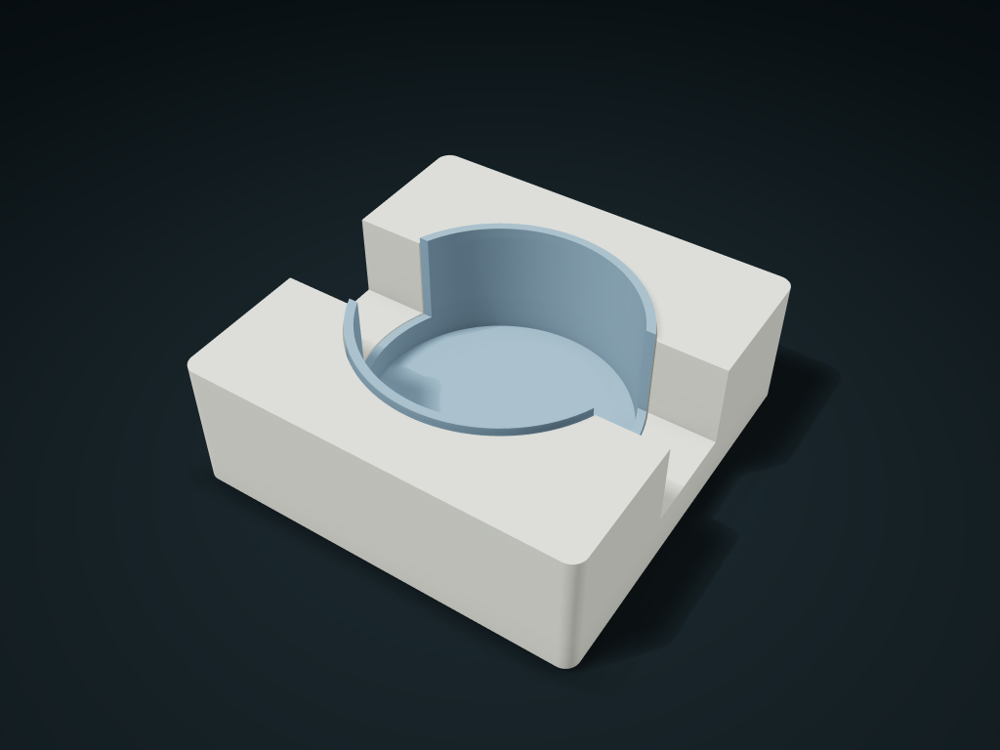](../models/soft-liner-lens-cup/) | [Interchangeable Soft Liner Lens Bay](../models/soft-liner-lens-cup/) | 110 × 110 × 40 mm | 2 | [boxesmodel](https://boxesmodel.com/models/soft-liner-lens-cup) |
|  | [Lift-Mat Textured Brush Shallow Box](../models/lift-mat-brush-basin/) | 150 × 110 × 25 mm | 2 | [boxesmodel](https://boxesmodel.com/models/lift-mat-brush-basin) |
| [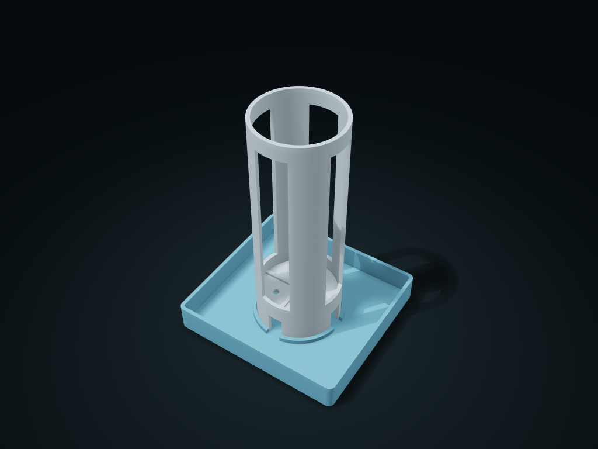](../models/lift-cup-umbrella-basin/) | [Lift-Out Tube Folding Umbrella Drip Stand](../models/lift-cup-umbrella-basin/) | 140 × 130 × 190 mm | 2 | [boxesmodel](https://boxesmodel.com/models/lift-cup-umbrella-basin) |
| [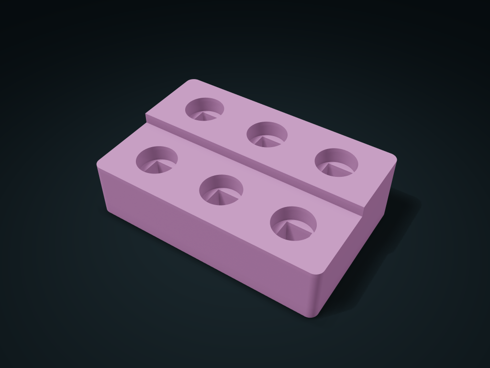](../models/lipstick-step-well-box/) | [Lipstick Stepped Shoulder Locating Box](../models/lipstick-step-well-box/) | 170 × 110 × 50 mm | 1 | [boxesmodel](https://boxesmodel.com/models/lipstick-step-well-box) |
| [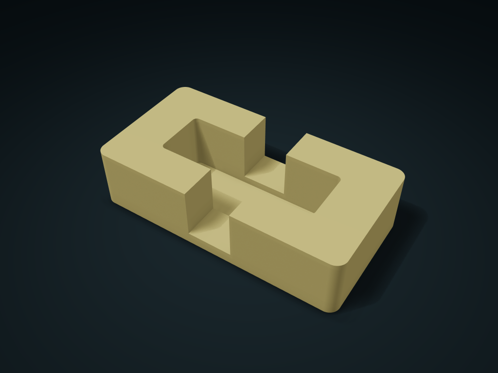](../models/cotton-swab-cross-box/) | [Mid-Grip Cotton Bud Box](../models/cotton-swab-cross-box/) | 165 × 85 × 40 mm | 1 | [boxesmodel](https://boxesmodel.com/models/cotton-swab-cross-box) |
| [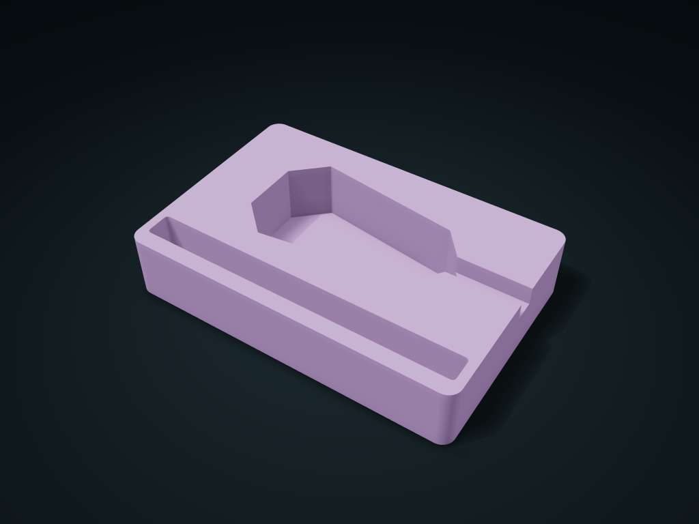](../models/mouse-pear-tail-case/) | [Mouse Pear-Shaped Tail Slot Box](../models/mouse-pear-tail-case/) | 180 × 120 × 35 mm | 1 | [boxesmodel](https://boxesmodel.com/models/mouse-pear-tail-case) |
| [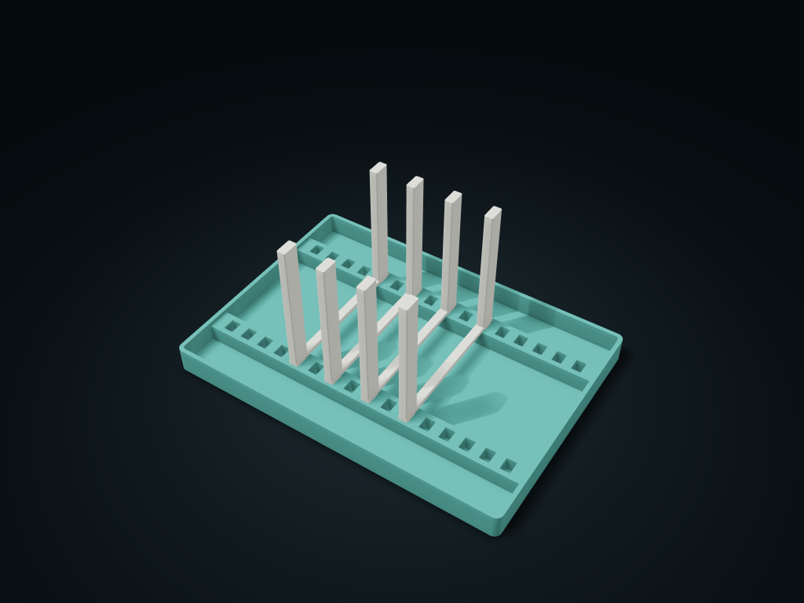](../models/twin-key-lid-file/) | [Movable Two-Leg Divider Lid Rack](../models/twin-key-lid-file/) | 240 × 170 × 110 mm | 5 | [boxesmodel](https://boxesmodel.com/models/twin-key-lid-file) |
|  | [Neck & Body Twin-Cradle Bottle Box](../models/heel-stop-bottle-cellar/) | 240 × 210 × 65 mm | 1 | [boxesmodel](https://boxesmodel.com/models/heel-stop-bottle-cellar) |
|  | [Open-Front Parts Box](../models/scoop-bin/) | 200 × 150 × 90 mm | 1 | [boxesmodel](https://boxesmodel.com/models/scoop-bin) |
| [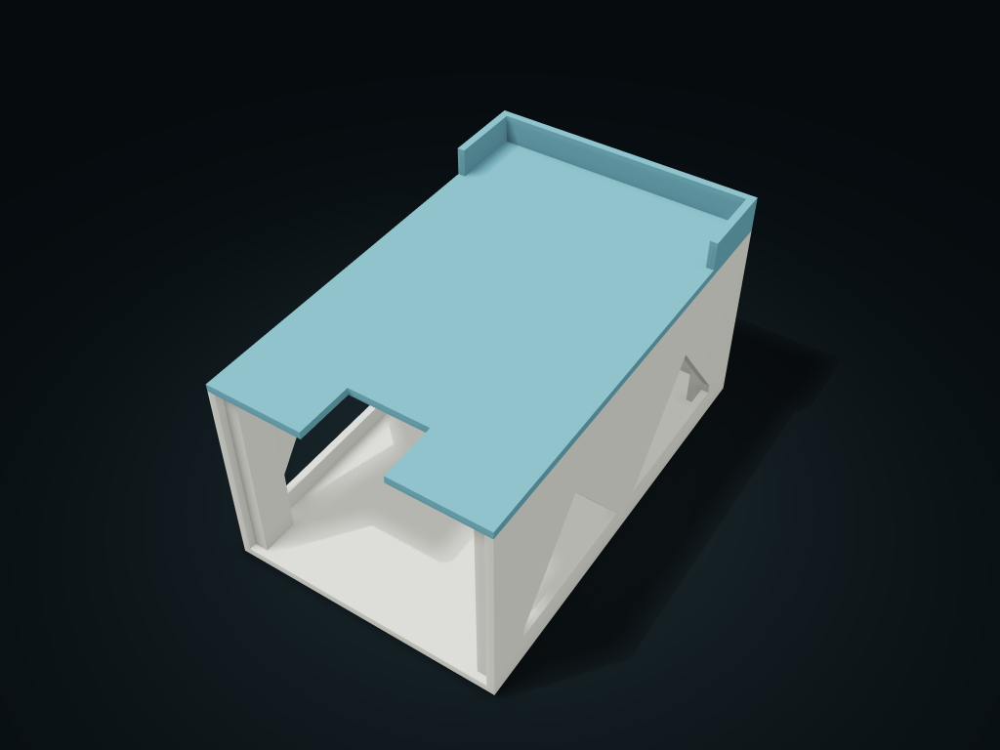](../models/open-front-shoe-pair/) | [Open-Front Two-Shoe Rack](../models/open-front-shoe-pair/) | 150 × 238 × 132 mm | 2 | [boxesmodel](https://boxesmodel.com/models/open-front-shoe-pair) |
|  | [Pen Lay-Flat Slot Tray](../models/pen-tip-tray/) | 200 × 100 × 18 mm | 1 | [boxesmodel](https://boxesmodel.com/models/pen-tip-tray) |
|  | [Pleated Filter Paper Shaping Tube](../models/wave-filter-cup/) | 114.4 × 114.4 × 51.4 mm | 1 | [boxesmodel](https://boxesmodel.com/models/wave-filter-cup) |
| [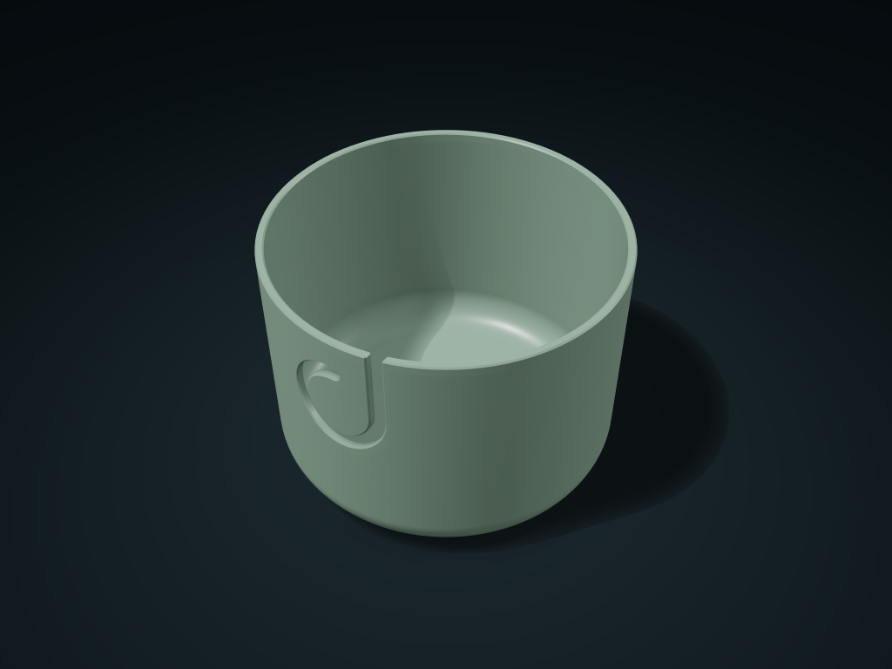](../models/yarn-guide-bowl/) | [Return Hook Yarn Guide Bowl](../models/yarn-guide-bowl/) | 119.6 × 119.6 × 87.8 mm | 1 | [boxesmodel](https://boxesmodel.com/models/yarn-guide-bowl) |
| [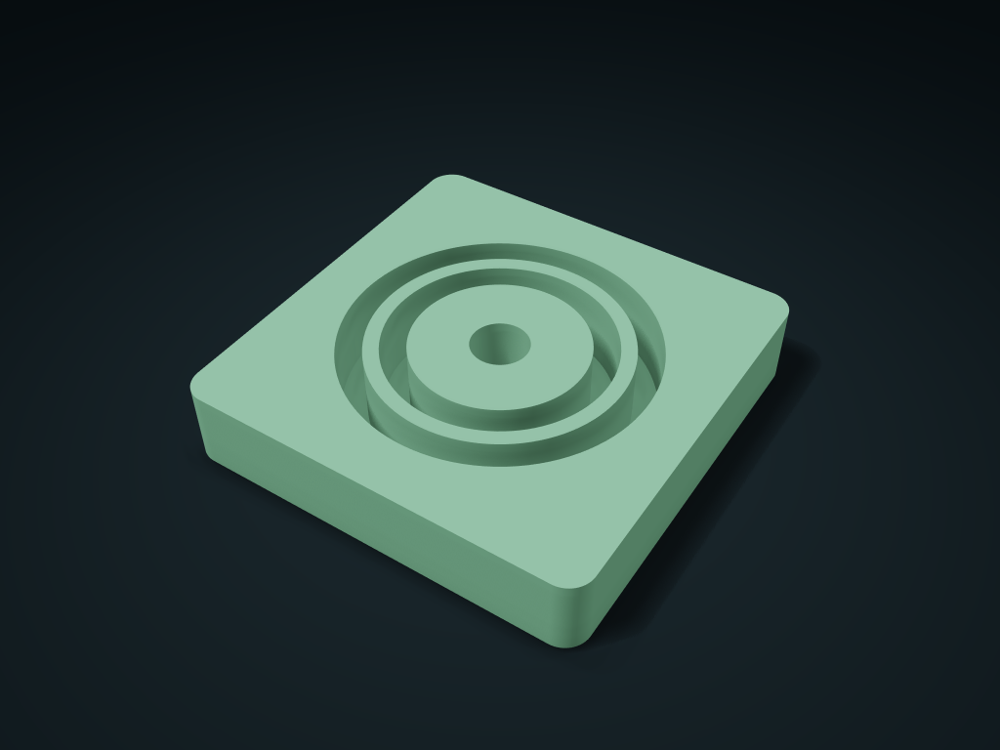](../models/ring-channel-vanity-box/) | [Ring Groove Ring Sorting Tray](../models/ring-channel-vanity-box/) | 130 × 130 × 25 mm | 1 | [boxesmodel](https://boxesmodel.com/models/ring-channel-vanity-box) |
|  | [Ring-Ended Rolled Mat Holder](../models/split-collar-mat-bin/) | 240 × 170 × 70 mm | 3 | [boxesmodel](https://boxesmodel.com/models/split-collar-mat-bin) |
| [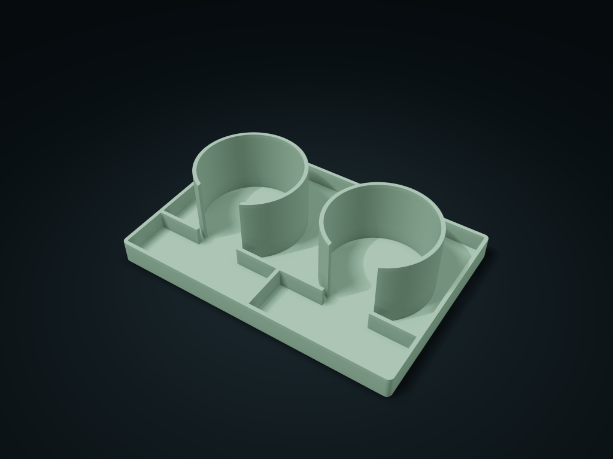](../models/coil-buckle-pocket-box/) | [Rolled Strap & Buckle Compartment Box](../models/coil-buckle-pocket-box/) | 220 × 150 × 55 mm | 1 | [boxesmodel](https://boxesmodel.com/models/coil-buckle-pocket-box) |
|  | [Round Lift-Out Draining Caddy with Spout](../models/round-spout-lift-drain-caddy/) | 150 × 170 × 85 mm | 2 | [boxesmodel](https://boxesmodel.com/models/round-spout-lift-drain-caddy) |
|  | [Shaver Head & Handle Compartment Box](../models/razor-head-saddle-box/) | 155 × 120 × 35 mm | 1 | [boxesmodel](https://boxesmodel.com/models/razor-head-saddle-box) |
| [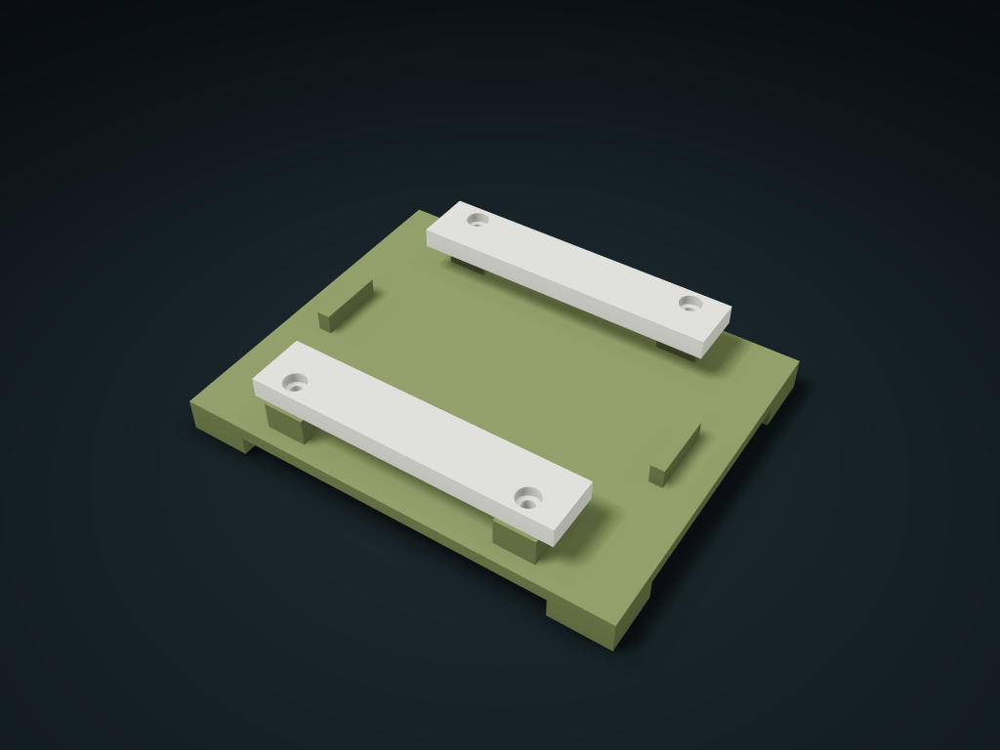](../models/shoulder-jaw-battery-nest/) | [Shoulder-Clamp Power Tool Battery Dock](../models/shoulder-jaw-battery-nest/) | 130 × 104 × 24.4 mm | 3 | [boxesmodel](https://boxesmodel.com/models/shoulder-jaw-battery-nest) |
|  | [Side-Access Under-Desk Cable Trough](../models/side-service-underdesk-trough/) | 220 × 110 × 65 mm | 1 | [boxesmodel](https://boxesmodel.com/models/side-service-underdesk-trough) |
| [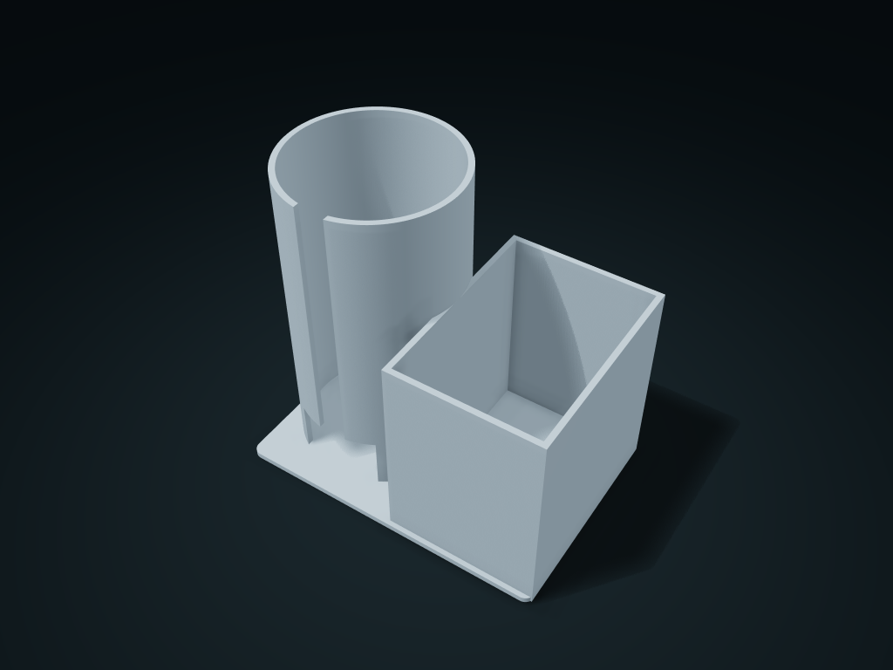](../models/cotton-pad-dispenser/) | [Side-Pick Disc Box](../models/cotton-pad-dispenser/) | 130 × 90 × 130 mm | 1 | [boxesmodel](https://boxesmodel.com/models/cotton-pad-dispenser) |
| [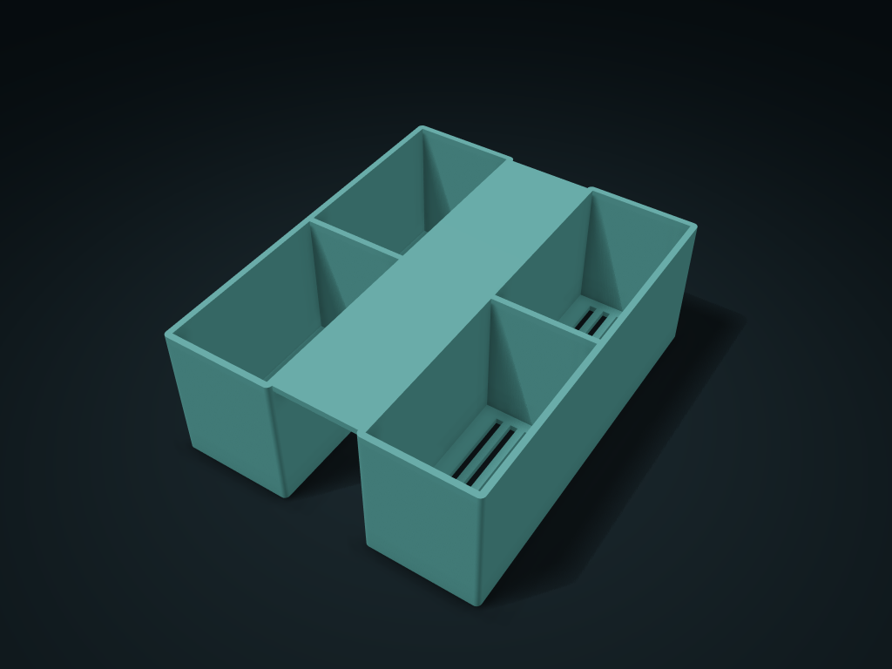](../models/saddle-drain-caddy/) | [Sink-Spanning Two-Side Compartment Box](../models/saddle-drain-caddy/) | 122.8 × 150 × 55 mm | 1 | [boxesmodel](https://boxesmodel.com/models/saddle-drain-caddy) |
|  | [Square & Round Bottle Base Locating Tray](../models/perfume-footprint-caddy/) | 185 × 125 × 32 mm | 1 | [boxesmodel](https://boxesmodel.com/models/perfume-footprint-caddy) |
| [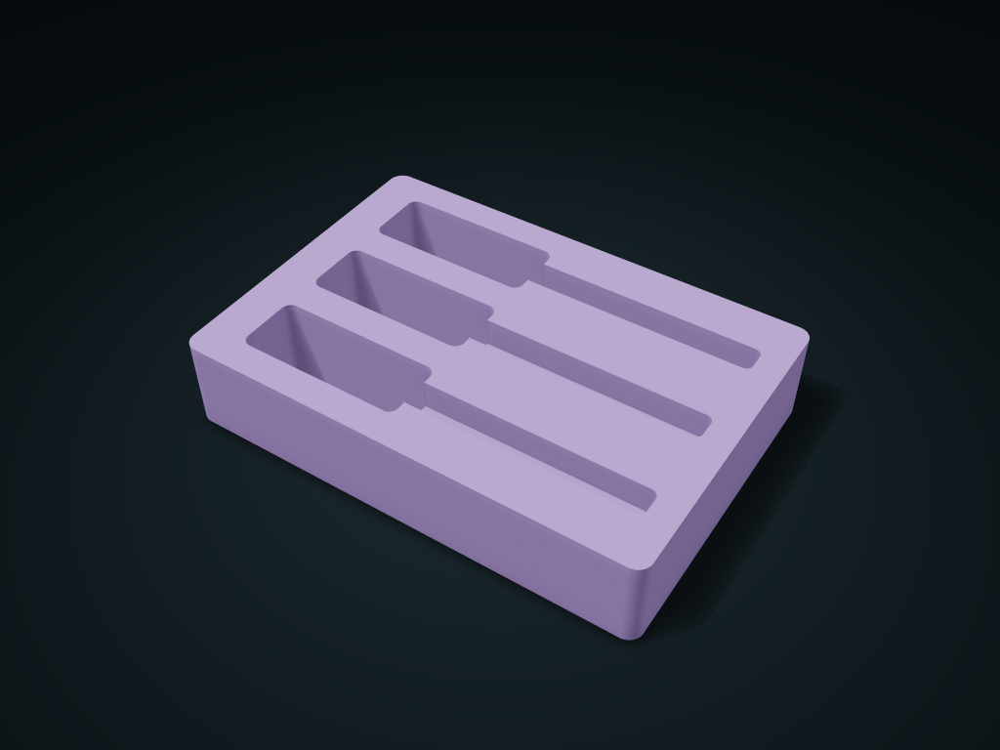](../models/powder-brush-groove-tray/) | [Suspended Brush Head Cross Slot Box](../models/powder-brush-groove-tray/) | 195 × 135 × 38 mm | 1 | [boxesmodel](https://boxesmodel.com/models/powder-brush-groove-tray) |
|  | [Tapered Fluted Planter with Saucer](../models/taper-flute-planter-saucer/) | 150 × 150 × 140 mm | 2 | [boxesmodel](https://boxesmodel.com/models/taper-flute-planter-saucer) |
| [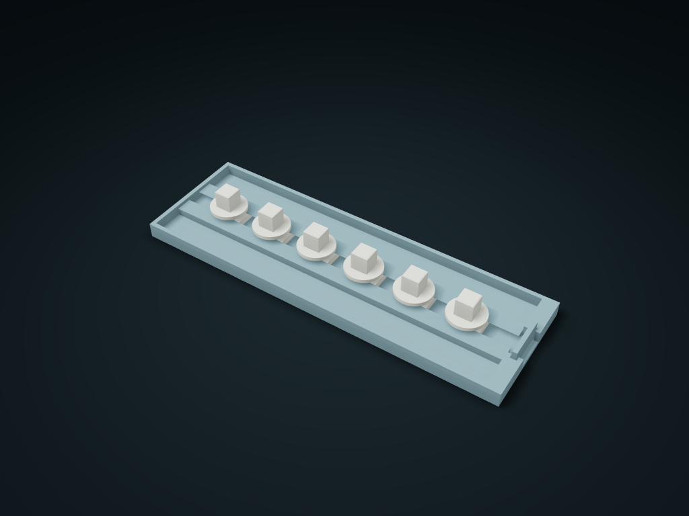](../models/socket-rail-tray/) | [Track Socket Storage Tray](../models/socket-rail-tray/) | 200 × 64 × 21.4 mm | 8 | [boxesmodel](https://boxesmodel.com/models/socket-rail-tray) |
| [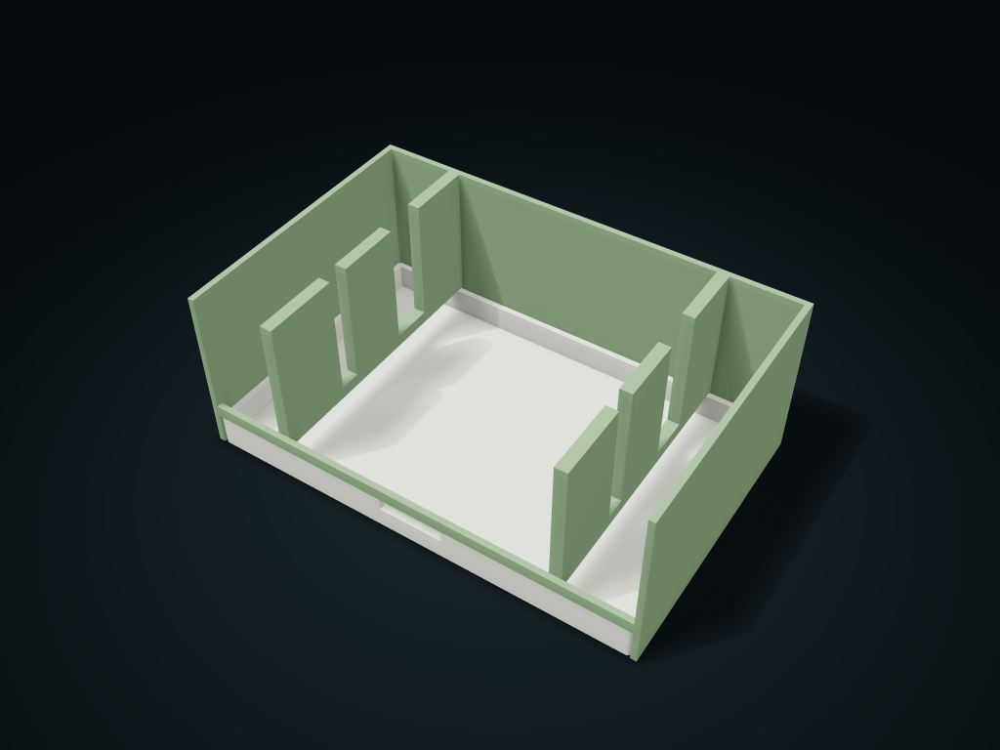](../models/twin-comb-board-drain/) | [Twin-Comb Chopping Board Drying Rack](../models/twin-comb-board-drain/) | 220 × 140 × 85 mm | 2 | [boxesmodel](https://boxesmodel.com/models/twin-comb-board-drain) |
| [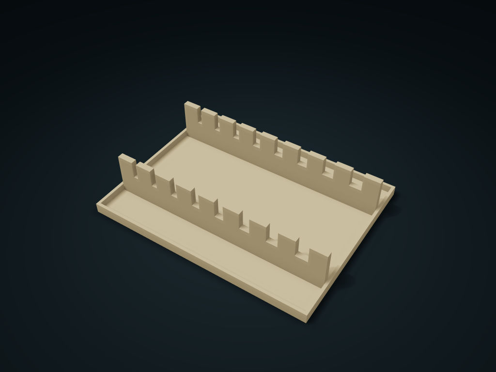](../models/wrench-cradle-tray/) | [Twin-Comb Wrench Storage Tray](../models/wrench-cradle-tray/) | 180 × 140 × 36 mm | 1 | [boxesmodel](https://boxesmodel.com/models/wrench-cradle-tray) |

**1** · [2](open-storage-2.md) · [Next →](open-storage-2.md)
