# Stackable Storage

**Page 1 of 1** · Models 1–32 of 32

Click a thumbnail or model name to open its files and guide. Use **Preview & customize** to open the interactive model on boxesmodel.

[All models](../CATALOG.md) · [Collection overview](../README.md)

| Thumbnail | Model | Default dimensions | Parts | Preview & customize |
| --- | --- | --- | ---: | --- |
|  | [Angled Slot Lift-Out Divider Box](../models/diagonal-lift-divider-box/) | 165 × 125 × 55 mm | 2 | [boxesmodel](https://boxesmodel.com/models/diagonal-lift-divider-box) |
|  | [Arched Handle Inner Basket Box](../models/ring-handle-lift-basket/) | 175 × 125 × 85 mm | 2 | [boxesmodel](https://boxesmodel.com/models/ring-handle-lift-basket) |
| [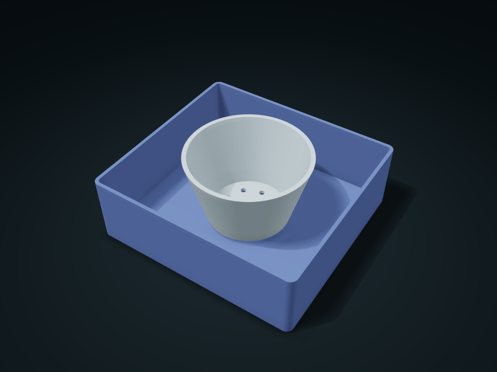](../models/cone-screen-lift-case/) | [Cone Cup Sieve & Catch Tray Box](../models/cone-screen-lift-case/) | 145 × 135 × 55 mm | 2 | [boxesmodel](https://boxesmodel.com/models/cone-screen-lift-case) |
| [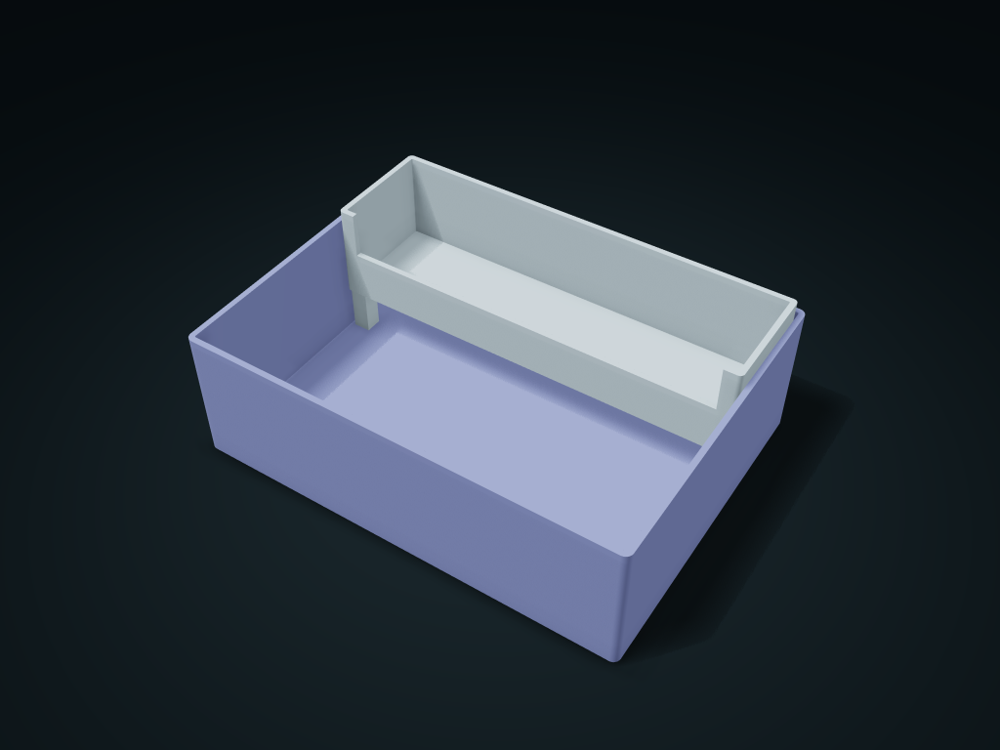](../models/corner-balcony-lift-case/) | [Corner Raised Deck Lift-Out Box](../models/corner-balcony-lift-case/) | 180 × 135 × 62 mm | 2 | [boxesmodel](https://boxesmodel.com/models/corner-balcony-lift-case) |
| [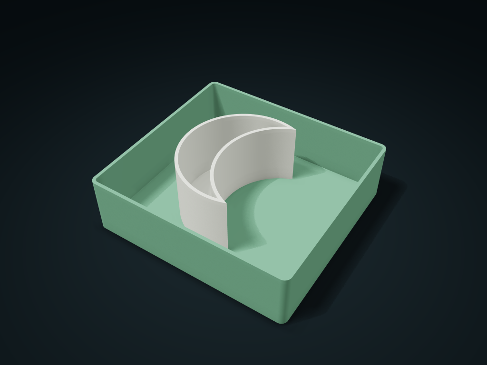](../models/crescent-lift-cup-case/) | [Crescent Lift-Out Cup Zone Box](../models/crescent-lift-cup-case/) | 150 × 140 × 50 mm | 2 | [boxesmodel](https://boxesmodel.com/models/crescent-lift-cup-case) |
| [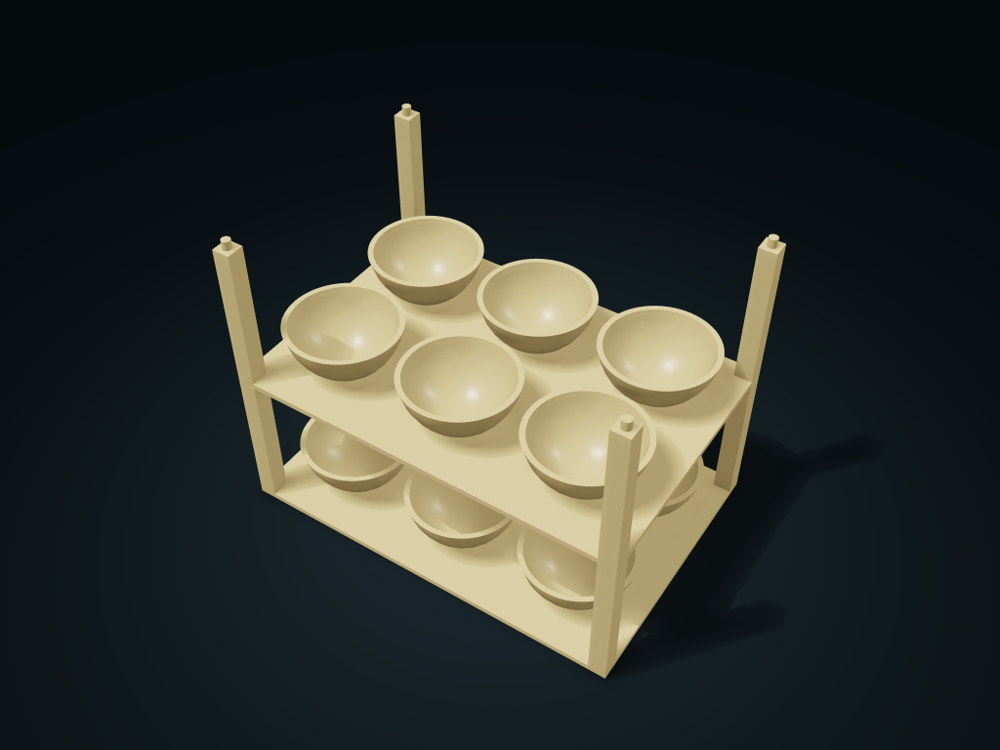](../models/egg-cradle-stack/) | [Curved Egg Pocket Stacking Trays](../models/egg-cradle-stack/) | 178.4 × 121.2 × 140.8 mm | 2 | [boxesmodel](https://boxesmodel.com/models/egg-cradle-stack) |
| [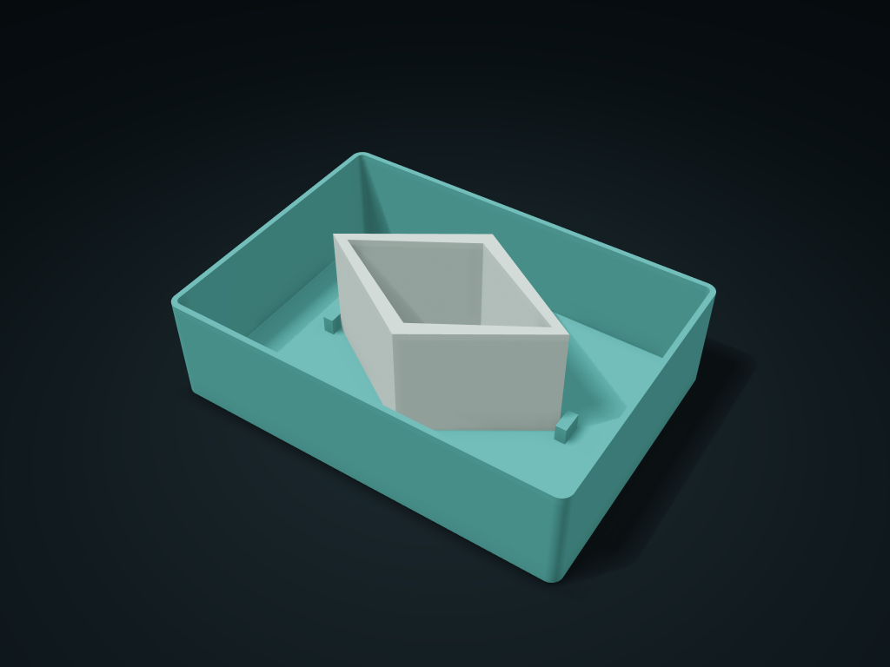](../models/diamond-lift-bin/) | [Diamond Lift-Out Sorting Box](../models/diamond-lift-bin/) | 175 × 125 × 55 mm | 2 | [boxesmodel](https://boxesmodel.com/models/diamond-lift-bin) |
| [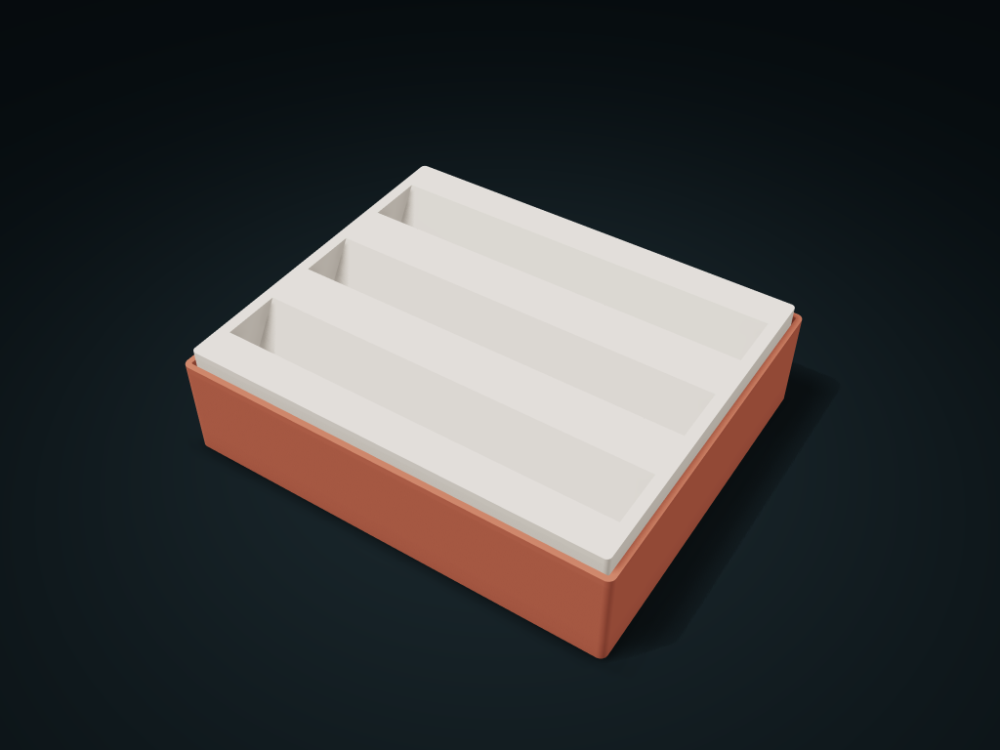](../models/accordion-vee-lift-case/) | [Folded Valley Lift-Out Insert Box](../models/accordion-vee-lift-case/) | 180 × 150 × 48 mm | 2 | [boxesmodel](https://boxesmodel.com/models/accordion-vee-lift-case) |
| [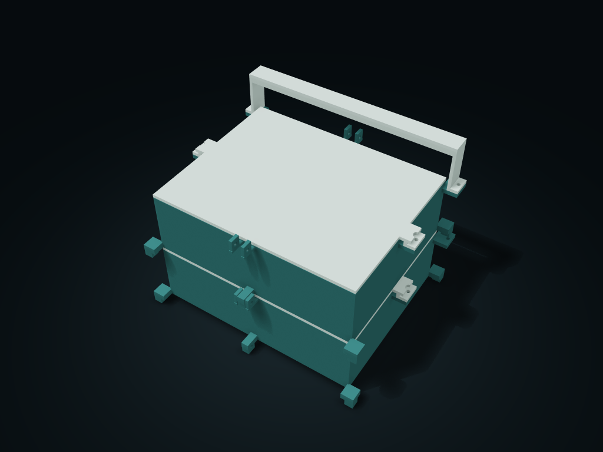](../models/clevis-coupled-cell-carrier/) | [Fork-Ear Linked Divided Box Set](../models/clevis-coupled-cell-carrier/) | 220 × 180 × 164 mm | 7 | [boxesmodel](https://boxesmodel.com/models/clevis-coupled-cell-carrier) |
| [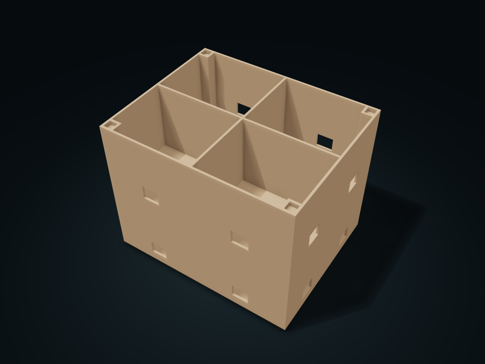](../models/corner-lock-crate/) | [Four-Corner Locating Stacking Baskets](../models/corner-lock-crate/) | 200 × 160 × 160 mm | 2 | [boxesmodel](https://boxesmodel.com/models/corner-lock-crate) |
|  | [Four-Pin Aligned Stacking Boxes](../models/pin-stack-box/) | 175 × 120 × 110 mm | 6 | [boxesmodel](https://boxesmodel.com/models/pin-stack-box) |
| [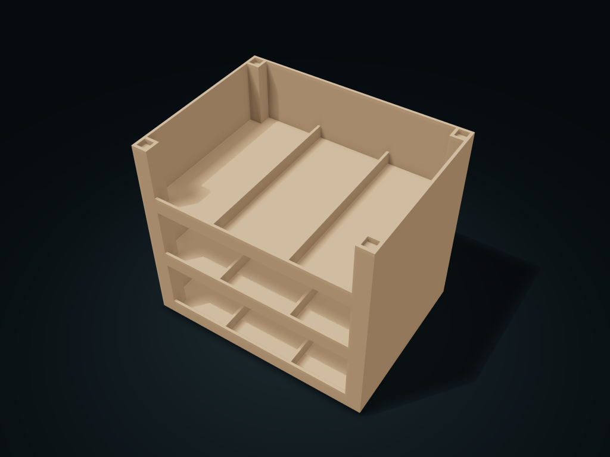](../models/front-access-stack/) | [Front-Access Stacking Compartment Box](../models/front-access-stack/) | 200 × 150 × 180 mm | 3 | [boxesmodel](https://boxesmodel.com/models/front-access-stack) |
|  | [Graded Sieve Stacking Trays](../models/graded-sieve-stack/) | 160 × 130 × 135 mm | 4 | [boxesmodel](https://boxesmodel.com/models/graded-sieve-stack) |
| [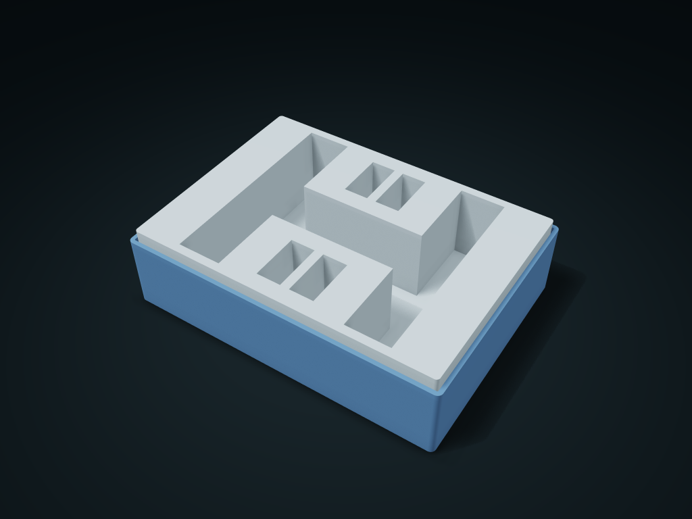](../models/h-channel-lift-case/) | [H-Shaped Long-Item Lift-Out Box](../models/h-channel-lift-case/) | 180 × 130 × 48 mm | 2 | [boxesmodel](https://boxesmodel.com/models/h-channel-lift-case) |
| [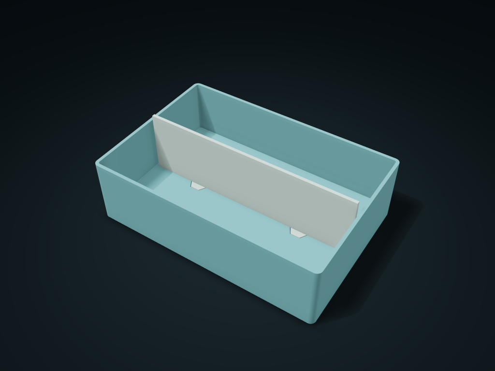](../models/hex-keyed-divider-case/) | [Hex Tenon Lift-Out Divider Box](../models/hex-keyed-divider-case/) | 170 × 115 × 55 mm | 2 | [boxesmodel](https://boxesmodel.com/models/hex-keyed-divider-case) |
| [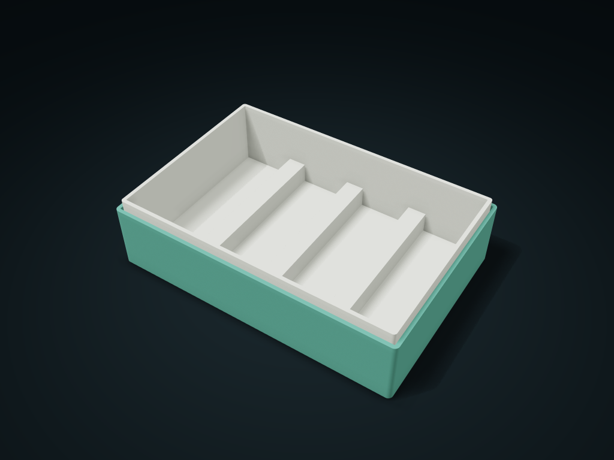](../models/ladder-deck-lift-case/) | [Ladder Rack Tool Lift-Out Box](../models/ladder-deck-lift-case/) | 185 × 125 × 48 mm | 2 | [boxesmodel](https://boxesmodel.com/models/ladder-deck-lift-case) |
| [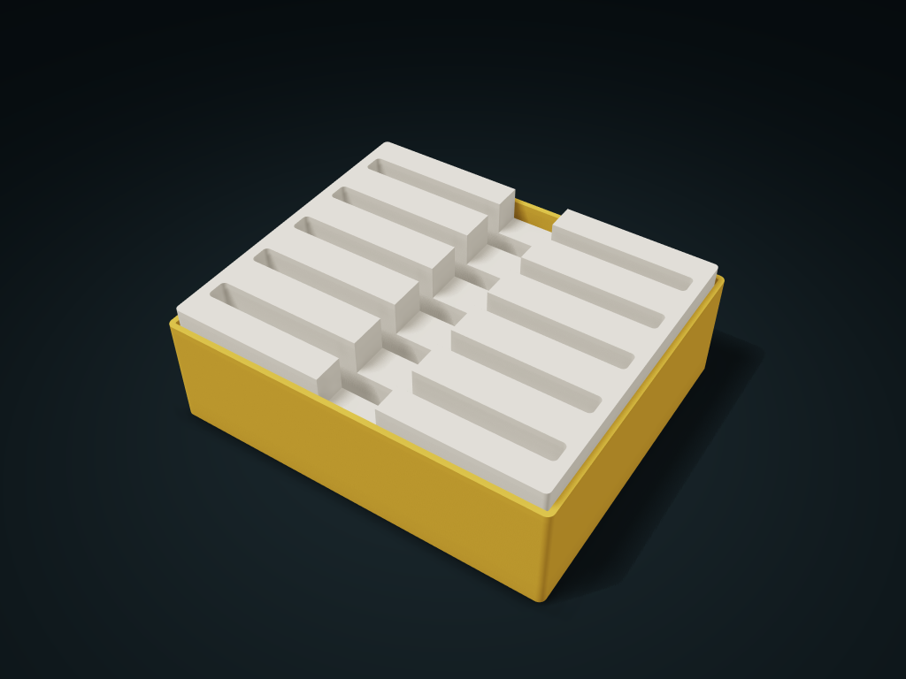](../models/card-cassette-lift-box/) | [Lift-Out Card Slot Insert Box](../models/card-cassette-lift-box/) | 165 × 140 × 55 mm | 2 | [boxesmodel](https://boxesmodel.com/models/card-cassette-lift-box) |
| [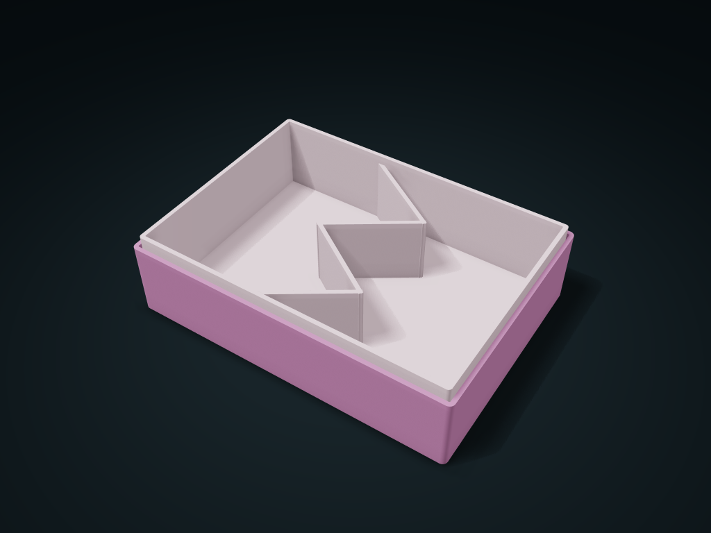](../models/zigzag-river-lift-case/) | [Meandering River Two-Zone Lift-Out Box](../models/zigzag-river-lift-case/) | 180 × 130 × 48 mm | 2 | [boxesmodel](https://boxesmodel.com/models/zigzag-river-lift-case) |
| [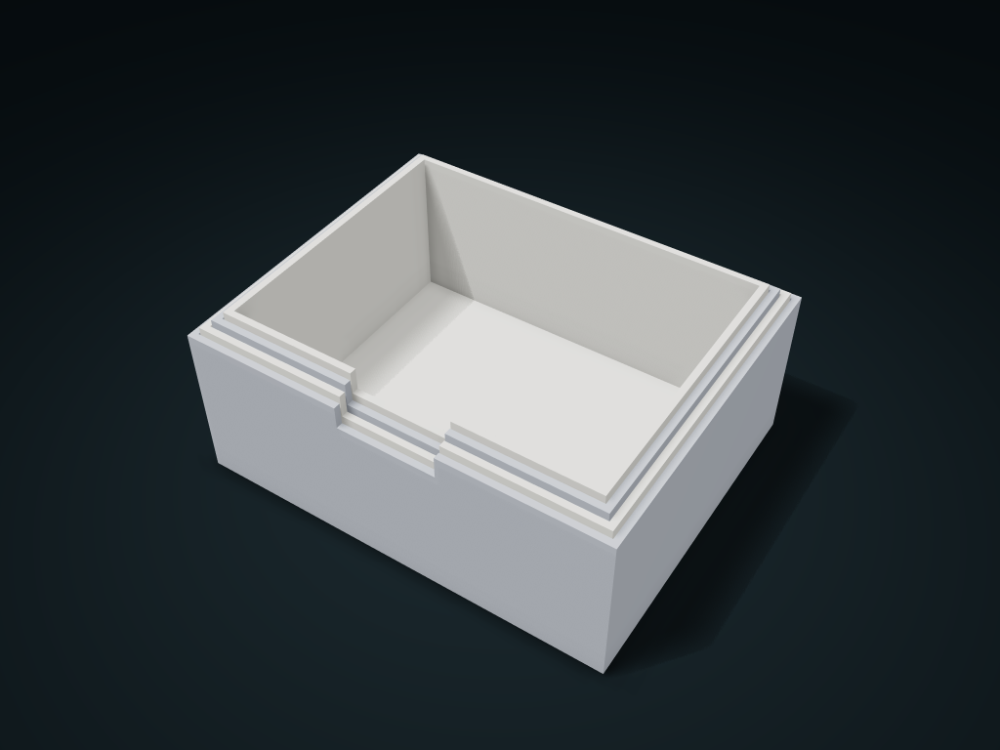](../models/nested-cup-case/) | [Nesting Cup Organizer](../models/nested-cup-case/) | 150 × 120 × 65 mm | 4 | [boxesmodel](https://boxesmodel.com/models/nested-cup-case) |
| [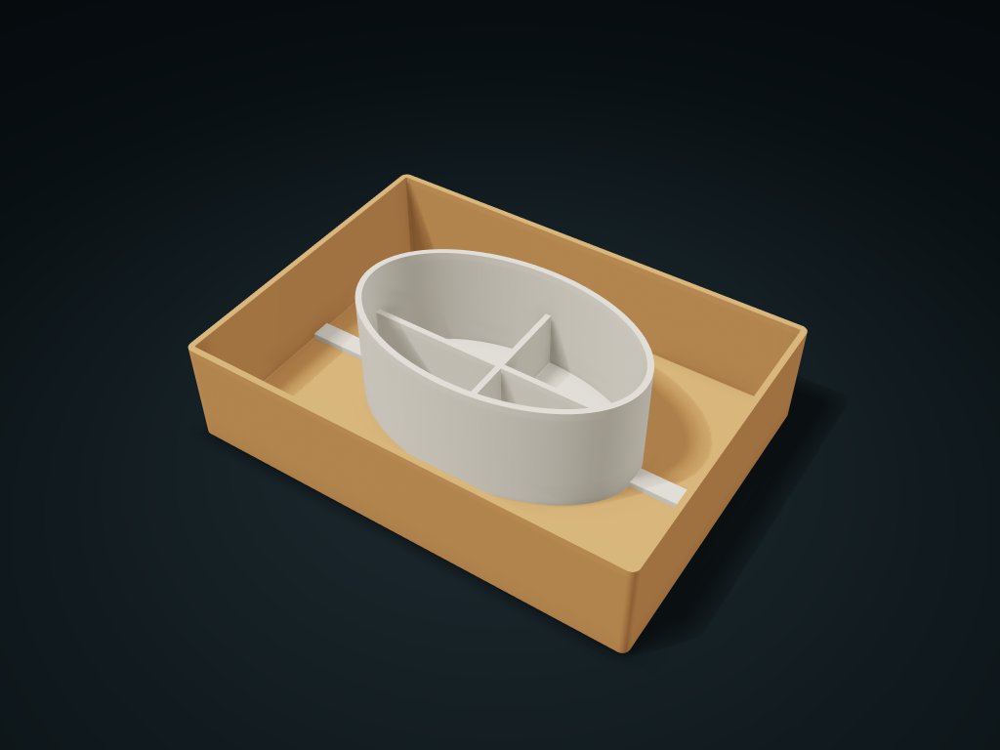](../models/oval-cross-lift-case/) | [Oval Cross Lift-Out Cup Box](../models/oval-cross-lift-case/) | 180 × 130 × 48 mm | 2 | [boxesmodel](https://boxesmodel.com/models/oval-cross-lift-case) |
| [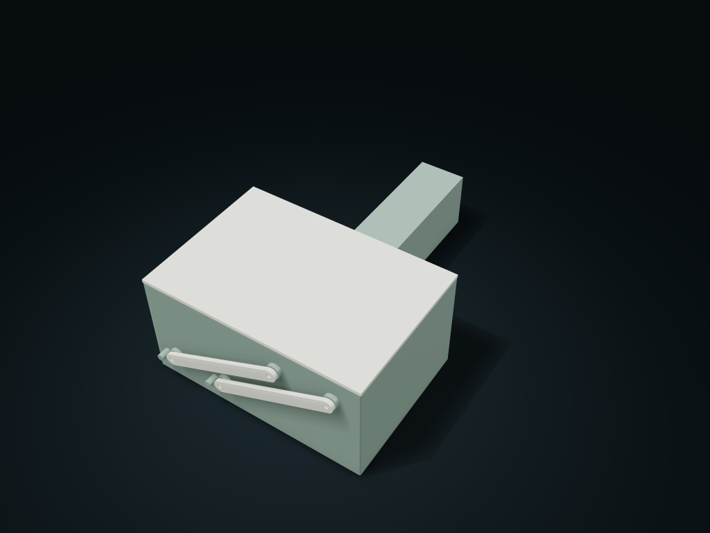](../models/cantilever-tier-box/) | [Parallel Linkage Tiered Box](../models/cantilever-tier-box/) | 160 × 247.5 × 79.4 mm | 8 | [boxesmodel](https://boxesmodel.com/models/cantilever-tier-box) |
|  | [Round Core Radial Compartment Box](../models/split-ring-core-case/) | 155 × 130 × 50 mm | 2 | [boxesmodel](https://boxesmodel.com/models/split-ring-core-case) |
|  | [Separate Round Lid Well Box](../models/circle-cap-cell-box/) | 185 × 100 × 50 mm | 4 | [boxesmodel](https://boxesmodel.com/models/circle-cap-cell-box) |
|  | [Stacking Divided Box](../models/stacked-tray/) | 200 × 140 × 138 mm | 3 | [boxesmodel](https://boxesmodel.com/models/stacked-tray) |
|  | [Staggered Two-Cup Lift-Out Box](../models/stair-step-lift-caddy/) | 160 × 145 × 70 mm | 3 | [boxesmodel](https://boxesmodel.com/models/stair-step-lift-caddy) |
| [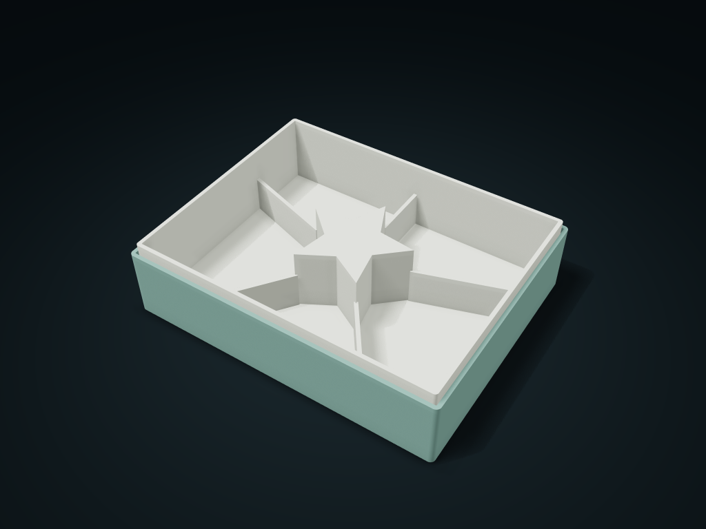](../models/star-center-lift-case/) | [Star Core Perimeter Compartment Box](../models/star-center-lift-case/) | 190 × 150 × 48 mm | 2 | [boxesmodel](https://boxesmodel.com/models/star-center-lift-case) |
|  | [Swivel Tiered Storage Trays](../models/swivel-tray-tower/) | 190 × 120 × 140 mm | 5 | [boxesmodel](https://boxesmodel.com/models/swivel-tray-tower) |
| [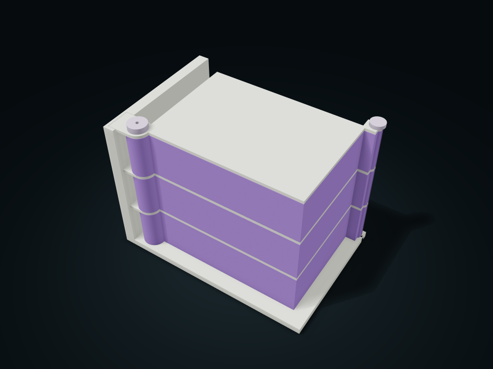](../models/keyed-column-swing-tower/) | [Through Lock Post Swing-Out Tower](../models/keyed-column-swing-tower/) | 220 × 150 × 165 mm | 13 | [boxesmodel](https://boxesmodel.com/models/keyed-column-swing-tower) |
| [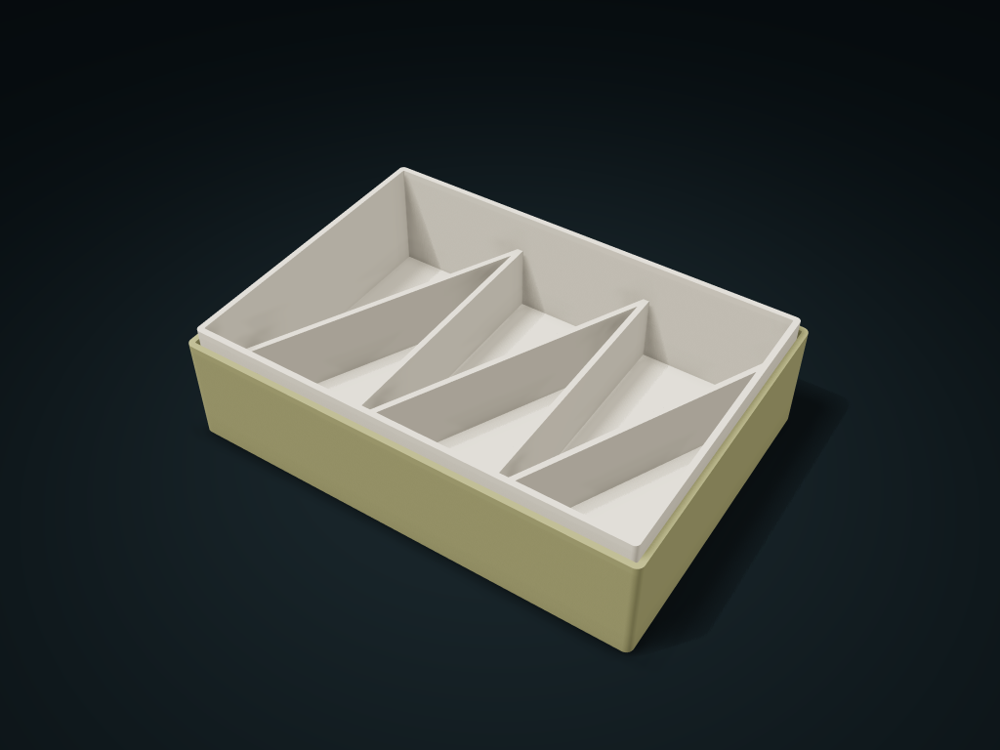](../models/triangle-cell-lift-case/) | [Triangle Shared-Wall Lift-Out Box](../models/triangle-cell-lift-case/) | 185 × 130 × 50 mm | 2 | [boxesmodel](https://boxesmodel.com/models/triangle-cell-lift-case) |
| [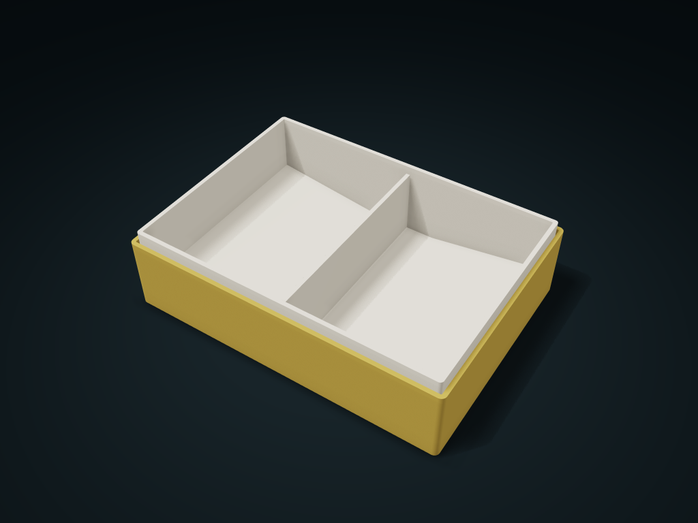](../models/paired-ramp-lift-case/) | [Twin-Slope Gathering Lift-Out Box](../models/paired-ramp-lift-case/) | 180 × 130 × 48 mm | 2 | [boxesmodel](https://boxesmodel.com/models/paired-ramp-lift-case) |
| [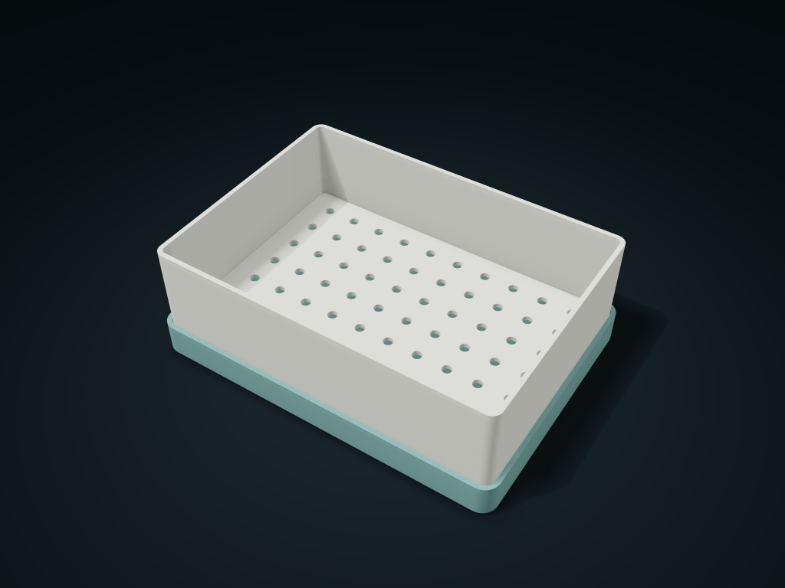](../models/sieve-box/) | [Two-Level Draining Box](../models/sieve-box/) | 180 × 130 × 60 mm | 2 | [boxesmodel](https://boxesmodel.com/models/sieve-box) |
| [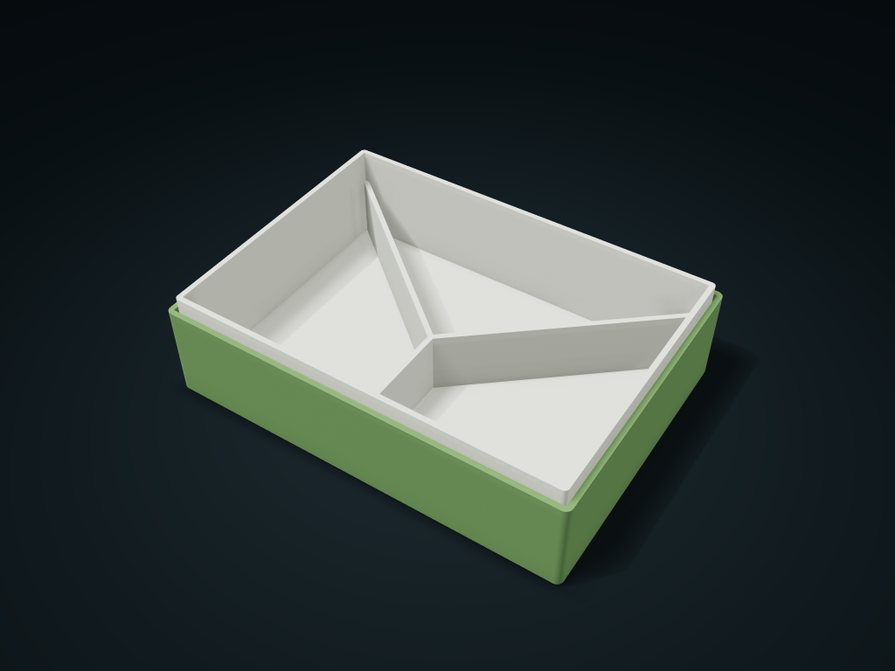](../models/y-junction-lift-case/) | [Y-Shaped Workflow Lift-Out Box](../models/y-junction-lift-case/) | 180 × 130 × 48 mm | 2 | [boxesmodel](https://boxesmodel.com/models/y-junction-lift-case) |
