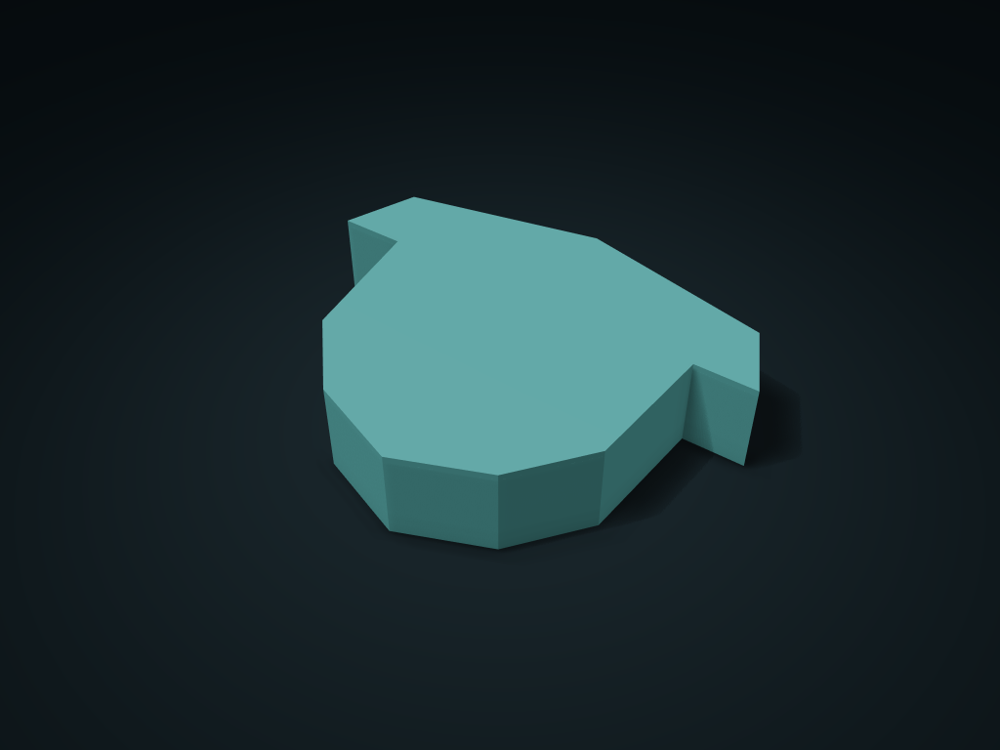

# Acorn Cap Rim Divided Box

Sort seed-shaped decorations and cord clasps, covering parts for unfinished projects; lift the lid to access. Adjust dividers and height.

**[Preview this model and customize it on boxesmodel](https://boxesmodel.com/models/acorn-cap-lift-box)**

## Default model

| Property | Value |
| --- | --- |
| Category | Lidded Storage |
| Model version | 1.0.0 |
| Default assembly display size | 180 × 140 × 38 mm |
| Included parts | 2 |
| Formats | STL and STEP |
| Units | Millimeters |

Covers the layout of all parts in the current preview; see Files and dimensions for each part's print size.

## Intended use

- Decorations and cord clasps; edge spaces are narrower than nominal cells. Narrow tips need retrievable items. No latch or seal is promised.

## Download the parts

Open a file below and choose **Download raw file** on GitHub. STL is for slicers; STEP is for CAD editing.

| Part | Dimensions | STL | STEP |
| --- | --- | --- | --- |
| Shaped divided box | 180 × 140 × 35.6 mm | [body.stl](body.stl) | [body.step](body.step) |
| Lift-off lid located by the inner rim | 180 × 140 × 4.8 mm | [lid.stl](lid.stl) | [lid.step](lid.step) |

Each listed part has its own STL and STEP file. Preview colors are illustrative; the manufacturing files do not contain the displayed colors.

## Printing and assembly

- 2 parts in total: divided box body and lift-off lid, no hardware. Print the box base down; flip the lid when slicing so its flat outer face is on the build plate.
- The inner locating rim's single-side clearance is set separately; close the lid straight down and lift the whole lid to take items; no latch or seal is promised.
- Shaped edge compartments are smaller than the nominal rectangular grid cell; pointed corners and narrow necks only take small items that come out easily.
- Units are millimeters; matching parts use files generated in the same export. Set clearance by your items' maximum size and leave room to take them in and out.
- Check orientation and supports before printing, and test-print key mating parts first.
- Import at millimeter scale. Check your build volume, orientation, overhangs, supports and mating clearances in the slicer.

## Adjust the design

Visit the [interactive model page](https://boxesmodel.com/models/acorn-cap-lift-box) to inspect the 3D model and adjust the available dimensions and layout options. This folder contains the default-size export shown above; custom exports follow the options and pricing shown on boxesmodel.

## License and attribution

Copyright © 2026 boxesmodel. These model files, preview and description are licensed under [CC BY 4.0](https://creativecommons.org/licenses/by/4.0/). You may share, modify and use them commercially with the required attribution. See the [full license](../../LICENSE) and [attribution guide](../../ATTRIBUTION.md).

Suggested credit:

> “Acorn Cap Rim Divided Box” by [boxesmodel](https://boxesmodel.com/models/acorn-cap-lift-box), licensed under [CC BY 4.0](https://creativecommons.org/licenses/by/4.0/). Indicate any changes you make.

[Browse all models](../../CATALOG.md) · [About the collection](../../README.md)
