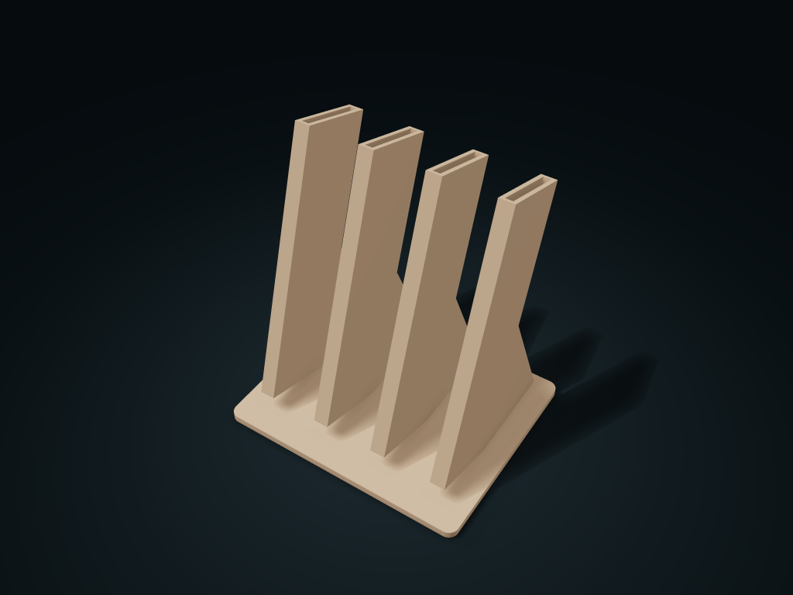

# Angled Knife Sheath Box

Store straight knives in angled sheaths with handles exposed; configure blade dimensions, handle width and grip spacing.

**[Preview this model and customize it on boxesmodel](https://boxesmodel.com/models/angled-knife-box)**

## Default model

| Property | Value |
| --- | --- |
| Category | Desktop Organizers |
| Model version | 1.0.0 |
| Default box size | 151 × 124.14 × 173.64 mm |
| Included parts | 1 |
| Formats | STL and STEP |
| Units | Millimeters |

Dimensions include the outer outline of the box; see the specifications for usable interior space.

## Intended use

- Dry straight knives before storage; closed bottoms do not drain. Handle shoulders must span the slot. Withdraw along the angle, not vertically. Curved blades or unusual guards need separate fitting.
- Check stability, blade wear and food-contact suitability before use; no child protection is provided.

## Dimensions and features

| Detail | Default value |
| --- | --- |
| Separate knife positions | 4 |
| Handle center distance | 38.0 mm |
| Clear distance between neighboring handles | 12.0 mm |
| Knife slot angle | 18° |

## Download the parts

Open a file below and choose **Download raw file** on GitHub. STL is for slicers; STEP is for CAD editing.

| Part | Dimensions | STL | STEP |
| --- | --- | --- | --- |
| Angled knife sheath box body | 151 × 124.14 × 173.64 mm | [body.stl](body.stl) | [body.step](body.step) |

Each listed part has its own STL and STEP file. Preview colors are illustrative; the manufacturing files do not contain the displayed colors.

## Printing and assembly

- Blade size is measured as the maximum envelope of a straight blade; each slot side has another 0.6 mm, and the nominal tip sits 1 mm above the slot bottom.
- The handle shoulder must be wider than the slot and rest on both sides of the slot mouth; pull out along the angle of the knife slot; do not pull straight up by force.
- Support ribs on both sides of each knife sheath join a shared base; the closed bottom does not drain. Dry knives before storing; curved blades and irregular guards need a separate fit.
- Print base down; check supports for the sloped walls when slicing. Before use, check real stability, blade wear or food contact; no child protection is provided.
- Import at millimeter scale. Check your build volume, orientation, overhangs, supports and mating clearances in the slicer.

## Adjust the design

Visit the [interactive model page](https://boxesmodel.com/models/angled-knife-box) to inspect the 3D model and adjust the available dimensions and layout options. This folder contains the default-size export shown above; custom exports follow the options and pricing shown on boxesmodel.

## License and attribution

Copyright © 2026 boxesmodel. These model files, preview and description are licensed under [CC BY 4.0](https://creativecommons.org/licenses/by/4.0/). You may share, modify and use them commercially with the required attribution. See the [full license](../../LICENSE) and [attribution guide](../../ATTRIBUTION.md).

Suggested credit:

> “Angled Knife Sheath Box” by [boxesmodel](https://boxesmodel.com/models/angled-knife-box), licensed under [CC BY 4.0](https://creativecommons.org/licenses/by/4.0/). Indicate any changes you make.

[Browse all models](../../CATALOG.md) · [About the collection](../../README.md)
