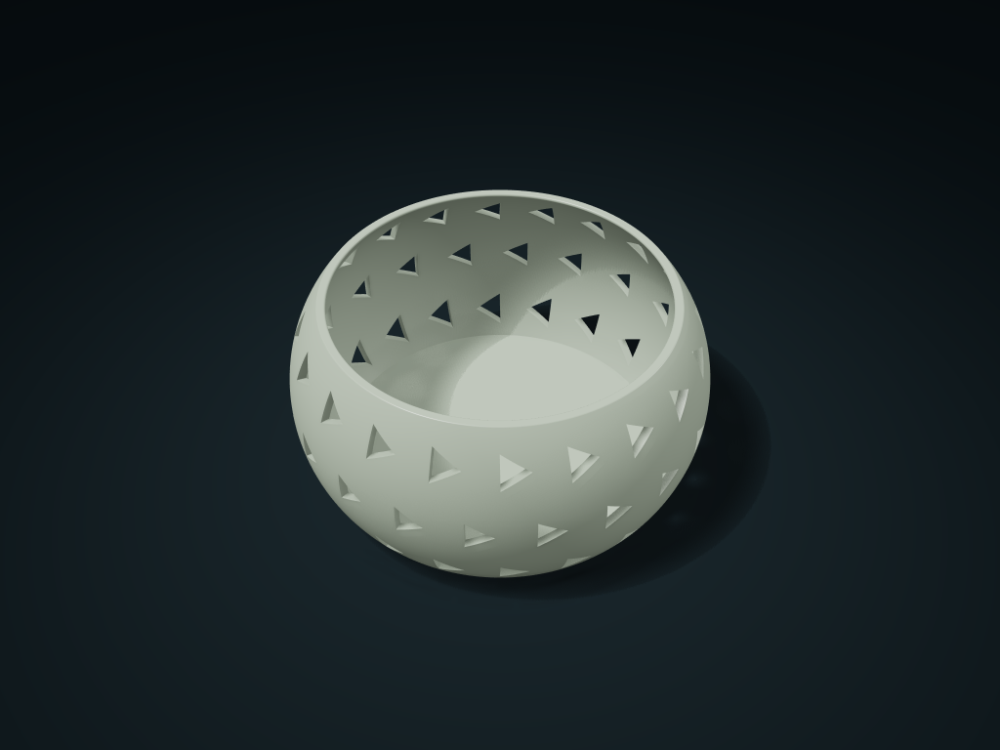

# Arc Belly Triangle Window Basket

A continuous curved belly with triangular windows, a closed floor, and optional shared-wall dividers organizes everyday items

**[Preview this model and customize it on boxesmodel](https://boxesmodel.com/models/arc-belly-triangle-basket)**

## Default model

| Property | Value |
| --- | --- |
| Category | Desktop Organizers |
| Model version | 1.0.1 |
| Default box size | 140 × 140 × 70 mm |
| Included parts | 1 |
| Formats | STL and STEP |
| Units | Millimeters |

Dimensions include the outer outline of the box; see the specifications for usable interior space.

## Dimensions and features

| Detail | Default value |
| --- | --- |
| Minimum clear diameter at rounded rim | 110.4 mm |
| Bottom internal diameter × clear depth | 113.2 × 67.2 mm |
| Number of compartments | 1 compartment |

## Download the parts

Open a file below and choose **Download raw file** on GitHub. STL is for slicers; STEP is for CAD editing.

| Part | Dimensions | STL | STEP |
| --- | --- | --- | --- |
| One-Piece Arc Belly Triangle Window Basket | 140 × 140 × 70 mm | [body.stl](body.stl) | [body.step](body.step) |

Each listed part has its own STL and STEP file. Preview colors are illustrative; the manufacturing files do not contain the displayed colors.

## Printing and assembly

- The body and shared dividers form one piece, requiring no purchased hardware or assembly; print with the bottom down. Preview colors are for display only; STL/STEP files are uncolored.
- The open-cavity option has no vertical dividers; with dividers, the divider top height is 30.0 mm; the rim diameter is not the usable diameter of each compartment.
- Organize bundled cables, notes, hair ties, and everyday items on an entryway console or desk. Use an inner pouch for items smaller than the windows; do not hold food or liquids directly.
- The inner and outer belly walls use offset circular arcs above a complete floor. Insert items through the narrower opening from above; their widest section must fit through the rim with handling clearance.
- Check overhangs, materials, and supports for your printer; no support-free, load-bearing, or food-contact safety claim is made.
- Rounded edges are part of the manufacturing geometry and change with the style parameters. Allow for curved corners when checking usable space; use the generated model for actual external dimensions.
- Import at millimeter scale. Check your build volume, orientation, overhangs, supports and mating clearances in the slicer.

## Adjust the design

Visit the [interactive model page](https://boxesmodel.com/models/arc-belly-triangle-basket) to inspect the 3D model and adjust the available dimensions and layout options. This folder contains the default-size export shown above; custom exports follow the options and pricing shown on boxesmodel.

## License and attribution

Copyright © 2026 boxesmodel. These model files, preview and description are licensed under [CC BY 4.0](https://creativecommons.org/licenses/by/4.0/). You may share, modify and use them commercially with the required attribution. See the [full license](../../LICENSE) and [attribution guide](../../ATTRIBUTION.md).

Suggested credit:

> “Arc Belly Triangle Window Basket” by [boxesmodel](https://boxesmodel.com/models/arc-belly-triangle-basket), licensed under [CC BY 4.0](https://creativecommons.org/licenses/by/4.0/). Indicate any changes you make.

[Browse all models](../../CATALOG.md) · [About the collection](../../README.md)
