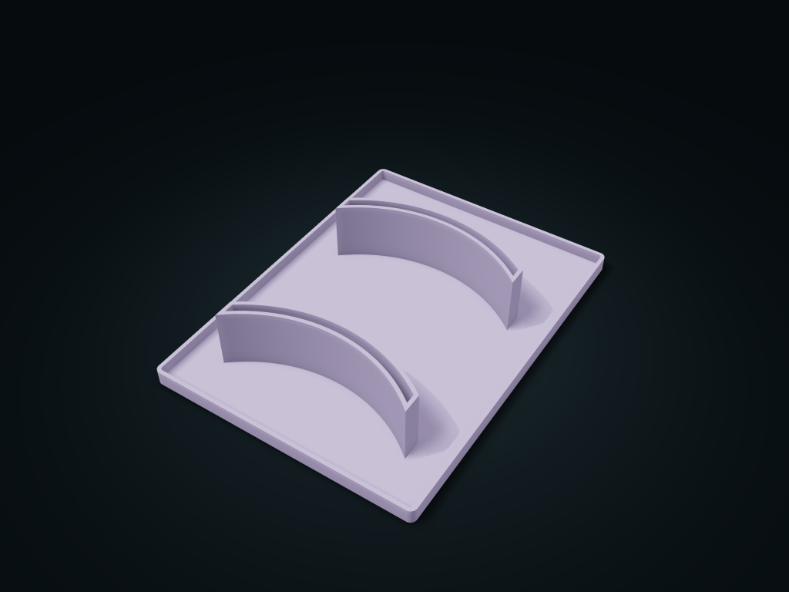

# Curved Brim Cap Holder

Curved rigid brims drop vertically into the arc slots, with the crowns staying above.

**[Preview this model and customize it on boxesmodel](https://boxesmodel.com/models/arc-slot-cap-caddy)**

## Default model

| Property | Value |
| --- | --- |
| Category | Open Storage |
| Model version | 1.0.0 |
| Default box size | 210 × 280 × 50 mm |
| Included parts | 1 |
| Formats | STL and STEP |
| Units | Millimeters |

Dimensions include the outer outline of the box; see the specifications for usable interior space.

## Dimensions and features

| Detail | Default value |
| --- | --- |
| Separate cap positions | 2 positions |
| Brim slot chord width / clear thickness | 145 / 6 mm |
| Slot center curve radius | 120 mm |
| Recommended envelope for a single cap crown | 196 × 129 mm |

## Download the parts

Open a file below and choose **Download raw file** on GitHub. STL is for slicers; STEP is for CAD editing.

| Part | Dimensions | STL | STEP |
| --- | --- | --- | --- |
| Curved brim blind slot base tray | 210 × 280 × 50 mm | [caddy.stl](caddy.stl) | [caddy.step](caddy.step) |

Each listed part has its own STL and STEP file. Preview colors are illustrative; the manufacturing files do not contain the displayed colors.

## Printing and assembly

- 1 complete printed part; nothing must be bought. Only for caps with rigid brims whose measured curve matches and that can be stored upside down; not every baseball cap has the same size.
- 2 cap positions, brim slot chord width 145 mm, center radius 120 mm, normal clear thickness 6 mm; recommended brim chord width ≤ 141 mm and thickness ≤ 5 mm. Check the curve with a paper template first; do not bend a rigid brim to force it in.
- The slot floor supports at Z = 3 mm, with a 47 mm tall insertion section. Recommended envelope for a complete cap crown (including the adjuster) ≤ 196 × 129 mm, with at least 30 mm showing above the slot top for gripping; must also meet the arc condition of a single slot.
- The lower edge of the brim drops vertically into the arc from above, crown up; lift one cap at a time by its crown; neighboring caps do not need to move. Real brim shapes vary a lot; the slot length does not mean the whole cap will fit.
- Print flat base down; the arc slots are open at the top and do not go through the bottom. Before use, check slicing, real cap shape fit, inverted stability and long-term dents; not recommended for soft caps or flat brims.
- Import at millimeter scale. Check your build volume, orientation, overhangs, supports and mating clearances in the slicer.

## Adjust the design

Visit the [interactive model page](https://boxesmodel.com/models/arc-slot-cap-caddy) to inspect the 3D model and adjust the available dimensions and layout options. This folder contains the default-size export shown above; custom exports follow the options and pricing shown on boxesmodel.

## License and attribution

Copyright © 2026 boxesmodel. These model files, preview and description are licensed under [CC BY 4.0](https://creativecommons.org/licenses/by/4.0/). You may share, modify and use them commercially with the required attribution. See the [full license](../../LICENSE) and [attribution guide](../../ATTRIBUTION.md).

Suggested credit:

> “Curved Brim Cap Holder” by [boxesmodel](https://boxesmodel.com/models/arc-slot-cap-caddy), licensed under [CC BY 4.0](https://creativecommons.org/licenses/by/4.0/). Indicate any changes you make.

[Browse all models](../../CATALOG.md) · [About the collection](../../README.md)
