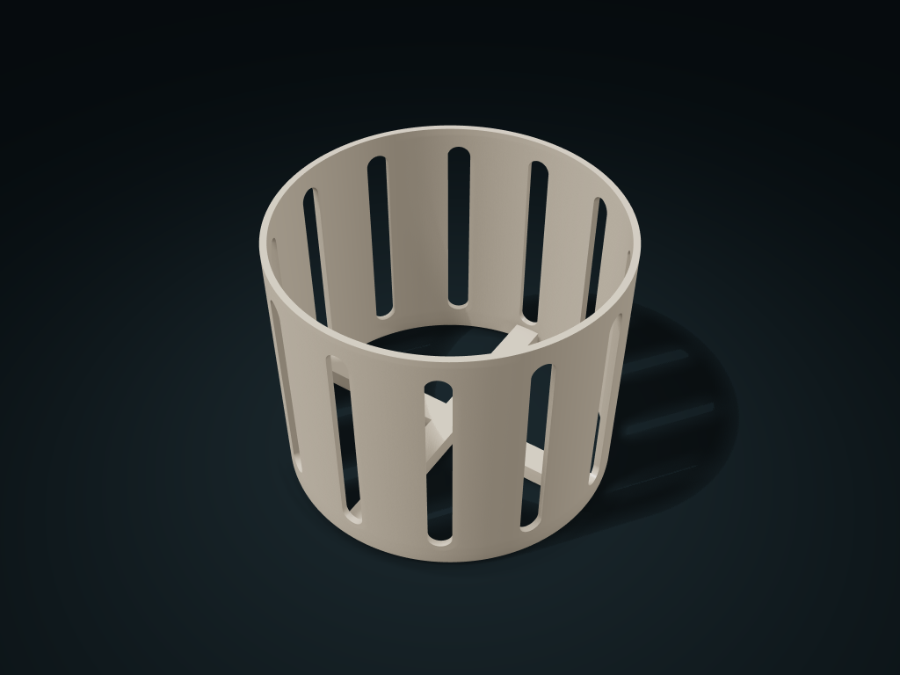

# Arched-Vent Nursery Pot Sleeve

Continuous top and bottom rings and tall arched windows surround a nursery pot. An integral cross support raises its base while keeping the bottom open.

**[Preview this model and customize it on boxesmodel](https://boxesmodel.com/models/arched-vent-nursery-sleeve)**

## Default model

| Property | Value |
| --- | --- |
| Category | Open Storage |
| Model version | 1.0.0 |
| Default box size | 145 × 145 × 115 mm |
| Included parts | 1 |
| Formats | STL and STEP |
| Units | Millimeters |

Dimensions include the outer outline of the box; see the specifications for usable interior space.

## Dimensions and features

| Detail | Default value |
| --- | --- |
| Sleeve Straight Inner Diameter | 139.4 mm |
| Inner Pot Support Height | 8.0 mm |
| Vent window clear width | 10.0 mm |

## Download the parts

Open a file below and choose **Download raw file** on GitHub. STL is for slicers; STEP is for CAD editing.

| Part | Dimensions | STL | STEP |
| --- | --- | --- | --- |
| Ventilated Sleeve with Cross Support | 145 × 145 × 115 mm | [sleeve.stl](sleeve.stl) | [sleeve.step](sleeve.step) |

Each listed part has its own STL and STEP file. Preview colors are illustrative; the manufacturing files do not contain the displayed colors.

## Printing and assembly

- The one-piece sleeve includes its cross support and needs no purchased fasteners. Supply your existing nursery pot; it is not a printed component.
- The widest part of the nursery pot must be at least 2 mm smaller than the clear diameter. Its base must be at least 30 mm across to span the support, and its rim should protrude for gripping.
- The base is open. Remove the nursery pot for watering and let it drain before returning it; this sleeve does not collect water or hold soil directly.
- Slice with the base down and check bridging over the arched windows. Bridge quality has not been physically tested.
- Preview colors are not included in STL/STEP.
- Import at millimeter scale. Check your build volume, orientation, overhangs, supports and mating clearances in the slicer.

## Adjust the design

Visit the [interactive model page](https://boxesmodel.com/models/arched-vent-nursery-sleeve) to inspect the 3D model and adjust the available dimensions and layout options. This folder contains the default-size export shown above; custom exports follow the options and pricing shown on boxesmodel.

## License and attribution

Copyright © 2026 boxesmodel. These model files, preview and description are licensed under [CC BY 4.0](https://creativecommons.org/licenses/by/4.0/). You may share, modify and use them commercially with the required attribution. See the [full license](../../LICENSE) and [attribution guide](../../ATTRIBUTION.md).

Suggested credit:

> “Arched-Vent Nursery Pot Sleeve” by [boxesmodel](https://boxesmodel.com/models/arched-vent-nursery-sleeve), licensed under [CC BY 4.0](https://creativecommons.org/licenses/by/4.0/). Indicate any changes you make.

[Browse all models](../../CATALOG.md) · [About the collection](../../README.md)
