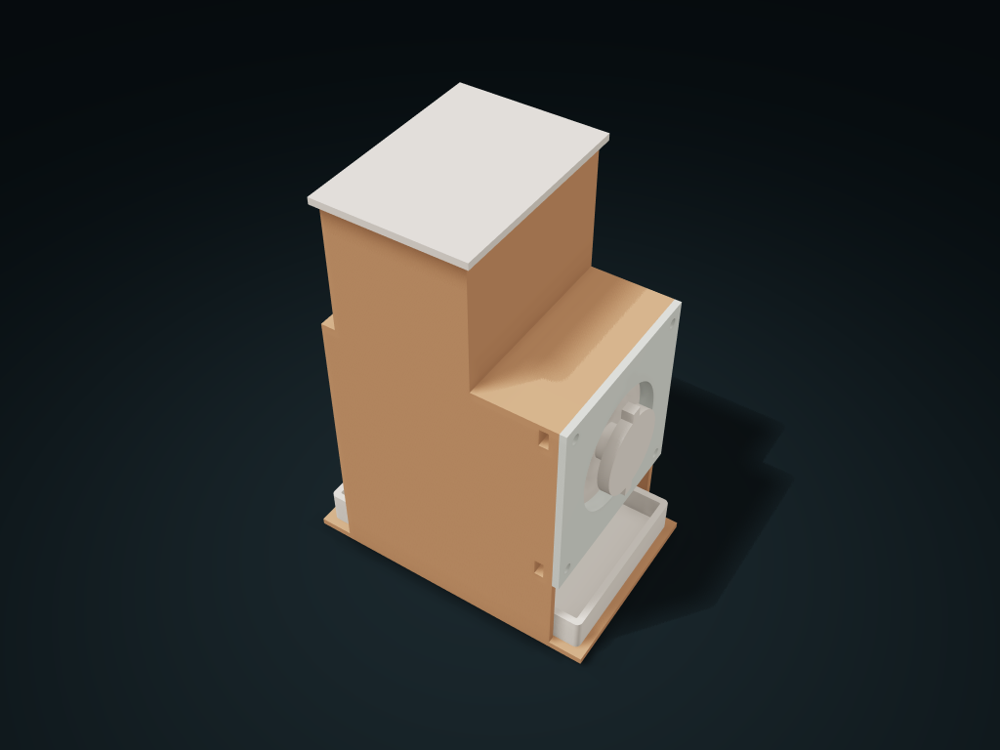

# Auger Feed Storage Box

Refill dry craft granules at the rear, turn the knob to feed forward and pull out the tray; adjust screw size, pitch and reference granule diameter.

**[Preview this model and customize it on boxesmodel](https://boxesmodel.com/models/auger-feed-bin)**

## Default model

| Property | Value |
| --- | --- |
| Category | Lidded Storage |
| Model version | 1.0.0 |
| Default assembly display size | 106.4 × 71.6 × 148.2 mm |
| Included parts | 5 |
| Formats | STL and STEP |
| Units | Millimeters |

Covers the layout of all parts in the current preview; see Files and dimensions for each part's print size.

## Intended use

- Only similarly sized dry granules, not powder, sticky or sharp items. Stop and empty if jammed; never force. Check feeding, bridging and friction; no food-contact, sealing or precise-metering claim.
- Supply four M3 screw/nut sets; select screws and washers for the shown effective length, without bottoming out or overtightening. Empty before removing the plate and shaft; check nominal clearances with a test print.

## Dimensions and features

| Detail | Default value |
| --- | --- |
| Auger feed length | 72 mm / 3 rings |
| Pitch / nominal granule | 24 / 5 mm |
| Effective shank length of the four purchased M3s | 8.4 mm (screw length minus total washer thickness; excluding the head) |

## Download the parts

Open a file below and choose **Download raw file** on GitHub. STL is for slicers; STEP is for CAD editing.

| Part | Dimensions | STL | STEP |
| --- | --- | --- | --- |
| Storage shell and front drop outlet | 106.4 × 67.6 × 145.4 mm | [body.stl](body.stl) | [body.step](body.step) |
| Auger feed shaft and knob | 86.4 × 48 × 48 mm | [auger.stl](auger.stl) | [auger.step](auger.step) |
| Side retaining plate | 4.8 × 67.6 × 67.6 mm | [cap.stl](cap.stl) | [cap.step](cap.step) |
| Lift-off refill lid | 52 × 71.6 × 5.8 mm | [lid.stl](lid.stl) | [lid.step](lid.step) |
| Pull-out catch tray | 100.8 × 62 × 12 mm | [cup.stl](cup.stl) | [cup.step](cup.step) |

Each listed part has its own STL and STEP file. Preview colors are illustrative; the manufacturing files do not contain the displayed colors.

## Printing and assembly

- Seen from the knob toward the box, turning clockwise makes the auger feed granules from the rear compartment to the lower front outlet; the catch tray pulls out horizontally from the knob side.
- Only for dry craft granules of similar size; not for powders, sticky or sharp items. Actual feeding, bridging, jamming and friction need trying out; if it jams, stop turning and empty it immediately; do not force it.
- Fit the feed axle from the side first, then pass the end plate over the knob and fix it with four sets of purchased M3 screws/nuts. The preview and download contain only the five printed parts, not the metal hardware.
- Fit the nuts through the left and right side slots near the front plate; the M3 screw goes in through the front plate; the thread must pass through the nut and stop before the end of the blind hole. Choose screws and washers by the effective shank length shown; do not overtighten against the printed walls.
- The feed axle can only come out sideways after removing the four screws and the end plate; empty the storage compartment before assembling or disassembling. Test-print to check the 0.4 mm radial and axial clearance first; a direct fit is not guaranteed.
- Shell base down; check supports for the tube top and sloped walls; slice with the feed shaft vertical and the end plate and lid lying flat. No food contact, sealing or precise measuring is claimed.
- Import at millimeter scale. Check your build volume, orientation, overhangs, supports and mating clearances in the slicer.

## Adjust the design

Visit the [interactive model page](https://boxesmodel.com/models/auger-feed-bin) to inspect the 3D model and adjust the available dimensions and layout options. This folder contains the default-size export shown above; custom exports follow the options and pricing shown on boxesmodel.

## License and attribution

Copyright © 2026 boxesmodel. These model files, preview and description are licensed under [CC BY 4.0](https://creativecommons.org/licenses/by/4.0/). You may share, modify and use them commercially with the required attribution. See the [full license](../../LICENSE) and [attribution guide](../../ATTRIBUTION.md).

Suggested credit:

> “Auger Feed Storage Box” by [boxesmodel](https://boxesmodel.com/models/auger-feed-bin), licensed under [CC BY 4.0](https://creativecommons.org/licenses/by/4.0/). Indicate any changes you make.

[Browse all models](../../CATALOG.md) · [About the collection](../../README.md)
