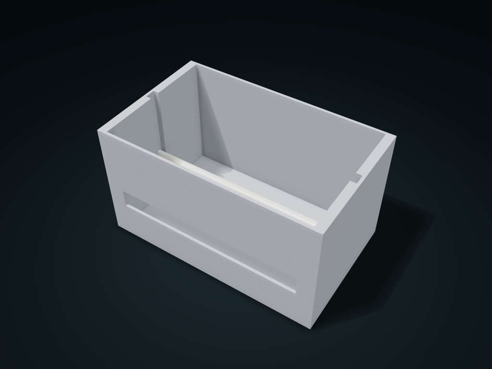

# Bag Roll Dispenser Box

The roll is refilled from the top and the bag strip pulls out through the front slot; roll width and diameter are fitted to the actual roll.

**[Preview this model and customize it on boxesmodel](https://boxesmodel.com/models/bag-roll-dispenser)**

## Default model

| Property | Value |
| --- | --- |
| Category | Open Storage |
| Model version | 1.0.2 |
| Default assembly display size | 180 × 110 × 100 mm |
| Included parts | 2 |
| Formats | STL and STEP |
| Units | Millimeters |

Covers the layout of all parts in the current preview; see Files and dimensions for each part's print size.

## Dimensions and features

| Detail | Default value |
| --- | --- |
| Supported roll width and diameter | 150.0 × Ø70.0 mm |
| Axle support height | 39.4 mm |

## Download the parts

Open a file below and choose **Download raw file** on GitHub. STL is for slicers; STEP is for CAD editing.

| Part | Dimensions | STL | STEP |
| --- | --- | --- | --- |
| Bag roll box and axle seats | 180 × 110 × 100 mm | [body.stl](body.stl) | [body.step](body.step) |
| Lift-out reel | 174.4 × 8 × 8 mm | [axle.stl](axle.stl) | [axle.step](axle.step) |

Each listed part has its own STL and STEP file. Preview colors are illustrative; the manufacturing files do not contain the displayed colors.

## Printing and assembly

- Pass the axle through the actual roll core, then drop it from the top into the U-shaped supports at both ends; both outer walls are kept to stop axial sliding.
- Measure roll width and diameter as a whole roll; the axle diameter must be smaller than the actual roll core inner diameter. The front slot lets the bag strap out; no cutter or automatic dispensing.
- Slice-check bridging and axle print orientation for the U-slot and bag outlet; test-print to check rotation resistance first.
- Import at millimeter scale. Check your build volume, orientation, overhangs, supports and mating clearances in the slicer.

## Adjust the design

Visit the [interactive model page](https://boxesmodel.com/models/bag-roll-dispenser) to inspect the 3D model and adjust the available dimensions and layout options. This folder contains the default-size export shown above; custom exports follow the options and pricing shown on boxesmodel.

## License and attribution

Copyright © 2026 boxesmodel. These model files, preview and description are licensed under [CC BY 4.0](https://creativecommons.org/licenses/by/4.0/). You may share, modify and use them commercially with the required attribution. See the [full license](../../LICENSE) and [attribution guide](../../ATTRIBUTION.md).

Suggested credit:

> “Bag Roll Dispenser Box” by [boxesmodel](https://boxesmodel.com/models/bag-roll-dispenser), licensed under [CC BY 4.0](https://creativecommons.org/licenses/by/4.0/). Indicate any changes you make.

[Browse all models](../../CATALOG.md) · [About the collection](../../README.md)
