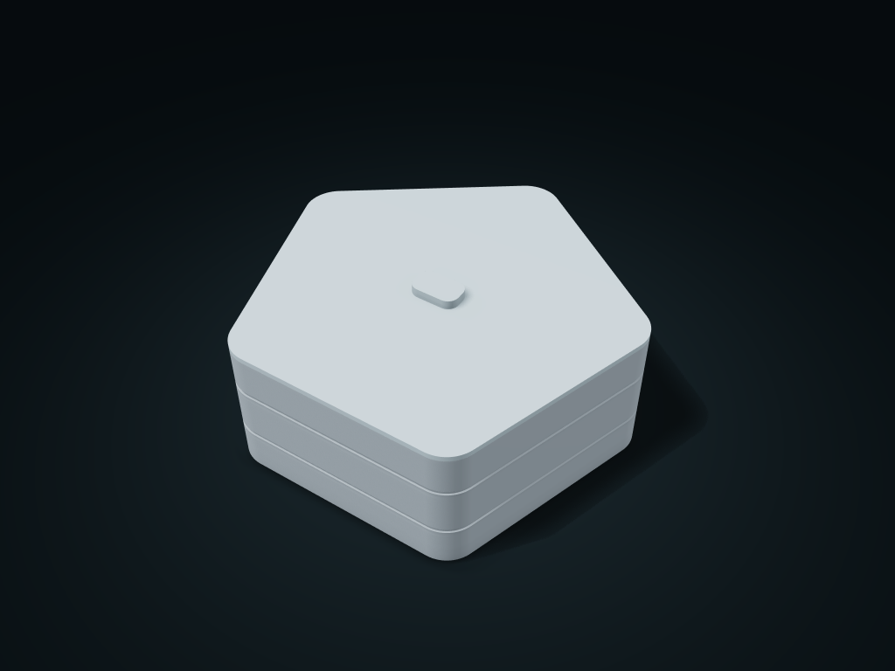

# Banded Pentagon Lift-Off Case

A rounded pentagonal solid-wall case with a matching lift-off lid, shared-wall compartments and horizontal banding for everyday organization.

**[Preview this model and customize it on boxesmodel](https://boxesmodel.com/models/banded-pentagon-lift-case)**

## Default model

| Property | Value |
| --- | --- |
| Category | Desktop Organizers |
| Model version | 1.0.0 |
| Default assembly display size | 200 × 191.97 × 80 mm |
| Included parts | 2 |
| Formats | STL and STEP |
| Units | Millimeters |

Covers the layout of all parts in the current preview; see Files and dimensions for each part's print size.

## Dimensions and features

| Detail | Default value |
| --- | --- |
| Actual Filleted Outer Width | 192.0 mm |
| Conservative Straight Clear Length per Compartment | 56.4 mm |
| Conservative Straight Clear Width per Compartment | 115.5 mm |
| Usable Interior Depth | 65.4 mm |
| Compartment Count | 2 compartments |
| Actual Divider Height | 30.0 mm; no divider for one compartment |
| Locating Ring Insertion Depth | 4 mm |
| Ring clearance per side | 0.45 mm |
| Nominal Wall at the Deepest Recess | 1.8 mm |

## Download the parts

Open a file below and choose **Download raw file** on GitHub. STL is for slicers; STEP is for CAD editing.

| Part | Dimensions | STL | STEP |
| --- | --- | --- | --- |
| Rounded-Pentagon Compartment Body | 200 × 191.97 × 72.2 mm | [body.stl](body.stl) | [body.step](body.step) |
| Matching Pentagon Locating-Ring Lid | 200 × 191.97 × 11.8 mm | [lid.stl](lid.stl) | [lid.step](lid.step) |

Each listed part has its own STL and STEP file. Preview colors are illustrative; the manufacturing files do not contain the displayed colors.

## Printing and assembly

- The kit includes a rounded-pentagon body and matching lift-off lid. The locating ring inserts vertically by 4 mm, the lid plate rests on the rim, and the rounded grip lifts it off.
- The ring leaves 0.45 mm nominal clearance per side at the straight walls and all five rounded corners. Test the fit on your printer; it does not lock or seal.
- Outer length is the actual maximum length after rounding. Outer width is calculated from the regular pentagon and corner radius. Spare corner areas are excluded from the conservative rectangular compartment clearances.
- One compartment has no divider; two or three compartments share divider walls. Remove items from above and leave extra handling space around their widest outline.
- Slice the body with its complete flat base down. Separately check the orientation, overhangs and supports of the lid ring and grip. Intended for small countertop belongings, with no wall mounting or fixing structure.
- The exterior recesses are nominally 1 mm deep, leaving base wall thickness minus 1 mm at the thinnest point; these grooves are not through-holes.
- All custom parts are included in the download; no purchased parts are required. Preview colors are for display only; manufacturing STL/STEP files are uncolored.
- Check overhangs, supports and fit before printing; support-free printing, load capacity, sealing and food-contact safety are not promised.
- Import at millimeter scale. Check your build volume, orientation, overhangs, supports and mating clearances in the slicer.

## Adjust the design

Visit the [interactive model page](https://boxesmodel.com/models/banded-pentagon-lift-case) to inspect the 3D model and adjust the available dimensions and layout options. This folder contains the default-size export shown above; custom exports follow the options and pricing shown on boxesmodel.

## License and attribution

Copyright © 2026 boxesmodel. These model files, preview and description are licensed under [CC BY 4.0](https://creativecommons.org/licenses/by/4.0/). You may share, modify and use them commercially with the required attribution. See the [full license](../../LICENSE) and [attribution guide](../../ATTRIBUTION.md).

Suggested credit:

> “Banded Pentagon Lift-Off Case” by [boxesmodel](https://boxesmodel.com/models/banded-pentagon-lift-case), licensed under [CC BY 4.0](https://creativecommons.org/licenses/by/4.0/). Indicate any changes you make.

[Browse all models](../../CATALOG.md) · [About the collection](../../README.md)
