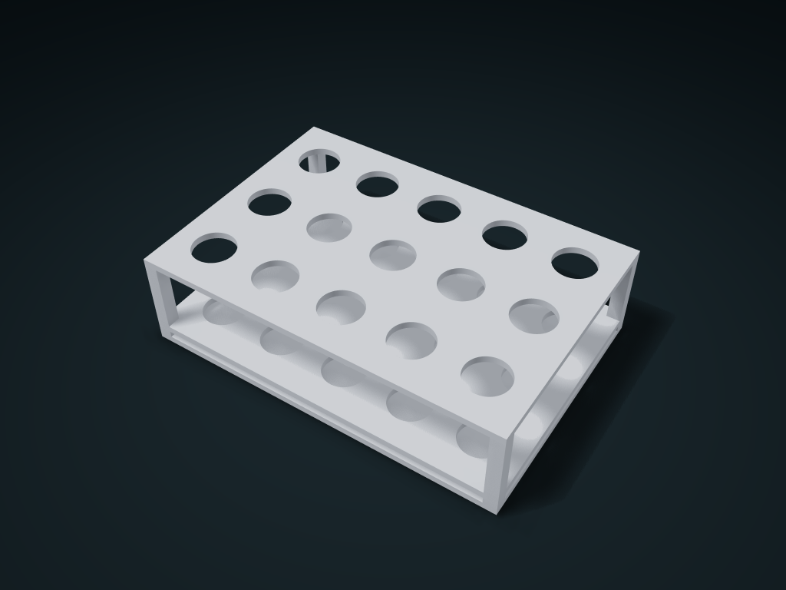

# Battery Locating Grid Box

Stand cylindrical batteries through aligned holes, with tops exposed for pickup and sides visible. Adjust rows, columns and hole diameter.

**[Preview this model and customize it on boxesmodel](https://boxesmodel.com/models/battery-crate)**

## Default model

| Property | Value |
| --- | --- |
| Category | Desktop Organizers |
| Model version | 1.0.1 |
| Default box size | 130 × 90 × 35 mm |
| Included parts | 1 |
| Formats | STL and STEP |
| Units | Millimeters |

Dimensions include the outer outline of the box; see the specifications for usable interior space.

## Intended use

- Allow clearance around the wrapped battery diameter and keep the box lower than the battery. Solid bottom; storage only, with no electrical connections or charging.
- The two locating plates have long bridges; inspect supports in the slicer before printing.

## Dimensions and features

| Detail | Default value |
| --- | --- |
| Number of battery positions | 15 |
| Locating hole clear diameter | 15.0 mm |

## Download the parts

Open a file below and choose **Download raw file** on GitHub. STL is for slicers; STEP is for CAD editing.

| Part | Dimensions | STL | STEP |
| --- | --- | --- | --- |
| Two-level locating frame box | 130 × 90 × 35 mm | [body.stl](body.stl) | [body.step](body.step) |

Each listed part has its own STL and STEP file. Preview colors are illustrative; the manufacturing files do not contain the displayed colors.

## Printing and assembly

- For storing cylindrical batteries upright; hole diameters are clear sizes, so leave allowance for the actual wrapped battery diameter.
- Upper and lower locating holes are coaxial, with a fully solid bottom; the box height should be lower than the battery length so the top sticks out for easy grabbing.
- The two locating plate levels have long bridges; check supports in the slicer. For storage and positioning only; no electrical connection or charging.
- Import at millimeter scale. Check your build volume, orientation, overhangs, supports and mating clearances in the slicer.

## Adjust the design

Visit the [interactive model page](https://boxesmodel.com/models/battery-crate) to inspect the 3D model and adjust the available dimensions and layout options. This folder contains the default-size export shown above; custom exports follow the options and pricing shown on boxesmodel.

## License and attribution

Copyright © 2026 boxesmodel. These model files, preview and description are licensed under [CC BY 4.0](https://creativecommons.org/licenses/by/4.0/). You may share, modify and use them commercially with the required attribution. See the [full license](../../LICENSE) and [attribution guide](../../ATTRIBUTION.md).

Suggested credit:

> “Battery Locating Grid Box” by [boxesmodel](https://boxesmodel.com/models/battery-crate), licensed under [CC BY 4.0](https://creativecommons.org/licenses/by/4.0/). Indicate any changes you make.

[Browse all models](../../CATALOG.md) · [About the collection](../../README.md)
