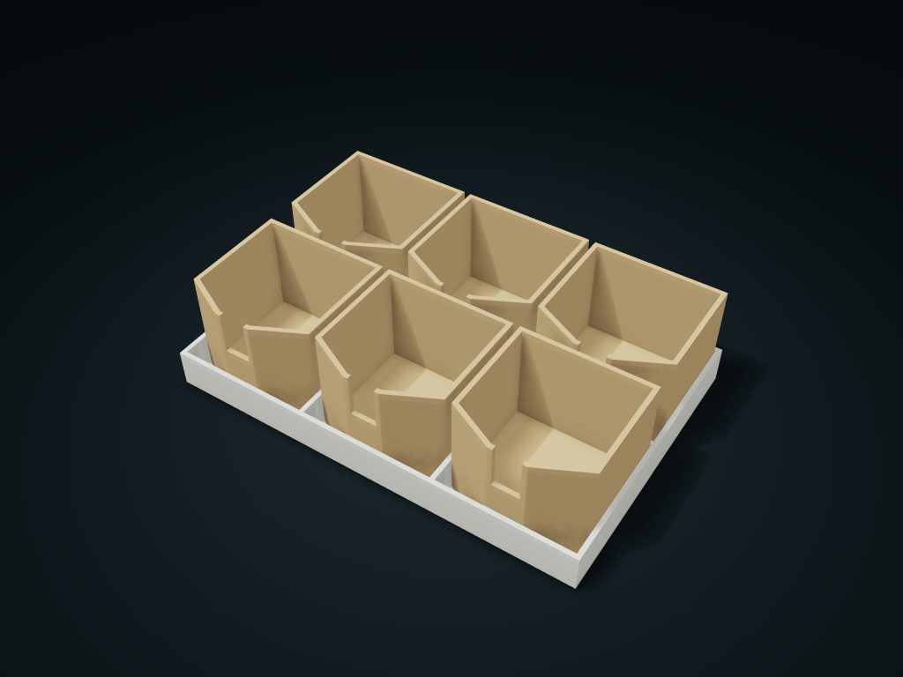

# Spouted Bead Cup Tray

Sort beads and small parts in cups; lift one vertically, then pour through its narrow spout. Adjust cup rows, columns and spout width.

**[Preview this model and customize it on boxesmodel](https://boxesmodel.com/models/bead-funnel-cups)**

## Default model

| Property | Value |
| --- | --- |
| Category | Desktop Organizers |
| Model version | 1.0.1 |
| Default assembly display size | 210 × 140 × 55 mm |
| Included parts | 7 |
| Formats | STL and STEP |
| Units | Millimeters |

Covers the layout of all parts in the current preview; see Files and dimensions for each part's print size.

## Intended use

- Beads and small parts; fill below the spout. Not automatic dispensing; use matching parts from the same set.

## Dimensions and features

| Detail | Default value |
| --- | --- |
| Lift-out cups | 6 |
| Pour spout clear width | 13.2 mm |
| Retaining clear height | 29.2 mm |

## Download the parts

Open a file below and choose **Download raw file** on GitHub. STL is for slicers; STEP is for CAD editing.

| Part | Dimensions | STL | STEP |
| --- | --- | --- | --- |
| Cup holder base | 210 × 140 × 19.25 mm | [carrier.stl](carrier.stl) | [carrier.step](carrier.step) |
| Cup 1-1 | 66 × 65.6 × 52.6 mm | [cup-1-1.stl](cup-1-1.stl) | [cup-1-1.step](cup-1-1.step) |
| Cup 1-2 | 66 × 65.6 × 52.6 mm | [cup-1-2.stl](cup-1-2.stl) | [cup-1-2.step](cup-1-2.step) |
| Cup 1-3 | 66 × 65.6 × 52.6 mm | [cup-1-3.stl](cup-1-3.stl) | [cup-1-3.step](cup-1-3.step) |
| Cup 2-1 | 66 × 65.6 × 52.6 mm | [cup-2-1.stl](cup-2-1.stl) | [cup-2-1.step](cup-2-1.step) |
| Cup 2-2 | 66 × 65.6 × 52.6 mm | [cup-2-2.stl](cup-2-2.stl) | [cup-2-2.step](cup-2-2.step) |
| Cup 2-3 | 66 × 65.6 × 52.6 mm | [cup-2-3.stl](cup-2-3.stl) | [cup-2-3.step](cup-2-3.step) |

Each listed part has its own STL and STEP file. Preview colors are illustrative; the manufacturing files do not contain the displayed colors.

## Printing and assembly

- Do not fill above the pour spout; first lift a single cup straight up, then tilt it to pour out beads or parts; it is not an automatic feeder.
- The cup stands above the holder for easy gripping; 0.4 mm single-side design gap; fits only parts from the same set. Print all parts base down.
- Import at millimeter scale. Check your build volume, orientation, overhangs, supports and mating clearances in the slicer.

## Adjust the design

Visit the [interactive model page](https://boxesmodel.com/models/bead-funnel-cups) to inspect the 3D model and adjust the available dimensions and layout options. This folder contains the default-size export shown above; custom exports follow the options and pricing shown on boxesmodel.

## License and attribution

Copyright © 2026 boxesmodel. These model files, preview and description are licensed under [CC BY 4.0](https://creativecommons.org/licenses/by/4.0/). You may share, modify and use them commercially with the required attribution. See the [full license](../../LICENSE) and [attribution guide](../../ATTRIBUTION.md).

Suggested credit:

> “Spouted Bead Cup Tray” by [boxesmodel](https://boxesmodel.com/models/bead-funnel-cups), licensed under [CC BY 4.0](https://creativecommons.org/licenses/by/4.0/). Indicate any changes you make.

[Browse all models](../../CATALOG.md) · [About the collection](../../README.md)
