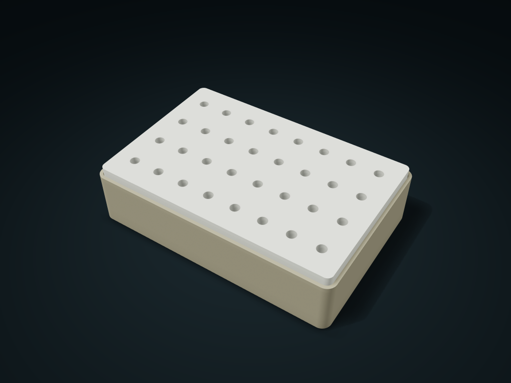

# Tool Bit Locating Box

Place tool bits and rods in blind holes; empty and lift the block by its exposed edge. Adjust diameter, depth and hole layout.

**[Preview this model and customize it on boxesmodel](https://boxesmodel.com/models/bit-index-case)**

## Default model

| Property | Value |
| --- | --- |
| Category | Desktop Organizers |
| Model version | 1.0.0 |
| Default assembly display size | 180 × 120 × 45 mm |
| Included parts | 2 |
| Formats | STL and STEP |
| Units | Millimeters |

Covers the layout of all parts in the current preview; see Files and dimensions for each part's print size.

## Intended use

- Tool bits, rods and small tools; round blind holes do not clamp or prevent rotation. Use matching parts and check fit with a test print.

## Dimensions and features

| Detail | Default value |
| --- | --- |
| Tool locating holes | 32 |
| Blind hole size | Ø6.8 × 12.0 mm |

## Download the parts

Open a file below and choose **Download raw file** on GitHub. STL is for slicers; STEP is for CAD editing.

| Part | Dimensions | STL | STEP |
| --- | --- | --- | --- |
| Tool bit base tray | 180 × 120 × 39 mm | [carrier.stl](carrier.stl) | [carrier.step](carrier.step) |
| Blind-hole locating block | 174.4 × 114.4 × 14.4 mm | [index.stl](index.stl) | [index.step](index.step) |

Each listed part has its own STL and STEP file. Preview colors are illustrative; the manufacturing files do not contain the displayed colors.

## Printing and assembly

- Print the base tray and hole block base down separately; the hole block stands 6 mm proud of the outer frame; once empty, lift it straight out by the exposed edge.
- Round blind holes, with floor thickness following the wall thickness; set by the tool's measured outer diameter and insertion depth; not a clamping or anti-rotation interface.
- Fixed 0.4 mm single-side design gap; fits only parts from the same set; test-print to check the real fit first.
- Import at millimeter scale. Check your build volume, orientation, overhangs, supports and mating clearances in the slicer.

## Adjust the design

Visit the [interactive model page](https://boxesmodel.com/models/bit-index-case) to inspect the 3D model and adjust the available dimensions and layout options. This folder contains the default-size export shown above; custom exports follow the options and pricing shown on boxesmodel.

## License and attribution

Copyright © 2026 boxesmodel. These model files, preview and description are licensed under [CC BY 4.0](https://creativecommons.org/licenses/by/4.0/). You may share, modify and use them commercially with the required attribution. See the [full license](../../LICENSE) and [attribution guide](../../ATTRIBUTION.md).

Suggested credit:

> “Tool Bit Locating Box” by [boxesmodel](https://boxesmodel.com/models/bit-index-case), licensed under [CC BY 4.0](https://creativecommons.org/licenses/by/4.0/). Indicate any changes you make.

[Browse all models](../../CATALOG.md) · [About the collection](../../README.md)
