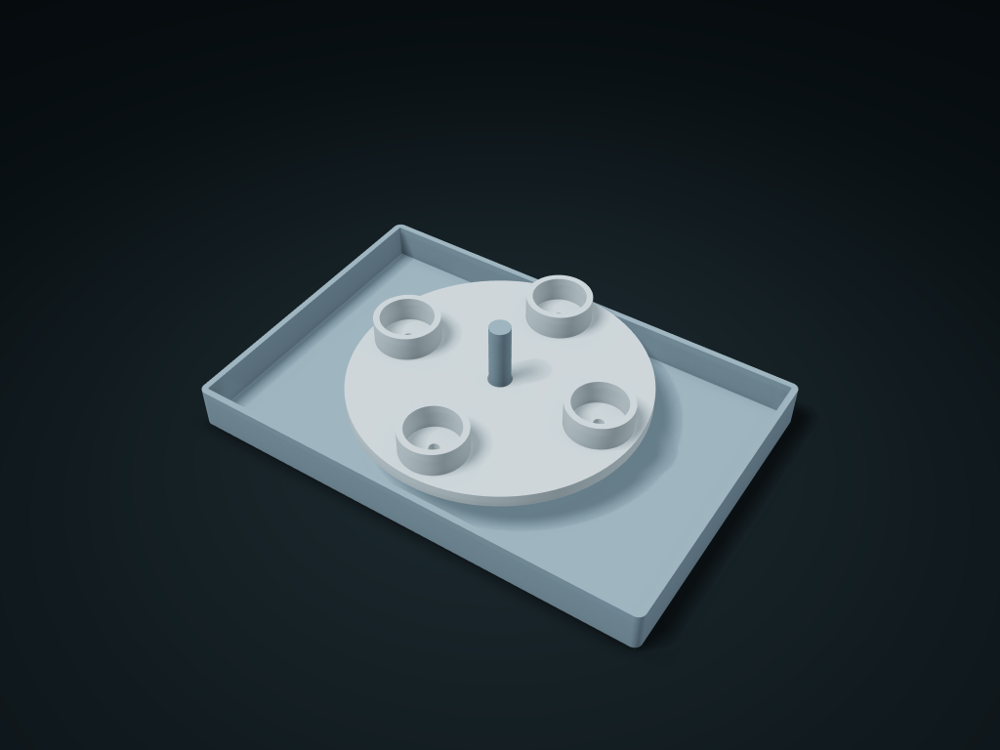

# Pivoting Bottle Cap Drying Box

A lift-out rotating perforated tray holds bottle caps, and water from the pocket bottoms drains into the fixed base tray

**[Preview this model and customize it on boxesmodel](https://boxesmodel.com/models/bottle-cap-spindle-bin)**

## Default model

| Property | Value |
| --- | --- |
| Category | Desktop Organizers |
| Model version | 1.0.0 |
| Default assembly display size | 180 × 120 × 45 mm |
| Included parts | 2 |
| Formats | STL and STEP |
| Units | Millimeters |

Covers the layout of all parts in the current preview; see Files and dimensions for each part's print size.

## Download the parts

Open a file below and choose **Download raw file** on GitHub. STL is for slicers; STEP is for CAD editing.

| Part | Dimensions | STL | STEP |
| --- | --- | --- | --- |
| Pivot water collection tray | 180 × 120 × 45 mm | [body.stl](body.stl) | [body.step](body.step) |
| Bottle cap hole tray | 110.4 × 110.4 × 14.8 mm | [wheel.stl](wheel.stl) | [wheel.step](wheel.step) |

Each listed part has its own STL and STEP file. Preview colors are illustrative; the manufacturing files do not contain the displayed colors.

## Printing and assembly

- The perforated tray's center fits over the one-piece axle; once it drops onto the shoulder it turns by hand and lifts straight off. Each lid pocket has a through drain hole; no screws needed.
- Set the cap pocket diameter by actual outer diameter; 0.5 mm single-side clearance at the pivot. No anti-separation latch; test-print to check rotation resistance and stability first.
- Units are millimeters. Measure clearance from your actual items first; check slicing before printing and test-fit the key mating parts.
- Import at millimeter scale. Check your build volume, orientation, overhangs, supports and mating clearances in the slicer.

## Adjust the design

Visit the [interactive model page](https://boxesmodel.com/models/bottle-cap-spindle-bin) to inspect the 3D model and adjust the available dimensions and layout options. This folder contains the default-size export shown above; custom exports follow the options and pricing shown on boxesmodel.

## License and attribution

Copyright © 2026 boxesmodel. These model files, preview and description are licensed under [CC BY 4.0](https://creativecommons.org/licenses/by/4.0/). You may share, modify and use them commercially with the required attribution. See the [full license](../../LICENSE) and [attribution guide](../../ATTRIBUTION.md).

Suggested credit:

> “Pivoting Bottle Cap Drying Box” by [boxesmodel](https://boxesmodel.com/models/bottle-cap-spindle-bin), licensed under [CC BY 4.0](https://creativecommons.org/licenses/by/4.0/). Indicate any changes you make.

[Browse all models](../../CATALOG.md) · [About the collection](../../README.md)
