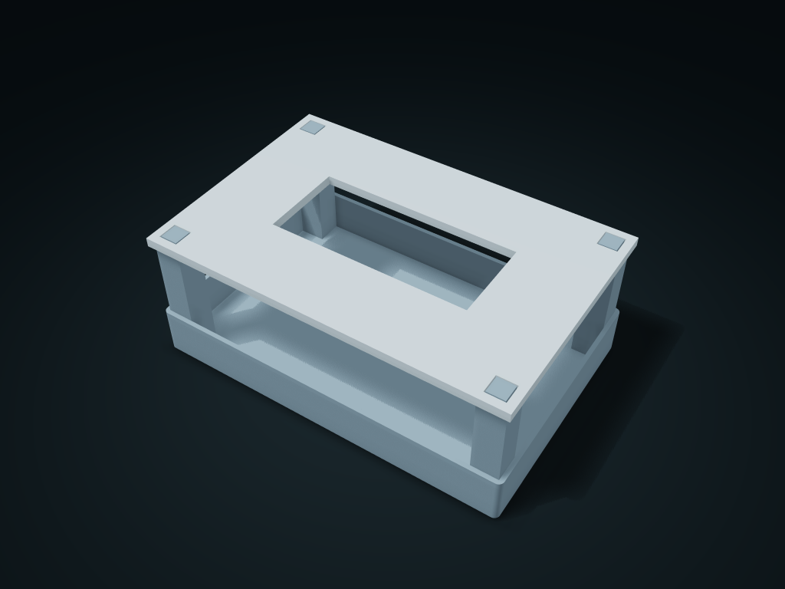

# Four-Post Floating Lid Long-Item Box

Store long tools in side spaces, accessing through the frame window or lifting the frame off; adjust window size, posts and clearance.

**[Preview this model and customize it on boxesmodel](https://boxesmodel.com/models/bridge-retainer-case)**

## Default model

| Property | Value |
| --- | --- |
| Category | Desktop Organizers |
| Model version | 1.0.0 |
| Default assembly display size | 190 × 125 × 72 mm |
| Included parts | 2 |
| Formats | STL and STEP |
| Units | Millimeters |

Covers the layout of all parts in the current preview; see Files and dimensions for each part's print size.

## Intended use

- Long tools; the frame rests vertically on post shoulders, with no latch or crush-protection claim.

## Download the parts

Open a file below and choose **Download raw file** on GitHub. STL is for slicers; STEP is for CAD editing.

| Part | Dimensions | STL | STEP |
| --- | --- | --- | --- |
| Four-post base box | 190 × 125 × 72 mm | [body.stl](body.stl) | [body.step](body.step) |
| Pick-up window lid frame | 190 × 125 × 4.8 mm | [cover.stl](cover.stl) | [cover.step](cover.step) |

Each listed part has its own STL and STEP file. Preview colors are illustrative; the manufacturing files do not contain the displayed colors.

## Printing and assembly

- Line the lid frame holes up with the four posts' thin tenons and lower it onto the shoulders. The window is for taking long items in and out, and the whole frame lifts away; no latch; no crush protection is promised.
- Units are millimeters. Measure clearance from your actual items first; check slicing before printing and test-fit the key mating parts.
- Import at millimeter scale. Check your build volume, orientation, overhangs, supports and mating clearances in the slicer.

## Adjust the design

Visit the [interactive model page](https://boxesmodel.com/models/bridge-retainer-case) to inspect the 3D model and adjust the available dimensions and layout options. This folder contains the default-size export shown above; custom exports follow the options and pricing shown on boxesmodel.

## License and attribution

Copyright © 2026 boxesmodel. These model files, preview and description are licensed under [CC BY 4.0](https://creativecommons.org/licenses/by/4.0/). You may share, modify and use them commercially with the required attribution. See the [full license](../../LICENSE) and [attribution guide](../../ATTRIBUTION.md).

Suggested credit:

> “Four-Post Floating Lid Long-Item Box” by [boxesmodel](https://boxesmodel.com/models/bridge-retainer-case), licensed under [CC BY 4.0](https://creativecommons.org/licenses/by/4.0/). Indicate any changes you make.

[Browse all models](../../CATALOG.md) · [About the collection](../../README.md)
