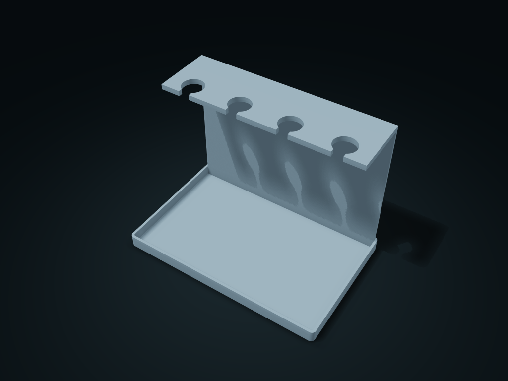

# Upside-Down Brush Drip Box

Slide brush necks in from the front, resting wider shoulders on the plate with bristles above the tray. Adjust hole size, entry width and slot count.

**[Preview this model and customize it on boxesmodel](https://boxesmodel.com/models/brush-suspension-basin)**

## Default model

| Property | Value |
| --- | --- |
| Category | Desktop Organizers |
| Model version | 1.0.0 |
| Default box size | 190 × 120 × 140 mm |
| Included parts | 1 |
| Formats | STL and STEP |
| Units | Millimeters |

Dimensions include the outer outline of the box; see the specifications for usable interior space.

## Intended use

- Only for brushes whose narrow neck passes through the entry and whose shoulder is wider than the hole. Keep downward-facing bristles above the tray.
- The plate overhang requires planned print supports; check that they can be removed. No support-free printing claim.

## Dimensions and features

| Detail | Default value |
| --- | --- |
| Use | Open neck slots hang shouldered brush handles so the bristles stay off the drip tray |

## Download the parts

Open a file below and choose **Download raw file** on GitHub. STL is for slicers; STEP is for CAD editing.

| Part | Dimensions | STL | STEP |
| --- | --- | --- | --- |
| Upside-Down Brush Drip Box | 190 × 120 × 140 mm | [body.stl](body.stl) | [body.step](body.step) |

Each listed part has its own STL and STEP file. Preview colors are illustrative; the manufacturing files do not contain the displayed colors.

## Printing and assembly

- The brush's thin neck enters the round hole sideways from the front opening, and the wider shoulder rests on the hanging plate; bristles point down and should sit above the base tray.
- Only suits brushes whose thin neck passes the entrance and whose shoulder is wider than the hole; the hanging plate overhangs; arrange supports when slicing and check they can be removed; support-free printing is not claimed.
- Import at millimeter scale. Check your build volume, orientation, overhangs, supports and mating clearances in the slicer.

## Adjust the design

Visit the [interactive model page](https://boxesmodel.com/models/brush-suspension-basin) to inspect the 3D model and adjust the available dimensions and layout options. This folder contains the default-size export shown above; custom exports follow the options and pricing shown on boxesmodel.

## License and attribution

Copyright © 2026 boxesmodel. These model files, preview and description are licensed under [CC BY 4.0](https://creativecommons.org/licenses/by/4.0/). You may share, modify and use them commercially with the required attribution. See the [full license](../../LICENSE) and [attribution guide](../../ATTRIBUTION.md).

Suggested credit:

> “Upside-Down Brush Drip Box” by [boxesmodel](https://boxesmodel.com/models/brush-suspension-basin), licensed under [CC BY 4.0](https://creativecommons.org/licenses/by/4.0/). Indicate any changes you make.

[Browse all models](../../CATALOG.md) · [About the collection](../../README.md)
