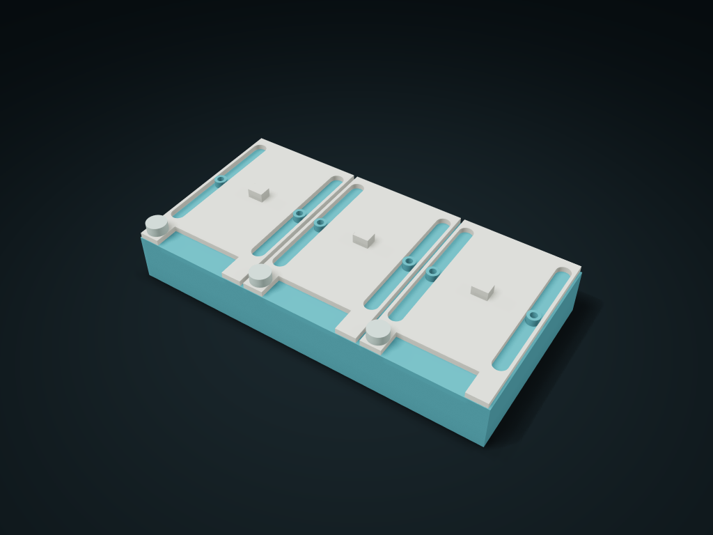

# Travel-Limited Twin Compartment Portion Box

Needs an M3 through screw, large washer and nut supplied separately; the two compartments in each group share a travel-limited full lid; with the pin pulled, sliding to either end exposes only one compartment.

**[Preview this model and customize it on boxesmodel](https://boxesmodel.com/models/captive-pair-dose-slider)**

## Default model

| Property | Value |
| --- | --- |
| Category | Lidded Storage |
| Model version | 1.0.0 |
| Default assembly display size | 180 × 90 × 32 mm |
| Included parts | 7 |
| Formats | STL and STEP |
| Units | Millimeters |

Covers the layout of all parts in the current preview; see Files and dimensions for each part's print size.

## Dimensions and features

| Detail | Default value |
| --- | --- |
| Shared walls / number of double compartment groups | 16 mm / 3 groups, 2 compartments each |
| Closed printed parts list | 1 box + 3 full lids + 3 closing pins |
| Current purchased parts list | 6 × M3×25 mm screws / 6 × DIN 9021 large washers / 6 × DIN 934 nuts |
| Travel slot / minimum large washer coverage | Slot width 7 mm; at least 0.82 mm per side |
| Closing pin effective insertion depth / hole bottom allowance | 9.6 mm / 11.3 mm |
| Two-way pick-up travel | ±31.4 mm, the two compartment openings are mutually exclusive; desktop retention only; not yet verified with real items |

## Download the parts

Open a file below and choose **Download raw file** on GitHub. STL is for slicers; STEP is for CAD editing.

| Part | Dimensions | STL | STEP |
| --- | --- | --- | --- |
| Twin compartment box and through shoulder posts | 180 × 90 × 27.7 mm | [body.stl](body.stl) | [body.step](body.step) |
| Group 1 two-way travel-limited full lid | 58.1 × 90 × 7.5 mm | [cover-1.stl](cover-1.stl) | [cover-1.step](cover-1.step) |
| Group 1 removable closing pin | 10 × 10 × 17.5 mm | [pin-1.stl](pin-1.stl) | [pin-1.step](pin-1.step) |
| Group 2 two-way travel-limited full lid | 58.1 × 90 × 7.5 mm | [cover-2.stl](cover-2.stl) | [cover-2.step](cover-2.step) |
| Group 2 removable closing pin | 10 × 10 × 17.5 mm | [pin-2.stl](pin-2.stl) | [pin-2.step](pin-2.step) |
| Group 3 two-way travel-limited full lid | 58.1 × 90 × 7.5 mm | [cover-3.stl](cover-3.stl) | [cover-3.step](cover-3.step) |
| Group 3 removable closing pin | 10 × 10 × 17.5 mm | [pin-3.stl](pin-3.stl) | [pin-3.step](pin-3.step) |

Each listed part has its own STL and STEP file. Preview colors are illustrative; the manufacturing files do not contain the displayed colors.

## Printing and assembly

- Printed parts: 1 box, 3 travel-limited full lids and 3 closing pins, 7 in total; all metal hardware must be supplied separately and is not among the STL/STEP printed parts.
- Supply 6 M3×25 mm socket head screws (shank 3, head ≤ 5.5, head height ≤ 3 mm, 2.5 mm hex drive, at least 3 mm of effective thread at the end), 6 DIN 9021 M3 large washers (outer 8.64–9, inner 3.2–3.38, 0.7–0.9 mm thick) and 6 DIN 934 M3 nuts (AF ≤ 5.5, height ≤ 2.4 mm, pitch 0.5). Never substitute plain OD7 washers.
- First lower the lid from above along the two shoulder posts; screws go up through the open head holes at the bottom, with a large washer and nut placed on each post top in order. Tighten onto the post shoulder with a 2.5 mm hex key from below and a ≤ 8 mm outer diameter socket from above; keep 0.4 mm nominal axial clearance at the lid top and do not clamp the lid. The screw end is 0.5 mm below the outer height, the nut engages its full height and the end extends at least 0.5 mm; washers thinner than 0.9 mm add spare thread without changing the post shoulder position.
- Insert the closing pin with the whole lid centered; to take items, pull the pin straight up, then slide along Y to either end (±31.4 mm travel). At this point only the matching compartment of the group is exposed; the other stays covered; return to center and reinsert the pin; no need to remove the guide post hardware. The end slots stop it pulling further, and the large washer stops it lifting. To remove the whole lid, first remove the top nut and large washer.
- Each compartment clear width × depth × height under the lid: 38 × 28.2 × 21.7 mm; the floor is 2.8 mm. Reference: small 8 mm cubes, 4 per compartment with room to pick them up; still measure the maximum item envelope from your actual items. Leave another 31.4 mm in Y at the open end, and room above the pull pin for its length and your fingers.
- Print the box bottom, lid bottom and pin bottom each facing down; check the tops inside the screw head holes and the shoulder post round holes when slicing; check slicing before printing, and test-print to check clearances, thin slot edge strength, friction and long-term retention.
- For portioning two sets of dry small items on a desk. Tablets are an application scenario only; no medical safety, child resistance, food contact, sealing or leak-proof transport is promised; the pin can be pulled out deliberately and has no tested anti-tip retention; use outer packaging when carrying.
- Suggested colors: cream/lake blue/coral, slate/mustard/indigo, sage/apricot/terracotta, berry/light pink/cream, lavender/lime/misty purple, deep sea blue/mint/sand. Colors are for display only and do not change manufacturing size.
- Import at millimeter scale. Check your build volume, orientation, overhangs, supports and mating clearances in the slicer.

### Additional hardware

Each set needs 2 M3 socket head screws, 2 large washers and 2 nuts supplied separately; default 3 groups of 6. Choose screw length from the current size list (default M3×25 mm), head diameter ≤ 5.5 mm / height ≤ 3 mm, effective thread at the end ≥ 3 mm; DIN 9021 large washers: outer diameter 8.64–9 mm, inner diameter 3.2–3.38 mm, thickness 0.7–0.9 mm; do not use small OD7 washers; DIN 934 nut AF ≤ 5.5 mm / height ≤ 2.4 mm. The print files contain only the box body, full lid and closing pin.

## Adjust the design

Visit the [interactive model page](https://boxesmodel.com/models/captive-pair-dose-slider) to inspect the 3D model and adjust the available dimensions and layout options. This folder contains the default-size export shown above; custom exports follow the options and pricing shown on boxesmodel.

## License and attribution

Copyright © 2026 boxesmodel. These model files, preview and description are licensed under [CC BY 4.0](https://creativecommons.org/licenses/by/4.0/). You may share, modify and use them commercially with the required attribution. See the [full license](../../LICENSE) and [attribution guide](../../ATTRIBUTION.md).

Suggested credit:

> “Travel-Limited Twin Compartment Portion Box” by [boxesmodel](https://boxesmodel.com/models/captive-pair-dose-slider), licensed under [CC BY 4.0](https://creativecommons.org/licenses/by/4.0/). Indicate any changes you make.

[Browse all models](../../CATALOG.md) · [About the collection](../../README.md)
