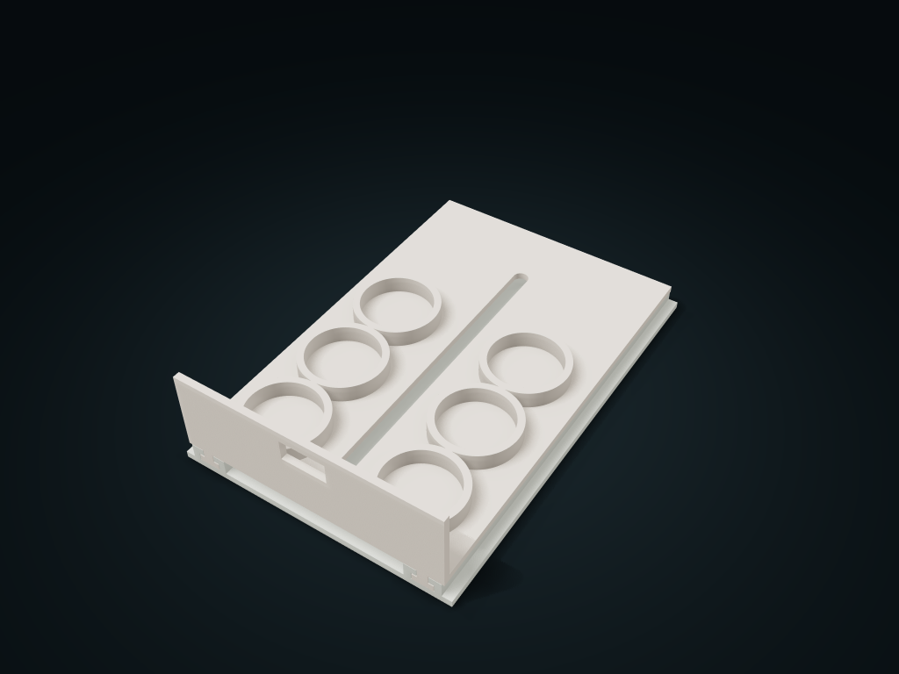

# Tail-Retained Two-Row Pull-Out Bottle Box

Store closed spice bottles in two rows and pull slowly to lift each out; configure bottle size, count and cabinet space, keeping tail rails engaged.

**[Preview this model and customize it on boxesmodel](https://boxesmodel.com/models/captive-tail-bottle-pullout)**

## Default model

| Property | Value |
| --- | --- |
| Category | Drawer Storage |
| Model version | 1.0.1 |
| Default assembly display size | 160 × 240 × 60 mm |
| Included parts | 3 |
| Formats | STL and STEP |
| Units | Millimeters |

Covers the layout of all parts in the current preview; see Files and dimensions for each part's print size.

## Intended use

- Closed round bottles; check maximum diameter, height and cabinet access. Keep the center aisle and tail empty. Mount wood screws in flat solid wood; not thin backing, hollow board or glass. Assess other substrates separately.
- Supply one M3 fully threaded screw, nut and washer, four 3.5 mm wood screws, a 2.5 mm hex key and screwdriver. Select lengths from the current list and board thickness; do not scale hardware or use a longer M3 screw.
- Check screw engagement and pilot depth per instructions. Empty and support the tray before removal, leaving 250 mm ahead. No inverted carrying or abrupt loaded pulls; the sleeve is not a transport lock. Check loads, friction, wear and creep.

## Dimensions and features

| Detail | Default value |
| --- | --- |
| Complete print list | 1 twin C-rail base + 1 two-row cup tray + 1 shoulder sleeve (8/3.4 × 9.5 mm) |
| Purchased materials for this set | 1 × M3×16 socket head, 1 × M3 nut, 1 × M3 flat washer, 4 × 3.5×16 wood screws (the latter only an 18 mm solid wood example) |
| Cups and clear diameter | 2×3； Clear diameter 40.8, cup height 10 mm |
| Nominal travel / actual minimum engagement | 171 / 64.6mm |
| Reference clear height inside the cabinet | At least 127.2 mm (for a 100 mm tall closed bottle) |

## Download the parts

Open a file below and choose **Download raw file** on GitHub. STL is for slicers; STEP is for CAD editing.

| Part | Dimensions | STL | STEP |
| --- | --- | --- | --- |
| Twin C-rail base fixed with wood screws | 160 × 240 × 12.8 mm | [base.stl](base.stl) | [base.step](base.step) |
| Tail-retained two-row cup tray | 152 × 236 × 56 mm | [tray.stl](tray.stl) | [tray.step](tray.step) |
| Separate rigid shoulder travel-limit sleeve | 8 × 8 × 9.5 mm | [sleeve.stl](sleeve.stl) | [sleeve.step](sleeve.step) |

Each listed part has its own STL and STEP file. Preview colors are illustrative; the manufacturing files do not contain the displayed colors.

## Printing and assembly

- Extra materials needed: 1 M3 fully threaded socket head screw (M3×16 mm in this set, head diameter ≤ 5.5 / height ≤ 3); 1 × M3 hex nut (5.5 across flats / 2.4 thick); 1 × M3 flat washer (inner 3.2 / outer 7 / 0.5 thick); 4 × 3.5 mm round-head wood screws (head diameter ≤ 7 / height ≤ 3; for 18 mm solid wood the example shank under the head is 16 mm; choose the length for your board using the formula below). 3 printed parts: 1 twin C-rail base, 1 cup tray and 1 shoulder sleeve; all generated in the same export.
- Closed round bottles go in by a measured maximum outer diameter of 40 mm, 2 columns × 3 rows; reference full-load test height 100 mm; taller bottles need the cabinet's clear height checked separately, and fit is not inferred from brand. Cup clear diameter 40.8, height 10, center distance 48.8 mm. The central 20 mm service corridor and the rear tail section are not for storage.
- Closed total envelope 160 × 240 × 60 mm including the front grip plate; the base tray's effective floor is at Z17.2 mm. Cabinet interior width at least 162, clear depth from the base front edge backward at least 242, clear height above at least 127.2 mm; for taller real bottles, re-set the allowance from the bottle top. The cabinet opening is taken at the base front edge; the face frame must not block the guide feet, and the cabinet door must open fully.
- Assembly: first put the M3 nut into the base's 5.8 across-flats, 2.6 deep hex pocket; with no tray fitted, drive the wood screws through the four holes from above. Push the tray straight in from the front onto the twin C-rails up to the rear stop; the separate shoulder sleeve drops down through the central long hole onto the boss; add an M3 washer and screw the M3×16 into the nut. The shoulder sleeve (outer 8 / inner 3.4 / length 9.5 mm) follows this rail height, sitting 0.3 mm above the tray face, so tightening the screw does not clamp the sliding tray. The 2.5 mm hex tool enters straight from above the center.
- M3 axle bottom Z2 mm ≥ 0.5, clear of the shelf; the hex nut sits at Z5.4–7.8 mm, with at least 2.2 mm of actual thread engagement. Standard screw, nut and washer sizes do not scale with bottle diameter or box size; do not substitute longer screws.
- The four wood screws go down into flat solid wood. Engagement P = S − T is calculated from the measured shank length under the head S, floor thickness T = 4 mm and board thickness D; mounting sizes must satisfy 8 ≤ P ≤ D − 3 and pilot hole P + 1 ≤ D − 2. Example for 18 mm solid wood: S = 16 under the head gives P = 12 mm; other substrates need separate confirmation of hardware and real loads; thin backboards, hollow boards and glass are unsuitable, and the strength of unknown materials cannot be promised.
- Day to day, hold the tray and pull it forward slowly; nominal travel 171 mm; the long slot end and sleeve reach the limit at about 171.4 mm, with the twin rails still engaged 64.6 mm. All bottles, including 4 mm of pinch room per side, are outside the cabinet opening; lift them out straight one by one and do not put extra bottles in the tail section. The pull tabs and rail caps are captured by structural size; check tilt resistance, load-bearing and friction before use.
- To remove the tray, empty and support it: after removing the M3 screw, washer and shoulder sleeve, pull it fully off the rails straight forward, leaving at least 250 mm of space in front; the four wood screws can be removed directly at this point. The shoulder sleeve is not a transport lock; do not carry it upside down or yank a fully loaded tray.
- Base down; slice-check orientation and supports for the C-rail roof and the drawer underside guide feet and clean off residue; keep the shoulder sleeve axle vertical. Test-print the rail fit, central sleeve slot and nut samples first. Check slicing before printing; before use, check assembly, load, wear and creep; reliable load-bearing or completely jam-free operation is not guaranteed.
- Import at millimeter scale. Check your build volume, orientation, overhangs, supports and mating clearances in the slicer.

### Additional hardware

Supply separately 1 fully threaded M3 socket head screw (default M3×16 mm; choose the length from the current list when changing parameters; head diameter ≤5.5 / height ≤3 mm), 1 M3 hex nut (5.5 across flats / 2.4 mm thick), 1 M3 flat washer (ID 3.2 / OD 7 / 0.5 mm thick) and four 3.5 mm round head wood screws (default 16 mm shank under the head, an example for 18 mm solid wood only; head diameter ≤7 / height ≤3 mm; choose the length by the actual board thickness and the current list). The printed parts are 1 base, 1 cup tray and 1 shoulder sleeve; a 2.5 mm hex key and a wood-screw screwdriver are also needed.

## Adjust the design

Visit the [interactive model page](https://boxesmodel.com/models/captive-tail-bottle-pullout) to inspect the 3D model and adjust the available dimensions and layout options. This folder contains the default-size export shown above; custom exports follow the options and pricing shown on boxesmodel.

## License and attribution

Copyright © 2026 boxesmodel. These model files, preview and description are licensed under [CC BY 4.0](https://creativecommons.org/licenses/by/4.0/). You may share, modify and use them commercially with the required attribution. See the [full license](../../LICENSE) and [attribution guide](../../ATTRIBUTION.md).

Suggested credit:

> “Tail-Retained Two-Row Pull-Out Bottle Box” by [boxesmodel](https://boxesmodel.com/models/captive-tail-bottle-pullout), licensed under [CC BY 4.0](https://creativecommons.org/licenses/by/4.0/). Indicate any changes you make.

[Browse all models](../../CATALOG.md) · [About the collection](../../README.md)
