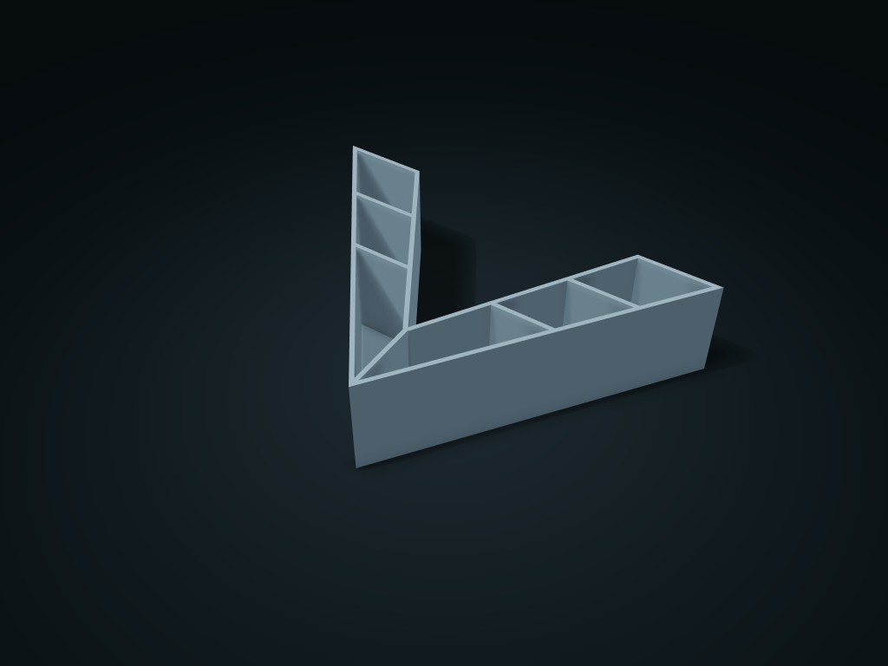

# Folded Corner Twin-Wing Box

The two wings follow the desk's folded corner, and cross segments lay items out in tiers

**[Preview this model and customize it on boxesmodel](https://boxesmodel.com/models/chevron-console-caddy)**

## Default model

| Property | Value |
| --- | --- |
| Category | Desktop Organizers |
| Model version | 1.0.0 |
| Default box size | 220 × 150 × 55 mm |
| Included parts | 1 |
| Formats | STL and STEP |
| Units | Millimeters |

Dimensions include the outer outline of the box; see the specifications for usable interior space.

## Dimensions and features

| Detail | Default value |
| --- | --- |
| Use | The two wings follow the desk's folded corner, and cross segments lay items out in tiers |

## Download the parts

Open a file below and choose **Download raw file** on GitHub. STL is for slicers; STEP is for CAD editing.

| Part | Dimensions | STL | STEP |
| --- | --- | --- | --- |
| Folded Corner Twin-Wing Box | 220 × 150 × 55 mm | [body.stl](body.stl) | [body.step](body.step) |

Each listed part has its own STL and STEP file. Preview colors are illustrative; the manufacturing files do not contain the displayed colors.

## Printing and assembly

- The two wings spread along an angled desk corner, and items drop into each section from above, sorting remotes or stationery into left and right zones.
- One-piece, printed flat on its base; each wing's clear width depends on the angle of the slanted sides; check your items against the generated clear compartment outline.
- Import at millimeter scale. Check your build volume, orientation, overhangs, supports and mating clearances in the slicer.

## Adjust the design

Visit the [interactive model page](https://boxesmodel.com/models/chevron-console-caddy) to inspect the 3D model and adjust the available dimensions and layout options. This folder contains the default-size export shown above; custom exports follow the options and pricing shown on boxesmodel.

## License and attribution

Copyright © 2026 boxesmodel. These model files, preview and description are licensed under [CC BY 4.0](https://creativecommons.org/licenses/by/4.0/). You may share, modify and use them commercially with the required attribution. See the [full license](../../LICENSE) and [attribution guide](../../ATTRIBUTION.md).

Suggested credit:

> “Folded Corner Twin-Wing Box” by [boxesmodel](https://boxesmodel.com/models/chevron-console-caddy), licensed under [CC BY 4.0](https://creativecommons.org/licenses/by/4.0/). Indicate any changes you make.

[Browse all models](../../CATALOG.md) · [About the collection](../../README.md)
