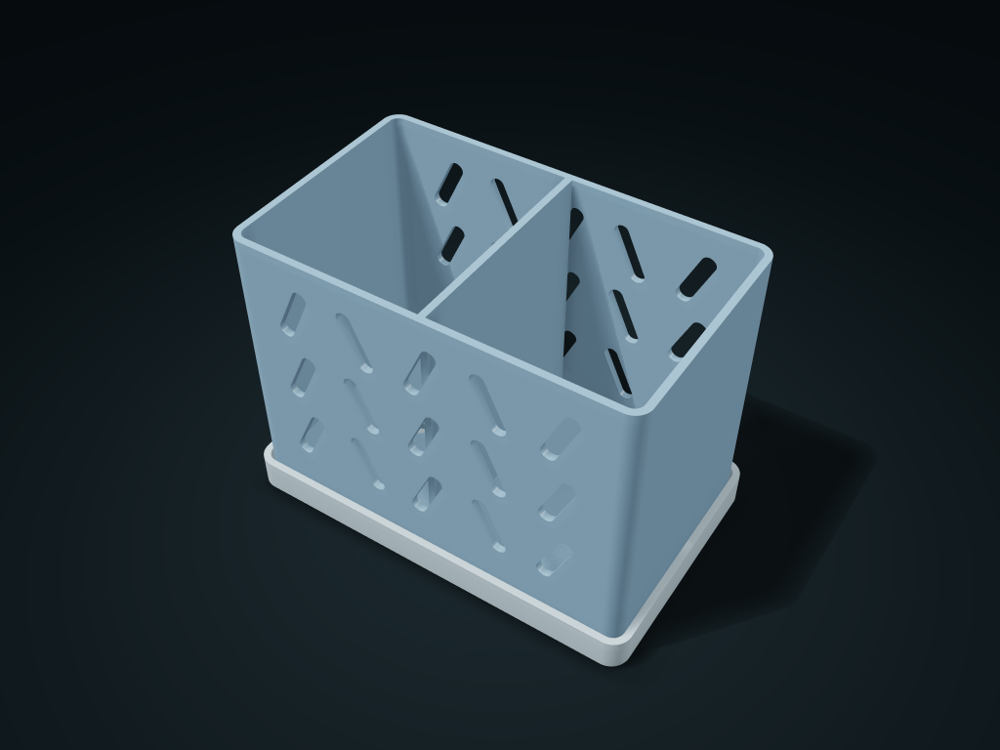

# Zigzag Slanted Window Bathroom Basket

Group toiletries in a slanted-window basket; lift it to empty and clean the tray separately. Adjust cells, outer size and solid lower rim.

**[Preview this model and customize it on boxesmodel](https://boxesmodel.com/models/chevron-vanity-caddy)**

## Default model

| Property | Value |
| --- | --- |
| Category | Desktop Organizers |
| Model version | 1.0.0 |
| Default assembly display size | 150 × 92 × 110 mm |
| Included parts | 2 |
| Formats | STL and STEP |
| Units | Millimeters |

Covers the layout of all parts in the current preview; see Files and dimensions for each part's print size.

## Intended use

- Toiletries; no dedicated charging compartment. The basket lifts upward rather than pulling forward.
- Allow another 1 mm per side after walls and dividers; avoid curved corners. Keep pieces smaller than openings below the solid rim or bagged. Lift the basket to clean and empty the tray regularly.
- Assess opening supports in the slicer; check supports, load capacity, leakage and material suitability for the intended use.

## Dimensions and features

| Detail | Default value |
| --- | --- |
| Clear boundary per compartment | 68.1 × 80.8 × 100.8 mm (corner compartments clear the rounded corners) |
| Compartment layout | 2 columns × 1 row; wall thickness 2.6 mm |
| Solid lower guard | At least 16.0 mm; upper pattern scale 10.0 mm |

## Download the parts

Open a file below and choose **Download raw file** on GitHub. STL is for slicers; STEP is for CAD editing.

| Part | Dimensions | STL | STEP |
| --- | --- | --- | --- |
| Perforated Compartment Draining Basket | 144 × 86 × 103.4 mm | [basket.stl](basket.stl) | [basket.step](basket.step) |
| One-piece drip tray with support ribs | 150 × 92 × 12 mm | [base.stl](base.stl) | [base.step](base.step) |

Each listed part has its own STL and STEP file. Preview colors are illustrative; the manufacturing files do not contain the displayed colors.

## Printing and assembly

- Each compartment's clearance is net of the actual wall thickness and shared dividers; leave another 1 mm per side for taking items in and out; corner compartments must clear the rounded corners.
- Only the front and back walls are perforated; the left and right walls stay solid; loose pieces smaller than the holes should be kept within the lower lip or in a separate small bag.
- Place each part floor-down on the build plate separately; for hole-top bridges and slanted windows, decide on supports from the slicer preview; check supports and load capacity for the intended use.
- Lift the whole basket up to remove it for washing; floor holes 5 mm in diameter with 4 mm of drip space below; empty the tray regularly.
- The complete printed parts are the basket and a drip tray with integrated support ribs, no purchased parts; no promise that layer lines are leak-proof or food-contact safe.
- Import at millimeter scale. Check your build volume, orientation, overhangs, supports and mating clearances in the slicer.

## Adjust the design

Visit the [interactive model page](https://boxesmodel.com/models/chevron-vanity-caddy) to inspect the 3D model and adjust the available dimensions and layout options. This folder contains the default-size export shown above; custom exports follow the options and pricing shown on boxesmodel.

## License and attribution

Copyright © 2026 boxesmodel. These model files, preview and description are licensed under [CC BY 4.0](https://creativecommons.org/licenses/by/4.0/). You may share, modify and use them commercially with the required attribution. See the [full license](../../LICENSE) and [attribution guide](../../ATTRIBUTION.md).

Suggested credit:

> “Zigzag Slanted Window Bathroom Basket” by [boxesmodel](https://boxesmodel.com/models/chevron-vanity-caddy), licensed under [CC BY 4.0](https://creativecommons.org/licenses/by/4.0/). Indicate any changes you make.

[Browse all models](../../CATALOG.md) · [About the collection](../../README.md)
