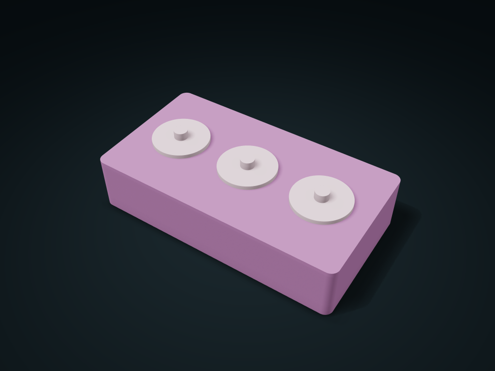

# Separate Round Lid Well Box

Store beads and small parts in round wells and lift only the lid needed; adjust well diameter, count and lid clearance.

**[Preview this model and customize it on boxesmodel](https://boxesmodel.com/models/circle-cap-cell-box)**

## Default model

| Property | Value |
| --- | --- |
| Category | Stackable Storage |
| Model version | 1.0.0 |
| Default assembly display size | 185 × 100 × 50 mm |
| Included parts | 4 |
| Formats | STL and STEP |
| Units | Millimeters |

Covers the layout of all parts in the current preview; see Files and dimensions for each part's print size.

## Intended use

- Beads and small parts; lids do not seal and carry no spill-prevention claim for transport.

## Download the parts

Open a file below and choose **Download raw file** on GitHub. STL is for slicers; STEP is for CAD editing.

| Part | Dimensions | STL | STEP |
| --- | --- | --- | --- |
| Separate round well box | 185 × 100 × 41 mm | [body.stl](body.stl) | [body.step](body.step) |
| Round well lift-off lid 1 | 42 × 42 × 12 mm | [cap-1.stl](cap-1.stl) | [cap-1.step](cap-1.step) |
| Round well lift-off lid 2 | 42 × 42 × 12 mm | [cap-2.stl](cap-2.stl) | [cap-2.step](cap-2.step) |
| Round well lift-off lid 3 | 42 × 42 × 12 mm | [cap-3.stl](cap-3.stl) | [cap-3.step](cap-3.step) |

Each listed part has its own STL and STEP file. Preview colors are illustrative; the manufacturing files do not contain the displayed colors.

## Printing and assembly

- The box and round lids print separately, with no hardware. The locating rim inserts 3 mm, the lid shoulder rests on the well mouth, and it lifts off; not a sealed lid; no spill-proof transport is promised.
- Units are millimeters; matching parts use files generated in the same export. Set clearance by your items' maximum size and leave room to take them in and out.
- Check orientation and supports before printing, and test-print key mating parts first.
- Import at millimeter scale. Check your build volume, orientation, overhangs, supports and mating clearances in the slicer.

## Adjust the design

Visit the [interactive model page](https://boxesmodel.com/models/circle-cap-cell-box) to inspect the 3D model and adjust the available dimensions and layout options. This folder contains the default-size export shown above; custom exports follow the options and pricing shown on boxesmodel.

## License and attribution

Copyright © 2026 boxesmodel. These model files, preview and description are licensed under [CC BY 4.0](https://creativecommons.org/licenses/by/4.0/). You may share, modify and use them commercially with the required attribution. See the [full license](../../LICENSE) and [attribution guide](../../ATTRIBUTION.md).

Suggested credit:

> “Separate Round Lid Well Box” by [boxesmodel](https://boxesmodel.com/models/circle-cap-cell-box), licensed under [CC BY 4.0](https://creativecommons.org/licenses/by/4.0/). Indicate any changes you make.

[Browse all models](../../CATALOG.md) · [About the collection](../../README.md)
