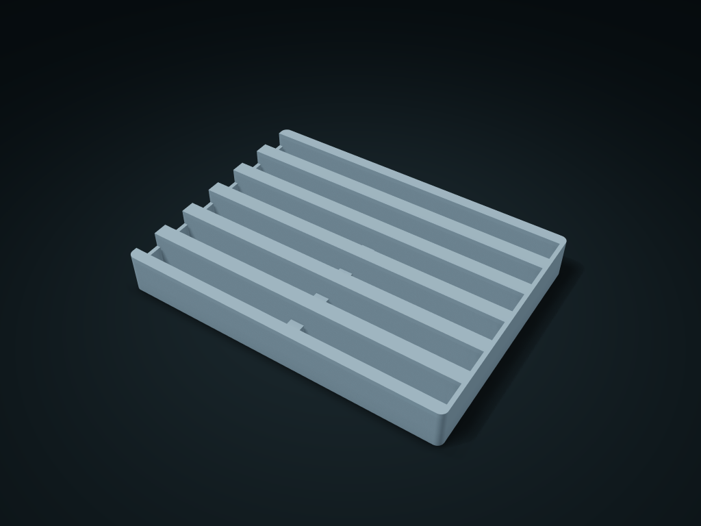

# SMD Component Tape Strip Cassette

Lay cut component tape strips in separate lanes and press one end to tip the other over the center bridge. Adjust lane count, width and finger recess.

**[Preview this model and customize it on boxesmodel](https://boxesmodel.com/models/component-tape-cassette)**

## Default model

| Property | Value |
| --- | --- |
| Category | Desktop Organizers |
| Model version | 1.0.0 |
| Default box size | 190 × 140 × 24 mm |
| Included parts | 1 |
| Formats | STL and STEP |
| Units | Millimeters |

Dimensions include the outer outline of the box; see the specifications for usable interior space.

## Intended use

- Only for cut tape strips, not full reels. Slot width must include carrier edges; the space beneath the bridge is not extra storage.

## Dimensions and features

| Detail | Default value |
| --- | --- |
| Use | Long cavities for narrow tape strips with a middle support bridge and a separate front pick-up notch |

## Download the parts

Open a file below and choose **Download raw file** on GitHub. STL is for slicers; STEP is for CAD editing.

| Part | Dimensions | STL | STEP |
| --- | --- | --- | --- |
| SMD Component Tape Strip Cassette | 190 × 140 × 24 mm | [body.stl](body.stl) | [body.step](body.step) |

Each listed part has its own STL and STEP file. Preview colors are illustrative; the manufacturing files do not contain the displayed colors.

## Printing and assembly

- One-piece box; each tape strip lies flat, and a small central bridge lets both ends be pressed up and picked up.
- Holds only cut short tape strips; slot width includes the carrier tape edges; the space under the bridge is not an extra compartment.
- Import at millimeter scale. Check your build volume, orientation, overhangs, supports and mating clearances in the slicer.

## Adjust the design

Visit the [interactive model page](https://boxesmodel.com/models/component-tape-cassette) to inspect the 3D model and adjust the available dimensions and layout options. This folder contains the default-size export shown above; custom exports follow the options and pricing shown on boxesmodel.

## License and attribution

Copyright © 2026 boxesmodel. These model files, preview and description are licensed under [CC BY 4.0](https://creativecommons.org/licenses/by/4.0/). You may share, modify and use them commercially with the required attribution. See the [full license](../../LICENSE) and [attribution guide](../../ATTRIBUTION.md).

Suggested credit:

> “SMD Component Tape Strip Cassette” by [boxesmodel](https://boxesmodel.com/models/component-tape-cassette), licensed under [CC BY 4.0](https://creativecommons.org/licenses/by/4.0/). Indicate any changes you make.

[Browse all models](../../CATALOG.md) · [About the collection](../../README.md)
