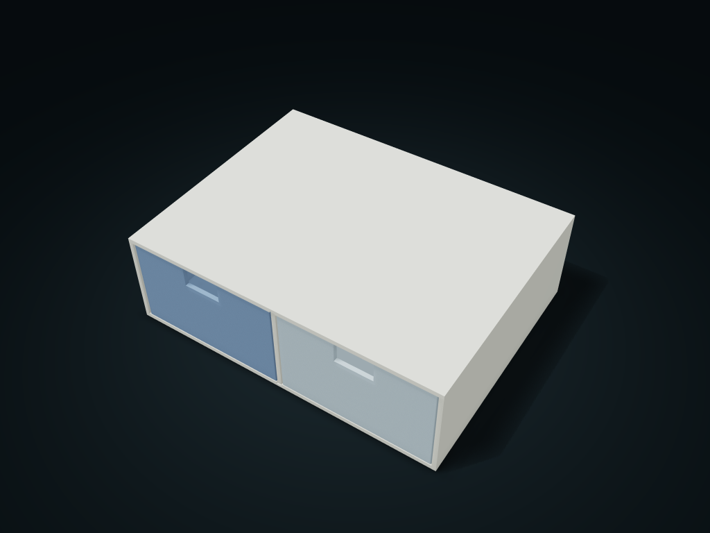

# Full & Half Width Interchangeable Drawer Cabinet

The same cabinet frame switches between one large drawer and two small drawers, and the middle divider pulls forward to remove.

**[Preview this model and customize it on boxesmodel](https://boxesmodel.com/models/convertible-width-drawer)**

## Default model

| Property | Value |
| --- | --- |
| Category | Desktop Organizers |
| Model version | 1.0.0 |
| Default assembly display size | 220 × 170 × 68 mm |
| Included parts | 4 |
| Formats | STL and STEP |
| Units | Millimeters |

Covers the layout of all parts in the current preview; see Files and dimensions for each part's print size.

## Dimensions and features

| Detail | Default value |
| --- | --- |
| Current inner parts | Middle divider + two half-width drawers |
| Straight-side clear width per drawer | 98.3 mm |
| Clear depth / height per cell | 78.4 / 58.2 mm |
| Effective slot engagement of the middle divider top and bottom | 0.9 mm each; removed in full-width mode |

## Download the parts

Open a file below and choose **Download raw file** on GitHub. STL is for slicers; STEP is for CAD editing.

| Part | Dimensions | STL | STEP |
| --- | --- | --- | --- |
| General single-level cabinet frame | 220 × 170 × 68 mm | [cabinet.stl](cabinet.stl) | [cabinet.step](cabinet.step) |
| Pull-forward middle divider | 3 × 165.8 × 63.8 mm | [separator.stl](separator.stl) | [separator.step](separator.step) |
| Left half-width drawer | 104.3 × 165.8 × 61.2 mm | [left.stl](left.stl) | [left.step](left.step) |
| Right half-width drawer | 104.3 × 165.8 × 61.2 mm | [right.stl](right.stl) | [right.step](right.step) |

Each listed part has its own STL and STEP file. Preview colors are illustrative; the manufacturing files do not contain the displayed colors.

## Printing and assembly

- The cabinet frame is the same in both width modes; switching configuration only requires reprinting the matching inner parts. In half-width mode, insert the middle divider along the upper and lower slots first, then put in the two small drawers; in full-width mode, remove the small drawers and the middle divider first.
- The drawer bottom sits directly on the cabinet floor, with 0.8 mm above; 0.6 mm side clearance. The middle divider enters the slots 0.9 mm at the top and bottom, leaving 0.3 mm at the slot bottom and 0.3 mm at the slot sides.
- All inner parts pull straight out from the front; work on the middle divider only after the drawer is fully removed. The back plate stops it sliding backward; there is no front anti-separation lock, so the drawer comes fully out of the cabinet; support the bottom by hand when removing it.
- Pull the drawer fully out first, then take items from above. The open finger slot is only in the front wall; closed clear height inside the cabinet is not the same as finger working space.
- Slicing the cabinet frame back down with the opening up is recommended; drawer bottom down; choose the wide face of the middle divider on the bed. Exported in assembly orientation; adjust before slicing, and check sliding and load-bearing before use.
- Import at millimeter scale. Check your build volume, orientation, overhangs, supports and mating clearances in the slicer.

## Adjust the design

Visit the [interactive model page](https://boxesmodel.com/models/convertible-width-drawer) to inspect the 3D model and adjust the available dimensions and layout options. This folder contains the default-size export shown above; custom exports follow the options and pricing shown on boxesmodel.

## License and attribution

Copyright © 2026 boxesmodel. These model files, preview and description are licensed under [CC BY 4.0](https://creativecommons.org/licenses/by/4.0/). You may share, modify and use them commercially with the required attribution. See the [full license](../../LICENSE) and [attribution guide](../../ATTRIBUTION.md).

Suggested credit:

> “Full & Half Width Interchangeable Drawer Cabinet” by [boxesmodel](https://boxesmodel.com/models/convertible-width-drawer), licensed under [CC BY 4.0](https://creativecommons.org/licenses/by/4.0/). Indicate any changes you make.

[Browse all models](../../CATALOG.md) · [About the collection](../../README.md)
