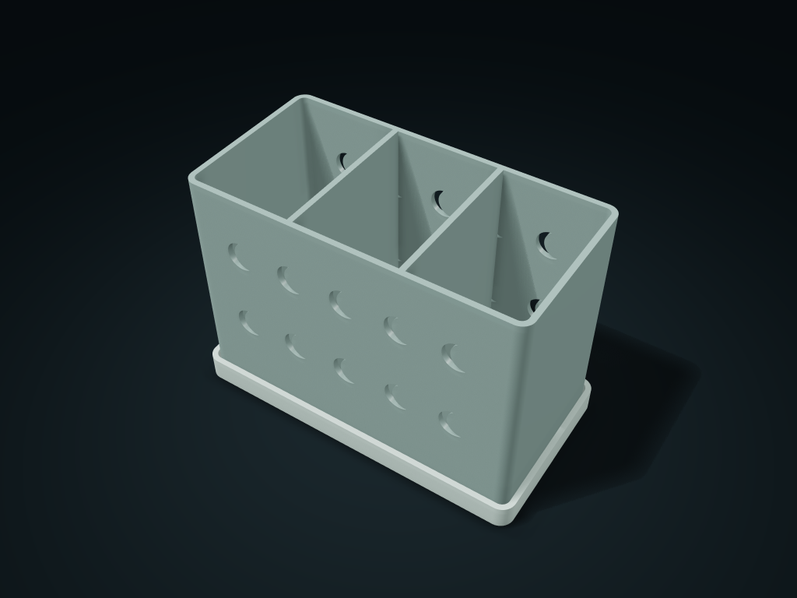

# Crescent Window Toothbrush Drip Caddy

Keep brushes and toothpaste in crescent-window spaces draining into a removable tray; size compartments for items and lift the caddy to empty and clean.

**[Preview this model and customize it on boxesmodel](https://boxesmodel.com/models/crescent-brush-drain-caddy)**

## Default model

| Property | Value |
| --- | --- |
| Category | Desktop Organizers |
| Model version | 1.0.0 |
| Default assembly display size | 168 × 88 × 118 mm |
| Included parts | 2 |
| Formats | STL and STEP |
| Units | Millimeters |

Covers the layout of all parts in the current preview; see Files and dimensions for each part's print size.

## Intended use

- Toothbrushes, toothpaste and small brushes.
- Brush ends must be wider than drain holes; measure handles and toothpaste width. No electric toothbrush charging structure. Empty and dry the drip tray promptly.
- Check load, leakage, hygiene and material suitability for the intended use; inspect opening bridges and supports before printing.

## Dimensions and features

| Detail | Default value |
| --- | --- |
| Brush compartment clearance | 50.1 × 76.0 × 108.4 mm |
| Drain holes | 1 hole per compartment, 4.0 mm in diameter |
| Drip tray fit | 0.40 mm clearance per side; 4 mm clear gap at the bottom |

## Download the parts

Open a file below and choose **Download raw file** on GitHub. STL is for slicers; STEP is for CAD editing.

| Part | Dimensions | STL | STEP |
| --- | --- | --- | --- |
| Ventilated shared-wall brush compartments | 161.6 × 81.6 × 111.2 mm | [basket.stl](basket.stl) | [basket.step](basket.step) |
| Drip tray with support ribs | 168 × 88 × 12 mm | [base.stl](base.stl) | [base.step](base.step) |

Each listed part has its own STL and STEP file. Preview colors are illustrative; the manufacturing files do not contain the displayed colors.

## Printing and assembly

- Brush handle ends must be wider than the drain holes; measure handle and toothpaste widths first; no electric toothbrush charging structure.
- Empty and dry the drip tray promptly; leak-proofing and hygiene performance have not been verified.
- All required parts are in the download; no purchased screws, shafts or glued parts. Display colors are only for covers and previews; STL/STEP manufacturing files carry no color.
- Place each part on the build plate separately before printing, and check hole-top bridges and supports in the slicer; Check load capacity, leak resistance and material suitability for your intended use.
- Import at millimeter scale. Check your build volume, orientation, overhangs, supports and mating clearances in the slicer.

## Adjust the design

Visit the [interactive model page](https://boxesmodel.com/models/crescent-brush-drain-caddy) to inspect the 3D model and adjust the available dimensions and layout options. This folder contains the default-size export shown above; custom exports follow the options and pricing shown on boxesmodel.

## License and attribution

Copyright © 2026 boxesmodel. These model files, preview and description are licensed under [CC BY 4.0](https://creativecommons.org/licenses/by/4.0/). You may share, modify and use them commercially with the required attribution. See the [full license](../../LICENSE) and [attribution guide](../../ATTRIBUTION.md).

Suggested credit:

> “Crescent Window Toothbrush Drip Caddy” by [boxesmodel](https://boxesmodel.com/models/crescent-brush-drain-caddy), licensed under [CC BY 4.0](https://creativecommons.org/licenses/by/4.0/). Indicate any changes you make.

[Browse all models](../../CATALOG.md) · [About the collection](../../README.md)
