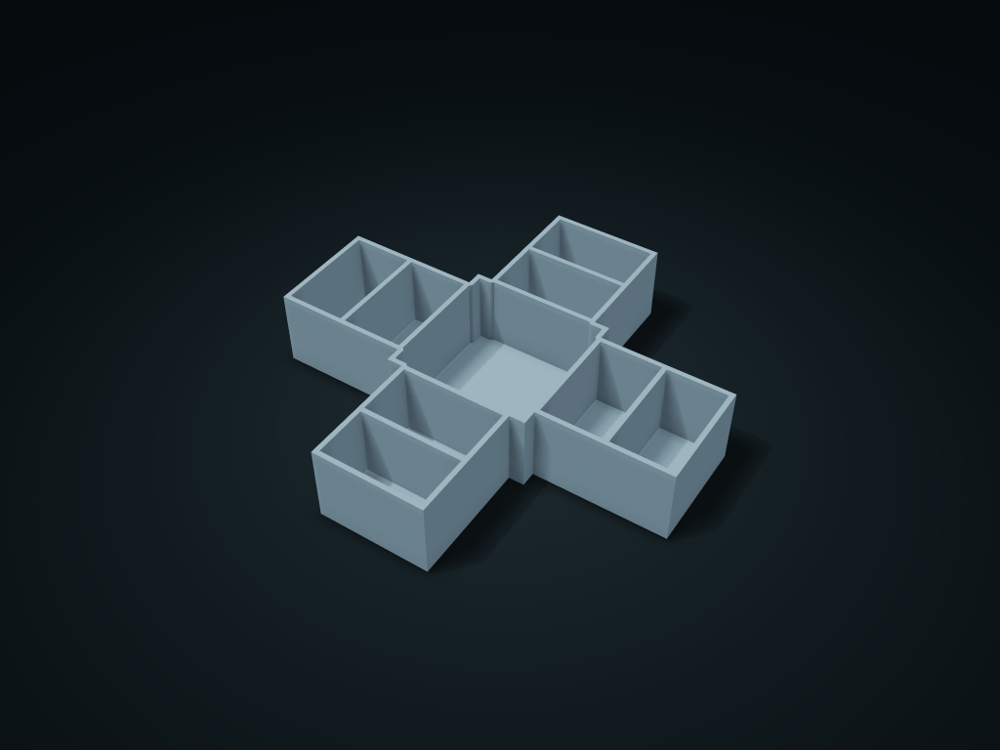

# Cross Desk Direction Box

Keep frequent-use stationery centrally and sort the four arms by task or access direction; adjust center size, arm width and shared segment count.

**[Preview this model and customize it on boxesmodel](https://boxesmodel.com/models/cross-junction-caddy)**

## Default model

| Property | Value |
| --- | --- |
| Category | Desktop Organizers |
| Model version | 1.0.0 |
| Default box size | 200 × 190 × 38 mm |
| Included parts | 1 |
| Formats | STL and STEP |
| Units | Millimeters |

Dimensions include the outer outline of the box; see the specifications for usable interior space.

## Intended use

- Stationery and everyday desktop items, accessed from multiple directions.

## Dimensions and features

| Detail | Default value |
| --- | --- |
| Use | A central main compartment and four extending compartments for stationery in different directions |

## Download the parts

Open a file below and choose **Download raw file** on GitHub. STL is for slicers; STEP is for CAD editing.

| Part | Dimensions | STL | STEP |
| --- | --- | --- | --- |
| Cross Desk Direction Box | 200 × 190 × 38 mm | [body.stl](body.stl) | [body.step](body.step) |

Each listed part has its own STL and STEP file. Preview colors are illustrative; the manufacturing files do not contain the displayed colors.

## Printing and assembly

- The central compartment holds everyday items, and the four extending arms hold stationery for different steps or directions; segment count per arm adjusts together.
- One-piece, printed flat on its base; inner corners and dividers share the floor; the cross shape is easy to reach from many directions and needs no fixing hardware.
- Import at millimeter scale. Check your build volume, orientation, overhangs, supports and mating clearances in the slicer.

## Adjust the design

Visit the [interactive model page](https://boxesmodel.com/models/cross-junction-caddy) to inspect the 3D model and adjust the available dimensions and layout options. This folder contains the default-size export shown above; custom exports follow the options and pricing shown on boxesmodel.

## License and attribution

Copyright © 2026 boxesmodel. These model files, preview and description are licensed under [CC BY 4.0](https://creativecommons.org/licenses/by/4.0/). You may share, modify and use them commercially with the required attribution. See the [full license](../../LICENSE) and [attribution guide](../../ATTRIBUTION.md).

Suggested credit:

> “Cross Desk Direction Box” by [boxesmodel](https://boxesmodel.com/models/cross-junction-caddy), licensed under [CC BY 4.0](https://creativecommons.org/licenses/by/4.0/). Indicate any changes you make.

[Browse all models](../../CATALOG.md) · [About the collection](../../README.md)
