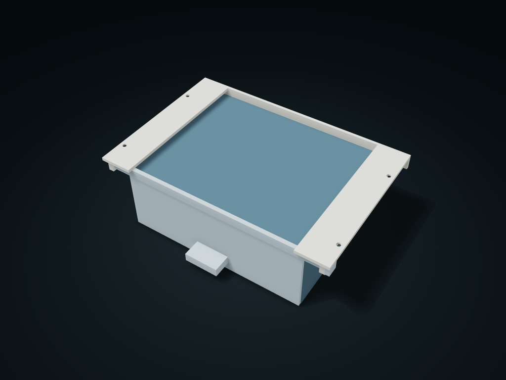

# Cross-Bar Locked Removable Case Drawer

Twin rails under the desk carry the whole case; with the cross bar locked, pull the inner drawer day to day, and pull the bar to remove the whole case horizontally.

**[Preview this model and customize it on boxesmodel](https://boxesmodel.com/models/crossbar-dock-drawer)**

## Default model

| Property | Value |
| --- | --- |
| Category | Drawer Storage |
| Model version | 1.0.1 |
| Default assembly display size | 220 × 160 × 70 mm |
| Included parts | 4 |
| Formats | STL and STEP |
| Units | Millimeters |

Covers the layout of all parts in the current preview; see Files and dimensions for each part's print size.

## Dimensions and features

| Detail | Default value |
| --- | --- |
| Release the whole case | Support → pull bar right → slide the box forward horizontally |
| Buy before printing | 4 × DIN 97 A2 3×12 mm slotted 90° countersunk wood screws / Westfield WF78848; head Ø5.6 × 1.65, shank 2.6–3.0 mm |
| Complete print list | 1 twin rail + 1 case + 1 divided drawer + 1 cross bar (main bar 212.6 × 4 × 8 mm, follows the total length) |
| Solid wood thickness and in-stock length | D=18mm → 3×12 / WF78848； Only the 10/12/16 mm standard series; not verified with real parts |
| Seating / depth / allowance | Head sunk 0.45–0.65 mm / P = 9.45–9.65 mm / tail ≥ 8.35 mm |
| Tools | 1 flat screwdriver: 0.6 × 3.5 mm tip, Ø3.5 × 100 mm shaft, 81 mm handle; the actual slot depth must be ≥ 0.4 mm |
| Inner drawer clear compartment | 51.1 × 62.3 × 52.6 mm |

## Download the parts

Open a file below and choose **Download raw file** on GitHub. STL is for slicers; STEP is for CAD editing.

| Part | Dimensions | STL | STEP |
| --- | --- | --- | --- |
| Twin C-rails fixed with wood screws | 220 × 148 × 14 mm | [dock.stl](dock.stl) | [dock.step](dock.step) |
| Whole case removable | 193.2 × 136.6 × 62 mm | [case.stl](case.stl) | [case.step](case.step) |
| Closed-bottom divided inner drawer | 171.2 × 153.2 × 58.6 mm | [drawer.stl](drawer.stl) | [drawer.step](drawer.step) |
| Pull-right cross lock bar | 216.3 × 10 × 8 mm | [lock.stl](lock.stl) | [lock.step](lock.step) |

Each listed part has its own STL and STEP file. Preview colors are illustrative; the manufacturing files do not contain the displayed colors.

## Printing and assembly

- Shopping list: 4 × DIN 97 A2 slotted 90° countersunk wood screws, currently 3×12 mm (total length including head), verified in-stock part Westfield WF78848; head Ø5.6 × 1.65 mm, actual shank 2.6–3.0 mm, slot width 0.8 mm. Standard screw sizes are fixed; they do not scale with the box and need no cutting or custom machining.
- Enter your measured solid wood desk thickness D (the default 18 mm is only a parameter example, not your desk). The rail cap is 3 mm thick with a 1.7 mm deep 90° cone, leaving 1.3 mm of full straight hole. The widest underside of the standard head sinks 0.45–0.65 mm into the cap bottom; check actual seating so the shoulder meets the cone and the head does not protrude.
- The current geometric depth into the wood is P = 9.45–9.65 mm, with a minimum tail margin of 8.35 mm; the pilot hole depth is at most 10.65 mm, leaving at least 7.35 mm of desk board. P = S − rail cap thickness + actual seating offset; the software requires 8 ≤ P ≤ D − 3 and P + 1 ≤ D − 2; only the shortest valid size is chosen from the verified 3×10/WF78847, 3×12/WF78848 and 3×16/WF1106; if nothing matches, generation is blocked. P includes the tip envelope; it is not a measure of full effective thread engagement or safe load.
- First drill 4 pilot holes to the measured solid wood and the hardware maker's conditions, then press the empty twin rails flat against the desk underside; fit the screws from below upward, and fit the whole case only after all 4 heads sit on the cones and the tool is removed. Required standard tool: 1 flat screwdriver, verified Wera 335 05008015001 with 0.6 × 3.5 mm tip, Ø3.5 × 100 mm shaft and 81 mm handle; the supply table only gives a maximum slot depth of 0.85 mm; check that the real slot depth takes the 0.4 mm blade tip, and do not treat the maximum depth as a minimum guarantee. Tools and metal screws are not counted as printed parts.
- Stock basis: Westfield DIN 97 3 mm series catalog https://www.westfieldfasteners.co.uk/A2-Woodscrew-SlotCsk-3.html and the 10/12/16 mm product datasheets; Wera 335 official catalog: https://www.wera.de/en/tools/335-screwdriver-for-slotted-screws. Only for confirmed suitable solid wood and mounting areas; thin boards, hollow boards, glass or unknown desktops are outside the scope of this design. Confirm the pilot hole diameter, fastening and load for your actual wood with the manufacturer and real parts.
- Push the case in from the front along the two support wings to the rear stop, then insert the cross bar from the right until the grip tab nears the right guide hole; do not hang it in use until the cross bar is fully inserted. It is a manual removable bar, with no elastic automatic latch or vibration retention promise.
- Day to day, only pull the inner drawer; to remove the whole case, close the drawer, support the bottom with both hands, hold the drawer front and keep it level. At least 230 mm of clearance on the right to pull the bar, and at least 170 mm in front to move the box; not suitable where a wall or neighboring module is in the way.
- Each drawer compartment is about 51.1 × 62.3 mm clear and 52.6 mm clear high. Short items filling a compartment need at least 10 mm for two fingers on one pair of opposite sides, with 2 mm at the top; open the drawer fully before gripping straight down; take longer items out before removing the box. The inner drawer has no anti-pull-out catch; not a box for tilted transport.
- 4 printed parts: twin rail, case, divided drawer and lock bar, from the same export. The rail caps and case top plate overhang; check orientation and supports when slicing first; test-print the nominal sliding clearance first. Not compatible with GEN2 or other brands' interfaces.
- Check slicing before printing; before use, check assembly and load; no conclusion on reliable load-bearing, fastening material strength or life.
- Import at millimeter scale. Check your build volume, orientation, overhangs, supports and mating clearances in the slicer.

### Additional hardware

Supply four DIN 97 A2 slotted 90° countersunk wood screws separately (nominal 3 mm, default 3×12 mm; when changing parameters choose 3×10/12/16 mm from the current solid-wood desktop list); 1 standard 0.6 × 3.5 mm flat screwdriver supplied separately. Screw head Ø5.6 × 1.65 mm, actual shank 2.6–3.0 mm, verified in-stock Westfield WF78847/WF78848/WF1106; all 4 printed parts included. Mount only on solid wood confirmed to be suitable; unknown, hollow or glass desktops are not suitable.

## Adjust the design

Visit the [interactive model page](https://boxesmodel.com/models/crossbar-dock-drawer) to inspect the 3D model and adjust the available dimensions and layout options. This folder contains the default-size export shown above; custom exports follow the options and pricing shown on boxesmodel.

## License and attribution

Copyright © 2026 boxesmodel. These model files, preview and description are licensed under [CC BY 4.0](https://creativecommons.org/licenses/by/4.0/). You may share, modify and use them commercially with the required attribution. See the [full license](../../LICENSE) and [attribution guide](../../ATTRIBUTION.md).

Suggested credit:

> “Cross-Bar Locked Removable Case Drawer” by [boxesmodel](https://boxesmodel.com/models/crossbar-dock-drawer), licensed under [CC BY 4.0](https://creativecommons.org/licenses/by/4.0/). Indicate any changes you make.

[Browse all models](../../CATALOG.md) · [About the collection](../../README.md)
