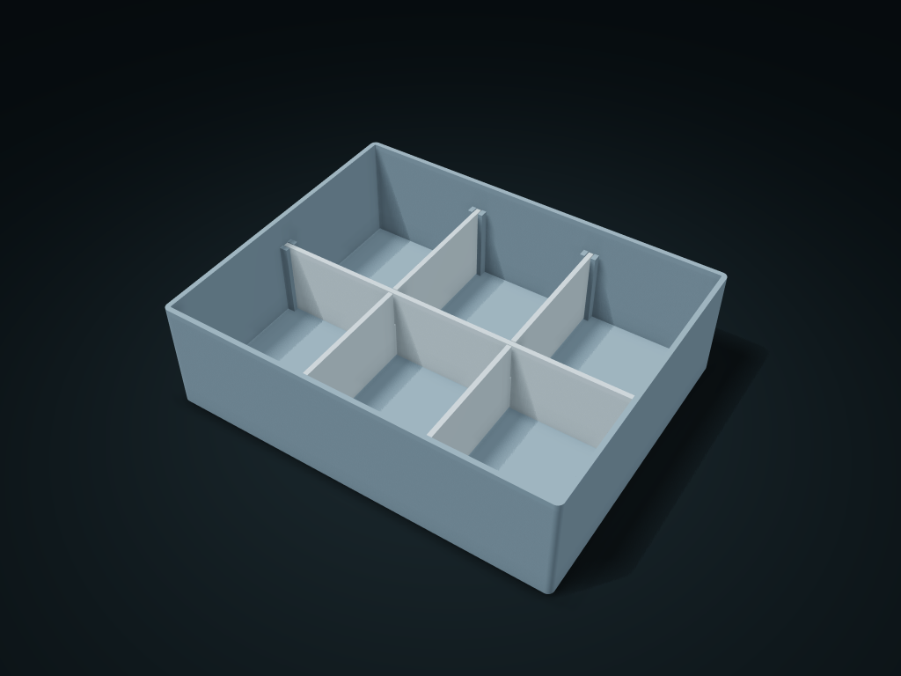

# Half-Slot Cross Divider Box

Removable lengthwise and crosswise half-slot dividers form shared-wall rectangular compartments

**[Preview this model and customize it on boxesmodel](https://boxesmodel.com/models/crosslap-grid-box)**

## Default model

| Property | Value |
| --- | --- |
| Category | Desktop Organizers |
| Model version | 1.0.0 |
| Default assembly display size | 190 × 150 × 55 mm |
| Included parts | 4 |
| Formats | STL and STEP |
| Units | Millimeters |

Covers the layout of all parts in the current preview; see Files and dimensions for each part's print size.

## Dimensions and features

| Detail | Default value |
| --- | --- |
| Divider single-side clearance | 0.4 mm |
| Number of separate compartments | 6 |

## Download the parts

Open a file below and choose **Download raw file** on GitHub. STL is for slicers; STEP is for CAD editing.

| Part | Dimensions | STL | STEP |
| --- | --- | --- | --- |
| Guide outer box | 190 × 150 × 55 mm | [body.stl](body.stl) | [body.step](body.step) |
| Lengthwise top-slotted plate 1 | 2.4 × 144.4 × 38 mm | [long-0.stl](long-0.stl) | [long-0.step](long-0.step) |
| Lengthwise top-slotted plate 2 | 2.4 × 144.4 × 38 mm | [long-1.stl](long-1.stl) | [long-1.step](long-1.step) |
| Crosswise bottom-slotted plate 1 | 184.4 × 2.4 × 38 mm | [cross-0.stl](cross-0.stl) | [cross-0.step](cross-0.step) |

Each listed part has its own STL and STEP file. Preview colors are illustrative; the manufacturing files do not contain the displayed colors.

## Printing and assembly

- First stand the lengthwise plates with top half-slots in their guides, then cross the crosswise plates with bottom half-slots down onto them; no glue or hardware needed.
- Dividers are output in assembly orientation; rotate 90° when slicing to lay the large face flat. Remove in reverse: lift the crosswise plates first, then the lengthwise ones. Confirm the fit and the narrow bottom slits with a real test piece.
- Import at millimeter scale. Check your build volume, orientation, overhangs, supports and mating clearances in the slicer.

## Adjust the design

Visit the [interactive model page](https://boxesmodel.com/models/crosslap-grid-box) to inspect the 3D model and adjust the available dimensions and layout options. This folder contains the default-size export shown above; custom exports follow the options and pricing shown on boxesmodel.

## License and attribution

Copyright © 2026 boxesmodel. These model files, preview and description are licensed under [CC BY 4.0](https://creativecommons.org/licenses/by/4.0/). You may share, modify and use them commercially with the required attribution. See the [full license](../../LICENSE) and [attribution guide](../../ATTRIBUTION.md).

Suggested credit:

> “Half-Slot Cross Divider Box” by [boxesmodel](https://boxesmodel.com/models/crosslap-grid-box), licensed under [CC BY 4.0](https://creativecommons.org/licenses/by/4.0/). Indicate any changes you make.

[Browse all models](../../CATALOG.md) · [About the collection](../../README.md)
