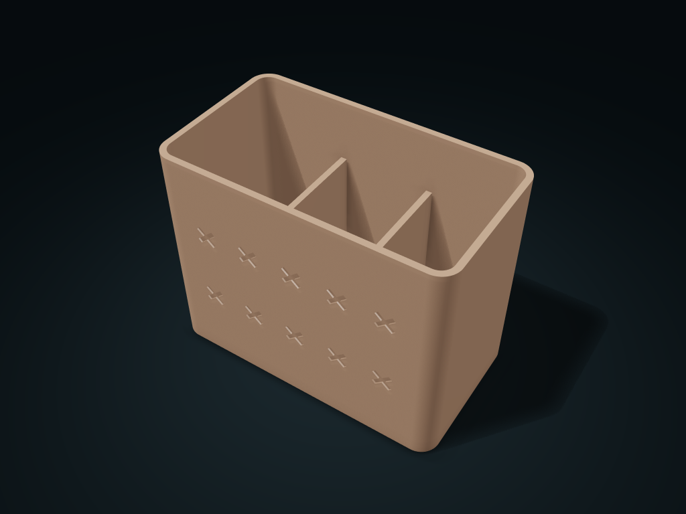

# Crossweave Pattern Chopstick & Spoon Crock

Two crossing diagonal bars form woven windows, keeping solid top and bottom edges; continuous solid walls and low dividers make sorting easy

**[Preview this model and customize it on boxesmodel](https://boxesmodel.com/models/crossweave-cutlery-crock)**

## Default model

| Property | Value |
| --- | --- |
| Category | Desktop Organizers |
| Model version | 1.0.0 |
| Default box size | 180 × 100 × 140 mm |
| Included parts | 1 |
| Formats | STL and STEP |
| Units | Millimeters |

Dimensions include the outer outline of the box; see the specifications for usable interior space.

## Dimensions and features

| Detail | Default value |
| --- | --- |
| Clear boundary per compartment | 54.7 × 92.0 × 136.0 mm |
| Sorting dividers | 3 compartments; divider top height 100.8 mm |
| Effective base thickness | Solid walls at least 2.8 mm; floor and dividers 4.0 mm |

## Download the parts

Open a file below and choose **Download raw file** on GitHub. STL is for slicers; STEP is for CAD editing.

| Part | Dimensions | STL | STEP |
| --- | --- | --- | --- |
| Shared-wall chopstick and spoon sorting crock | 180 × 100 × 140 mm | [body.stl](body.stl) | [body.step](body.step) |

Each listed part has its own STL and STEP file. Preview colors are illustrative; the manufacturing files do not contain the displayed colors.

## Printing and assembly

- Solid floor without drain holes, for dry utensils only; no food-contact safety is claimed; let wet utensils dry first.
- Floor and dividers are actually 4.0 mm thick; the shallow pattern is at most 1.0 mm deep and does not cut into the inner wall.
- All required parts are in the download; no purchased screws, shafts or glued parts. Display colors are only for covers and previews; STL/STEP manufacturing files carry no color.
- Place each part on the build plate separately before printing, and check hole-top bridges and supports in the slicer; Check load capacity, leak resistance and material suitability for your intended use.
- Import at millimeter scale. Check your build volume, orientation, overhangs, supports and mating clearances in the slicer.

## Adjust the design

Visit the [interactive model page](https://boxesmodel.com/models/crossweave-cutlery-crock) to inspect the 3D model and adjust the available dimensions and layout options. This folder contains the default-size export shown above; custom exports follow the options and pricing shown on boxesmodel.

## License and attribution

Copyright © 2026 boxesmodel. These model files, preview and description are licensed under [CC BY 4.0](https://creativecommons.org/licenses/by/4.0/). You may share, modify and use them commercially with the required attribution. See the [full license](../../LICENSE) and [attribution guide](../../ATTRIBUTION.md).

Suggested credit:

> “Crossweave Pattern Chopstick & Spoon Crock” by [boxesmodel](https://boxesmodel.com/models/crossweave-cutlery-crock), licensed under [CC BY 4.0](https://creativecommons.org/licenses/by/4.0/). Indicate any changes you make.

[Browse all models](../../CATALOG.md) · [About the collection](../../README.md)
