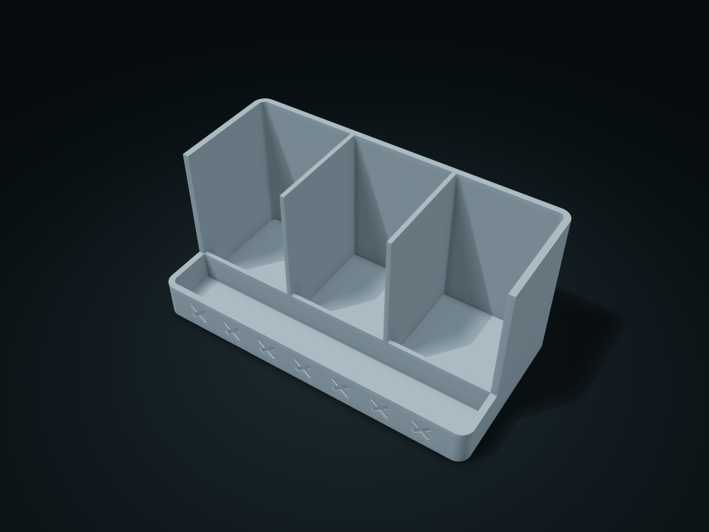

# Crossweave Pattern Remote Valet

Stand remotes in rear compartments with crossed side openings; keep keys and earplugs in front. Retrieve separately; adjust count, tray depth and rim height.

**[Preview this model and customize it on boxesmodel](https://boxesmodel.com/models/crossweave-remote-valet)**

## Default model

| Property | Value |
| --- | --- |
| Category | Desktop Organizers |
| Model version | 1.0.0 |
| Default box size | 210 × 108 × 100 mm |
| Included parts | 1 |
| Formats | STL and STEP |
| Units | Millimeters |

Dimensions include the outer outline of the box; see the specifications for usable interior space.

## Intended use

- Allow 1 mm per side around actual remote width and thickness; avoid rounded tray corners. Rear compartments do not tilt or provide charging.
- No purchased screws, shafts or adhesive parts; check bridges over openings and supports before printing.
- Check load capacity, leakage and material suitability for the intended use.

## Dimensions and features

| Detail | Default value |
| --- | --- |
| Remote compartment clearance | 65.5 × 67.2 mm； Rounded-corner allowance |
| Front tray clear depth | 30.0 mm； Guard height 24.0 mm |
| Number of rear compartments | 3 compartments; taken straight from the top |

## Download the parts

Open a file below and choose **Download raw file** on GitHub. STL is for slicers; STEP is for CAD editing.

| Part | Dimensions | STL | STEP |
| --- | --- | --- | --- |
| Shared-wall remote compartments with a low front tray | 210 × 108 × 100 mm | [body.stl](body.stl) | [body.step](body.step) |

Each listed part has its own STL and STEP file. Preview colors are illustrative; the manufacturing files do not contain the displayed colors.

## Printing and assembly

- The rear compartments are not tilted and have no charging function; front tray floor 4.0 mm thick; corners must clear the rounded corners.
- All required parts are in the download; no purchased screws, shafts or glued parts. Display colors are only for covers and previews; STL/STEP manufacturing files carry no color.
- Place each part on the build plate separately before printing, and check hole-top bridges and supports in the slicer; Check load capacity, leak resistance and material suitability for your intended use.
- Import at millimeter scale. Check your build volume, orientation, overhangs, supports and mating clearances in the slicer.

## Adjust the design

Visit the [interactive model page](https://boxesmodel.com/models/crossweave-remote-valet) to inspect the 3D model and adjust the available dimensions and layout options. This folder contains the default-size export shown above; custom exports follow the options and pricing shown on boxesmodel.

## License and attribution

Copyright © 2026 boxesmodel. These model files, preview and description are licensed under [CC BY 4.0](https://creativecommons.org/licenses/by/4.0/). You may share, modify and use them commercially with the required attribution. See the [full license](../../LICENSE) and [attribution guide](../../ATTRIBUTION.md).

Suggested credit:

> “Crossweave Pattern Remote Valet” by [boxesmodel](https://boxesmodel.com/models/crossweave-remote-valet), licensed under [CC BY 4.0](https://creativecommons.org/licenses/by/4.0/). Indicate any changes you make.

[Browse all models](../../CATALOG.md) · [About the collection](../../README.md)
