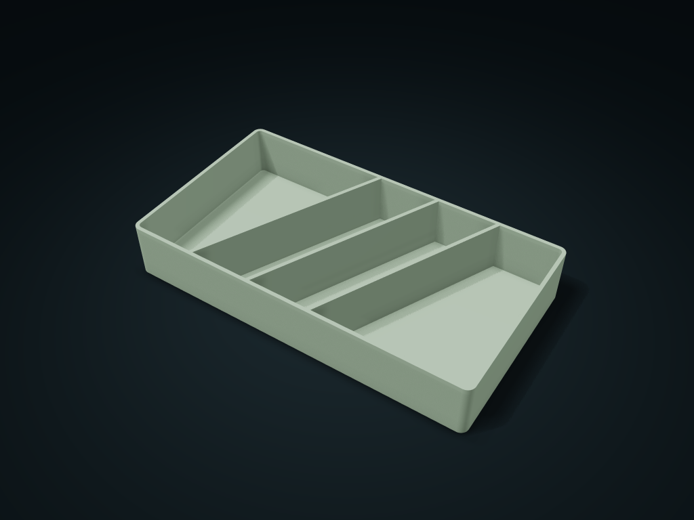

# Angled Divider Drawer Insert

An angled divider forms a long compartment; adjust the angle to the drawer space.

**[Preview this model and customize it on boxesmodel](https://boxesmodel.com/models/diagonal-drawer-insert)**

## Default model

| Property | Value |
| --- | --- |
| Category | Desktop Organizers |
| Model version | 1.0.0 |
| Default box size | 220 × 120 × 35 mm |
| Included parts | 1 |
| Formats | STL and STEP |
| Units | Millimeters |

Dimensions include the outer outline of the box; see the specifications for usable interior space.

## Dimensions and features

| Detail | Default value |
| --- | --- |
| Number of angled compartments | 4 |
| Minimum clear distance between dividers | 34.2 mm |

## Download the parts

Open a file below and choose **Download raw file** on GitHub. STL is for slicers; STEP is for CAD editing.

| Part | Dimensions | STL | STEP |
| --- | --- | --- | --- |
| Angled divided inner tray | 220 × 120 × 35 mm | [diagonal-tray.stl](diagonal-tray.stl) | [diagonal-tray.step](diagonal-tray.step) |

Each listed part has its own STL and STEP file. Preview colors are illustrative; the manufacturing files do not contain the displayed colors.

## Printing and assembly

- Print base down; dividers are arranged at the set angle, with end compartments cut by the outer frame.
- The clear distance is a conservative value measured across the dividers; rounded corners take some space at the ends.
- Import at millimeter scale. Check your build volume, orientation, overhangs, supports and mating clearances in the slicer.

## Adjust the design

Visit the [interactive model page](https://boxesmodel.com/models/diagonal-drawer-insert) to inspect the 3D model and adjust the available dimensions and layout options. This folder contains the default-size export shown above; custom exports follow the options and pricing shown on boxesmodel.

## License and attribution

Copyright © 2026 boxesmodel. These model files, preview and description are licensed under [CC BY 4.0](https://creativecommons.org/licenses/by/4.0/). You may share, modify and use them commercially with the required attribution. See the [full license](../../LICENSE) and [attribution guide](../../ATTRIBUTION.md).

Suggested credit:

> “Angled Divider Drawer Insert” by [boxesmodel](https://boxesmodel.com/models/diagonal-drawer-insert), licensed under [CC BY 4.0](https://creativecommons.org/licenses/by/4.0/). Indicate any changes you make.

[Browse all models](../../CATALOG.md) · [About the collection](../../README.md)
