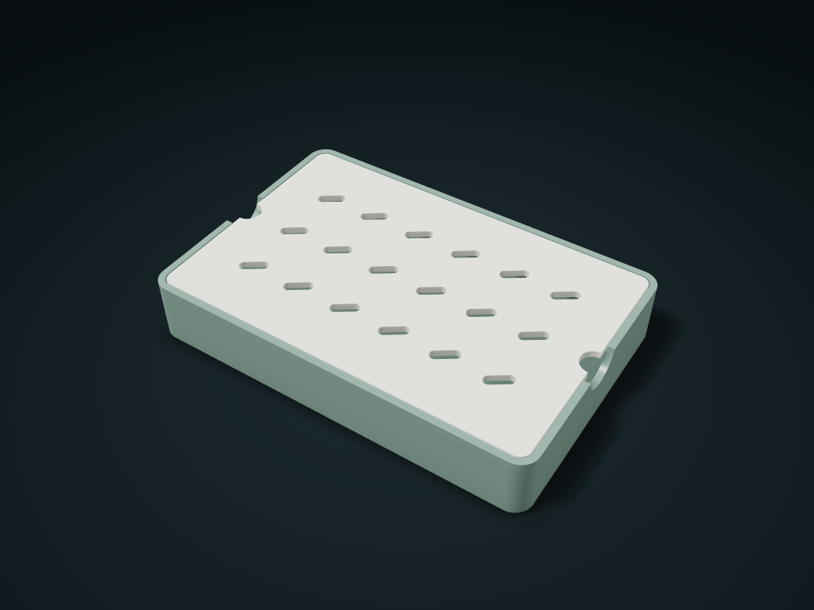

# Diagonal-Row Draining Soap Dish

Rest soap or sponges across the slotted plate, with drips caught below; lift at side recesses and adjust overall size and hole spacing.

**[Preview this model and customize it on boxesmodel](https://boxesmodel.com/models/diagonal-slot-soap-tray)**

## Default model

| Property | Value |
| --- | --- |
| Category | Desktop Organizers |
| Model version | 1.0.0 |
| Default assembly display size | 150 × 100 × 24 mm |
| Included parts | 2 |
| Formats | STL and STEP |
| Units | Millimeters |

Covers the layout of all parts in the current preview; see Files and dimensions for each part's print size.

## Intended use

- Whole soap bars or sponges beside a bathroom or kitchen sink.
- Center whole soap bars or sponges across several ribs; not for fragments smaller than the holes. Avoid edges and finger recesses, and empty water regularly.
- no support-free, weight-support, slip-resistance or certified leak-prevention claim.

## Dimensions and features

| Detail | Default value |
| --- | --- |
| Support board outer boundary | 144.0 × 94.0 mm； Keep clear of edges and finger recesses |
| Clear drip height below the board | 18.8 mm； Empty the tray by hand |
| Drainage and fit | Hole scale 7.0 mm; 0.40 mm clearance per side |

## Download the parts

Open a file below and choose **Download raw file** on GitHub. STL is for slicers; STEP is for CAD editing.

| Part | Dimensions | STL | STEP |
| --- | --- | --- | --- |
| Drip tray with support ledge and side finger recesses | 150 × 100 × 24 mm | [base.stl](base.stl) | [base.step](base.step) |
| Separate draining support board | 144 × 94 × 2.6 mm | [deck.stl](deck.stl) | [deck.step](deck.step) |

Each listed part has its own STL and STEP file. Preview colors are illustrative; the manufacturing files do not contain the displayed colors.

## Printing and assembly

- Complete set of 2 printed parts: drip tray and drainer board, no purchased parts; lift the drainer board by the finger recesses on the left and right, then empty and clean the tray.
- Place a whole bar of soap or a sponge in the center so it covers several support ribs; do not place soap scraps smaller than the holes, and do not treat the whole outer outline of the board as a gap-free support area.
- Print the tray and perforated board separately, lying flat; catching drips is not a leak-proof certification; empty standing water regularly.
- STL/STEP files carry no color; no promise of support-free printing, load capacity or slip resistance.
- Import at millimeter scale. Check your build volume, orientation, overhangs, supports and mating clearances in the slicer.

## Adjust the design

Visit the [interactive model page](https://boxesmodel.com/models/diagonal-slot-soap-tray) to inspect the 3D model and adjust the available dimensions and layout options. This folder contains the default-size export shown above; custom exports follow the options and pricing shown on boxesmodel.

## License and attribution

Copyright © 2026 boxesmodel. These model files, preview and description are licensed under [CC BY 4.0](https://creativecommons.org/licenses/by/4.0/). You may share, modify and use them commercially with the required attribution. See the [full license](../../LICENSE) and [attribution guide](../../ATTRIBUTION.md).

Suggested credit:

> “Diagonal-Row Draining Soap Dish” by [boxesmodel](https://boxesmodel.com/models/diagonal-slot-soap-tray), licensed under [CC BY 4.0](https://creativecommons.org/licenses/by/4.0/). Indicate any changes you make.

[Browse all models](../../CATALOG.md) · [About the collection](../../README.md)
