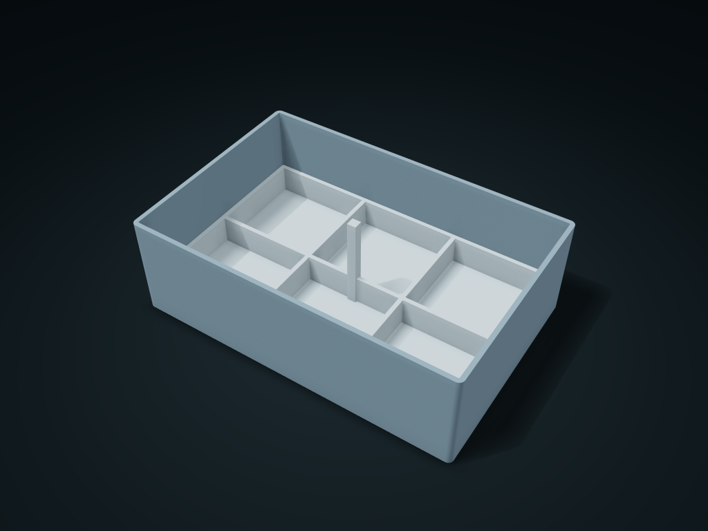

# Lift-Out Dice Cassette

Sort dice in the shallow insert and lift the group by its center post; adjust rows, columns, rim height and insert clearance.

**[Preview this model and customize it on boxesmodel](https://boxesmodel.com/models/dice-lift-cassette)**

## Default model

| Property | Value |
| --- | --- |
| Category | Desktop Organizers |
| Model version | 1.0.0 |
| Default assembly display size | 175 × 115 × 55 mm |
| Included parts | 2 |
| Formats | STL and STEP |
| Units | Millimeters |

Covers the layout of all parts in the current preview; see Files and dimensions for each part's print size.

## Intended use

- Dice; cell clearances change with row and column counts and must exceed actual dice dimensions.

## Download the parts

Open a file below and choose **Download raw file** on GitHub. STL is for slicers; STEP is for CAD editing.

| Part | Dimensions | STL | STEP |
| --- | --- | --- | --- |
| Outer box | 175 × 115 × 55 mm | [body.stl](body.stl) | [body.step](body.step) |
| Divided lift-out insert | 169 × 109 × 52.6 mm | [core.stl](core.stl) | [core.step](core.step) |

Each listed part has its own STL and STEP file. Preview colors are illustrative; the manufacturing files do not contain the displayed colors.

## Printing and assembly

- Put the whole insert into the outer box, and grip the short central post to lift it straight out; no hardware. Square cell clear size adjusts with rows and columns and must be larger than your actual dice.
- Units are millimeters. Measure clearance from your actual items first; check slicing before printing and test-fit the key mating parts.
- Import at millimeter scale. Check your build volume, orientation, overhangs, supports and mating clearances in the slicer.

## Adjust the design

Visit the [interactive model page](https://boxesmodel.com/models/dice-lift-cassette) to inspect the 3D model and adjust the available dimensions and layout options. This folder contains the default-size export shown above; custom exports follow the options and pricing shown on boxesmodel.

## License and attribution

Copyright © 2026 boxesmodel. These model files, preview and description are licensed under [CC BY 4.0](https://creativecommons.org/licenses/by/4.0/). You may share, modify and use them commercially with the required attribution. See the [full license](../../LICENSE) and [attribution guide](../../ATTRIBUTION.md).

Suggested credit:

> “Lift-Out Dice Cassette” by [boxesmodel](https://boxesmodel.com/models/dice-lift-cassette), licensed under [CC BY 4.0](https://creativecommons.org/licenses/by/4.0/). Indicate any changes you make.

[Browse all models](../../CATALOG.md) · [About the collection](../../README.md)
