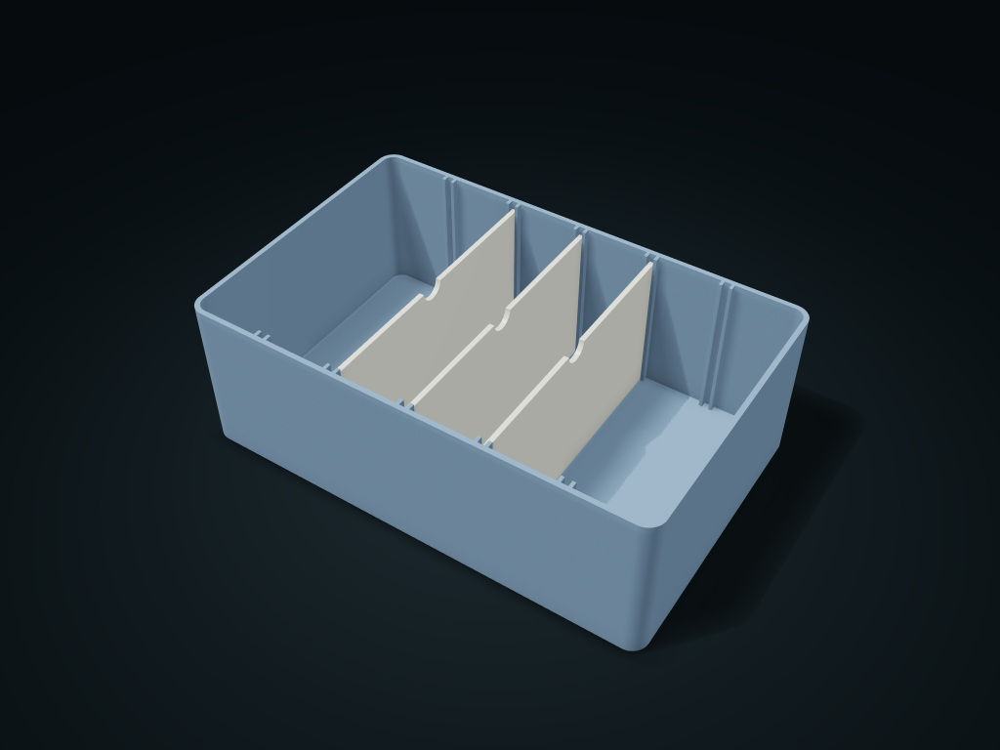

# Slot-In Divider Box

Dividers lift out along the guide slots and change position to rezone by item.

**[Preview this model and customize it on boxesmodel](https://boxesmodel.com/models/divider-box)**

## Default model

| Property | Value |
| --- | --- |
| Category | Desktop Organizers |
| Model version | 1.0.0 |
| Default assembly display size | 220 × 140 × 75 mm |
| Included parts | 4 |
| Formats | STL and STEP |
| Units | Millimeters |

Covers the layout of all parts in the current preview; see Files and dimensions for each part's print size.

## Dimensions and features

| Detail | Default value |
| --- | --- |
| Guide slot positions | 5 places |
| Movable dividers | 3 pieces |
| Spacing between neighboring guide slots | 35.9 mm |

## Download the parts

Open a file below and choose **Download raw file** on GitHub. STL is for slicers; STEP is for CAD editing.

| Part | Dimensions | STL | STEP |
| --- | --- | --- | --- |
| Guide slot box body | 220 × 140 × 75 mm | [box.stl](box.stl) | [box.step](box.step) |
| Removable divider 1 | 2.4 × 134.4 × 68.6 mm | [divider-1.stl](divider-1.stl) | [divider-1.step](divider-1.step) |
| Removable divider 2 | 2.4 × 134.4 × 68.6 mm | [divider-2.stl](divider-2.stl) | [divider-2.step](divider-2.step) |
| Removable divider 3 | 2.4 × 134.4 × 68.6 mm | [divider-3.stl](divider-3.stl) | [divider-3.step](divider-3.step) |

Each listed part has its own STL and STEP file. Preview colors are illustrative; the manufacturing files do not contain the displayed colors.

## Printing and assembly

- Dividers lift straight up and go into any guide slot; spread out by spacing by default.
- Divider files are output in assembly orientation; rotate 90° before printing to put the large flat face on the build plate. Box base down.
- Fixed 0.4 mm single-side clearance between guide slots and dividers; pairs only within this set; no snap lock; test-print to check the real fit first.
- Import at millimeter scale. Check your build volume, orientation, overhangs, supports and mating clearances in the slicer.

## Adjust the design

Visit the [interactive model page](https://boxesmodel.com/models/divider-box) to inspect the 3D model and adjust the available dimensions and layout options. This folder contains the default-size export shown above; custom exports follow the options and pricing shown on boxesmodel.

## License and attribution

Copyright © 2026 boxesmodel. These model files, preview and description are licensed under [CC BY 4.0](https://creativecommons.org/licenses/by/4.0/). You may share, modify and use them commercially with the required attribution. See the [full license](../../LICENSE) and [attribution guide](../../ATTRIBUTION.md).

Suggested credit:

> “Slot-In Divider Box” by [boxesmodel](https://boxesmodel.com/models/divider-box), licensed under [CC BY 4.0](https://creativecommons.org/licenses/by/4.0/). Indicate any changes you make.

[Browse all models](../../CATALOG.md) · [About the collection](../../README.md)
