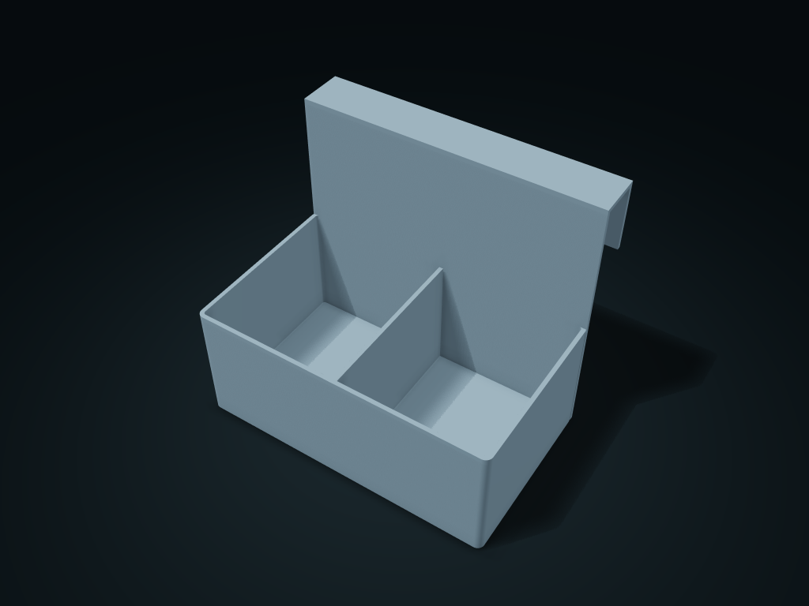

# Over-Door Inverted Hanging Box

An inverted U-shaped bridge hanger at the back joins the front storage compartment in one piece

**[Preview this model and customize it on boxesmodel](https://boxesmodel.com/models/door-saddle-caddy)**

## Default model

| Property | Value |
| --- | --- |
| Category | Desktop Organizers |
| Model version | 1.0.0 |
| Default box size | 170 × 125 × 145 mm |
| Included parts | 1 |
| Formats | STL and STEP |
| Units | Millimeters |

Dimensions include the outer outline of the box; see the specifications for usable interior space.

## Dimensions and features

| Detail | Default value |
| --- | --- |
| Use | An inverted U-shaped bridge hanger at the back joins the front storage compartment in one piece |

## Download the parts

Open a file below and choose **Download raw file** on GitHub. STL is for slicers; STEP is for CAD editing.

| Part | Dimensions | STL | STEP |
| --- | --- | --- | --- |
| Over-Door Inverted Hanging Box | 170 × 125 × 145 mm | [body.stl](body.stl) | [body.step](body.step) |

Each listed part has its own STL and STEP file. Preview colors are illustrative; the manufacturing files do not contain the displayed colors.

## Printing and assembly

- The hanger straddles a door panel or shelf from above; the clear thickness already includes the needed loose fit; measure the board thickness and the gap above first.
- One-piece structure with no screws; the top bridge overhang needs supports when slicing. For light items only; check load and tip/fall resistance before use; do not block door locks or fire exits.
- Import at millimeter scale. Check your build volume, orientation, overhangs, supports and mating clearances in the slicer.

## Adjust the design

Visit the [interactive model page](https://boxesmodel.com/models/door-saddle-caddy) to inspect the 3D model and adjust the available dimensions and layout options. This folder contains the default-size export shown above; custom exports follow the options and pricing shown on boxesmodel.

## License and attribution

Copyright © 2026 boxesmodel. These model files, preview and description are licensed under [CC BY 4.0](https://creativecommons.org/licenses/by/4.0/). You may share, modify and use them commercially with the required attribution. See the [full license](../../LICENSE) and [attribution guide](../../ATTRIBUTION.md).

Suggested credit:

> “Over-Door Inverted Hanging Box” by [boxesmodel](https://boxesmodel.com/models/door-saddle-caddy), licensed under [CC BY 4.0](https://creativecommons.org/licenses/by/4.0/). Indicate any changes you make.

[Browse all models](../../CATALOG.md) · [About the collection](../../README.md)
