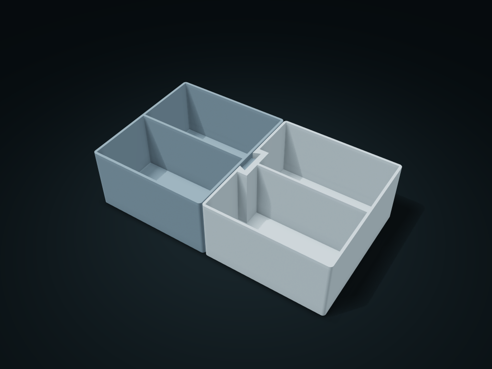

# Dovetail Side-Joined Twin Boxes

Two separate boxes join along a vertical dovetail into a detachable side-by-side set

**[Preview this model and customize it on boxesmodel](https://boxesmodel.com/models/dovetail-link-bins)**

## Default model

| Property | Value |
| --- | --- |
| Category | Desktop Organizers |
| Model version | 1.0.0 |
| Default assembly display size | 230 × 130 × 60 mm |
| Included parts | 2 |
| Formats | STL and STEP |
| Units | Millimeters |

Covers the layout of all parts in the current preview; see Files and dimensions for each part's print size.

## Dimensions and features

| Detail | Default value |
| --- | --- |
| Single-side fit clearance | 0.4 mm |

## Download the parts

Open a file below and choose **Download raw file** on GitHub. STL is for slicers; STEP is for CAD editing.

| Part | Dimensions | STL | STEP |
| --- | --- | --- | --- |
| Dovetail key box | 121.6 × 130 × 60 mm | [male.stl](male.stl) | [male.step](male.step) |
| Dovetail slot box | 114.6 × 130 × 60 mm | [female.stl](female.stl) | [female.step](female.step) |

Each listed part has its own STL and STEP file. Preview colors are illustrative; the manufacturing files do not contain the displayed colors.

## Printing and assembly

- Lay the slotted box flat and lower the keyed box from above along the dovetail slot until both bottoms are flush; remove the contents first, then separate vertically.
- The fixed clearance is set by the interface parameters; no lock; do not lift both boxes together for transport; not compatible with third-party dovetail systems.
- Import at millimeter scale. Check your build volume, orientation, overhangs, supports and mating clearances in the slicer.

## Adjust the design

Visit the [interactive model page](https://boxesmodel.com/models/dovetail-link-bins) to inspect the 3D model and adjust the available dimensions and layout options. This folder contains the default-size export shown above; custom exports follow the options and pricing shown on boxesmodel.

## License and attribution

Copyright © 2026 boxesmodel. These model files, preview and description are licensed under [CC BY 4.0](https://creativecommons.org/licenses/by/4.0/). You may share, modify and use them commercially with the required attribution. See the [full license](../../LICENSE) and [attribution guide](../../ATTRIBUTION.md).

Suggested credit:

> “Dovetail Side-Joined Twin Boxes” by [boxesmodel](https://boxesmodel.com/models/dovetail-link-bins), licensed under [CC BY 4.0](https://creativecommons.org/licenses/by/4.0/). Indicate any changes you make.

[Browse all models](../../CATALOG.md) · [About the collection](../../README.md)
