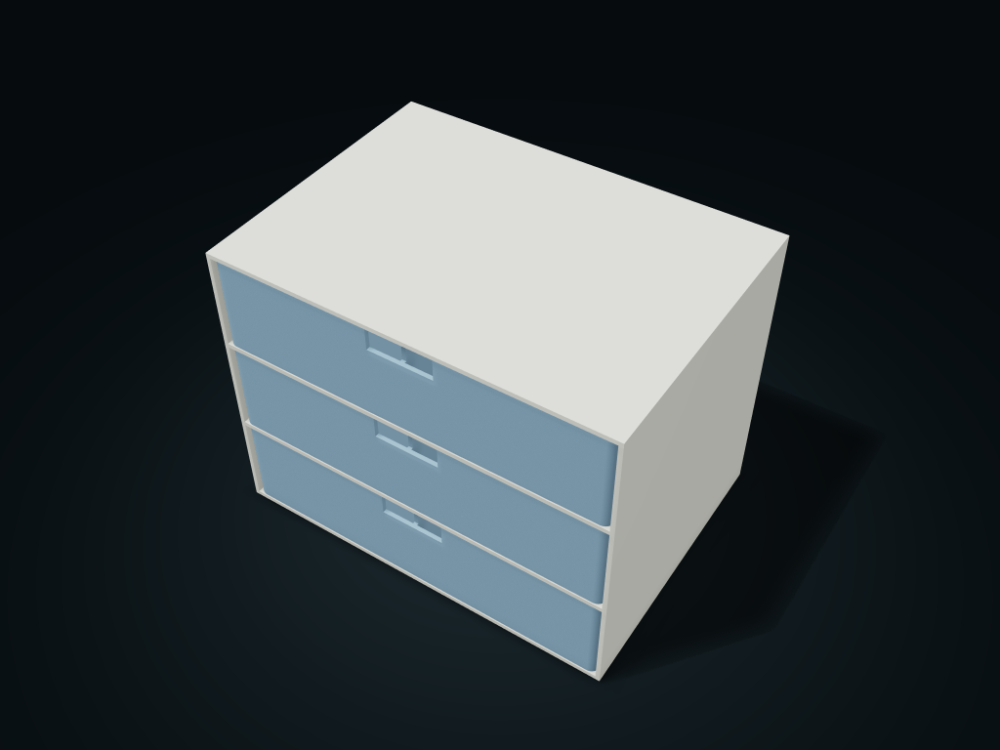

# Desktop Drawer Cabinet

Separate cabinet and drawers, sized by your space.

**[Preview this model and customize it on boxesmodel](https://boxesmodel.com/models/drawer-cabinet)**

## Default model

| Property | Value |
| --- | --- |
| Category | Drawer Storage |
| Model version | 1.1.0 |
| Default assembly display size | 220 × 160 × 168 mm |
| Included parts | 4 |
| Formats | STL and STEP |
| Units | Millimeters |

Covers the layout of all parts in the current preview; see Files and dimensions for each part's print size.

## Dimensions and features

| Detail | Default value |
| --- | --- |
| Interior clear height per drawer | 49.6 mm |
| Straight-side clear width per cell | 103.6 mm |

## Download the parts

Open a file below and choose **Download raw file** on GitHub. STL is for slicers; STEP is for CAD editing.

| Part | Dimensions | STL | STEP |
| --- | --- | --- | --- |
| Cabinet | 220 × 160 × 168 mm | [cabinet.stl](cabinet.stl) | [cabinet.step](cabinet.step) |
| Drawer 1 | 214.4 × 156.8 × 52 mm | [drawer-1.stl](drawer-1.stl) | [drawer-1.step](drawer-1.step) |
| Drawer 2 | 214.4 × 156.8 × 52 mm | [drawer-2.stl](drawer-2.stl) | [drawer-2.step](drawer-2.step) |
| Drawer 3 | 214.4 × 156.8 × 52 mm | [drawer-3.stl](drawer-3.stl) | [drawer-3.step](drawer-3.step) |

Each listed part has its own STL and STEP file. Preview colors are illustrative; the manufacturing files do not contain the displayed colors.

## Printing and assembly

- The cabinet has horizontal shelves; check print orientation and supports; files are exported along Z.
- Drawers and cabinet are generated together to the same specification and fit only within this model package. Test-print to check the actual sliding fit first.
- Import at millimeter scale. Check your build volume, orientation, overhangs, supports and mating clearances in the slicer.

## Adjust the design

Visit the [interactive model page](https://boxesmodel.com/models/drawer-cabinet) to inspect the 3D model and adjust the available dimensions and layout options. This folder contains the default-size export shown above; custom exports follow the options and pricing shown on boxesmodel.

## License and attribution

Copyright © 2026 boxesmodel. These model files, preview and description are licensed under [CC BY 4.0](https://creativecommons.org/licenses/by/4.0/). You may share, modify and use them commercially with the required attribution. See the [full license](../../LICENSE) and [attribution guide](../../ATTRIBUTION.md).

Suggested credit:

> “Desktop Drawer Cabinet” by [boxesmodel](https://boxesmodel.com/models/drawer-cabinet), licensed under [CC BY 4.0](https://creativecommons.org/licenses/by/4.0/). Indicate any changes you make.

[Browse all models](../../CATALOG.md) · [About the collection](../../README.md)
