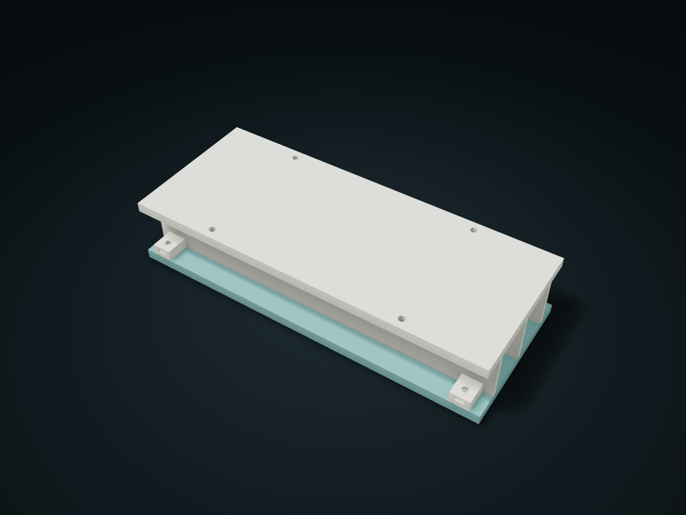

# Drop-Down Lid Cable Raceway

Load intact data cables and plugs from below into lanes; support cables when removing the cover. Adjust length, lanes and mounting spacing.

**[Preview this model and customize it on boxesmodel](https://boxesmodel.com/models/drop-cover-cable-trunk)**

## Default model

| Property | Value |
| --- | --- |
| Category | Lidded Storage |
| Model version | 1.0.0 |
| Default assembly display size | 220 × 90 × 42 mm |
| Included parts | 2 |
| Formats | STL and STEP |
| Units | Millimeters |

Covers the layout of all parts in the current preview; see Files and dimensions for each part's print size.

## Intended use

- Intact insulated USB or data cables only, not power adapters, bare connectors or electrical distribution. Support cables when open; allow bend radius outside. Check load, heating and fit physically.
- Supply four Ø3.5×12 mm wood screws, four M3×10 screws and four M3 nuts. The desk must be at least 12 mm thick and suitable for wood screws; predrill without piercing the top.
- Wood screw heads: diameter ≤7 mm, height ≤3 mm. M3 heads: diameter ≤6.2 mm, height ≤3 mm; nuts: 5.5 mm across flats, 2.4 mm high. Do not pinch cables when closing.

## Dimensions and features

| Detail | Default value |
| --- | --- |
| Separate cable lanes | 2 |
| Clear width × height per lane | 26.5 × 30.0 mm |
| Top mounting hole spacing | 120 × 78 mm |
| Fixed lower lid | 4 × M3×10 + 4 × M3 nuts |
| Printed parts | 2 parts, plus 8 screws and 4 nuts supplied separately |

## Download the parts

Open a file below and choose **Download raw file** on GitHub. STL is for slicers; STEP is for CAD editing.

| Part | Dimensions | STL | STEP |
| --- | --- | --- | --- |
| Top-mounted lane shell and side-entry nut seats | 220 × 90 × 36 mm | [fixed-shell.stl](fixed-shell.stl) | [fixed-shell.step](fixed-shell.step) |
| Drop-down bottom cover with counterbores | 220 × 90 × 6 mm | [bottom-cover.stl](bottom-cover.stl) | [bottom-cover.step](bottom-cover.step) |

Each listed part has its own STL and STEP file. Preview colors are illustrative; the manufacturing files do not contain the displayed colors.

## Printing and assembly

- Remove the bottom cover first and fix the top plate with 4 of your own Ø3.5 × 12 mm wood screws; head diameter ≤ 7 mm, head height ≤ 3 mm, about 9 mm into the wood. The desk board must be at least 12 mm of real thickness and suit wood screws; pre-drill pilot holes without breaking through the desktop.
- Supply 4 M3×10 screws (head diameter ≤ 6.2, head height ≤ 3 mm) and 4 M3 hex nuts (5.5 across flats, 2.4 mm tall); slide the nut in horizontally from outside to line up with the hole, support the bottom cover and tighten from below; do not overtighten and crush the printed seat.
- Complete cables and plugs go into each lane from below, with no need to pass connectors through end holes; check no cable is pinched before closing the lid. For repairs, support the cables first, remove the 4 bottom cover screws and take the cover straight down; it never has to slide out between neighboring sections.
- Each lane is 26.5 × 30.0 mm clear; recommended item envelope 1.2/1 mm smaller in width and height respectively; slots are open at both ends; leave the bend radius outside the slot as the cable requires.
- For organizing complete insulated USB/data cables; not for power adapters or bare connectors, and not a power distribution enclosure. With the lid open, the bottom loses support; hold it by hand or use a temporary strap; mounting load, material temperature rise and print fit still need confirming with real items.
- Slice the fixed shell top plate down and the lid flat, and check supports for the side nut seats and counterbores separately. Hardware is bought separately and is not part of the 2 printed parts.
- Import at millimeter scale. Check your build volume, orientation, overhangs, supports and mating clearances in the slicer.

## Adjust the design

Visit the [interactive model page](https://boxesmodel.com/models/drop-cover-cable-trunk) to inspect the 3D model and adjust the available dimensions and layout options. This folder contains the default-size export shown above; custom exports follow the options and pricing shown on boxesmodel.

## License and attribution

Copyright © 2026 boxesmodel. These model files, preview and description are licensed under [CC BY 4.0](https://creativecommons.org/licenses/by/4.0/). You may share, modify and use them commercially with the required attribution. See the [full license](../../LICENSE) and [attribution guide](../../ATTRIBUTION.md).

Suggested credit:

> “Drop-Down Lid Cable Raceway” by [boxesmodel](https://boxesmodel.com/models/drop-cover-cable-trunk), licensed under [CC BY 4.0](https://creativecommons.org/licenses/by/4.0/). Indicate any changes you make.

[Browse all models](../../CATALOG.md) · [About the collection](../../README.md)
