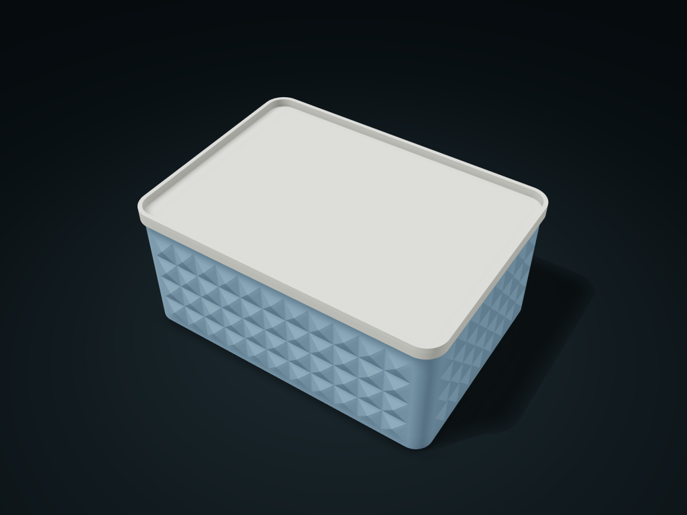

# Triangle Relief Box

Fine triangular facets with a removable small tray lid.

**[Preview this model and customize it on boxesmodel](https://boxesmodel.com/models/facet-box)**

## Default model

| Property | Value |
| --- | --- |
| Category | Lidded Storage |
| Model version | 1.1.0 |
| Default assembly display size | 180 × 130 × 80 mm |
| Included parts | 2 |
| Formats | STL and STEP |
| Units | Millimeters |

Covers the layout of all parts in the current preview; see Files and dimensions for each part's print size.

## Dimensions and features

| Detail | Default value |
| --- | --- |
| Interior layout | 1 × 1, 1 cell in total |
| Straight-side clear length × width per cell | 171.2 × 121.2 mm |
| Interior clear length × clear width | 171.2 × 121.2 mm |
| Interior clear height with the lid on | 67.2 mm |
| Number of relief rows | 4 |
| Lid tray depth | 5 mm |

## Download the parts

Open a file below and choose **Download raw file** on GitHub. STL is for slicers; STEP is for CAD editing.

| Part | Dimensions | STL | STEP |
| --- | --- | --- | --- |
| Triangle relief box body | 180 × 130 × 72.6 mm | [box.stl](box.stl) | [box.step](box.step) |
| Tray-style box lid | 180 × 130 × 10.4 mm | [lid.stl](lid.stl) | [lid.step](lid.step) |

Each listed part has its own STL and STEP file. Preview colors are illustrative; the manufacturing files do not contain the displayed colors.

## Printing and assembly

- The triangular relief is a solid outer wall; smooth inside; the texture and tray lid are included in the overall outer size.
- Box base down; lid locating face down and tray opening up; check the lid rim overhang when slicing and add supports as needed.
- Dividers are fixed and print together with the box; with both rows and columns set to 1 there are no cells. Divider tops leave 0.4 mm for the lid's locating face.
- Lift-off lid, no clips or seal; mates only with parts from the same set.
- Import at millimeter scale. Check your build volume, orientation, overhangs, supports and mating clearances in the slicer.

## Adjust the design

Visit the [interactive model page](https://boxesmodel.com/models/facet-box) to inspect the 3D model and adjust the available dimensions and layout options. This folder contains the default-size export shown above; custom exports follow the options and pricing shown on boxesmodel.

## License and attribution

Copyright © 2026 boxesmodel. These model files, preview and description are licensed under [CC BY 4.0](https://creativecommons.org/licenses/by/4.0/). You may share, modify and use them commercially with the required attribution. See the [full license](../../LICENSE) and [attribution guide](../../ATTRIBUTION.md).

Suggested credit:

> “Triangle Relief Box” by [boxesmodel](https://boxesmodel.com/models/facet-box), licensed under [CC BY 4.0](https://creativecommons.org/licenses/by/4.0/). Indicate any changes you make.

[Browse all models](../../CATALOG.md) · [About the collection](../../README.md)
