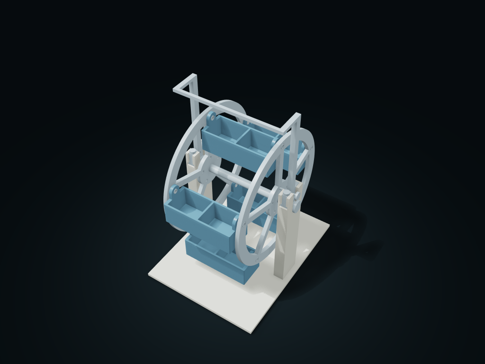

# Hanging Wheel Divided Organizer

A vertical wheel carries hanging bins; locate with the parking pin, then take sorted material.

**[Preview this model and customize it on boxesmodel](https://boxesmodel.com/models/ferris-tray-wheel)**

## Default model

| Property | Value |
| --- | --- |
| Category | Desktop Organizers |
| Model version | 1.0.1 |
| Default assembly display size | 160 × 208 × 256.5 mm |
| Included parts | 21 |
| Formats | STL and STEP |
| Units | Millimeters |

Covers the layout of all parts in the current preview; see Files and dimensions for each part's print size.

## Dimensions and features

| Detail | Default value |
| --- | --- |
| Separate bins / total cells | 5 boxes / 10 cells |
| Clear length and width per cell | 39.8 × 31.2 mm |
| Central axle rotation clearance | At least 34.8 mm (conservative outer envelope) |
| Front and rear working clearance | At least 246.5 mm, including the bin swing |
| Number of printed parts | 21 |
| Fasteners supplied separately | 10 × M4×20 bolts / 10 × lock nuts / 20 × washers |

## Download the parts

Open a file below and choose **Download raw file** on GitHub. STL is for slicers; STEP is for CAD editing.

| Part | Dimensions | STL | STEP |
| --- | --- | --- | --- |
| Twin tower support base | 160 × 208 × 152.25 mm | [frame.stl](frame.stl) | [frame.step](frame.step) |
| One-piece twin wheels and central axle | 154 × 174 × 174 mm | [rotor.stl](rotor.stl) | [rotor.step](rotor.step) |
| Twin tower joined T-shaped bearing cap | 142 × 46 × 122.85 mm | [cap.stl](cap.stl) | [cap.step](cap.step) |
| Side 1 pressing cap retaining pin | 8 × 8 × 29 mm | [stop-1.stl](stop-1.stl) | [stop-1.step](stop-1.step) |
| Side 2 pressing cap retaining pin | 8 × 8 × 29 mm | [stop-2.stl](stop-2.stl) | [stop-2.step](stop-2.step) |
| Removable parking pin | 30 × 10 × 10 mm | [parking-pin.stl](parking-pin.stl) | [parking-pin.step](parking-pin.step) |
| Hanging divided bin 1 | 90 × 36 × 43 mm | [tray-1.stl](tray-1.stl) | [tray-1.step](tray-1.step) |
| Box 1 left axle spacer | 11.8 × 6 × 6 mm | [sleeve-1-left.stl](sleeve-1-left.stl) | [sleeve-1-left.step](sleeve-1-left.step) |
| Box 1 right axle spacer | 11.8 × 6 × 6 mm | [sleeve-1-right.stl](sleeve-1-right.stl) | [sleeve-1-right.step](sleeve-1-right.step) |
| Hanging divided bin 2 | 90 × 36 × 43 mm | [tray-2.stl](tray-2.stl) | [tray-2.step](tray-2.step) |
| Box 2 left axle spacer | 11.8 × 6 × 6 mm | [sleeve-2-left.stl](sleeve-2-left.stl) | [sleeve-2-left.step](sleeve-2-left.step) |
| Box 2 right axle spacer | 11.8 × 6 × 6 mm | [sleeve-2-right.stl](sleeve-2-right.stl) | [sleeve-2-right.step](sleeve-2-right.step) |
| Hanging divided bin 3 | 90 × 36 × 43 mm | [tray-3.stl](tray-3.stl) | [tray-3.step](tray-3.step) |
| Box 3 left axle spacer | 11.8 × 6 × 6 mm | [sleeve-3-left.stl](sleeve-3-left.stl) | [sleeve-3-left.step](sleeve-3-left.step) |
| Box 3 right axle spacer | 11.8 × 6 × 6 mm | [sleeve-3-right.stl](sleeve-3-right.stl) | [sleeve-3-right.step](sleeve-3-right.step) |
| Hanging divided bin 4 | 90 × 36 × 43 mm | [tray-4.stl](tray-4.stl) | [tray-4.step](tray-4.step) |
| Box 4 left axle spacer | 11.8 × 6 × 6 mm | [sleeve-4-left.stl](sleeve-4-left.stl) | [sleeve-4-left.step](sleeve-4-left.step) |
| Box 4 right axle spacer | 11.8 × 6 × 6 mm | [sleeve-4-right.stl](sleeve-4-right.stl) | [sleeve-4-right.step](sleeve-4-right.step) |
| Hanging divided bin 5 | 90 × 36 × 43 mm | [tray-5.stl](tray-5.stl) | [tray-5.step](tray-5.step) |
| Box 5 left axle spacer | 11.8 × 6 × 6 mm | [sleeve-5-left.stl](sleeve-5-left.stl) | [sleeve-5-left.step](sleeve-5-left.step) |
| Box 5 right axle spacer | 11.8 × 6 × 6 mm | [sleeve-5-right.stl](sleeve-5-right.stl) | [sleeve-5-right.step](sleeve-5-right.step) |

Each listed part has its own STL and STEP file. Preview colors are illustrative; the manufacturing files do not contain the displayed colors.

## Printing and assembly

- Supply 10 sets of M4×20 bolts and M4 lock nuts and 20 M4 flat washers; washer outer diameter no more than 10 mm, about 1 mm thick; bolt head height no more than 4 mm. Hardware is not in the print files.
- Turn each empty position to the top and put a bin in from above; at each end a spacer passes through the wheel hole and ear hole; the outer bolt goes in with a washer, and an inner washer and lock nut secure it. The nuts press both ends of the spacers without clamping the wheel plates or bin ears; check each box can swing freely.
- Drop the twin wheels' central axle into the base frame's U-slots from above, with the axle shoulders outside the towers. Slide the joined T-shaped pressing cap from front to back all the way, then insert the two retaining pins vertically. The upper connecting beam clears the bin's swing and the highest lift path. Remove in reverse order, supporting the wheel.
- Insert the right parking pin into the small holes where the pressing cap and wheel tray align, then take material; pull the parking pin, turn slowly while holding the wheel rim, then park it over a hole. Load each box lightly and evenly front to back, and keep material below the box rim; uneven loads tilt it; preventing bumps does not prevent spills; do not take material while it is turning.
- Test-print to check real axle hole friction, center of gravity, spacer compression, nut loosening, load-bearing and tip stability first.
- Base frame bottom down; choose orientation and supports in the slicer for the twin wheels, bin ears, pressing cap and cross holes. The twin wheels can print on their side with the upper wheel plate supported; trim the axle holes after removing supports; support-free printing is not claimed.
- Import at millimeter scale. Check your build volume, orientation, overhangs, supports and mating clearances in the slicer.

## Adjust the design

Visit the [interactive model page](https://boxesmodel.com/models/ferris-tray-wheel) to inspect the 3D model and adjust the available dimensions and layout options. This folder contains the default-size export shown above; custom exports follow the options and pricing shown on boxesmodel.

## License and attribution

Copyright © 2026 boxesmodel. These model files, preview and description are licensed under [CC BY 4.0](https://creativecommons.org/licenses/by/4.0/). You may share, modify and use them commercially with the required attribution. See the [full license](../../LICENSE) and [attribution guide](../../ATTRIBUTION.md).

Suggested credit:

> “Hanging Wheel Divided Organizer” by [boxesmodel](https://boxesmodel.com/models/ferris-tray-wheel), licensed under [CC BY 4.0](https://creativecommons.org/licenses/by/4.0/). Indicate any changes you make.

[Browse all models](../../CATALOG.md) · [About the collection](../../README.md)
