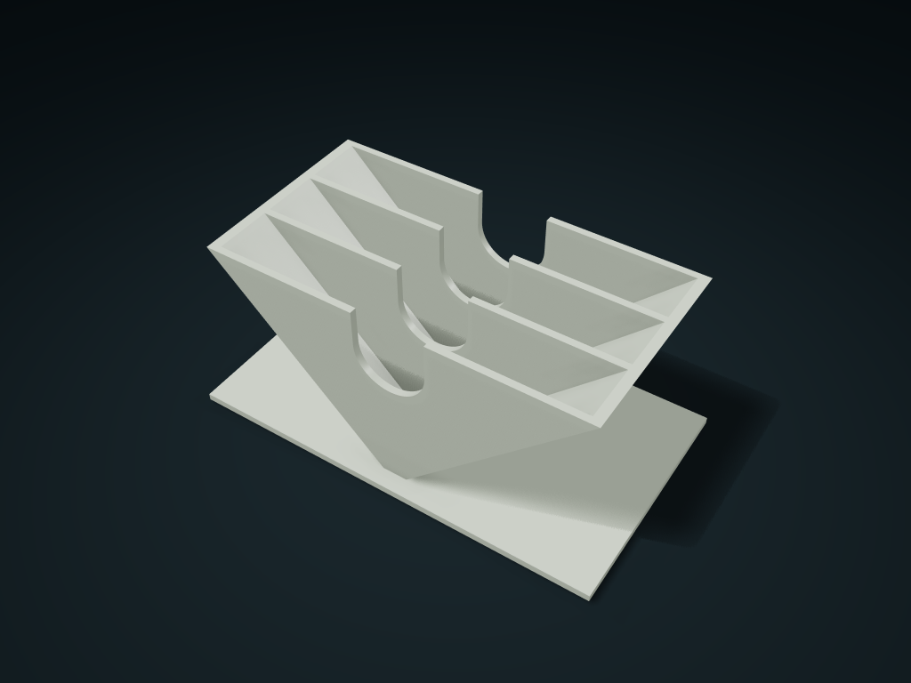

# V-Cradle Filter Paper Sorter

Store folded filters tip-down and lift them through finger cutouts; configure radius, angle, stack thickness and front-to-back compartments.

**[Preview this model and customize it on boxesmodel](https://boxesmodel.com/models/filter-fan-caddy)**

## Default model

| Property | Value |
| --- | --- |
| Category | Desktop Organizers |
| Model version | 1.0.0 |
| Default box size | 140.05 × 79.2 × 62.18 mm |
| Included parts | 1 |
| Formats | STL and STEP |
| Units | Millimeters |

Dimensions include the outer outline of the box; see the specifications for usable interior space.

## Intended use

- Dry, roughly fan-shaped folded filters; measure actual paper and stack thickness, not brand or size number. No sheet-count capacity claim; outer dimensions exclude exposed paper.
- Check paper deformation, pulling friction, tipping stability, cleaning hygiene and material suitability for food contact before use.

## Dimensions and features

| Detail | Default value |
| --- | --- |
| Separate paper compartments | 3 compartments (front to back) |
| Clear thickness per compartment | 19.2 mm / paper stack 18 mm |
| V-slot angle | 90° |
| Exposed paper edge height | 18 mm |
| Nominal paper shape outer width/height | 155.6 / 110 mm (excluding floor thickness) |

## Download the parts

Open a file below and choose **Download raw file** on GitHub. STL is for slicers; STEP is for CAD editing.

| Part | Dimensions | STL | STEP |
| --- | --- | --- | --- |
| V-Cradle Multi-Compartment Filter Paper Box | 140.05 × 79.2 × 62.18 mm | [holder.stl](holder.stl) | [holder.step](holder.step) |

Each listed part has its own STL and STEP file. Preview colors are illustrative; the manufacturing files do not contain the displayed colors.

## Printing and assembly

- For dry filter papers that are roughly fan-shaped when folded, tip down; radius is measured from the tip to the outer arc and angle between the two straight edges; fit is not automatically guaranteed by brand or size number.
- Measure the thickness of the whole stack of filter papers first, then set the stack thickness per compartment; each compartment leaves another 0.6 mm per side; capacity is not claimed in sheets. Exposed height is the vertical distance from the arc ends on both sides of the filter paper to the box opening.
- Filter paper goes in and comes out from above, with U-shaped notches to help pinch it. Several paper compartments run front to back; the whole box depth follows changes in wall or paper stack thickness.
- Print base down; the V-shaped side walls lean outward; check overhangs and supports in the slicer. No assembly hardware; the printed outer size excludes filter paper sticking out of the box.
- Leave access room for the actual paper size; before use, check real paper deformation/pulling friction, tip-over stability, cleaning hygiene and the material's food contact suitability.
- Import at millimeter scale. Check your build volume, orientation, overhangs, supports and mating clearances in the slicer.

## Adjust the design

Visit the [interactive model page](https://boxesmodel.com/models/filter-fan-caddy) to inspect the 3D model and adjust the available dimensions and layout options. This folder contains the default-size export shown above; custom exports follow the options and pricing shown on boxesmodel.

## License and attribution

Copyright © 2026 boxesmodel. These model files, preview and description are licensed under [CC BY 4.0](https://creativecommons.org/licenses/by/4.0/). You may share, modify and use them commercially with the required attribution. See the [full license](../../LICENSE) and [attribution guide](../../ATTRIBUTION.md).

Suggested credit:

> “V-Cradle Filter Paper Sorter” by [boxesmodel](https://boxesmodel.com/models/filter-fan-caddy), licensed under [CC BY 4.0](https://creativecommons.org/licenses/by/4.0/). Indicate any changes you make.

[Browse all models](../../CATALOG.md) · [About the collection](../../README.md)
