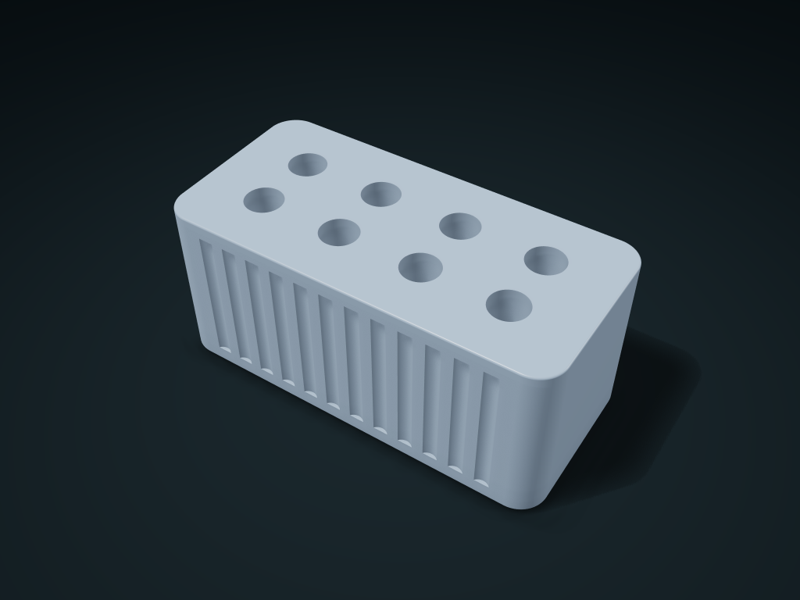

# Fluted Multi Hole Pen Block

Rows of blind holes hold everyday pen shafts individually, with fluted sides and flat top and bottom shoulders

**[Preview this model and customize it on boxesmodel](https://boxesmodel.com/models/flute-hole-pen-block)**

## Default model

| Property | Value |
| --- | --- |
| Category | Desktop Organizers |
| Model version | 1.0.0 |
| Default box size | 126 × 60 × 55 mm |
| Included parts | 1 |
| Formats | STL and STEP |
| Units | Millimeters |

Dimensions include the outer outline of the box; see the specifications for usable interior space.

## Dimensions and features

| Detail | Default value |
| --- | --- |
| Number of pen holes | 8 holes |
| Clear pen hole diameter × depth | 12.0 × 36.0 mm |
| Hole center spacing | 27.0 × 21.0 mm |

## Download the parts

Open a file below and choose **Download raw file** on GitHub. STL is for slicers; STEP is for CAD editing.

| Part | Dimensions | STL | STEP |
| --- | --- | --- | --- |
| One-Piece Fluted Multi Hole Pen Block | 126 × 60 × 55 mm | [body.stl](body.stl) | [body.step](body.step) |

Each listed part has its own STL and STEP file. Preview colors are illustrative; the manufacturing files do not contain the displayed colors.

## Printing and assembly

- Print the one-piece pen block with the bottom down. Each blind hole has a closed floor; insert and remove shafts vertically from above.
- Measure the widest shaft diameter and leave clearance. Clips and shaped grips require more than a shaft-diameter check; hole diameter, depth, and row count change the actual geometry.
- All custom parts are included in the download; no purchased hardware is required. Preview colors are for display only; the STL/STEP manufacturing files contain no colors.
- Check overhangs, supports, and actual fit before printing; no support-free, load-bearing, sealing, or food-contact safety claim is made.
- Rounded edges are part of the manufacturing geometry and change with the style parameters. Allow for curved corners when checking usable space; use the generated model for actual external dimensions.
- Import at millimeter scale. Check your build volume, orientation, overhangs, supports and mating clearances in the slicer.

## Adjust the design

Visit the [interactive model page](https://boxesmodel.com/models/flute-hole-pen-block) to inspect the 3D model and adjust the available dimensions and layout options. This folder contains the default-size export shown above; custom exports follow the options and pricing shown on boxesmodel.

## License and attribution

Copyright © 2026 boxesmodel. These model files, preview and description are licensed under [CC BY 4.0](https://creativecommons.org/licenses/by/4.0/). You may share, modify and use them commercially with the required attribution. See the [full license](../../LICENSE) and [attribution guide](../../ATTRIBUTION.md).

Suggested credit:

> “Fluted Multi Hole Pen Block” by [boxesmodel](https://boxesmodel.com/models/flute-hole-pen-block), licensed under [CC BY 4.0](https://creativecommons.org/licenses/by/4.0/). Indicate any changes you make.

[Browse all models](../../CATALOG.md) · [About the collection](../../README.md)
